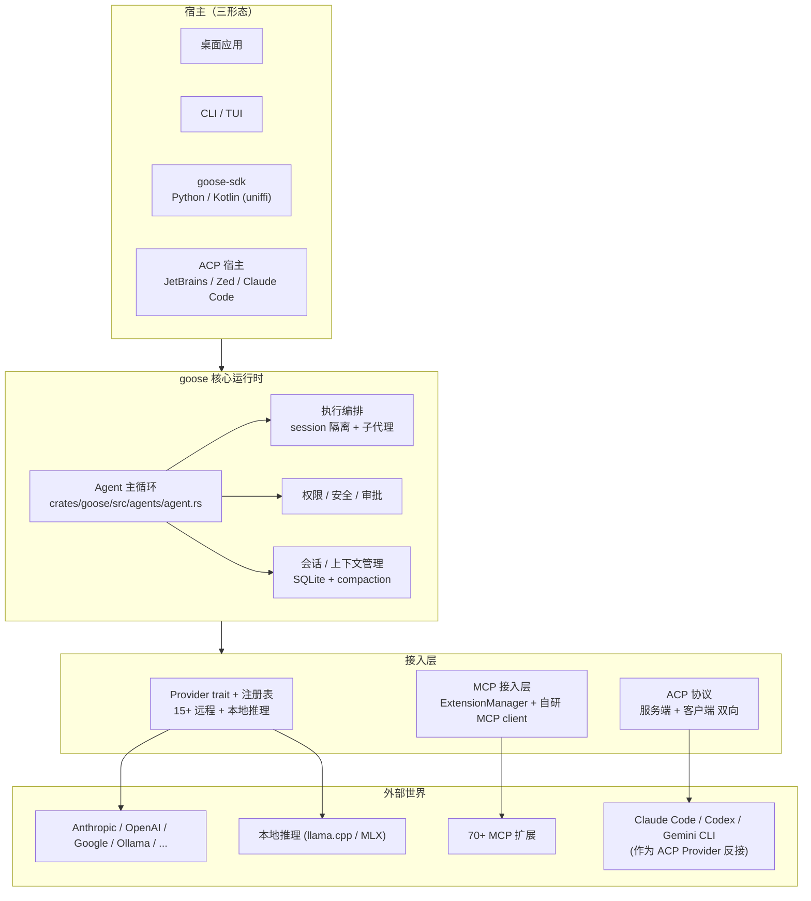

# goose 通用 AI Agent

> 本解读按 **agent ⊗ framework 类规格** 产出（Rust 实现的通用 AI Agent，叠加 framework 语言维度）。本地源码见 `aaif-goose/goose`（GitHub）主分支 checkout，未锁定具体 tag。

## 根因

goose 要解决的根本问题是：**用 Rust 造一个"什么都能干"的通用 AI Agent，跑在用户自己本机上，并且让整个 agent 生态（15+ LLM Provider、70+ MCP 扩展、多个编码 Agent）都能被这同一个主循环吸收、互操作**。它不是只能写代码的助手，而是把"感知 → 推理 → 调工具 → 反馈"的通用循环，做成可嵌入任意宿主（桌面 / CLI / API）、可换任意模型、可接任意工具的单一运行时。

goose 最独特的架构决策是**用同一套 ACP（Agent Client Protocol）开放标准双向打通生态**：

- 作为 **ACP 服务端**：`goose acp` 暴露为标准 agent，让 JetBrains / Zed / Claude Code 等宿主直接嵌入调用它；
- 作为 **ACP 客户端**：把 Claude Code / Codex / Gemini CLI 等成熟 agent **当 LLM Provider 反接进来**，复用它们内置的工具执行能力。

再加上统一的 `Provider` trait（接所有 LLM）、MCP 接入层（接 70+ 扩展）、SQLite 会话持久化 + 上下文 compaction（token 管理），goose 是一个典型的"大而深"单主循环 Agent 运行时。

## 概览

goose 是 Linux Foundation 旗下 Agentic AI Foundation（AAIF）的通用 AI Agent，由 Rust 实现，原生支持 macOS/Linux/Windows（桌面应用 + CLI + 可嵌入 API）。README 自述 "your native open source AI agent — desktop app, CLI, and API — for code, workflows, and everything in between"。

**核心能力**：

| 能力 | 说明 |
|------|------|
| 主 Agent 循环 | 单循环贯通感知→推理→工具→反馈；`max_turns`、Token 预算、错误回注不中断 |
| 多 Provider 抽象 | 一个 `Provider::stream()` 接 15+ 家（Anthropic/OpenAI/Google/Ollama/…）+ 本地推理 |
| 本地推理 | 独立 crate + feature gate，llama.cpp / MLX 后端跑在 CPU / Apple Silicon |
| MCP 接入 | 自研 MCP 客户端连 70+ 扩展；含内置记忆/计算机控制/图表 server |
| 会话与上下文 | SQLite 持久化 + 自动 compaction（阈值 0.8）+ 工具对先发压缩 |
| ACP 双向 | 既是 ACP 服务端可被嵌入，又是 ACP 客户端把外部 agent 当 provider 反接 |
| Skill / Recipe | SKILL.md 规范、可参数化指令模板、Slash 命令统一暴露 |
| 权限与安全 | 工具级审批、SmartApprove、Prompt 注入扫描、对抗/出站拦截 |
| 执行编排 | 多会话隔离 + 嵌套子代理 + `goose review` 确定性并行 + Telegram 网关 |

**技术栈一览**：Rust（约 23 万行，核心 crate `crates/goose` 14.7 万行）、`async-trait` / `tokio`、`sqlx` + SQLite、`rmcp`（MCP）、`agent-client-protocol`（ACP）、`uniffi`（Python/Kotlin 绑定）、`schemars`（工具 Schema）、`llamacpp` / `mlx`（本地推理）。多 crate 拆分：`goose`（核心）、`goose-provider-types` / `goose-providers`（LLM 接入）、`goose-mcp`（内置 MCP server）、`goose-cli`、`goose-local-inference`、`goose-sdk`/`goose-sdk-types`/`goose-acp-macros`（ACP/SDK）。

## 架构总览



**模块职责映射**（源 crate）：

```
crates/
├── goose/                  核心运行时（agent 循环 / 会话 / 权限 / MCP 客户端 / ACP / 网关 / 调度器）
├── goose-provider-types/   Provider trait、消息流、ProviderDescriptor（纯类型契约）
├── goose-providers/        Anthropic / OpenAI / Databricks 等 HTTP 实现 + 统一 ApiClient
├── goose-mcp/              内置 MCP Server 集合（memory / computercontroller / autovisualiser…）
├── goose-local-inference/  本地 CPU / MLX 推理后端（模型映射、tool_emulation）
├── goose-cli/              命令行入口与子命令（configure / tui / review / gateway / recipe…）
├── goose-acp-macros/       #[custom_methods] 宏：从请求类型生成 JSON-RPC 分发器
├── goose-sdk-types/        goose 对 ACP 的自定义扩展请求/通知类型
└── goose-sdk/              对外 SDK（uniffi 编 Python/Kotlin 进程内 API）
```

**推荐阅读顺序**：先 [`agent-loop.md`](agent-loop.md) 理解主循环，再 [`provider-architecture.md`](provider-architecture.md) 看模型怎么来，[`mcp-integration.md`](mcp-integration.md) 看工具怎么接，最后 [`acp-protocol.md`](acp-protocol.md) 看独特的双向生态打通。

## 子文档索引

- [`agent-loop.md`](agent-loop.md) — 主 Agent 循环：一次轮次的感知→推理→工具→反馈 心脏
- [`provider-architecture.md`](provider-architecture.md) — Provider 抽象与 LLM 接入：stream/注册表/toolshim/本地推理
- [`mcp-integration.md`](mcp-integration.md) — MCP 接入层：自研 MCP 客户端、ExtensionManager 工具表、内置 server
- [`session-and-context.md`](session-and-context.md) — 会话与上下文管理：SQLite 持久化 + auto-compaction 闭环
- [`data-model.md`](data-model.md) — 数据模型：sessions/messages/usage_ledger/threads schema 五要素
- [`permission-and-safety.md`](permission-and-safety.md) — 权限、安全与审批：工具审批、SmartApprove、prompt 注入扫描
- [`acp-protocol.md`](acp-protocol.md) — ACP 协议与 SDK：双向服务端/客户端 + custom_methods 宏 + uniffi SDK
- [`execution-and-subagents.md`](execution-and-subagents.md) — 执行编排与子代理：session 隔离、嵌套子 Agent、review 并行、网关、调度器
- [`skill-recipe-system.md`](skill-recipe-system.md) — Skill / Recipe / Slash 命令：可复用能力体系

## 核心模块导读

| 模块 | 定位 | 深度阅读 |
|------|------|----------|
| **Agent 主循环** | 唯一的"发动机"，贯通 LLM / 工具 / 会话，带多级停止闸门 | [`agent-loop.md`](agent-loop.md) |
| **Provider 抽象** | 一个 `stream()` 接所有 LLM，`complete()` 默认派生 | [`provider-architecture.md`](provider-architecture.md) |
| **本地推理** | 独立 crate + feature gate，llama.cpp/MLX，tool_emulation | [`provider-architecture.md`](provider-architecture.md) |
| **MCP 接入层** | 自研 MCP client + ExtensionManager 工具汇总与派发 | [`mcp-integration.md`](mcp-integration.md) |
| **会话 / 上下文** | SQLite 写入 + compaction 阈值 0.8 + 工具对压缩 | [`session-and-context.md`](session-and-context.md) |
| **数据模型** | schema v15 逐版迁移、usage_ledger 独立计费 | [`data-model.md`](data-model.md) |
| **权限 / 安全** | 工具审批决策链 + prompt 注入扫描 + 对抗拦截 | [`permission-and-safety.md`](permission-and-safety.md) |
| **ACP 协议** | 同一标准双向打通生态（被嵌入 + 反接外部 agent） | [`acp-protocol.md`](acp-protocol.md) |
| **执行 / 子代理** | session 隔离生命周期 + 嵌套子 Agent + review 确定性并行 | [`execution-and-subagents.md`](execution-and-subagents.md) |
| **Skill / Recipe** | SKILL.md 规范、按需 load、指令模板、Slash 暴露 | [`skill-recipe-system.md`](skill-recipe-system.md) |
| **网关 / 调度器** | Telegram 桥接 + 无头定时任务 | [`execution-and-subagents.md`](execution-and-subagents.md) |

## 设计亮点

- **`stream()` 单一必实现方法**：所有 Provider 只为一个"流式返回一条回复"负责，`complete()` 由 `stream` + 聚合默认实现，砍半了接入方的实现面（代价是整回复多一层间接）——[`provider-architecture.md`](provider-architecture.md)。
- **ACP 双向对称**：同一个协议既让 goose 被嵌入（服务端），又把 Claude Code/Codex 当 Provider 反接（客户端），`ACP_CURRENT_MODEL` 哨兵串联两端的模型解析（`crates/goose/src/acp/provider.rs`）——[`acp-protocol.md`](acp-protocol.md)。
- **错误不中断、回注当响应**：工具错误以 `tool_response` 文本回注给模型继续推理，而非打断循环；provider 建流失败封装成流内 `Err` item（`crates/goose/src/agents/reply_parts.rs`）——见 [`agent-loop.md`](agent-loop.md)。
- **上下文压缩双轨**：占用率超 0.8 触发的自动 compaction + `StructuredSummary` 结构化总结 + 工具对先发压缩，`replace_conversation` 整段覆盖（`crates/goose/src/context_mgmt/mod.rs`）——见 [`session-and-context.md`](session-and-context.md)。
- **`custom_methods` 宏**：用过程宏从 `#[request(method=…)]` 类型编译期生成 JSON-RPC 分发器 + Schema，把扩展 ACP 服务端的样板挤掉（`crates/goose-acp-macros/src/lib.rs`）——见 [`acp-protocol.md`](acp-protocol.md)。
- **review 的"确定性并行"**：`goose review` 用 Rust 决定编排结构（拆多少 check、怎么并行），只让模型做单点判断，把跨运行的调度方差抽掉，墙钟从 `sum(check)` 降到 `max(check)`（`crates/goose-cli/src/commands/review/orchestrator.rs`）——见 [`execution-and-subagents.md`](execution-and-subagents.md)。

## 不足与风险

- **体量庞大**：23 万行 Rust（核心 14.7 万行），学习曲线陡峭；对新贡献者，主循环 `reply_impl` 数千行是主要进入障碍。
- **单主循环的正交子循环多**：moim 注入、compaction、subagent、retry、hook 都与主循环耦合，跨 crate 字符串耦合有脆弱的测试守护（`agents/moim.rs`）。
- **次核心模块引用弱校验**：execution/subagent/skill 等文档中的部分引用仅经路径存在 + 行号未越界弱校验，未全部补精确指纹（见各篇文末）。
- **本地推理能力面受限**：本地模型无原生工具调用时依赖 tool_emulation 模拟，能力与远程前沿模型有差距（`goose-local-inference/src/tool_emulation.rs`）。

## 总结

goose 是"大而深"的通用 Agent 运行时范本：以**单一主 Agent 循环**为发动机，把 Provider 抽象、MCP 接入、会话/上下文、权限安全、执行编排统一收口，再借 **ACP 开放协议**打通与既有 agent 生态的双向互操作——既是可嵌入的 agent 服务端，又能把别的 agent 当模型反接。回扣根因：它用一棵统一的循环树，把"任意模型 + 任意工具 + 任意宿主"都折叠进同一个可落地的运行时。值得借鉴的可迁移模式：`stream()` 最小接口、错误回注哲学、`#![allow]` 分级权限聪明放行、review 的确定性并行、以及"用宏消灭协议样板"的过程宏应用。

## 项目规模

| 指标 | 数据 |
|------|------|
| 协议 / 语言 | Apache-2.0 / Rust |
| 仓库 | [github.com/aaif-goose/goose](https://github.com/aaif-goose/goose) |
| 代码量 | 约 23 万行 Rust（467 个 `.rs` 文件）；核心 crate `goose/` 14.7 万行 |
| 生态定位 | Linux Foundation AAIF 项目；驱动 ecosystem（桌面/CLI/API） |
