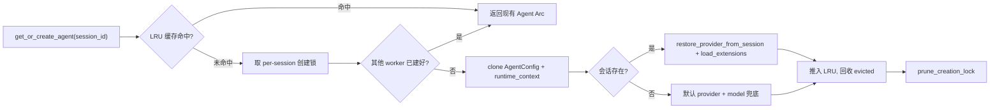
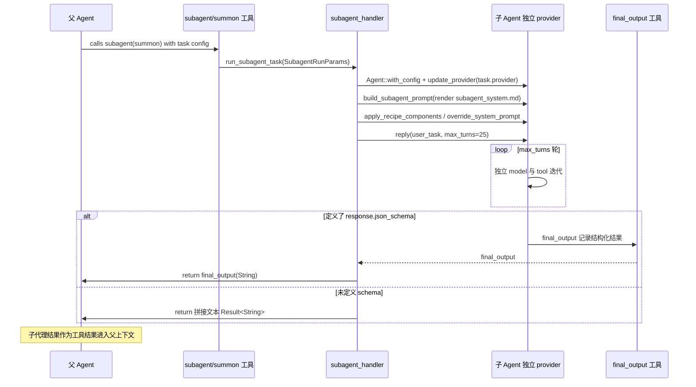

# 执行编排与子代理

## 根因

goose 的主 Agent 循环只解决"一次对话里，一个模型怎么和模型/工具迭代"；当产品要同时服务桌面、CLI、API 三种形态，并且要支持"多会话并存、任务被嵌套拆解、把 agent 接到 Telegram 上"时，就暴露出三个单循环之外的硬问题：

- 多个会话各自有独立的 provider、扩展、取消令牌，若都挤在同一个全局状态里，会话 A 的取消会误伤会话 B，模式（mode）、provider 也无法按会话隔离。
- 一个复杂任务需要被"父 Agent → 派生若干子 Agent"分层处理，且子 Agent 结果要回注父 Agent 上下文，这不是单循环能表达的。
- agent 要能"无头"地被触发（定时任务、聊天平台的每条消息），而非永远等用户在一个终端敲回车。

这三件事正是本模块（execution / subagent / review / gateway / scheduler）各自解决的底层问题；它们的共同方向是**把 agent 从"一个进程里的交互循环"抽象成"可被编排、可被并行、可被远程触发的执行单元"**。

## 执行管理层：会话隔离的 agent 生命周期

### 为什么需要"按会话隔离"

代码评审中评审员看到的最直接证据是 `[crates/goose/src/execution/manager.rs:34-34]()` 用一个 `LruCache<String, Arc<Agent>>` 把 `session_id → Agent` 以 LRU 缓存起来：


同一进程同时跑着很多会话，每个会话的 `Agent` 都是独立实例（provider、扩展、会话消息都归它私有）。`test_session_isolation`、`test_session_mode_isolation`（`[crates/goose/src/execution/manager.rs:442-442]()`、`[crates/goose/src/execution/manager.rs:865-865]()`）硬性断言"不同 session 返回不同 agent、同一 session 返回同一 agent"且各自继承自己的 `GooseMode`；这正是桌面/CLI/API 三形态能在同一 goosed 常驻进程里共存的基础——否则三个前端共享同一个循环，互相抢会话状态。

### 创建路径：get_or_create_agent_with_runtime_context



`[crates/goose/src/execution/manager.rs:110-110]()` 的 `get_or_create_agent_with_runtime_context` 是这个生命周期入口。它把创建过程分成"快路径（缓存命中）"和"慢路径（真正构造）"。慢路径不是简单当场构造，而是先取一把**按 session 隔离的创建锁**：

`[crates/goose/src/execution/manager.rs:46-46]()` 的 `creation_locks: Arc<Mutex<HashMap<String, Arc<Mutex<()>>>>>`，每个 session 一把独立的 `Arc<Mutex<()>>`。Rationale 直接写在源码注释里（`[crates/goose/src/execution/manager.rs:38-38]()`）：`start_agent` 的后台扩展加载任务和 `resume_agent` 请求可能同时抢同一个 session，若各建各的 Agent，会对**每一个 MCP server 各发一次 `initialize`**，这是昂贵的重活（issue #9031）。用 per-session 锁在"会话粒度"序列化，既避免了重复初始化，又不至于把整个 manager 串行化变成全局瓶颈——这是"按会话隔离"思想在并发层的一次具体应用。

慢路径 `create_agent_locked`（`[crates/goose/src/execution/manager.rs:169-169]()`）在构造后做两件恢复工作：

1. 若会话已持久化且记了 `provider_name`，调用 `restore_provider_from_session`（`[crates/goose/src/execution/manager.rs:217-217]()`），把 agent 的 provider 恢复回上次会话用的那个。
2. `load_extensions_from_session`（`[crates/goose/src/execution/manager.rs:225-225]()`）把会话绑定的 MCP 扩展重新加载。
3. 若会话绑定了 recipe，则 `apply_recipe_components`（`[crates/goose/src/execution/manager.rs:227-227]()`）把 recipe 的指令组件重新注入。

这样 LRU 逐出的会话重新进入时，"续上断点"而不是从零开始——**LRU 缓存逐出的只是内存中的 agent 实例，会话在磁盘上的状态还在，可以重建并恢复**。这是桌面应用"打开历史的会话还能继续对话"的基础。

### 忙态与取消令牌

`manager.rs cancel_tokens: Arc<RwLock<HashMap<String, CancellationToken>>>` 承担两个职责：

- **忙态判断**：`try_register_cancel_token`（`[crates/goose/src/execution/manager.rs:349-349]()`）在插入前检查该 session 是否已有令牌，有则直接报错 "Session is currently busy"——防止同一会话被两个并发请求同时驱动。
- **取消**：`cancel_session`（`[crates/goose/src/execution/manager.rs:368-368]()`）读令牌并 `token.cancel()`，让正在跑的 agent reply 能协作式地中止，而不是杀掉整个进程。

`remove_session`（`[crates/goose/src/execution/manager.rs:307-307]()`）会先取消令牌再移除缓存，保证清理会话时正在跑的生成被终止。

### 子任务模式 SubTask 如何嵌套

`[crates/goose/src/execution/mod.rs:12-12]()` 用枚举定义执行模式：

`SessionExecutionMode::Interactive`（聊天）、`Background`（定时/后台，scheduler 用）、`SubTask { parent_session }`（携带父会话 id 的子任务）。`SubTask` 携带父会话 id 的意义在于：子任务能回溯它的发起者，这在**子代理编排**里构成树状归属（父 Agent 的 session 派生出子 Agent 的 session，child 认父）。

> **Why>What**：执行模式不是简单标签，而是"这个 agent 实例被谁、以什么方式驱动"的决定。Interactive 意味着等用户输入；Background 意味着被 cron/token 触发、无交互；SubTask 意味着它是另一个 agent 派生的临时执行单元。goose 把这三种驱动方式统一成枚举，让上层调度逻辑（scheduler、gateway、subagent_handler）不必各自维护一套状态机。

## 子进程安全：subprocess.rs

`subprocess.rs` 是为 agent 的安全执行服务的小而关键的工具模块。两个设计点值得单列：

**父进程死亡信号**。`configure_parent_death_signal`（`[crates/goose/src/subprocess.rs:6-6]()`，Linux）在子进程 `pre_exec` 里调用 `prctl(PR_SET_PDEATHSIG, SIGTERM)`，并校验 `getppid() != parent_pid` 兜底（因为 prctl 与 exec 之间父 pid 可能已被复用）。这样当 goose 主进程崩溃/被杀时，它派生的 shell 子进程会被自动 SIGTERM，不会变成孤儿进程继续挂着。这是"agent 调起 shell，就要对 shell 生命周期负责"的体现。

**安全 git 命令**。`git_command`（`[crates/goose/src/subprocess.rs:29-29]()`）强制加两条 `-c` 配置：

```rust
command.args([
    "-c", "safe.bareRepository=explicit",
    "-c", "core.fsmonitor=false",
]);
command
```

一条禁掉"隐式裸仓库"（防止 git 心不在焉地把一个目录内嵌 git 仓库当成裸仓库，导致 go 意外的仓库被当作安全上下文执行其钩子/hook），一条关掉 `core.fsmonitor`（仓库配置的 fsmonitor 钩子可能在子进程里跑任意命令）。这是 goose 审查流程（`goose review`）读取 diff、以及 developer 扩展跑 shell 时的默认安全基线——凡是 goose 自己发起的 git 命令，都走这条"已消毒"的路径。

另有 `configure_subprocess`（`[crates/goose/src/subprocess.rs:63-63]()`）把子进程隔离进独立进程组（Unix），避免用户在终端按 Ctrl+C 时 SIGINT 波及进 agent 派生的子进程。

## 子代理编排：subagent_handler

### 范式：嵌套子 Agent 而非单纯工具

goose 的 subagent 不是新东西，而是一种特殊执行：父 Agent 通过某个工具（subagent 工具 / summon 扩展）发起一次独立的 `run_subagent_task`，该任务在内部**构造一个新的 `Agent`、新的 provider、新的会话**，跑一个受 `max_turns` 限制的对答循环，最后把结果文本回注调用方。

`[crates/goose/src/agents/subagent_handler.rs:47-47]()` 的 `run_subagent_task` 是入口；它先调 `get_agent_messages`，若 recipe 声明了 `response.json_schema`（结构化输出），就走 `final_output` 工具拿结构化结果：

```rust
if let Some(output) = final_output {
    return Ok(output);
}
```

否则退回 `extract_response_text`（`[crates/goose/src/agents/subagent_handler.rs:64-64]()`）——把对话里所有文本（含 `Tool result: ...` 前缀的工具文本）拼起来作为子任务结论。

`get_agent_messages`（`[crates/goose/src/agents/subagent_handler.rs:121-121]()`）展示"嵌套"的全流程：

1. 从 recipe 取 `instructions`（系统指令）与 `prompt`（用户任务），见 `[crates/goose/src/agents/subagent_handler.rs:134-134]()`。
2. 构造新的 `Agent::with_config(config)`，`update_provider` 换成子任务指定的 provider/model（`[crates/goose/src/agents/subagent_handler.rs:142-142]()`），并把 `task_config.extensions` 逐个 `add_extension`（`[crates/goose/src/agents/subagent_handler.rs:151-151]()`）。→ **子 Agent 有自己独立的 provider 与扩展，互不共享**。
3. `build_subagent_prompt`（`[crates/goose/src/agents/subagent_handler.rs:233-233]()`）用 `subagent_system.md` 模板渲染子代理的系统提示，把 `max_turns`、`subagent_id`、可用工具清单填进去——让模型清楚它是"一个受限于轮数的子任务"。
4. 起一个一次性会话，`agent.reply(user_message, session_config, cancellation_token)`（`[crates/goose/src/agents/subagent_handler.rs:188-188]()`）流式消费 `AgentEvent`，把消息 push 进独立的 `Conversation`。
5. 遍历过程中 `create_tool_notification`（`[crates/goose/src/agents/subagent_handler.rs:278-278]()`）把子代理的每次工具调用包装成 `ServerNotification`（logging message)，转发给外部监听（UI 能看到子代理在干什么）。

### default max_turns = 25

`[crates/goose/src/agents/subagent_task_config.rs:9-9]()` 定义默认轮数上限：

```rust
pub const DEFAULT_SUBAGENT_MAX_TURNS: usize = 25;
```

`TaskConfig::new`（`[crates/goose/src/agents/subagent_task_config.rs:35-35]()`）从 `GOOSE_SUBAGENT_MAX_TURNS` 环境变量读取，缺省 25。这个上限是子代理可靠性的关键：子代理是独立推理循环，若不设上限，一个发散的子代理可能无限烧 token 而不返回。25 轮是一个"能完成多数原子子任务又不会失联"的经验值——权衡了"深度"与"可控性"。
（所以用户问题描述中提到的 max_turns=25 即此常量的落地。）

### 结果回注

子代理没有独立的记忆回写通道；它把结果以**字符串**形式返回给父 Agent 的工具调用（`run_subagent_task` 返回 `Result<String>`），父 Agent 把它当作工具结果放进自身对话上下文。如果 recipe 定义了 `response.json_schema`，则通过 `final_output tool`（`[crates/goose/src/agents/subagent_handler.rs:264-264]()`）产出结构化 JSON 对象回注，父 Agent 能拿到字段化结果而非纯文本。这是"工具返回文本"范式，而非共享记忆——父 Agent 每次只通过工具的返回值感知子代理的产出，简单且无状态同步问题。



## 代码评审 orchestration：从"模型驱动"到"确定性驱动"

`goose review` 的默认路径里，LLM 自己决定每个 check 是派成一个真实子代理（`delegate(... async: true)`）还是内联做，这个决策**不可确定**，且是运行间方差的主要来源（注释里给了实测数字：16s 最佳 vs 60s+ 全派成子代理）。`[crates/goose-cli/src/commands/review/orchestrator.rs:1-1]()` 的模块注释开门见山点明这个痛点：

> The default in-process review path lets the LLM decide whether to dispatch each check as a real subagent ... That decision is non-deterministic and is the dominant source of variance we see between runs.

于是 `run_checks_in_parallel`（`[crates/goose-cli/src/commands/review/orchestrator.rs:86-86]()`）换了一种策略：**不再让模型决定，Rust 直接在确定性层面编排**：

- 每个 check 起一个独立子进程 `goose run -q -t <prompt>`（`[crates/goose-cli/src/commands/review/orchestrator.rs:237-237]()`）。
- 并发度用 Tokio `Semaphore::new(MAX_WORKERS)` 封顶，`MAX_WORKERS = 4`（`[crates/goose-cli/src/commands/review/orchestrator.rs:46-46]()`），注释说明 4 是"在触到 LLM 限流和本地资源争抢前"的实验甜点。
- 每个 check 用严格、无工具的 prompt（`build_check_prompt`，`[crates/goose-cli/src/commands/review/orchestrator.rs:633-633]()`），强制只返回 `{"findings":[...]}` JSON。
- 每个 finding 的 `check` 字段由 Rust 打标（`[crates/goose-cli/src/commands/review/orchestrator.rs:219-219]()`），不由模型声称。
- 单 check 失败绝不阻断整次 review（`[crates/goose-cli/src/commands/review/orchestrator.rs:146-146]()`），空 findings + stderr 警告继续。

**Wall-clock 的加速原理**在 `[crates/goose-cli/src/commands/review/orchestrator.rs:22-22]()` 注释里写得很清楚：整个编排阶段墙钟 = `max(check_latency)`（最慢的单个 check），而不是模型驱动串行派发的时间之和。

更深一层的对比：`run_main_pass_in_parallel`（`[crates/goose-cli/src/commands/review/orchestrator.rs:307-307]()`）把"主正确性 pass"也做成 N 个按文件并行的子进程。它替代了旧的进程内 `session.headless()` 路径，原因是两条经验法则（`[crates/goose-cli/src/commands/review/orchestrator.rs:292-292]()`）：① 旧路径把整个 diff 一次塞进单 prompt，大 diff（1000+ 行）会让 Gemini 3.x 在 ~30s 后短路返回 `[]`；② 文件太多时 context 过大导致模型不逐行走完。按文件扇出把每个子进程 context 压小，让模型确实走完每一处改动，且并行让总墙钟接近最慢单文件而非随 diff 规模线性增长。

> **Why>What（本模块最有价值的对比）**：主 Agent 循环是"模型驱动"的（模型决定每一步做什么）；review orchestrator 刻意反其道——**用 Rust 决定编排结构（拆多少 check、怎么并行、prompt 怎么拼），用模型只做"单点判断"（这段 diff 是不是 bug）**。这样把"调度方差"从系统里抽出去，性能和可复现性都大幅提升。这是一个"架构师可以借鉴的教训：不要让模型做它不擅长的全局调度决策"。

## 网关：把 Agent 扩成聊天平台

### Gateway trait：平台无关抽象

`[crates/goose/src/gateway/mod.rs:77-77]()` 定义 `Gateway` trait：

- `start(&self, handler, cancel)`：启动轮询/长连接，收到消息交给 `GatewayHandler`。
- `send_message(&self, user, message)`：蓝图无关地发送 `OutgoingMessage::{Text, Typing}`。
- `validate_config()`：启动前校验平台配置。

`create_gateway`（`[crates/goose/src/gateway/mod.rs:96-96]()`）按 `gateway_type` 字符串工厂化创建，目前只有 `"telegram"`。这个 trait + 工厂是 goose 的核心扩展点——加入新聊天平台（Slack、Webex 等），只要实现这个 trait 并通过 `create_gateway` 注册即可。

**为什么把"对平台收发消息"和"对 agent 推理"分开**：`GatewayHandler`（`[crates/goose/src/gateway/handler.rs:49-49]()`）独立于具体平台，它不关心 telegram 还是别的，只认 `IncomingMessage`/`OutgoingMessage`。这样"消息→Agent 桥接"与"平台适配"彻底解耦：Telegram 适配层（`telegram.rs`）只管长短轮询 + Bot API 调用，agent 逻辑全在 handler。

### 生命周期管理：GatewayManager

`GatewayManager`（`[crates/goose/src/gateway/manager.rs:56-56]()`）负责网关的启动/停止/重启/持久化：

- 配置持久化分两处：平台配置（含 bot token）写 `secret`（`[crates/goose/src/gateway/manager.rs:360-360]()`，`set_secret`），非敏感信息（gateway_type/max_sessions）写 `gateway_configs` 参数（`[crates/goose/src/gateway/manager.rs:378-378]()`）。敏感与不敏感分开存，避免 token 落到明文参数。
- `check_auto_start`（`[crates/goose/src/gateway/manager.rs:79-79]()`）在服务启动时读取已保存配置并自动拉起——所以配过一次的 Telegram bot，下次启动 goosed 会自动恢复。
- 每个网关实例持有自己的 `CancellationToken` + `JoinHandle`（`GatewayInstance`，`[crates/goose/src/gateway/manager.rs:29-29]()`），stop 时优雅取消。

### 配对流程（Pairing）

`PairingState`（`[crates/goose/src/gateway/mod.rs:62-62]()`）是一个状态机：`Unpaired → PendingCode → Paired`。

`PairingStore`（`gateway/pairing.rs:28`）把配对关系持久化到 config。`generate_code`（`[crates/goose/src/gateway/pairing.rs:138-138]()`）生成 6 位、剔除了易混字符（去掉 I/O/1/0）的字母数字码；`generate_pairing_code`（`[crates/goose/src/gateway/manager.rs:313-313]()`）带 300 秒过期。

配对的核心在 `GatewayHandler`：

- `handle_message`（`[crates/goose/src/gateway/handler.rs:103-103]()`）查用户配对状态分流：Unpaired→提示输入码或尝试消费码；PendingCode→比对码、校验过期；Paired→正常 relay。
- `try_consume_code`（`[crates/goose/src/gateway/handler.rs:236-236]()`）规范化输入（大写、去空格连字符）后校验 6 位字符集，命中则 `consume_pending_code`。
- `complete_pairing`（`[crates/goose/src/gateway/handler.rs:248-248]()`）为该平台用户创建专属 working dir、专属的 `Gateway` 类型 session，把当前全局 provider/model/extensions 落到 session（这样 LRU 逐出后能 restore），然后置为 `Paired`.

> **为什么需要"配对"而不仅是"发消息"**：聊天平台天然没有"登录态"概念，任何人都可能给 bot 发消息。配对机制用一个一次性 6 位码把"TG 用户"和"goose session"绑定，是全流程里把**边界身份**映射到**内部会话**的安全闸门。配对后该用户才获得驱动一个专属 goose agent 的权限，未配对消息只会收到引导提示。

### 消息 → Agent 桥接

```
sequenceDiagram
    participant TG as Telegram Gateway
    participant H as GatewayHandler
    participant M as AgentManager
    participant A as Agent 会话
    participant G as Telegram 机器人

    TG->>TG: start(): get_updates(offset) 长轮询
    loop 收到每条约消息
        TG->>H: handle_message(IncomingMessage)
        H->>H: 按键入的配对状态分流
        H->>M: get_or_create_agent(session_id)
        M-->>H: 返回 Arc（该会话的 Agent 引用）
        H->>H: sync_session_config(session): 同步当前全局 provider/model/ext
        H->>A: agent.reply(...) 流式
        loop 流中每个 AgentEvent::Message
            A-->>H: 文本 / ToolRequest / ToolConfirmation
            H->>G: send_message(Text/Typing)(缓冲每 turn 一条)
        end
    end
```

几个值得深挖的桥接细节（`gateway/handler.rs`）：

1. **扩展变化时重建 agent**：`sync_session_config`（`handler.rs:330`）比对 session 现有 provider/model/extensions/mode 与当前全局 config，任何一项变化就更新 session；若"扩展"变了，返回 `extensions_changed = true`，调用方 `remove_session_if_loaded`（`handler.rs:420`）把旧 agent 踢掉——因为扩展进程（MCP server）变了，必须重建 agent 让旧扩展进程 tear down，否则僵尸扩展进程残留。
2. **tool-calling 轮的封顶**：`resolve_gateway_max_turns`（`handler.rs:37`）——Telegram 这类平台偏爱简短回复，因此默认 `DEFAULT_GATEWAY_MAX_TURNS = 5`（`handler.rs:30`），低于全局 `GOOSE_MAX_TURNS`，防止网关里的 agent 在回复前烧掉几十次工具调用。可被 `GOOSE_GATEWAY_MAX_TURNS` / `GOOSE_MAX_TURNS` 覆盖。
3. **tool confirmation 的聊天化**：`AgentEvent::Message` 里的 `ActionRequiredData::ToolConfirmation`（`handler.rs:587`）被转成一条带"approve / deny"指令的聊天消息并存入 `pending_confirmations`；用户回复 "approve always" 等关键词时 `handle_pending_confirmation`（`handler.rs:190`）把 `Permission::AlwaysAllow` 等回注给 agent 的 `handle_confirmation`。即：**权限审批也被桥接成聊天对话**。
4. **每 turn 一条消息的缓冲**：`pending_text` 缓冲单条助手消息里连续的文本（`handler.rs:528`），遇到 ToolRequest 就先 flush（让用户先看到"意图"），工具跑完再发下一条。避免逐 chunk 发消息的碎片化。
5. **Typing 心跳**：Telegram 的 "typing…" 指示 ~5s 就失效，`handler.rs:498` 每 4s 重发一次，保证 agent 长时间工作时用户一直看到"正在输入"。

### Telegram 适配细节

`TelegramGateway`（`[crates/goose/src/gateway/telegram.rs:16-16]()`）的核心是 `start`（`[crates/goose/src/gateway/telegram.rs:372-372]()`）里的**长轮询循环**：

`get_updates(offset)`（`[crates/goose/src/gateway/telegram.rs:396-396]()`）拉取增量更新，每个 `update_id` 递增 offset，语音/音频消息会下载保存并转成一个"请用 CLI 工具转写这段语音"的 prompt（`[crates/goose/src/gateway/telegram.rs:416-416]()`）——巧妙地把"我不能理解语音"变成"请 agent 用工具去转写"。每条消息 `tokio::spawn` 独立处理（`[crates/goose/src/gateway/telegram.rs:462-462]()`），避免单条慢消息阻塞轮询。`send_message`（`[crates/goose/src/gateway/telegram.rs:481-481]()`）把 `OutgoingMessage` 映射成 Telegram 的 `sendMessage` / `sendChatAction("typing")`。

## 调度器 scheduler：无头跑定时任务

`Scheduler`（`[crates/goose/src/scheduler.rs:262-262]()`）是 goose serve 无头模式下的说明：它用 `tokio_cron_scheduler` 驱动，把 cron 表达式映射到 `TokioJobScheduler` 的请求。

关键设计：

1. **持久化**：任务列表存 `schedule.json`（`get_default_scheduler_storage_path`，`[crates/goose/src/scheduler.rs:143-143]()`），每次状态变更（增删、运行中/完成）都 `persist_jobs` 落盘，重启后 `load_jobs_from_storage`（`[crates/goose/src/scheduler.rs:565-565]()`）恢复。任务自述的 recipe 文件被复制到 `scheduled_recipes/`（`[crates/goose/src/scheduler.rs:461-461]()`）并限定 1MB（`MAX_SCHEDULE_RECIPE_BYTES`，`[crates/goose/src/scheduler.rs:33-33]()`）、权限 `0o600`，防止用户手动改 recipe 注入恶意指令（安全考虑：recipe 是可能被执行指令的，复制加限长加私有权限是三道保险）。
2. **正在运行的任务**被记录 `currently_running` + `current_session_id` + `process_start_time`；`run_now`（`[crates/goose/src/scheduler.rs:784-784]()`）支持手动立即触发，`kill_running_job`（`[crates/goose/src/scheduler.rs:930-930]()`）通过 `running_tasks: HashMap<String, CancellationToken>` 取消。
3. **execute_job**（`[crates/goose/src/scheduler.rs:984-984]()`）从一个 agent 会话的 `reply` 消费 agent 输出流，把结果会话的 `schedule_id`、recipe 等写回 session 管理——这样定时任务的结果像普通会话一样可查询。每个 job 都 `create_session(..., SessionType::Scheduled, ...)`（`[crates/goose/src/scheduler.rs:1029-1029]()`），标记会话类型为 Scheduled。
4. **cron 兼容**：识别 5 字段旧 cron 自动补 `0 ` 前缀转 6 字段（`[crates/goose/src/scheduler.rs:308-308]()`）。
5. **stale 状态清理**：启动时把上次进程崩溃遗留的 `currently_running` 状态重置（`clear_running_state`，`[crates/goose/src/scheduler.rs:252-252]()`），避免"明明没在跑却显示在跑"的假象。

> **为什么要单独一个调度器而不是在 IPC 循环里做**：定时任务必须"无头、可持久、可监控"，它承担的是"准时触发 + 失败可查 + 重启恢复"。把它从主循环剥离，使 desktop app 关掉后 goosed 仍能跑定时任务，由 API / manager 层面来查看运行状态。它与 `execute_job` 复用的都是同一套 `Agent::reply`，只是驱动方式不同（交互 vs token 定时触发）——这与 `SessionExecutionMode::Background` 对应。

## 权衡与替代方案代价

1. **按 session 串行化创建锁（manager）**：用 per-session lock 换取"并发请求不重复初始化 MCP"，代价是同一 session 的并发创建被串行化。替代方案是全局锁——但那样任何 session 的创建都阻塞所有其他 session；per-session 锁在"不重复 init"与"不全局阻塞"之间取了平衡，代价是需要额外的 `prune_creation_lock` 逻辑防 HashMap 无限增长（`[crates/goose/src/execution/manager.rs:297-297]()`，用 `Arc::strong_count` 判断是否有在途 waiter）。

2. **子代理以"返回字符串"回注（subagent_handler）**：换取实现简单、无共享记忆；代价是子代理不能增量影响父上下文的中间步骤，结构化输出必须显式声明 `response.json_schema` 否则只能拿到拼接文本。替代方案是共享记忆/上下文注入，但会引入父与子并发写同一上下文的同步复杂度。

3. **review 用子进程而非子代理（orchestrator）**：每个 check 起 `goose run` 子进程换取确定性与可复现并行；代价是进程启动开销、每次都要 `resolve_check_model` 处理 provider 兼容，且强依赖"模型输出严格 JSON"。但它换来墙钟 `max(check_latency)` 而非模型串行 sum，方差从源头消除，是值得的取舍。

4. **网关默认 5 轮上限（handler）**：为聊天场景的"简短回复"牺牲深度；代价是遇到需要多次工具调用才能完成的任务会提前截断。可通过环境变量放开，默认保守是刻意选择。

5. **scheduler 复制 recipe 并限长（scheduler）**：为"定时执行可能含指令的 recipe"增加安全边界；代价是 recipe 相对路径（sub-recipe/include）要额外用 `recipe_base_dir` 记录原目录来正确解析（`[crates/goose/src/scheduler.rs:1000-1000]()`），复杂化了路径处理。
