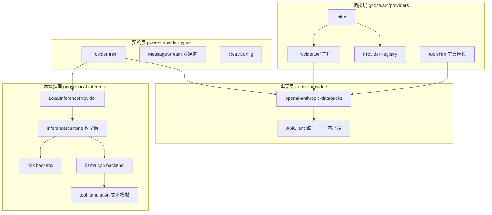
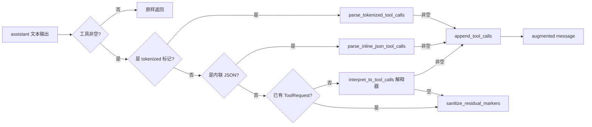
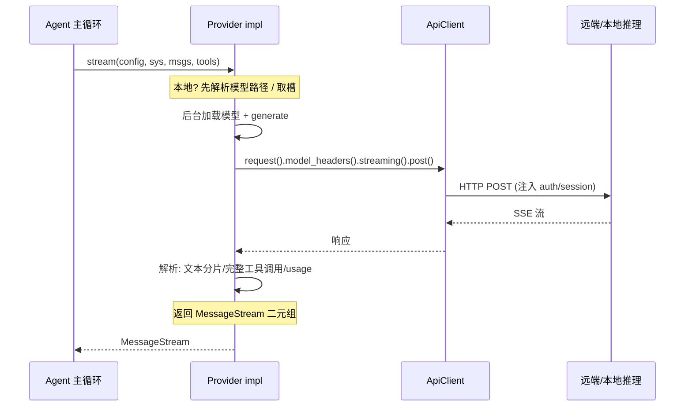

# Provider 抽象与 LLM 接入

## 根因

本模块属于 goose（Linux Foundation AAIF 旗下、横跨桌面/CLI/API 三种形态的通用 AI Agent）。它的设计哲学是把 15+ 个远程 LLM provider、本地 CPU/Metal 推理（llama.cpp/mlx）、以及 70+ 个 MCP 扩展全部纳入**同一个 agent 主循环**（system + messages + tools → 流式回复 → 工具调用 → 回填结果）。

本模块要解决的根本问题是：**在协议各异、能力边界各异的十余个 LLM 后端之间，提炼出一个最小、统一、且能流式驱动的接口契约**，让主 Agent 循环不关心"我连的是 OpenAI 还是个 llama.cpp 本地进程"。设计同时保证两个方向的扩展：横向加新 provider 只改一处注册；纵向让本地小模型也能伪装成"会调用工具"的 agent。

## 概览

本模块由三层组成：

| 层 | 承载 crate | 职责 |
|----|-----------|------|
| 契约层 | `goose-provider-types` | `Provider` trait、`MessageStream`、`ProviderMetadata`、`RetryConfig`、模型信息 |
| 实现层 | `goose-providers` | 各 HTTP provider（OpenAI/Anthropic/Databricks…）、统一 `ApiClient`、`openai_compatible` 组装器 |
| 编排层 | `goose/src/providers/` | `ProviderDef` 工厂、`ProviderRegistry`、`init` 注册、`toolshim` 兼容、本地推理 glue |

本地推理进一步拆成独立 crate `goose-local-inference`，经 feature gate 隔离编译。

## 架构总览



## Provider trait 契约：为什么 stream() 是唯一必实现方法

### 最小接口：让各家只为"流式一条回复"负责

`Provider` trait 里真正**必须实现**的方法只有一个 `stream()`，入参完全统一——`ModelConfig` + system 提示 + 消息列表 + 工具列表，返回 `MessageStream`：

[crates/goose-provider-types/src/base.rs:429-436]()
<!-- snippet: 
    /// Primary streaming method that all providers must implement.
    async fn stream(
        &self,
        model_config: &ModelConfig,
        system: &str,
        messages: &[Message],
        tools: &[Tool],
    ) -> Result<MessageStream, ProviderError>; -->

其余几十个方法（`complete`、`get_context_limit`、`fetch_supported_models`、`configure_oauth`、`refresh_credentials` 等）全部带默认实现，是**可选覆盖点**。这把"各家差异"压到一个面：远程 HTTP 各家与本地推理的唯一共同责任，就是**从一个模型配置和一组消息、工具里，吐出一条（可能分块的）回复流**。主 Agent 循环无需区分"我在跟谁说话"。

### complete() = stream() 的默认派生：一次性 vs 回调的权衡

`complete()` 没有独立实现，而是默认基于 `stream()` + `collect_stream()` 聚合而来：

[crates/goose-provider-types/src/base.rs:438-447]()
<!-- snippet: 
    async fn complete(
        &self,
        model_config: &ModelConfig,
        system: &str,
        messages: &[Message],
        tools: &[Tool],
    ) -> Result<(Message, ProviderUsage), ProviderError> {
        let stream = self.stream(model_config, system, messages, tools).await?;
        collect_stream(stream).await
    } -->

`stream_from_single_message()` 把单个 Message+Usage 包成一次性 MessageStream，让不支持流式的端点也能伪装成流：

[crates/goose-provider-types/src/base.rs:418-421]()
<!-- snippet: 
pub fn stream_from_single_message(message: Message, usage: ProviderUsage) -> MessageStream {
    let stream = futures::stream::once(async move { Ok((Some(message), Some(usage))) });
    Box::pin(stream)
} -->

这个"stream 为唯一真源、complete 为聚合"的设计核心是**单一实现路径**：不要求 provider 作者写两套（流式 + 一次性），实现面砍半；agent 主循环统一消费流式接口，想要完整回复就调 `collect_stream`，想逐 token 显示就读流。代价是多一层间接（完整回复也要过 stream → collect），但对 Agent 系统的实时性诉求（token 级进度、中途工具调用）而言是值得的。

## MessageStream 的 Item 结构：消息与用量的双通道流

`MessageStream` 的 Item 是 `(Option<Message>, Option<ProviderUsage>)` 二元组，两个字段都可能为空：

[crates/goose-provider-types/src/base.rs:308-313]()
<!-- snippet: 
/// A message stream yields partial text content but complete tool calls, all within the Message object
/// So a message with text will contain potentially just a word of a longer response, but tool calls
/// messages will only be yielded once concatenated.
pub type MessageStream = Pin<
    Box<dyn Stream<Item = Result<(Option<Message>, Option<ProviderUsage>), ProviderError>> + Send>,
>; -->

注释直接写明了语义：**文本内容是分片的，但工具调用必须完整聚合后才一次性吐出**。`collect_stream()` 的合并逻辑印证了这点——连续文本块做拼接，非文本块（工具调用、图片）直接追加：

[crates/goose-provider-types/src/base.rs:359-396]()
<!-- snippet: 
    while let Some(result) = stream.next().await {
        let (msg_opt, usage_opt) = result?;

        if let Some(msg) = msg_opt {
            final_message = Some(match final_message {
                Some(mut prev) => {
                    for new_content in msg.content {
                        match (&mut prev.content.last_mut(), &new_content) {
                            // Coalesce consecutive text blocks
                            (
                                Some(MessageContentBlock::Text(last_text)),
                                MessageContentBlock::Text(new_text),
                            ) if last_text
                                .annotations
                                .as_ref()
                                .and_then(|a| a.audience.as_ref())
                                == new_text
                                    .annotations
                                    .as_ref()
                                    .and_then(|a| a.audience.as_ref()) =>
                            {
                                last_text.text.push_str(&new_text.text);
                            }
                            _ => {
                                prev.content.push(new_content);
                            }
                        }
                    }
                    prev
                }
                None => msg,
            });
        }

        if let Some(usage) = usage_opt {
            final_usage = Some(usage);
        }
    } -->

聚合收尾时，`(None, Some(usage))` 分支返回一个空 assistant 消息（只有用量，类心跳式 final usage 项），`(None, None)` 分支则报 `ExecutionError("Stream yielded no message")`：

[crates/goose-provider-types/src/base.rs:398-416]()
<!-- snippet: 
    match (final_message, final_usage) {
        (Some(msg), usage) => {
            let usage = usage
                .unwrap_or_else(|| ProviderUsage::new("unknown".to_string(), Usage::default()));
            Ok((msg, usage))
        }
        (None, Some(usage)) => Ok((
            Message::new(
                rmcp::model::Role::Assistant,
                chrono::Utc::now().timestamp(),
                Vec::new(),
            ),
            usage,
        )),
        (None, None) => Err(ProviderError::ExecutionError(
            "Stream yielded no message".to_string(),
        )),
    }
} -->

这个类型设计的关键洞察：**它把"分片"的粒度决定权交给 provider（实现方），而稳定接口只承诺"文本可分片、工具调用必然完整"**。对比"回调 on_token / on_tool_call"式的主动推送方案，这里是消费方拉取（Pull）的流，provider 不需要维护回调句柄的注册与生命周期，实现更纯粹，也更易组合。

## ProviderDef 工厂 + ProviderRegistry：把"配置 → 实例"统一收口

### 两层 trait：契约 Provider vs 工厂 ProviderDef

契约层的 `Provider` trait 只管"能推理"，不关心"怎么创建"。创建实例由编排层的 `ProviderDef` 承担——它是伴生工厂 trait，关联一个 `Provider` 类型，核心方法是 `from_env`（从环境/配置文件构造实例）：

[crates/goose/src/providers/base.rs:31-51]()
<!-- snippet: 
pub trait ProviderDef: ProviderDescriptor + Send + Sync {
    type Provider: Provider + 'static;

    fn from_env(
        extensions: Vec<ExtensionConfig>,
        tls_config: Option<TlsConfig>,
    ) -> BoxFuture<'static, Result<Self::Provider>>
    where
        Self: Sized;

    fn from_env_with_working_dir(
        extensions: Vec<ExtensionConfig>,
        _working_dir: PathBuf,
        tls_config: Option<TlsConfig>,
    ) -> BoxFuture<'static, Result<Self::Provider>>
    where
        Self: Sized,
    {
        Self::from_env(extensions, tls_config)
    }
} -->

`ProviderDef` 用 `BoxFuture` 返回而非 `impl Future`，是为了让 `from_env` 能被**协变地装箱存储**，供 registry 的构造器闭包直接调用。`Provider` 实例通过关联类型 `type Provider` 严格对齐契约。`ProviderDescriptor`（提供静态 `metadata()`）把"每个 provider 长什么样"（名称、默认模型、配置项、setup 步骤）与运行实例分离——这是 UI/CLI 无需实例化即可枚举 provider 的关键。

以 OpenAI 为例，`OpenAiProviderDef::from_env` 只是薄封装，把几十行 host/base_path/API key 解析放进独立 `from_env()`：

[crates/goose/src/providers/openai_def.rs:38-47]()
<!-- snippet: 
impl ProviderDef for OpenAiProviderDef {
    type Provider = OpenAiProvider;

    fn from_env(
        _extensions: Vec<crate::config::ExtensionConfig>,
        tls_config: Option<crate::providers::api_client::TlsConfig>,
    ) -> BoxFuture<'static, Result<Self::Provider>> {
        Box::pin(from_env(tls_config))
    }
} -->

### ProviderRegistry：注册表把"哪个名字 → 哪个构造器"存下来

`ProviderRegistry` 本质是一个 `HashMap<String, ProviderEntry>`，每个 entry 存 metadata、一个包装成 `Arc<dyn Provider>` 的**构造器闭包**、以及 inventory 相关解析器：

[crates/goose/src/providers/provider_registry.rs:24-34]()
<!-- snippet: 
#[derive(Clone)]
pub struct ProviderEntry {
    metadata: ProviderMetadata,
    pub(crate) constructor: ProviderConstructor,
    pub(crate) inventory_identity: super::inventory::InventoryIdentityResolver,
    pub(crate) inventory_configured: super::inventory::InventoryConfiguredResolver,
    pub(crate) cleanup: Option<ProviderCleanup>,
    provider_type: ProviderType,
    supports_inventory_refresh: bool,
    tls_config: Option<TlsConfig>,
} -->

`constructor` 的类型是 `Arc<dyn Fn(Vec<ExtensionConfig>, Option<PathBuf>, Option<TlsConfig>) -> BoxFuture<'static, Result<Arc<dyn Provider>>>`（`ProviderConstructor` 别名，[crates/goose/src/providers/provider_registry.rs:12-20]()）。注册时把泛型 `F: ProviderDef` 的 `from_env` / `from_env_with_working_dir` 捕获进闭包并**擦除泛型**：

[crates/goose/src/providers/provider_registry.rs:136-147]()
<!-- snippet: 
                constructor: Arc::new(|extensions, working_dir, tls_config| {
                    Box::pin(async move {
                        let provider = match working_dir {
                            Some(working_dir) => {
                                F::from_env_with_working_dir(extensions, working_dir, tls_config)
                                    .await?
                            }
                            None => F::from_env(extensions, tls_config).await?,
                        };
                        Ok(Arc::new(provider) as Arc<dyn Provider>)
                    })
                }), -->

这是"注册表模式 + 工厂模式"的组合：**注册发生在启动期（类型擦除），实例化发生在运行时收到同名请求时**。好处是 provider 枚举、模型拾取器、UI 展示都不需要真正实例化；坏处是构造期错误被推迟到 `create()` 调用时（延迟失败），且 declarative 构造器闭包要被 clone（[crates/goose/src/config/declarative_providers.rs:399-402]() 注释明确指出闭包移入注册表、未来才被调用）。`get_from_registry` 是运行时取用统一入口：

[crates/goose/src/providers/init.rs:251-258]()
<!-- snippet: 
pub async fn get_from_registry(name: &str) -> Result<ProviderEntry> {
    let guard = get_registry().await.read().unwrap();
    guard
        .entries
        .get(name)
        .ok_or_else(|| anyhow::anyhow!("Unknown provider: {}", name))
        .cloned()
} -->

### 一次性注册全部 provider：init.rs 的静态登记

`init.rs` 用 `OnceCell<RwLock<ProviderRegistry>>` 静态保存注册表，首次访问时原子初始化：

[crates/goose/src/providers/init.rs:54]()
<!-- snippet: 
static REGISTRY: OnceCell<RwLock<ProviderRegistry>> = OnceCell::const_new(); -->

每个 provider 一行 `register_with_inventory`（或 `register`）注册，如 OpenAI：

[crates/goose/src/providers/init.rs:154-157]()
<!-- snippet: 
        registry.register_with_inventory::<OpenAiProviderDef>(
            true,
            Some(registrations::openai_inventory()),
        ); -->

`init_registry()` 一口气注册 30+ 个 provider，并给带缓存的 provider（github_copilot、databricks、xai_oauth 等）挂 cleanup 钩子（[crates/goose/src/providers/init.rs:182-214]()）。`register` 的第一个 bool 决定 `provider_type` 是 `Preferred` 还是 `Builtin`：

[crates/goose/src/providers/provider_registry.rs:151-155]()
<!-- snippet: 
                provider_type: if preferred {
                    ProviderType::Preferred
                } else {
                    ProviderType::Builtin
                }, -->

值得注意 **`register`（简单）与 `register_with_inventory`（带 inventory）的分流**：前者用于 `Bedrock`、`LocalInferenceProvider` 这类 feature-gated 的 provider；后者用于可通过 `/models` 拉清单的云 provider，附带 inventory 解析/刷新能力（`supports_inventory_refresh`）。这透出"两档扩展成本"：**最小 provider 只需 `ProviderDef + Provider`，升级到"动态模型清单"才需 inventory**。

### declarative providers：让"OpenAI 兼容端点"一键入册

`register_declarative_providers` 把自定义/内置配置按 `engine` 路由到对应实现：

[crates/goose/src/config/declarative_providers.rs:349-364]()
<!-- snippet: 
pub fn register_declarative_providers(
    registry: &mut crate::providers::provider_registry::ProviderRegistry,
) -> Result<()> {
    let dir = custom_providers_dir();
    let custom_providers = load_custom_providers(&dir)?;
    let fixed_providers = fixed_provider_configs()?;
    for config in fixed_providers {
        register_declarative_provider(registry, config, ProviderType::Declarative);
    }

    for config in custom_providers {
        register_declarative_provider(registry, config, ProviderType::Custom);
    }

    Ok(())
} -->

engine 为 OpenAI 时分流：HuggingFace / OllamaCloud 有专门实现，否则默认 `from_custom_config` 落到 OpenAI 兼容组装：

[crates/goose/src/config/declarative_providers.rs:448-464]()
<!-- snippet: 
            } else {
                registry.register_with_name::<OpenAiProviderDef, _, _>(
                    &config,
                    provider_type,
                    config.dynamic_models.unwrap_or(false),
                    move |tls_config| {
                        let mut cfg = captured.clone();
                        resolve_config(&mut cfg)?;
                        crate::providers::openai_def::from_custom_config(cfg, tls_config)
                    },
                    move || {
                        let mut cfg = identity_config.clone();
                        resolve_config(&mut cfg)?;
                        declarative_inventory_identity(&cfg)
                    },
                );
            } -->

这解释了为什么"OpenAI 兼容"能覆盖 Groq、Mistral、DeepSeek 等大量网关：**它们共享 OpenAI chat/completions（或新版 responses）协议，goose 用一个 `OpenAiProvider` 加可更换的 base_path/host 就全收编了**。副作用是差异靠 provider 名黑名单 + 运行时 `sanitize_request_for_compat` 硬编码补齐：

[crates/goose-providers/src/openai.rs:413-428]()
<!-- snippet: 
    /// Providers known to reject `max_completion_tokens` and require
    /// the legacy `max_tokens` field instead.
    const PROVIDERS_NEEDING_MAX_TOKENS_REMAP: &[&str] = &[
        "cerebras",
        "custom_deepseek",
        "groq",
        "inception",
        "kimi",
        "lmstudio",
        "mistral",
        "moonshot",
        "nearai",
        "ovhcloud",
    ];

    const PROVIDERS_NEEDING_STANDARD_CHAT_PARAMS: &[&str] = &["nearai"]; -->

与其说是漏洞，不如说它体现了"统一抽象 vs 各家 HTTP 差异"的精确取舍：**抽象集中消灭 90% 的重复，剩下的 10% 用一张名字黑名单 + 运行时 sanitize 收敛，而不是为每个差异开新 provider 文件**。

## 统一 HTTP 客户端 ApiClient：把"认证 + 流式 + TLS + 追踪"收进一处

所有远程 provider 共享同一个 `ApiClient`，内聚：host/base_path 拼接、`AuthMethod`（NoAuth / BearerToken / ApiKey header / Custom 动态认证）、TLS 配置、超时、默认查询参数，以及一个 `request_builder` 装饰器钩子：

[crates/goose-providers/src/api_client.rs:23-39]()
<!-- snippet: 
pub struct ApiClient {
    client: Client,
    host: String,
    auth: AuthMethod,
    default_headers: HeaderMap,
    default_query: Vec<(String, String)>,
    timeout: Duration,
    tls_config: Option<TlsConfig>,
    request_builder: Option<RequestBuilderDecorator>,
}

pub enum AuthMethod {
    NoAuth,
    BearerToken(String),
    ApiKey { header_name: String, key: String },
    Custom(Box<dyn AuthProvider>),
} -->

`AuthMethod::Custom(Box<dyn AuthProvider>)` 是认证扩展点——把"动态取 token（OAuth 刷新、托管身份）"从客户端抽离，避免为每种动态认证改 client。`request_builder` 是请求拦截/装饰钩子，goose 用它注入 session id。

流式请求链是 `provider.with_retry(...) → api_client.request(base_path).model_headers(...).streaming(...).response_post(payload)`。`ApiRequestBuilder::send_request` 统一应用 headers、认证、timeout、装饰器：

[crates/goose-providers/src/api_client.rs:496-512]()
<!-- snippet: 
        if let Some(decorator) = &self.client.request_builder {
            request = decorator(request)?;
        }

        request = match &self.client.auth {
            AuthMethod::NoAuth => request,
            AuthMethod::BearerToken(token) => {
                request.header("Authorization", format!("Bearer {}", token))
            }
            AuthMethod::ApiKey { header_name, key } => request.header(header_name.as_str(), key),
            AuthMethod::Custom(provider) => {
                let (header_name, header_value) = provider.get_auth_header().await?;
                request.header(header_name, header_value)
            }
        };

        Ok(request) -->

`model_headers` 把 `ModelConfig` 声明的每请求头合并进 builder（可覆盖静态头），`streaming(bool)` 控制是否走 `send_bounded`（带超时的流读取，支持优雅断流）——见 [crates/goose-providers/src/api_client.rs:445-466]()。

## 重试与错误协议：错误分类 + 指数退避 + 认证刷新

错误重试统一收敛在 `RetryConfig`（默认 max_retries=3、指数退避、`transient_only` 标志），[crates/goose-provider-types/src/retry.rs:13-26]()。`Provider::retry_config()` 默认返回默认配置，provider 可覆盖（如 Databricks 从环境变量加载自己的退避参数）。`stream()` 内部用 `with_retry` 包住整段请求-解析，重试判定交给 blanket `ProviderRetry::with_retry_config`（`impl<P: Provider> ProviderRetry for P`，[crates/goose-provider-types/src/retry.rs:181-260]()）。

关键语义在 `should_retry`，它按错误类别决定重试边界：

[crates/goose-provider-types/src/retry.rs:100-109]()
<!-- snippet: 
pub fn should_retry(error: &ProviderError, config: &RetryConfig) -> bool {
    match error {
        ProviderError::RateLimitExceeded { .. }
        | ProviderError::ServerError(_)
        | ProviderError::NetworkError(_) => true,
        ProviderError::RequestFailed(message) if is_permanent_request_failure(message) => false,
        ProviderError::RequestFailed(_) => !config.transient_only,
        _ => false,
    }
} -->

几个精妙权衡：

- **瞬时错误（限流/5xx/网络）无条件重试**；4xx（`RequestFailed`）默认重试但可被 `transient_only` 关闭——多数 4xx 重试无意义。
- **`is_permanent_request_failure` 用子串标记识别"确定性永久 4xx"**：Anthropic 拒绝修改 thinking 块（配置中途变更），这种请求重试多少次 payload 都一样，必须不重试（[crates/goose-provider-types/src/retry.rs:84-98]() 的 `PERMANENT_REQUEST_FAILURE_MARKERS`）。这是对"错误分类只按状态码"的深化——**同类 4xx 内部再按是否可重试做一次深度分类**。
- `with_retry_config` 叠加**独立的认证刷新重试**：遇 `Authentication` 且未刷新过则调一次 `refresh_credentials()`，这个刷新**不计入 max_retries**、最多一次（[crates/goose-provider-types/src/retry.rs:200-224]()），注释明确 "auth retry is separate from transient-error retries"，防止每轮普通重试都触发一次令牌刷新。

错误协议与 `Provider::refresh_credentials()`、`ProviderMetadata` 的 `ConfigKey`（`oauth_flow` / `device_code_flow`，[crates/goose-provider-types/src/base.rs:135-155]()）遥相呼应：**认证不是 provider 内部私事，而是契约层的显式成员**——30+ provider 认证方式差异太大（API key / OAuth / 托管身份），goose 把它们抽象成可检索、可配置、可刷新的统一面。

## toolshim：无原生工具调用模型的兼容层

### Why：Agent 主循环假定"会调用工具"

goose 的 Agent 主循环假定模型能输出工具调用，但大量模型（尤其本地小模型、纯文本端点）没有原生 function calling。goose 的选择是**不把"能调工具"当作 provider 的前置假设**，而是提供旁路的 `toolshim` 层，把"模型输出文本"解释成"工具调用"。

核心抽象是 `ToolInterpreter` trait——把文本（可能是模型"模仿"的 JSON 工具声明）转成 `Vec<CallToolRequestParams>`：

[crates/goose/src/providers/toolshim.rs:536-544]()
<!-- snippet: 
#[async_trait::async_trait]
pub trait ToolInterpreter {
    /// Interpret potential tool calls from text and convert them to proper tool call JSON format
    async fn interpret_to_tool_calls(
        &self,
        content: &str,
        tools: &[Tool],
    ) -> Result<Vec<CallToolRequestParams>, ProviderError>;
} -->

入口 `augment_message_with_tool_calls` 是数据流主干：先走**轻量本地解析**（tokenized 标记 `<|tool_call_begin|>` 或内联 JSON），解析不到再降级到**重型解释器模型**二次调用 LLM：

[crates/goose/src/providers/toolshim.rs:964-991]()
<!-- snippet: 
pub async fn augment_message_with_tool_calls<T: ToolInterpreter>(
    interpreter: &T,
    message: Message,
    tools: &[Tool],
) -> Result<Message, ProviderError> {
    // If there are no tools or the message is empty, return the original message
    if tools.is_empty() {
        return Ok(message);
    }

    // Extract and combine all text content blocks from the message.
    let content = message
        .content
        .iter()
        .filter_map(|content| {
            if let MessageContent::Text(text) = content {
                Some(text.text.as_str())
            } else {
                None
            }
        })
        .collect::<Vec<_>>()
        .join("\n");

    if content.trim().is_empty() {
        return Ok(message);
    }
    ... -->



### 为什么先本地解析再上解释器模型

`augment_message_with_tool_calls` 的懒探索次序（直接解析 → 内联 JSON → 解释器）是刻意的性能/可靠性权衡：

- **本地解析零 LLM 成本**。tokenized 格式是 goose 用系统 prompt 教模型输出的（`modify_system_prompt_for_tool_json`），模型只要遵守，本地解析即可还原，无需二次模型调用（[crates/goose/src/providers/toolshim.rs:954-961]()）。
- `parse_tokenized_tool_calls` 做了工具名模糊匹配（`resolve_tool_name` 容忍 `functions.shell:0`、`.` 变 `__`、短名等），`maybe_convert_execute_to_shell_tool_call` 还把 `execute` / `execute_code` 转成 `shell` 调用并抽取 `command` 字段（[crates/goose/src/providers/toolshim.rs:116-162]()、[crates/goose/src/providers/toolshim.rs:217-233]()）。
- **解释器模型是兜底**。两条实现：`OllamaInterpreter` 用 Ollama `format` 结构化输出硬约束 JSON schema（[crates/goose/src/providers/toolshim.rs:647-671]()），`LocalInterpreter` 直接复用本地推理 provider 做结构化推理。
- 末尾 `sanitize_residual_markers` 是"防败事外泄"的最后防线——无论成功与否，都要清掉残留的 `using tool:` 或杂散 JSON，防止底层指令噪声漏进用户可见输出（[crates/goose/src/providers/toolshim.rs:505-530]()）。

另一关键点 `convert_tool_messages_to_text`：toolshim 模式下发给 provider 的是**空的 tools**，历史上已有的 ToolRequest/ToolResponse 块会触发某些 provider（如 Bedrock）"tool_use 只能在定义 tools 时出现"的校验，所以必须把这些块文本化后再发（[crates/goose/src/providers/toolshim.rs:888-951]()）。

### 权衡：伪工具调用 vs 原生工具调用

toolshim 的代价明显：**解释器模型是一次额外 LLM 往返，延迟和成本翻倍**；且只认 shell / code_execution 两种"文本化工具语法"，对其它 MCP 工具无表达力（`extract_text_content` 注释明确警示"自定义 MCP 工具会被静默丢弃"，因为模拟路径没有语法表达它们）。因此 goose 把它定位为"早期兼容兜底"，真正的本地推理路径走更精致的 native-tool 分流（见下）。

## 本地推理分支：独立 crate + feature gate 隔离的理由

### 为什么单独 crate + feature gate

本地推理被拆成 `goose-local-inference` crate，并由 `goose` crate 的 `local-inference` feature gate 控制：

[crates/goose/src/providers/init.rs:6-7]()
<!-- snippet: 
#[cfg(feature = "local-inference")]
use super::local_inference::LocalInferenceProvider; -->

[crates/goose/src/providers/init.rs:79-80]()
<!-- snippet: 
        #[cfg(feature = "local-inference")]
        registry.register::<LocalInferenceProvider>(false); -->

拆 crate 的根因：

1. **依赖重型 FFI 绑定**。llama.cpp / mlx 都是 C/C++ 库，`llama-cpp-rs` 这类 wrapper 是重型且平台敏感的依赖。独立成 crate + feature 意味着**不需要本地推理的用户完全不编译这部分**，主二进制和云 provider 保持轻量。
2. **本地推理有完全不同的资源生命周期**：模型文件下载、算子库加载、内存占用估算、运行时模型槽缓存。这套归到独立 crate 便于内聚（`local_model_registry`、`management`、`hf_models` 等都是专属模块）。
3. **同一 `Provider` trait 复用**。即便分开，`LocalInferenceProvider` 仍实现同一个 `Provider`，保证"本地也只是一个 provider"的契约统一。

### InferenceRuntime：模型槽 + 内存排他

本地推理核心是 `InferenceRuntime`：以 `ModelCacheKey`（backend_id + model_id + chat_template）为键管理 `ModelSlot`，用 `Notify` 做加载状态机（`Empty → Loading → Loaded`）。`get_or_init` 懒构造并注册 llama.cpp 与 mlx 两个后端：

[crates/goose-local-inference/src/lib.rs:105-123]()
<!-- snippet: 
impl InferenceRuntime {
    pub fn get_or_init() -> Result<Arc<Self>> {
        let mut guard = RUNTIME.lock().expect("runtime lock poisoned");
        if let Some(runtime) = guard.upgrade() {
            return Ok(runtime);
        }
        let llamacpp_backend: Arc<dyn LocalInferenceBackend> = Arc::new(LlamaCppBackend::new()?);
        let mlx_backend: Arc<dyn LocalInferenceBackend> = Arc::new(MlxBackend::new());
        let mut backends = HashMap::new();
        backends.insert(LLAMACPP_BACKEND_ID, llamacpp_backend);
        backends.insert(MLX_BACKEND_ID, mlx_backend);
        let runtime = Arc::new(Self {
            models: StdMutex::new(HashMap::new()),
            cold_load_lock: Mutex::new(()),
            backends,
        });
        *guard = Arc::downgrade(&runtime);
        Ok(runtime)
    } -->

后端抽象 `LocalInferenceBackend` 只暴露 4 个方法：`id`、`load_model`、`generate`、`available_memory_bytes`——把"加载模型"独立出来，因为**本地模型加载是秒级成本，必须跨请求缓存复用**（区别于远程 provider 每次请求都新建 client）：

[crates/goose-local-inference/src/backend.rs:33-50]()
<!-- snippet: 
pub(super) trait LocalInferenceBackend: Send + Sync {
    fn id(&self) -> &'static str;

    fn load_model(
        &self,
        model_id: &str,
        resolved: &ResolvedModelPaths,
        settings: &ModelSettings,
    ) -> Result<Box<dyn BackendLoadedModel>, ProviderError>;

    fn generate(
        &self,
        loaded: &mut dyn BackendLoadedModel,
        request: LocalGenerationRequest<'_>,
    ) -> Result<(), ProviderError>;

    fn available_memory_bytes(&self) -> u64;
} -->

### stream()：模型槽加载 + 后台生成 + mpsc 桥回 MessageStream

`LocalInferenceProvider::stream` 与远程 provider 的最大不同在于**模型加载是延迟的、阻塞的**，所以它通过 `tokio::mpsc` 把"加载动作 + 生成动作"全部搬到 `tokio::spawn` 的后台任务执行，主函数返回的 `MessageStream` 只是 `try_stream!` 消费通道：

[crates/goose-local-inference/src/lib.rs:765-787]()
<!-- snippet: 
                        let other_model_slots = runtime.other_model_slots(&cache_key);
                        for slot in other_model_slots {
                            let mut other = slot.state.lock().await;
                            if matches!(*other, ModelSlotState::Loaded(_)) {
                                tracing::info!("Unloading previous model to free memory");
                                *other = ModelSlotState::Empty;
                            }
                        }
...
            tokio::task::spawn_blocking(move || {
                ...
                let result = backend.generate(loaded, request);
                ...
            });
        });

        Ok(Box::pin(try_stream! {
            while let Some(result) = rx.recv().await {
                let item = result?;
                yield item;
            }

        })) -->

注意 `other_model_slots(...)` 把其它槽置空：**本地显存只够一个模型，加载新模型必须逐出旧的**。这是本地推理特有的"单槽内存模型"，与远程"多 provider 并存"形成鲜明对比——是 memory-bounded 的简化取舍（显存不够时优先保证能跑起来）。

### tool_emulation：对本地模型模拟工具调用的"文本即协议"

本地推理的工具支持走"文本即协议"：**不靠模型的 function calling，而是教它在文本里打出 `$ command` 或 ```execute_typescript 代码块**，解析器把这些文本模式实时转成工具调用消息。系统提示由 `load_tiny_model_prompt` 生成，`build_emulator_tool_description` 把工具清单渲染成"可用函数"说明（[crates/goose-local-inference/src/tool_emulation.rs:19-119]()）。

核心是 `StreamingEmulatorParser`——一个**流式**状态机（Normal / InCommand / InExecuteBlock），逐 chunk 解析、跨 chunk 缓存缓冲，保证分片也能正确还原工具边界：

[crates/goose-local-inference/src/tool_emulation.rs:133-148]()
<!-- snippet: 
pub(crate) struct StreamingEmulatorParser {
    buffer: String,
    state: ParserState,
    code_mode_enabled: bool,
}

impl StreamingEmulatorParser {
    pub(crate) fn new(code_mode_enabled: bool) -> Self {
        Self {
            buffer: String::new(),
            state: ParserState::Normal,
            code_mode_enabled,
        }
    }

    pub(crate) fn process_chunk(&mut self, chunk: &str) -> Vec<EmulatorAction> { -->

解析出的动作再经 `message_for_emulator_action` 转成 `MessageContent::tool_request`（`ShellCommand` 转成 `developer__shell`、`ExecuteCode` 转成 `code_execution__execute_typescript`），从而进入标准的工具调用流程：

[crates/goose-local-inference/src/tool_emulation.rs:286-298]()
<!-- snippet: 
        EmulatorAction::ShellCommand(command) => {
            let tool_id = Uuid::new_v4().to_string();
            let mut args = serde_json::Map::new();
            args.insert("command".to_string(), json!(command));
            let tool_call =
                CallToolRequestParams::new(Cow::Borrowed(SHELL_TOOL)).with_arguments(args);
            let mut message = Message::assistant();
            message
                .content
                .push(MessageContent::tool_request(tool_id, Ok(tool_call)));
            message.id = Some(message_id.to_string());
            (message, true)
        } -->

### 本地：native-tool 分流 vs emulation

本地推理并不一味用模拟，而是按模型能力动态分流。`should_use_native_tool_calling` 依据 `ToolCallingMode`（Auto / ForceNative / ForceEmulated）决定：Auto 下只有当 llama.cpp 的 chat template **干跑一次 `apply_chat_template_oaicompat` 并返回带 parser** 才判定"该模型原生支持工具"：

[crates/goose-local-inference/src/llamacpp/mod.rs:115-126]()
<!-- snippet: 
fn should_use_native_tool_calling(
    mode: ToolCallingMode,
    has_tools: bool,
    template_supports_native: bool,
) -> bool {
    has_tools
        && match mode {
            ToolCallingMode::Auto => template_supports_native,
            ToolCallingMode::ForceNative => true,
            ToolCallingMode::ForceEmulated => false,
        }
} -->

这个"template 干跑探测"很精致：不靠模型名硬编码（模型可下载、版本变化大），而是**用 llama.cpp 的 chat template 引擎实际试一次能否产出可解析的 tool-call payload**，全自动判断能力（[crates/goose-local-inference/src/llamacpp/mod.rs:57-113]()）。随后正式 generate 时按此分流：

[crates/goose-local-inference/src/llamacpp/mod.rs:533-538]()
<!-- snippet: 
        let native_tool_calling = should_use_native_tool_calling(
            request.settings.tool_calling,
            !request.tools.is_empty(),
            template_supports_native,
        );
        let use_emulator = !native_tool_calling && !request.tools.is_empty(); -->

这个设计把"本地小模型如何模拟工具调用"优雅解决：**有原生能力就走真工具，没有就走文本模拟，同一 `Provider.stream()` 对外零感知**。代价是这些 emulation schema / parser 都是 goose 自造的约定（不是标准），模型若不严格遵守就需容错。

## 全局关联：统一抽象如何支撑 Agent 主循环

三张图把本模块与 goose 整体串联：

- **契约统一**：无论远程/本地、无论工具能力有无，主循环只面对 `Provider.stream()` 一个流式接口。文本分片 + 完整工具调用 + 尾部用量，全在 `MessageStream` 一个类型里表达（见上文 Item 结构）。
- **扩展统一**：加 provider 只需 `ProviderDef + Provider`（注册进 `init.rs`）；加"能动态拉模型的 provider"就补 inventory；加用户自定义 OpenAI 兼容端点就写 JSON。三档扩展成本清晰。
- **能力降级统一**：没有原生工具调用的模型，既有 `toolshim`（远程、解释器兜底）又有本地 `tool_emulation`（文本即协议、模板探测分流）两条兼容路径，都在契约之下，不影响主循环。

## 请求链路（sequenceDiagram）



## 权衡与替代方案代价

| 设计决策 | goose 选择 | 替代方案及代价 |
|---------|-----------|---------------|
| stream 唯一必实现 | `complete` 由 `stream`+`collect` 派生 | 若要求两者都实现，实现面翻倍；若只实现一次性，丧失 token 级进度 |
| MessageStream 二元组 (Msg, Usage) 可选 | 消息/用量可独立为空 | 若用强类型分离两个流，需协调同步；若把 usage 塞进 Message，污染消息数据 |
| 两层 trait (Provider + ProviderDef) | 契约与工厂解耦 | 单一 trait 会让"能推理"与"如何创建"耦合，UI 枚举需实例化 |
| 注册表 + 类型擦除 | 启动注册、运行实例化 | 构造错误延迟到 `create()`；需 clone 闭包 |
| toolshim 先本地解析后解释器 | 零成本优先，LLM 兜底 | 若直接上解释器，每次工具判定都一次额外往返 |
| 本地推理单槽内存 + 模型版本 | 显存排他、状态机 slot | 多槽并发需更大显存、更复杂调度；无缓存则每次秒级加载 |
| native/模拟动态分流 | 模板干跑探测能力 | 若只做模拟，浪费原生能力模型；若硬编码模型名，跟不上版本 |

## 总结回扣根因

goose 的 Provider 抽象回答了"如何用一个契约接所有 LLM 含本地推理"：**契约层把差异压缩成单独的 `stream()` 与双通道 `MessageStream`；编排层用 `ProviderDef` 工厂 + `ProviderRegistry` 注册表把"配置→实例"统一收口并支持三档扩展；兼容层用 `toolshim` / `tool_emulation` 让无原生工具能力的模型也能接入主循环；本地推理用独立 crate + feature gate 隔离重型 FFI，并在运行时动态分流原生/模拟工具调用。** 最终，一个 Agent 主循环无需区分它驱动的是云端 GPT 还是本地 llama.cpp——这正是 goose"统一抽象"设计哲学的落地。
