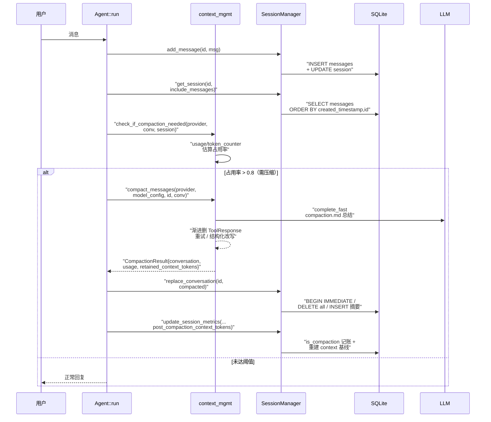

# 会话与上下文管理

> 核心文件：`crates/goose/src/session/session_manager.rs` 与 `context_mgmt/mod.rs`。

## 根因

goose 主循环里所有 LLM 交互都受两件事支配：**对话能存到哪、何时被压缩**。一句话根因——**"会话必须跨进程、跨形态（Desktop/CLI/API）可续，且模型上下文窗口有限，对话必须能被安全改写为更短的摘要而不丢用户可见的历史"**。因此 goose 把「持久化」与「上下文压缩」绑进同一个数据模型：`SessionManager` 负责用 SQLite 把每一条 agent 可见的消息落盘，`context_mgmt` 负责在 token 超阈值时调用 LLM 把旧对话总结成一条"系统不可见"的摘要，再通过 `replace_conversation` 把整段历史原子覆写入库。

这条主循环里有两个不可绕过的边界：
- `SessionType::User`/`Scheduled` 才计入用户可见会话；`Hidden`/`SubAgent`/`Acp`/`Gateway` 等是形态派生会话，不进列表。
- compaction 的摘要消息对 agent 可见、对用户**不可见**（`agent_only` metadata），保证 UI 里用户仍能看到全部原始消息，而历史被折叠成了 token 更省的摘要。

## 为什么选 SQLite + sqlx

会话存储是**本机、单用户、零运维**场景：需要崩溃后可续、并发读写安全、事务原子性，但不需要网络、多租户、横向扩展。SQLite 是这个场景的默认最优解，goose 的取舍十分明确：

- 连接池 `SqlitePoolOptions`，单文件 `sessions.db`，`create_if_missing(true)` 自动建库。
- 打开连接时显式开启 `foreign_keys(true)`、`busy_timeout(30s)`、`journal_mode(Wal)`——WAL 让读写并发下读不阻塞写，SQLite 本身无需独立运维进程。

```rust
let options = SqliteConnectOptions::new()
    .filename(path)
    .create_if_missing(true)
    .foreign_keys(true)
    .busy_timeout(std::time::Duration::from_secs(30))
    .journal_mode(sqlx::sqlite::SqliteJournalMode::Wal);
```
<!-- snippet: [crates/goose/src/session/session_manager.rs:907-912] let options = SqliteConnectOptions::new().filename(path).create_if_missing(true).foreign_keys(true).busy_timeout(std::time::Duration::from_secs(30)).journal_mode(sqlx::sqlite::SqliteJournalMode::Wal); -->

选型代价：不做分布式、不做云同步（这也是 goosemode / `.goosehints` 等走文件系统、记忆走磁盘文件的补充形态存在的原因）。所有写路径都用 `pool.begin_with("BEGIN IMMEDIATE")` 手工包事务，把构建器模式的逐个字段更新包成原子提交（`apply_update` 的 `SessionUpdateBuilder`），避免半写状态。

## SessionManager 与 Store 的形态划分

`SessionManager` 是一个无状态门面，内部持有 `Arc<SessionStorage>`，所有真实 SQL 都在 `SessionStorage`：

- 全局单例 `SESSION_STORAGE` 用 `LazyLock` 惰性初始化，`SessionManager::instance()` 复用同一池，保证 App 生命周期内连接池只建一次。
- 存储目录 `data_dir/sessions/sessions.db`（`SESSIONS_FOLDER` + `DB_NAME` 常量）。
- 对外 API 大多是门面的 1:1 转发（`create_session`/`get_session`/`add_message`/`replace_conversation`/`record_usage_metrics`…），真正复杂的 SQL 全部收敛在 `SessionStorage` impl 里。

这种划分带来单一心智负担：上层只认 `SessionManager` 语义接口，不必知道表结构；schema、迁移、连接都封在 `SessionStorage::pool()` 的初始化闭包里，任何并发首启只有一个 `OnceCell` 会触发建表/迁移。

## SessionType：为什么要有七种类型

`SessionType` 是会话的"来源身份标签"，不是运行时状态机。它的核心作用在**列表可见性**与**命名/压缩策略分支**上打标：

| 变体 | 谁创建 | 进不进用户列表 | 意义 |
|------|--------|--------------|------|
| `User`（默认） | 交互入口（CLI/Desktop/ACP 带 client 元数据） | 是 | 正常对话 |
| `Scheduled` | `scheduler.rs` 定时任务 | 是（与 User 并列） | 定时任务专属会话，跳过自动命名 |
| `SubAgent` | `summon.rs` 子代理 | 否 | 子代理专属会话 |
| `Hidden` | ACP `meta.hidden:true` / 内部工具会话 | 否 | 不向用户展示的会话 |
| `Terminal` | 仅枚举定义，尚未落地 | 否 | 为未来 terminal 形态预留 |
| `Gateway` | `gateway/handler.rs` | 否 | 网关触发的会话 |
| `Acp` | `acp/server.rs` | 否（除非显式查） | ACP 协议直接驱动的会话 |

为什么这么设计而不是用一个布尔 `is_hidden`？因为**每种形态不仅影响可见性，还影响命名策略和压缩策略**，用一个枚举可以集中匹配：

- `get_insights` 与 `list_sessions` 明确只统计 `[User, Scheduled]`，把形态会话排除在"用户会话数/token 总量"指标之外（`[crates/goose/src/session/session_manager.rs:2065-2068]()`）。
- `maybe_update_name` 对 `Scheduled` 直接跳过自动命名（`session.session_type == SessionType::Scheduled` 短路返回）——定时任务不需要 LLM 生成标题（`[crates/goose/src/session/session_manager.rs:581-583]()`）。

```rust
if session.session_type == SessionType::Scheduled {
    return Ok(None);
}
```
<!-- snippet: [crates/goose/src/session/session_manager.rs:581-583] if session.session_type == SessionType::Scheduled { return Ok(None); } -->

枚举演进还能用 SQL 做到批量重分类而不用改代码逻辑：migration v9 直接把历史 user 会话里名为 `ACP Session` 的整批改标为 `Acp`（见数据模型篇演进策略）。

## 会话写入时机：add_message vs replace_conversation

这是理解持久化语义的分水岭，两条写入路径用途截然不同：

### add_message：增量追加（正常对话流）

主循环里每产生一条消息就追加一行 `messages`。它在同一事务里更新 `sessions.updated_at` 保证列表排序新鲜度。为兼容 AI 会话模型，message_id 由调用方输入或 fallback 生成 `msg_{session_id}_{uuid}`。

```rust
INSERT INTO messages (message_id, session_id, role, content_json, created_timestamp, metadata_json)
VALUES (?, ?, ?, ?, ?, ?)
```
<!-- snippet: [crates/goose/src/session/session_manager.rs:1836-1838] INSERT INTO messages (message_id, session_id, role, content_json, created_timestamp, metadata_json) VALUES (?, ?, ?, ?, ?, ?) -->

### replace_conversation：整段覆盖（compaction / clear / import / copy）

这是 compaction 回写、`/clear` 清空、导入导出、复制的共同落点。语义是**先 `DELETE` 该会话全部 messages，再按新 Conversation 逐条 `INSERT`**，包在一个 `BEGIN IMMEDIATE` 事务里，保证"删了没写 / 写了没删"的中间态不可见。

```rust
sqlx::query("DELETE FROM messages WHERE session_id = ?")
    .bind(session_id)
    .execute(&mut *tx)
    .await?;

for message in conversation.messages() {
    // INSERT 每条
}
```
<!-- snippet: [crates/goose/src/session/session_manager.rs:1865-1868] sqlx::query("DELETE FROM messages WHERE session_id = ?").bind(session_id).execute(&mut *tx).await?; -->

关键洞察：**SQLite 没有"整段替换"操作，goose 用 DELETE+INSERT 模拟**。代价是每条消息的 autoincrement `id` 会变化，但读取方从不依赖持久化的 id——读取时用 `created_timestamp, id` 排序重建，ID 只用来在同秒消息间打破平局。compaction 重写后，旧 id 序列被整体重建，这是安全的，因为 id 从不对上界暴露。

也正因如此，**compaction 不是"轻量打标"，而是把整段历史物理重写一遍**。这解释了为什么 `replace_conversation` 是 compaction 的固定搭档（agent.rs/execute_commands.rs 每次都成对调用）。

## compaction：自动与手动的完整闭环

`context_mgmt` 拆成两层：**判断要不要压**（`check_if_compaction_needed`）与**执行压缩**（`compact_messages`）。两者解耦，自动路径先判后压，手动 `/compact` 命令只压不判。

### 阈值判定：占用率 > 0.8

- 默认阈值 `DEFAULT_COMPACTION_THRESHOLD = 0.8`，可用 `GOOSE_AUTO_COMPACT_THRESHOLD` 覆盖（`[crates/goose/src/context_mgmt/mod.rs:26-34]()`）。
- 先看 provider 是否 `manages_own_context()`（如 Gemini 类自带记忆的模型），是则**永不自动压缩**——把上下文管理让渡给模型自身。
- `usage_ratio = current_tokens / context_limit`：current_tokens 优先读 `session.usage.total_tokens`（会话元数据里已记账的 token），缺失时退化为用 agent 可见消息重算。

```rust
let usage_ratio = current_tokens as f64 / context_limit as f64;
let needs_compaction = if threshold <= 0.0 || threshold >= 1.0 {
    false // Auto-compact is disabled.
} else {
    usage_ratio > threshold
};
```
<!-- snippet: [crates/goose/src/context_mgmt/mod.rs:259-266] let usage_ratio = current_tokens as f64 / context_limit as f64; let needs_compaction = if threshold <= 0.0 || threshold >= 1.0 { false // Auto-compact is disabled. } else { usage_ratio > threshold }; -->

阈值在 [0,1] 外（`<=0` 或 `>=1`）视为关闭自动压缩，这是把"0 或 1"当成禁用开关，避免边界误触发。

### 摘要生成：do_compact 的渐进式降级

`do_compact` 把 agent 可见消息序列化后调用模型总结，但**不是一次到位**：当模型因 `ContextLengthExceeded` 失败时，按 `[0, 10, 20, 50, 100]` 五档百分比从中间逐步删掉 ToolResponse 消息（`filter_tool_responses` 的 middle-out 策略），逐档重试，直到能在一个更短的上下文里完成总结。这是对"上下文本身已经接近爆掉"的自我保护。

```rust
for (attempt, &remove_percent) in removal_percentages.iter().enumerate() {
    let filtered_messages = filter_tool_responses(&agent_visible_messages, remove_percent);
```
<!-- snippet: [crates/goose/src/context_mgmt/mod.rs:331-332] for (attempt, &remove_percent) in removal_percentages.iter().enumerate() { let filtered_messages = filter_tool_responses(&agent_visible_messages, remove_percent); -->

usage 必在改写前冻结：`ensure_usage_tokens` 先按"原始输出"估 token，再用 `apply_structured_summary` 把原始响应改写为结构化渲染文本，保证**计费 token 是模型原始输出，而上下文里保留的是更短的渲染版**。

### 结构化摘要：StructuredSummary

总结不只要求模型给一段话，而是要求一个结构化 JSON（`user_intent / technical_concepts / files / errors_and_fixes / problem_solving / user_messages / pending_tasks / current_work / next_step`），再经 `compaction_summary.md` 模板渲染成 Markdown 塞回上下文。核心理由是**可裁剪性**：列表"最重要的在最前"，后续实验可从头尾部裁剪节段而保摘要主心。

关键容错在于 `json_candidates`：模型常把 JSON 包在 `</analysis>` scratchpad 或 ```json``` fence 里，甚至把摘要里再引用 `</analysis>`。它按"最后一个 terminator 起找 fenced JSON → 逐候选回退 → 兜底整段文本"，**任何一个候选 brace 不配平就不采纳**，保证拿不到可靠 JSON 时就回退保留模型原始文本，绝不用残缺 JSON 顶替好摘要（lossless fallback）。

```rust
pub fn parse(response_text: &str) -> Option<Self> {
    json_candidates(response_text).into_iter().find_map(|c| {
        let value = safely_parse_json(c).ok()?;
        let mut summary: Self = serde_json::from_value(value).ok()?;
        summary.normalize();
        (!summary.is_empty()).then_some(summary)
    })
}
```
<!-- snippet: [crates/goose/src/context_mgmt/structured.rs:131-138] pub fn parse(response_text: &str) -> Option<Self> { json_candidates(response_text).into_iter().find_map(|c| { let value = safely_parse_json(c).ok()?; let mut summary: Self = serde_json::from_value(value).ok()?; summary.normalize(); (!summary.is_empty()).then_some(summary) }) } -->

且反序列化是"宽容模式"：模型把 `files` 数组写成字符串、把错误项写成 `{error,fix}` 对象、把字段类型写错，都不会因单个字段丢弃整个摘要——`stringify_lenient` 把它们字符串化并收进适当列表。

### 压缩后的消息编排

`compact_messages` 最终构造的新会话结构（`[crates/goose/src/context_mgmt/mod.rs:147-175]()`）：
1. 原消息逐条 `with_agent_invisible()`——对 agent 不可见、对用户仍可见。
2. 摘要消息 `agent_only()`——agent 可见、用户不可见。
3. 追加一条含 continuation 文案的 assistant 消息（`CONVERSATION_CONTINUATION_TEXT` / `TOOL_LOOP_CONTINUATION_TEXT` / `MANUAL_COMPACT_CONTINUATION_TEXT` 三种，取决于空手动压/最近是否用户消息），指导模型"别看挂了提到压缩，继续自然对话"。
4. 非手动压缩时保留**最近一条纯文本 user 消息**（`preserved_user_message`），防止当前指令被一并折叠。

```rust
for msg in messages_to_compact {
    let updated_metadata = msg.metadata.clone().with_agent_invisible();
    let updated_msg = msg.clone().with_metadata(updated_metadata);
    final_messages.push(updated_msg);
}
let summary_msg = summary_message.with_metadata(MessageMetadata::agent_only());
```
<!-- snippet: [crates/goose/src/context_mgmt/mod.rs:147-153] for msg in messages_to_compact { let updated_metadata = msg.metadata.clone().with_agent_invisible(); let updated_msg = msg.clone().with_metadata(updated_metadata); final_messages.push(updated_msg); } let summary_msg = summary_message.with_metadata(MessageMetadata::agent_only()); -->

这套 agent-visible / user-visible 双可见性模型是 goose 上下文管理的支柱：**历史对用户不丢、对 agent 折叠**。用户看到完整白屏历史，模型只看到更省 token 的摘要，二者共用同一套 `messages` 表，靠 `metadata_json` 里的 audience/visibility 区分。

## 会话与上下文写入时序

下面用 sequenceDiagram 串起"自动压缩"完整链路（agent.rs 驱动），展示持久化与压缩如何耦合。



关键点：**compaction 的记账**是 `post_compaction_context_tokens`——传的是 `retained_context_tokens`（压缩后 agent 可见摘要的大小）而不是模型原始输出，它把会话的 "current usage" 基线重置为压缩后的尺寸，同时 `MessageUsage::from_provider_usage(..., is_compaction=true)` 把这次调用标记为 compaction（见 reply_parts.rs）。这样 `total_tokens` 反映的是当前 agent 可见上下文，而累计账目（accumulated/usage_ledger）仍把原始 billable 输出全记账。

## 工具对（Tool Pair）的先发压缩

`maybe_summarize_tool_pairs` 是压缩的"精细平移"：在整段压缩之前，当单次会话内 `ToolRequest+ToolResponse` 对超过一定阈值时，后台 `tokio::spawn` 异步把最早的一批工具对各自总结成一句 `agent_only` 回复塞回上下文（`[crates/goose/src/context_mgmt/mod.rs:626-663]()`）。触发量由 `compute_tool_call_cutoff` 决定——随上下文窗口 `3 * effective_limit / 20000` 线性放大并 clamp 到 `[10, 500]`，这样大窗口模型可以先压再多工具对，小窗口早早触发。这是对"工具调用通常最占 token"这一经验的针对性优化，且**异步不阻塞主回复流**。

```rust
Some(tokio::spawn(async move {
    let mut results = Vec::new();
    for tool_id in tool_ids {
        match summarize_tool_call(
            provider.as_ref(),
            &model_config,
            &session_id,
            &conversation,
            &tool_id,
        )
        .await
        {
            Ok(summary) => results.push((summary, tool_id)),
            Err(e) => {
                warn!("Failed to summarize tool pair: {}", e);
            }
        }
    }
    results
}))
```
<!-- snippet: [crates/goose/src/context_mgmt/mod.rs:643-662] Some(tokio::spawn(async move { let mut results = Vec::new(); for tool_id in tool_ids { match summarize_tool_call( provider.as_ref(), &model_config, &session_id, &conversation, &tool_id, ) .await { Ok(summary) => results.push((summary, tool_id)), Err(e) => { warn!("Failed to summarize tool pair: {}", e); } } } results })) -->

## 召回：Chat History Search

`chat_history_search.rs` 提供跨会话全文召回（供 chatrecall / `MCP` 工具用）。它不用 FTS，而是对每个关键词做 `LOWER(json_extract(content,'$.text')) LIKE '%kw%'` 的 `EXISTS json_each(content_json)` 子查询（见数据模型篇），并在 SQL 里先按 `metadata_json.agentVisible=1` 与 audience 投影过滤，保证**用户不可见的私有块 / secret 不出现在召回结果里**。这是"双可见性"在查询层的又一次投影。

## hints 注入：.goosehints / AGENTS.md 与子目录按需加载

系统提示构建走 `PromptManager`，Hints 是"语境注入"，不是会话数据，但同样是上下文管理的一环：

- `with_hints(working_dir)` 一次性把全局（`~/.config/goose/.goosehints` + `~/.agents/AGENTS.md`）与本地项目（cwd 到 git root 路径上逐层 `.goosehints`/`AGENTS.md`）的 hints 拼进 `system_prompt_extras["hints"]`，渲染到系统提示的 `# Additional Instructions` 段（`[crates/goose/src/agents/prompt_manager.rs:95-105]()` + `[crates/goose/src/agents/prompt_manager.rs:173-175]()`）。
- 文件名可由 `CONTEXT_FILE_NAMES` 配置覆盖（默认 `[.goosehints, AGENTS.md]`），`.goosehints` 里 `@file` 语法可引用其它文件，且会受 `.gitignore` 过滤（敏感文件不注入）。
- **子目录按需加载**：`SubdirectoryHintTracker` 监听工具调用的 `path`/`command` 参数，当 agent 访问到工作区子目录时，找到该目录路径上层层祖先目录里的 hints 再追加进系统提示，且用 `loaded_dirs` 去重、限制在 working_dir 边界内（防穿越）。

```rust
let pending = std::mem::take(&mut self.pending_dirs);
if pending.is_empty() {
    return Vec::new();
}
...
if !dir.starts_with(&working_dir) || dir == working_dir {
    continue;
}
if self.loaded_dirs.contains(&dir) {
    continue;
}
```
<!-- snippet: [crates/goose/src/hints/load_hints.rs:73-80] let pending = std::mem::take(&mut self.pending_dirs); if pending.is_empty() { return Vec::new(); } -->

> 路径/去重/加载逻辑连续见 `[crates/goose/src/hints/load_hints.rs:83-100]()`（`dir.starts_with(&working_dir)` 边界校验、`loaded_dirs` 去重、`subdir_hints:` key 拼装）。

`PromptManager::load_subdirectory_hints` 把新发现的子目录 hints 用独立 key（`subdir_hints:<dir>`）写进 `system_prompt_extras`，与主 hints 平级，可随时追加而互不覆盖（`[crates/goose/src/agents/prompt_manager.rs:243-250]()`）。

## 会话命名的权衡

`session_naming.rs` 是会话元数据的最小化生成：仅在用户消息数 ≤3（`MSG_COUNT_FOR_SESSION_NAME_GENERATION`）时触发，用 LLM 生成 ≤100 字符的短语标题，并做 XML 标签剥离 + 引号短语提取（`extract_short_title`）以拿到干净标题。`user_set_name` 标志决定是否尊重用户手改标题——用户一旦手改，系统永不覆盖（`maybe_update_name` 读 `user_set_name` 短路）。这是对"命名成本极低、但必须防覆盖用户意图"的权衡。

## 与 memory 的边界

内置 memory MCP server（`goose-mcp/src/memory`）走的是**文件系统**而非 SQLite：本地 `.goose/memory/*.txt` / 全局 `~/.config/goose/memory/*.txt`，用分类 ≤下按 entry 追加。它和会话库是两套语义：会话库记录"对话及其 token"，memory 记录"用户跨会话偏好/项目配置"。二者互补，不共用 schema（见数据模型篇）。

## 设计亮点

- **双可见性（agent_visible/user_visible）单一事实来源**：history 压缩后用户与模型各持所见，共用一张表，靠 metadata 投影，天然支持"压缩但用户可见原始"。这比"物理删旧消息"或"单独存一份 UI 历史"都简洁。
- **计费 token 与上下文 token 分离记账**：`retained_context_tokens` 与 billable output 分离，避免"压缩后 total 反而变大"的假象。
- **渐进式降级**（删 ToolResponse 档位 / raw-text fallback）：面对"上下文已爆"与"模型不给格式化输出"两个现实，都能保底完成。
- **SessionType 集中打标**：形态进列表、跳命名、分压缩，一个枚举贯通策略分支。

## 不足 / 风险

- `replace_conversation` 是 DELETE+INSERT 全量重写，会话越长重写越贵（O(n) 写 + autovacuum 压力），虽并发安全但非增量友好。
- 全文归还没上 FTS/倒排索引，关键词 `LIKE '%...%'` 在消息海量时是线性扫描，仅有 `idx_messages_session` 支撑 session 一级切分，跨会话全文检索可扩展性有限。
- `Terminal`/`Gateway` 等 SessionType 部分变体在当前版本还未消费，属前瞻性预留，阅读源码时需注意不要按"已实现"去理解。
