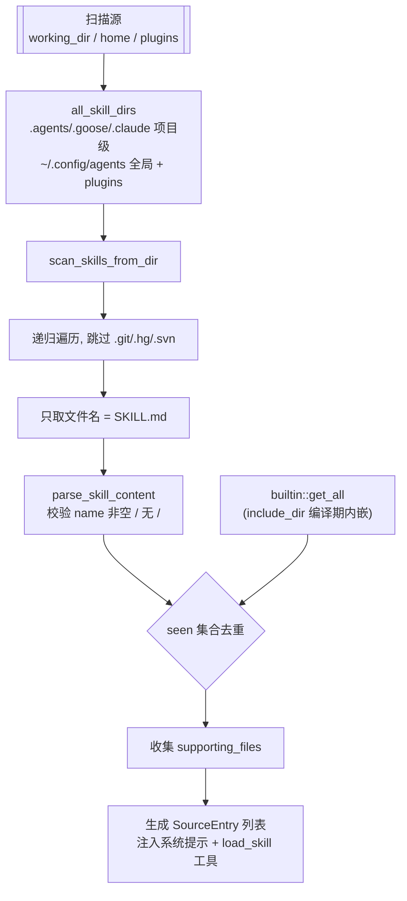
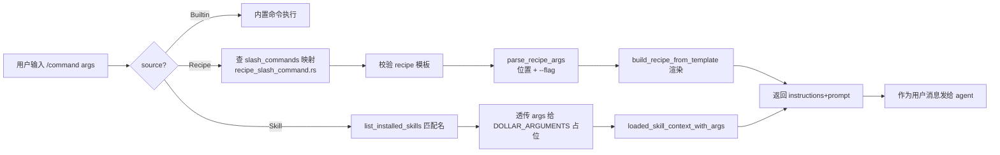

# Skill / Recipe / Slash 命令

## 根因

goose 的主循环与执行管理解决"agent 怎么跑起来、怎么并发、怎么被嵌套"；但当用户想让 agent **复用一段既定的操作流程**时，会撞到三个现实问题：

1. **同样的能力要能在不同会话、不同项目、不同形态（CLI/桌面/API）下被稳定复用**——不能每次靠用户把一段话粘进去。
2. 复用物需要分层：有的很小（"一次怎么用 gdrive"），有的很大（"整个做一件事的 recipe，含子步骤、参数、结构化输出、重试策略"）。
3. 用户习惯用斜杠命令快速触发，而不是敲完整段落。

本模块的 Skill / Recipe / Slash 命令共同回答这些问题：Skill 是"可注入上下文的指令文件（SKILL.md 规范）"，Recipe 是"可参数化、可模板化、可嵌套、可声明确输出的一种执行模板"，Slash 命令则是"把内置命令 / Skill / Recipe 统一暴露成一条斜杠触发的入口"。三者形成一条"复用 → 发现 → 触发"的闭环。

## Skill 体系

### SKILL.md 规范

一个 skill 是目录下的一颗 `SKILL.md`（Markdown + YAML frontmatter），frontmatter 含 `name` + `description` + 可选的 `metadata` 嵌套映射。`[crates/goose/src/skills/mod.rs:25-25]()` 定义 frontmatter 结构，并引用 agentskills.io 规范——说明 goose 的 skill 格式**对齐了业界已存在的 agentskills.io 生态**，而非自造标准：

```rust
pub struct SkillFrontmatter {
    #[serde(default)]
    pub name: Option<String>,
    #[serde(default)]
    pub description: String,
    #[serde(default)]
    pub metadata: HashMap<String, Value>,
}
```

解析时要求 `name` 非空（`[crates/goose/src/skills/mod.rs:354-354]()`），且不能含 `/`（`[crates/goose/src/skills/mod.rs:366-366]()`）。技能名还受 `validate_skill_name`（`[crates/goose/src/skills/mod.rs:74-74]()`）约束：≤64 字符、只允许小写字母/数字/连字符、不进 `-`。这是为了让 skill 名既能作 slash 命令名、又能作 `load_skill` 工具参数，都必须是一个"干净、可寻址"的字符串。

### 目录发现：扫哪些目录

`all_skill_dirs`（`[crates/goose/src/skills/mod.rs:316-316]()`）列出所有 agent 读取 skill 的目录，并标出是否全局（home 锚定）。它按**项目优先、全局在后**的顺序：

- 项目级（相对 working_dir）：`.agents/skills`、`.goose/skills`、`.claude/skills`（`[crates/goose/src/skills/mod.rs:320-320]()`）。
- 全局级（home 锚定）：`~/.agents/skills`、`config_dir/skills`、`~/.claude/skills`、`~/.config/agents/skills`（`[crates/goose/src/skills/mod.rs:326-326]()`、`329`）。
- 已安装插件的技能目录：`installed_plugin_skill_dirs()`（`[crates/goose/src/skills/mod.rs:335-335]()`）。

> **Why>What（兼容视角）**：同时扫 `.goose`、`.claude`、`.agents` 三个名字，本质是让 goose **兼容 Claude 已有的 skill 目录约定**，降低用户 / 生态迁移成本——一个为 Claude/agentskills 写的 skill 目录，goose 直接能发现，而不用搬去一个 goose 专属位置。`dirs` 注释也点明"顺序即发现优先级：项目 dirs 在前，然后全局 dirs"，同名校以先者胜。

### discover_skills：递归扫描 + builtin 注入

`discover_skills`（`[crates/goose/src/skills/mod.rs:480-480]()`）是所有 skill 发现的统一入口：

```rust
pub fn discover_skills(working_dir: Option<&Path>) -> Vec<SourceEntry> {
    let mut sources: Vec<SourceEntry> = Vec::new();
    let mut seen = HashSet::new();

    for (dir, is_global) in all_skill_dirs(working_dir) {
        for source in scan_skills_from_dir(&dir, is_global, &mut seen) {
            sources.push(source);
        }
    }
    for content in builtin::get_all() { ... }
    sources
}
```

- `scan_skills_from_dir`（`[crates/goose/src/skills/mod.rs:425-425]()`）用 `walk_files_recursively` 递归遍历，跳过 `.git/.hg/.svn`（`should_skip_dir`，`[crates/goose/src/skills/mod.rs:383-383]()`），只挑文件名恰为 `SKILL.md` 的文件；再用 `seen` 集合去重（同名后发现的被跳过）。
- 每个 skill 还会递归收集它的 `supporting_files`（`[crates/goose/src/skills/mod.rs:456-456]()`），即 skill 目录下除 SKILL.md 外的所有文件——这些是 skill 运行时可能引用的脚本/模板。
- 内置 skill 由 `builtin::get_all()`（`[crates/goose/src/skills/builtin.rs:5-5]()`）用 `include_dir!` 在编译期把 `src/skills/builtins` 目录的 .md 全部打进二进制，作为 `SourceType::BuiltinSkill` 追加，且同名校时用户目录的 skill 优先（内置只在 `seen` 未命中时进）。



### 注入上下文：loaded_skill_context 与 load_skill 工具

Skill 不是一次性塞进上下文的；goose 采用"**系统提示只列出技能清单，用到一个再 load**"的按需注入策略。

**清单注入**在 `SkillsClient::get_instructions`（`[crates/goose/src/skills/client.rs:246-246]()`）——它把已发现 skills 的名字+描述拼进系统指令，告诉模型"你有这些 skill 可用，适合时再用"。这样不会一次把所有 skill 正文塞进上下文烧 token，模型按需调用 `load_skill` 拉取。

**正文注入**在 `SkillsClient::call_tool` 的 `load_skill`（`[crates/goose/src/skills/client.rs:103-103]()`）：

- `list_tools`（`client.rs:61`）只暴露唯一一个工具 `load_skill`（`client.rs:82`），参数 `name`（支持 `skill-name` 或 `skill-name/relative-path`）+ 可选 `args`。工具描述教导模型"skill 先列在系统提示，要用时先加载以拿到详细指令"（`client.rs:84`）。
- `call_tool` 找到同名 skill 后调 `loaded_skill_context_with_args`（`[crates/goose/src/skills/mod.rs:154-154]()`）渲染成一段注入文本：`# Loaded Skill: <name> (<source_type>)` + description + 内容 +（若有 supporting files）列出解析后的绝对路径。该函数还会用 `skill_argument_names`/`apply_skill_arguments` 做 `$ARGUMENTS` 占位符替换（`client.rs:136`）。
- 若传的是 `skill-name/rel-path`，则按 supporting file 加载：`[crates/goose/src/skills/client.rs:145-145]()` 解析父 skill 目录，遍历 `supporting_files` 匹配相对路径，然后 `canonicalize` 并断言解析后路径仍在父 skill 目录内，`canonical.starts_with(&canonical_skill_dir)`（`client.rs:166`），否则 "Refusing to load ... resolves outside the skill directory"（`client.rs:181`）——**防止任意文件读取**。
- 找不到时给出最多 3 个近似的 `Did you mean:` 建议（`client.rs:218`），很有产品感。

> **Why>>What（注入 vs 常驻）**：把 skill 从"常驻系统提示"改成"系统提示列清单 + 工具按需加载"，是 token 成本与可用性之间的权衡：常驻则每次请求都带全部 skill 正文（浪费），纯按需则模型不知道有哪些 skill 可用（遗漏）。折中是"列清单给模型全貌，由模型判断何时 load"。`ingress` 的 supporting file 加载 + canonicalize 防越界则回应了安全（skill 目录是用户可写得来的外部来源，不能让它变成读任意文件的通道）。

## Recipe 体系：可参数化的执行模板

### Recipe 结构

`[crates/goose/src/recipe/mod.rs:42-42]()` 定义 `Recipe`。相比 skill（一个注入文件），recipe 是更"重"的执行模板，字段丰富得多：

- 必填：`version`（semver）、`title`、`description`；且 `instructions` 与 `prompt` 至少一个（`[crates/goose/src/recipe/mod.rs:52-52]()` 注释，`RecipeBuilder::build` 在 `[crates/goose/src/recipe/mod.rs:413-413]()` 硬校验）。
- 可选：`extensions`（要启用的扩展）、`settings`（provider/model/temperature/max_turns）、`activities`（启动时显示的活动 pill）、`parameters`（可编排的入参）、`response.json_schema`（结构化输出声明）、`sub_recipes`（子 recipe 引用）、`retry`（重试策略）。

`Recipe::from_content`（`[crates/goose/src/recipe/mod.rs:322-322]()`）支持 YAML/JSON，且能解析"内嵌 recipe"形态（顶层 `recipe:` 字段下的嵌套结构——兼容 goose 中央仓库的打包格式，`[crates/goose/src/recipe/mod.rs:325-325]()`）。

### 编译期的自动补全

两个 `ensure_*` 是 recipe 加载时的"隐形修正"：

- `ensure_analyze_for_developer`（`[crates/goose/src/recipe/mod.rs:230-230]()`）：旧的 builtin `developer` 扩展若没有 analyze，则自动注入 `analyze` 平台扩展。
- `ensure_summon_for_subrecipes`（`[crates/goose/src/recipe/mod.rs:254-254]()`）：**一旦 recipe 声明了 `sub_recipes`，就自动注入 `summon` 扩展**——因为"把子 recipe 派给独立子代理执行"正是 summon 工具能力的体现，它把 recipe 的静态结构（`sub_recipes:` 列表）和运行时能力（summon 派发子代理）绑定起来。这是 recipe 与子代理编排两个模块交汇的接缝。

### 校验：validate_recipe

`validate_recipe.rs` 把 recipe 从"能被反序列化"推进到"能被安全可靠地执行"：

`validate_recipe_template_from_content`（`[crates/goose/src/recipe/validate_recipe.rs:39-39]()`）依次做：

1. `validate_prompt_or_instructions`（`[crates/goose/src/recipe/validate_recipe.rs:69-69]()`）——`instructions`/`prompt` 至少一个非空。
2. `validate_retry_config`（`[crates/goose/src/recipe/validate_recipe.rs:57-57]()`）——重试配置自校验。
3. `validate_json_schema`（`[crates/goose/src/recipe/validate_recipe.rs:22-22]()`）——若声明了 `response.json_schema`，用 `jsonschema` 校验器验证这个 schema 本身合法。
4. `parse_and_validate_parameters`（`[crates/goose/src/recipe/validate_recipe.rs:11-11]()`）——先 `parse_recipe_content` 提取模板变量，然后：
   - `validate_optional_parameters`（`[crates/goose/src/recipe/validate_recipe.rs:145-145]()`）——**`File` 型参数禁止有默认值**（"以免导入敏感的用户文件"，`[crates/goose/src/recipe/validate_recipe.rs:156-156]()`），且 Optional 参数必须给默认值。
   - `validate_parameters_in_template`（`[crates/goose/src/recipe/validate_recipe.rs:90-90]()`）——模板里出现的每个变量都必须在 `parameters` 里定义，反之 parameters 里不能有模板用不到的"多余定义"（missing_keys / extra_keys 双向校验）。这样参数定义与模板占位严格对齐，避免运行时惊现未定义占位符。

> **Why>What**：recipe 校验层存在的意义是"把错误挡在跑之前"。因为 recipe 是要被拿去执行（甚至被 Schedule 定时执行）的指令，若等运行时才发现"缺参数 / JSON schema 非法 / File 参数带默认值"，轻则报错重run，重则引入安全风险。双向校验 `parameters ↔ 模板变量` 尤其反映了一种"声明即契约"的态度。

### 模板化：template_recipe（MiniJinja）

recipe 是模板，不是纯字符串。`template_recipe.rs` 用 `minijinja`（Jinja2 语法的 Rust 实现）渲染：

`render_recipe_content_with_params`（`[crates/goose/src/recipe/template_recipe.rs:92-92]()`）做了三段预处理再渲染：

1. 把 `: ""` 空字符串占位换成 `: ''`（防止 MiniJinja 把 `\"\"` 转义破坏 YAML 解析）。
2. `preprocess_template_variables`（`[crates/goose/src/recipe/template_recipe.rs:15-15]()`）——**把解析不了的变量名用 `...` 保护**，避免把非参数占位（如 Git 或 shell 风格的 `{{var}}`）误当模板变量求值而报错。
3. 用 `UndefinedBehavior::Strict` 渲染，未定义参数会报错（`[crates/goose/src/recipe/template_recipe.rs:108-108]()`）——这配合校验层的"参数必须全部定义"。

子模板加载 `load_template_from_recipe_dir`（`[crates/goose/src/recipe/template_recipe.rs:135-135]()`）有**路径安全防护**：拒绝 `ParentDir / RootDir / Prefix` 组件（`[crates/goose/src/recipe/template_recipe.rs:139-139]()`），且 `canonicalize` 后断言 `path.starts_with(&recipe_dir)`（`[crates/goose/src/recipe/template_recipe.rs:162-162]()`）——recipe 的 `` 不能逃出其所在目录去 include 任意文件。这与 skill 的 supporting-file 越界防护是同一个安全主题。

`parse_recipe_content`（`[crates/goose/src/recipe/template_recipe.rs:208-208]()`）在**校验阶段**以 `UndefinedBehavior::Lenient` + `render_captured` 收集模板全部未声明变量名（供上述双向校验用），并检测是否用了 `/` 继承——有继承才真渲染，否则保留条件/变量原样（避免校验时就把参数值烧进去）。

### 本地发现：local_recipes + manifest

`local_recipes.rs` 定义 recipe 的搜索目录，`local_recipe_dirs`（`local_recipes.rs:21`）：

- 当前目录 `.`；`GOOSE_RECIPE_PATH` 环境变量（路径分隔符 `:`），`config_dir/recipes`（全局库，`get_recipe_library_dir` 的 `is_global=true` 分支，`local_recipes.rs:15`），当前目录 `.goose/recipes`，以及 `.agents/recipes`（home 与 cwd，`local_recipes.rs:32`）。

`load_local_recipe_file`（`local_recipes.rs:48`）支持"直接给文件路径"或"按名字在各 search dir 找 `<name>.yaml/.json`"两路。`list_local_recipes`（`local_recipes.rs:84`）扫描所有目录里的 yaml/json 文件反序列化成 `(PathBuf, Recipe)`。

`manifest.rs` 在其上加一层可寻址：`list_recipe_file_manifests`（`manifest.rs:26`）为每个 recipe 算出 `last_modified`、用 `short_id_from_path`（一个基于 `DefaultHasher` 的稳定 16-hex id，`manifest.rs:19`）生成 id，并按修改时间倒序。这就给 API/前端一个"食谱清单 + 稳定 id + 最近修改"的可查询视图，`get_recipe_file_path_by_id`（`manifest.rs:54`）据此用 id 反查路径。

### recipe 与 skill / slash 的关系

- **skill 是"轻指令文件"**：一个 SKILL.md 注入上下文，靠 `load_skill` 工具按需加载，倾向于"教模型怎么做某类操作"。
- **recipe 是"重执行模板"**：可参数化渲染、可嵌套子 recipe、可声明结构化输出与重试、可被 Scheduling 定时执行，倾向于"把一整件任务按模板跑出来"。
- 二者**最终都能变成 slash 命令**，见下节。

## Slash 命令抽象

### 类型系统

`[crates/goose/src/slash_commands/types.rs:2-2]()` 定义命令来源枚举与条目：

```rust
pub enum SlashCommandSource {
    Builtin,
    Recipe,
    Skill,
}
```

`SlashCommandEntry`（name / description / source / source_path / input_hint）把三类来源统一成一个条目类型。这是"内置命令 + recipe + skill 三套东西，都只是一个斜杠命令"的抽象基石。

### 合并：merge_command_sources 与优先级

`[crates/goose/src/slash_commands/slash_command.rs:30-30]()` 的 `merge_command_sources` 把 Builtin + Recipe + Skill 三类命令合并成一份列表，并定义**命名冲突的优先级**：`内置 > recipe > skill`（`[crates/goose/src/slash_commands/slash_command.rs:36-36]()` 先插 builtin 占 reserved 名，再 recipe，skill 最后且过滤掉已被占用的）。测试 `merge_recipe_wins_over_skill_on_name_collision`（`[crates/goose/src/slash_commands/slash_command.rs:90-90]()`）、`merge_builtin_wins_over_recipe_and_skill`（`[crates/goose/src/slash_commands/slash_command.rs:102-102]()`）固化了这个约束，并用 `normalize_command_name`（去斜杠、统一小写）做去重键。

### recipe / skill 如何暴露为 slash 命令

两类都以各自的 `resolve_command` 把"斜杠命令 + 参数串"解析成"一段可发给 agent 的 prompt"：

**recipe → slash**：`[crates/goose/src/slash_commands/recipe_slash_command.rs:149-149]()` 的 `resolve_command`：

1. 用 `get_recipe_for_command` 查配置里的 `slash_commands` 映射（配置项 `SLASH_COMMANDS_CONFIG_KEY`，`[crates/goose/src/slash_commands/recipe_slash_command.rs:14-14]()`），把 `/command` 反查回 recipe 文件路径（`[crates/goose/src/slash_commands/recipe_slash_command.rs:59-59]()`）。这个映射由 `set_recipe_slash_command`（`[crates/goose/src/slash_commands/recipe_slash_command.rs:40-40]()`）维护——用户在 UI 里把一个 recipe 绑到一个斜杠命令，本质是写一条 `command → recipe_path` 到配置。
2. 校验整个 recipe 模板（`[crates/goose/src/slash_commands/recipe_slash_command.rs:170-170]()`）。
3. 按 `parameters` 的 `requirement` 区分 required / optional（`[crates/goose/src/slash_commands/recipe_slash_command.rs:181-181]()`），用 `parse_recipe_args`（`[crates/goose/src/slash_commands/recipe_slash_command.rs:227-227]()`）把用户输入的位置参数 + `--flag value` 解析成键值对——required 单参数时"整串都算该参数"（贪婪，`[crates/goose/src/slash_commands/recipe_slash_command.rs:197-197]()`）。这个解析器实现了常见的 CLI 约定（位置参数 + 选项 flag）。
4. 用 `build_recipe_from_template` 渲染真实 recipe，取 `instructions + prompt` 拼接成最终 prompt，并可选带出 `response`（结构化输出声明）返回（`[crates/goose/src/slash_commands/recipe_slash_command.rs:204-204]()`、`224`）。

边栏：`input_hint_for_recipe`（`[crates/goose/src/slash_commands/recipe_slash_command.rs:116-116]()`）把 recipe 的参数定义渲染成千变万化的提示（如 `<component> <from> [--to <to>]`），让客户端能告诉用户这个斜杠命令怎么用。

**skill → slash**：`[crates/goose/src/slash_commands/skill_slash_command.rs:43-43]()` 的 `resolve_command` 简单直接——按名字（忽略大小写）匹配 `list_installed_skills`，命中就把参数串透传给 `loaded_skill_context_with_args`（skill 自己的 `$ARGUMENTS` 机制）渲染成注入文本（`[crates/goose/src/slash_commands/skill_slash_command.rs:55-55]()`）。它不含 recipe 那样的复杂参数解析，因为 skill 的参数注入就一个 `$ARGUMENTS`。`format_installed_skills`（`[crates/goose/src/slash_commands/skill_slash_command.rs:12-12]()`）则是 `/skills` 命令展示已装 skill 清单的实现。



## 权衡与替代方案代价

1. **skill 清单 + 按需 load（而不是常驻系统提示）**：省 token、保灵活，但引入"模型可能忘记 load"的风险（清单是给模型看的薄描述，足够引导模型的工具调用习惯）。替代是全量注入，代价是每轮都背全部 skill 正文。

2. **skill/recipe 目录同时兼容 `.goose/.claude/.agents/.config`**（`[crates/goose/src/skills/mod.rs:316-316]()`）：最大化生态兼容，但产生多个"看似等价但语义可能不同"的位置，同名去重逻辑必须谨慎（先项目后全局、以先者胜）。若不兼容，用户要迁移已有 skill 目录，成本高但语义单一。

3. **recipe 用 Jinja 模板 + 严格校验 + Include 越界防护**：表达能力（继承/变量/条件）与安全性并得，代价是实现复杂度高（预处理转义、变量名保护、路径安全三套逻辑）。若只用纯字符串拼接则简单，但无法承载"参数化 recipe / 中心仓库打包格式"。

4. **sub_recipes 自动注入 summon 扩展**（`[crates/goose/src/recipe/mod.rs:254-254]()`）：自动绑定能力，但隐式——用户声明的 recipe 运行时实际启用的扩展比声明多了一个 summon。它省去用户手动写，但若 recipe 作者不希望子 recipe 被派发到独立子代理，这个自动行为不可控。这是"顺手"与"显式"之间的取舍。

5. **slash 命令优先级内置 > recipe > skill**（`[crates/goose/src/slash_commands/slash_command.rs:36-36]()`）：保证内置命令不被用户覆盖搞坏核心体验，但用户无法用 recipe/skill 覆盖一个同名内置命令来定制行为。若允许覆盖则灵活，但冒着用户把 `compact`/`clear` 这类核心命令换成任意 recipe 的风险。
