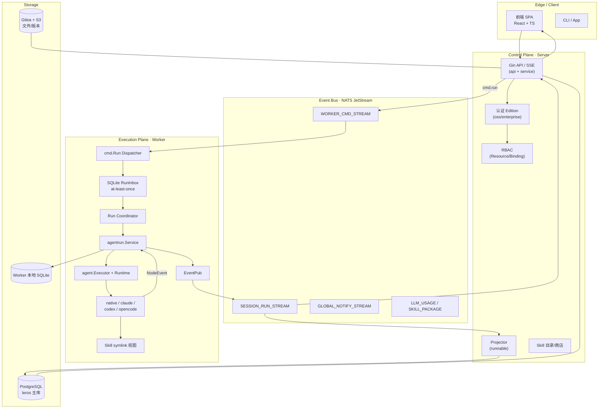

# Leros (Lework)

> 企业级 AI 工作协作操作系统 —— 让 AI 从「聊天工具」变成「可长期协同工作的团队成员」。
>
> 源码：私有 GitLab fork `git.yygu.cn:corekg/lework.git`（上游模块名 `github.com/insmtx/Leros`）｜ 版本 `v0.3.7-8-g9a3d7bc2` ｜ Go + React（Turbo 大型 monorepo）

## 子文档索引

- [`architecture.md`](architecture.md) — 四平面架构 + 事件驱动（NATS JetStream bus / subject 契约层 / 投影回放）
- [`agent-runtime.md`](agent-runtime.md) — Agent 多运行时执行层（native / Claude Code / Codex / OpenCode 同契约；NodeEvent 事实流）
- [`worker-system.md`](worker-system.md) — Worker 异步执行链（NATS 手动确认 + SQLite inbox 的 at-least-once 崩溃恢复；Coordinator 调度）
- [`skill-system.md`](skill-system.md) — Skill/Tool 能力分层（SKILL.md 文件型定义、symlink 视图、安全安装）
- [`data-model.md`](data-model.md) — 数据模型与存储（Postgres 真相源 + SQLite 本地 + JetStream 投递 + Gitea/S3 文件层，ER 图 + 字段表）
- [`auth-rbac.md`](auth-rbac.md) — 认证与治理（oss/enterprise 编译期 edition 隔离；用户/Worker 双通道令牌；资源级 RBAC）

---

## 快速概览

Leros 想解决的问题很本质：**对话式 AI「结束即清零」，AI 的产出收不回来、无法当劳动力管理**。它把一次 Chat 拆成「可指派、可验收、可追踪」的异步 Run，用 Project + Task + AI 队友（Agent）+ Skill 四个核心实体，把 AI 组织成一个可管理的团队。

### 核心能力清单

| 能力 | 说明 |
|------|------|
| AI 团队协作 | 创建项目、定义 AI 队友（角色+技能）、指派任务、验收交付物 |
| 多 Runtime 执行 | 内建 Eino 引擎 + Claude Code / Codex CLI / OpenCode CLI，同契约可替换 |
| 任务生命周期 | 异步 Run + 崩溃恢复（at-least-once），重启不丢已受理任务 |
| 实时过程回流 | Agent 执行过程经 NATS 流式回推，前端 SSE 实时看到 ai 思考/工具调用 |
| Skill 能力系统 | 文件型可复用能力单元，加载/注入/调度全程安全管控 |
| 企业级治理 | 多租户隔离、资源级 RBAC、执行审计、成本追踪、密钥托管 |
| 双版本认证 | 开源版内置认证 + 企业版委托 IAM，编译期隔离 |

### 技术栈一览

| 层 | 技术 |
|----|------|
| 后端语言 | Golang（约 9.6 万行有效代码） |
| HTTP/WebSocket | Gin + Swagger |
| 事件总线 | NATS JetStream（5 条 FileStorage Stream） |
| 主数据库 | PostgreSQL + GORM（JSONB 扩展字段） |
| Worker 本地 | SQLite（WAL，inbox + provider session） |
| 文件存储 | Gitea（版本/记忆）+ S3/MinIO（大文件） |
| LLM | 多模型（OpenAI / Claude / DeepSeek，modelrouter 路由与降级） |
| 前端 | React + TypeScript（Turbo pnpm workspace monorepo） |
| 部署 | Docker Compose / Helm / k3s（deployments/） |

### 同类定位对比

| 项目 | 差异点 |
|------|--------|
| **Leros (Lework)** | 企业级 AI 工作协作**操作系统级**平台：四平面 + 事件驱动 + 多 Agent 运行时 + 任务/项目/知识库资产沉淀 |
| Multica | 托管式 AI Agent 协作，Agent 作为第一公民的任务管理，偏轻量云端 |
| OpenBee | 自托管 24/7 数字员工，对话驱动，多 IM 集成（微信/飞书等），Worker 有组织身份 |
| Mem0 | AI Agent 记忆层（库/中间件），非完整协作平台，专注 70+ Provider 记忆检索 |

---

## 架构深读

### 架构总览

Leros 的精髓不是「又一个 Agent 框架」，而是一套**事件驱动的分布式智能执行操作系统**：控制面（Server）负责指令生成与结果投影，执行面（Worker）消费任务、驱动 Agent 执行、把过程事实流式回推。二者通过 NATS JetStream 事件总线解耦，靠「所有模块之间只能通过 Event Bus 通信」这一条铁律维持可扩展性。

### 核心执行链路（一次消息的完整旅程）

`用户发消息 → Server 落库并投递 cmd.run 到 NATS → Worker 持久化 inbox 后 Ack → Coordinator 去抖调度 → agentrun 准备 → Executor 驱动 Runtime 执行 → NodeEvent 流式映射为 RunEvent → EventPub 回推 run.stream/run.state → Server 投影落库 + SSE 推前端`。完整时序与崩溃恢复分支见 [`worker-system.md`](worker-system.md) 与 [`architecture.md`](architecture.md)。

### 设计哲学（Why 多于 What）

- **Runtime First, Model Second**：核心不是模型而是 Agent Runtime，业务代码禁止直接调 LLM（`backend/agent/runtime.go` 注释明示）。
- **Everything is a Capability**：能力分层 Tool→Skill→Agent→Workflow，必须可注册、可发现、可调度。
- **Event-Driven First** + **Control/Execution 分离**：模块只经事件总线通信；决策与执行彻底解耦。
- **Scheduling > Execution、State Persistence**：「内存不是状态，数据库才是」，Worker 重启不丢任务。
- **Isolation First**：`internal/` 强制隔离核心实现，`pkg/` 只对外公开契约。

> 唯一在真实源码里能看到这些原则「并非纸面」的强证据，是 `backend/agent` 包的行为宪法与架构守卫，见 [`agent-runtime.md`](agent-runtime.md)。

---

## 核心模块导读

| 关注面 | 一句话定位 | 深入阅读 |
|--------|-----------|---------|
| 事件总线与投影 | subject 契约收敛 + JetStream 持久化 + Server 投影回放，系统骨架 | [`architecture.md`](architecture.md) |
| Agent 多运行时 | 同一个 `agent.Runtime` 驱动四个异构引擎，只产出事实流 | [`agent-runtime.md`](agent-runtime.md) |
| Worker 执行链 | at-least-once 崩溃恢复 + Coordinator 并发调度 | [`worker-system.md`](worker-system.md) |
| Skill/Tool 分层 | 文件型能力单元 + symlink 视图 + 安全安装 | [`skill-system.md`](skill-system.md) |
| 数据模型与存储 | 多存储职责切割 + ER 关系 + Schema 演进 | [`data-model.md`](data-model.md) |
| 认证与治理 | 编译期双 edition + 双通道令牌 + 资源级 RBAC | [`auth-rbac.md`](auth-rbac.md) |

---

## 最值得借鉴的设计

1. **subject/consumer/stream 契约收敛到单一 `pkg/messaging` 层**：生产者与消费者不各自拼字符串，从根上消灭分布式系统经典的「两端错位」bug（[`architecture.md`](architecture.md)）。
2. **「先落库后 Ack」的 at-least-once 教科书实现**：用本地 SQLite inbox + NATS 手动确认拆分「安全接收」与「执行完成」，崩溃可恢复（[`worker-system.md`](worker-system.md)）。
3. **one-contract-four-engines 的多运行时切换**：用编译期断言把四个引擎钉死为同一个 `Runtime` 接口，引擎可插拔由注册表驱动（[`agent-runtime.md`](agent-runtime.md)）。
4. **编译期 build tag 做双版本 edition**：开源/企业两形态靠 `//go:build` 隔离，零运行时分支、依赖互不污染（[`auth-rbac.md`](auth-rbac.md)）。

---

## 不足与风险

- **文档与实现漂移**：`docs/architecture/overview.md` 中多处描述与当前代码不一致 —— 如并发默认值（文档写 20，代码实为 10）、`internal/skill/runtime/` 目录并不存在（真实逻辑在 `worker/agentrun`）、`docs/design/2026-07-04-*.md` 已删。
- **`pkg/event` 连接器事件是悬空路径**：`interaction.github.*` 无任何 JetStream stream/消费者覆盖，但 GitHub/GitLab connector 确实在发布 —— 双事件体系存疑。
- **at-least-once 重放副作用**：崩溃恢复可能重跑已开始的 Run，对不可幂等的 LLM 调用/外部副作用缺可见去重保护。
- **`LEROS_DEV=true` 环境变量后门**可伪造超级用户（`Uin=1/OrgID=1`），须在生产构建期排除。

> 以上均为「代码快照比对」结论，非官方 changelog。逐条论证与源码引用见各子文档。

---

## 总结

Leros 不把 Agent 当成「更强的函数调用系统」，而是当作**分布式智能执行操作系统**。它的根因锚点 —— 「把 AI 从聊天工具变成可长期协同工作的团队成员」—— 通过 事件驱动 + Control/Execution 分离 + 多 Runtime 统一 + 任务资产沉淀 四条支柱落地。相比同类开源 Agent 协作平台，它最大的特色是把「企业数字化治理」（多租户、RBAC、审计、成本、双版本认证）与「多引擎可替换的执行层」做成了系统的一等公民，是一套值得通读的、工程化程度很高的企业级 AI 工作台参考实现。
