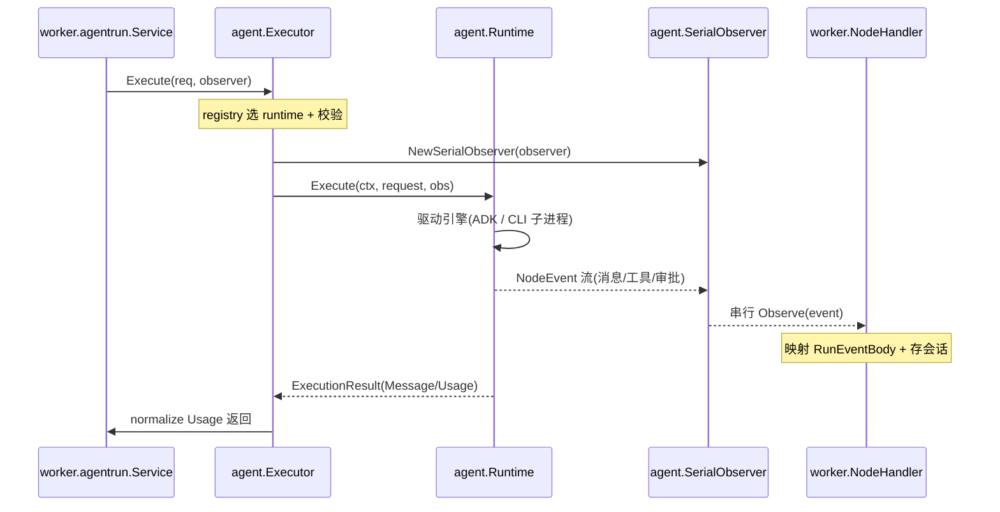

# Agent 多运行时执行层

> `backend/agent` 是 Leros **业务无关的独立执行契约层**：它把「一次任务执行」翻译成一个统一的中立事实流（NodeEvent），让 Worker 业务层可以透明地驱动四个异构 Agent 引擎 —— 内建 Eino、Claude Code、Codex CLI、OpenCode —— 而不被任何引擎的私有协议绑架。

## 在项目中的角色

去掉它，`worker/agentrun` 必须直接面对四种引擎的原生事件（Claude 的 stream-json、Codex 的 JSON-RPC、OpenCode 的 HTTP+SSE、Eino 的 ADK 流）。加一个引擎 = 改一处业务映射；换引擎 = 重写业务消费逻辑 —— 这直接摧毁「可替换、可审计」的立项根因。

架构文档对这块边界有一句极精准的界定（`docs/architecture/agent-runtime.md:11`）：

> Agent 层是独立运行层，只负责执行契约、Runtime 注册、Runtime 调用、工具接口、交互接口和强类型 `NodeEvent`。它不拥有业务 Run 生命周期，不发布 NATS，不分配业务 Seq，不读取业务 Session，也不上传 Plan 或 Artifact。

`Runtime` 的行为约束甚至直接以注释形式写进了接口（`backend/agent/runtime.go:96-100`）：

> Runtime MUST NOT: Emit run.started/completed/failed/cancelled events. Mutate ExecutionRequest. Access NATS, messaging, or Session persistence.

这条注释即「独立执行层」的行为宪法：引擎对业务与副作用零感知。

## 解决什么根因

Leros 要任选多个 Agent 引擎作为 AI 队友的后端，同时被同一 Worker 业务层统一调度。引擎在能力上是同质的（都能读文件、跑命令、写代码），但在过程表现上是异构的（事件格式、交互方式、会话模型全不同）。若不抽象，业务的每一次 Run 编排都会散落一堆引擎特判。

沉淀下来的三条设计意图：

1. **One Contract, Four Engines**：四个目录同级实现同一接口，引擎「可插拔」由注册表驱动而非代码分支驱动。
2. **Agent Decides, Does Not Execute → 执行层只产出事实**：Runtime 只发 `NodeEvent`，业务成败/取消/产物由 Worker Finalizer 兜底。
3. **Runtime First, Model Second**：把「由哪个引擎执行」提升为一级维度，模型只是 `ModelConfig` 里一个字段——运行时甚至排在模型之前。

## 设计思路

### NodeEvent 作为唯一执行契约，统一异构 Runtime

核心不是把四种事件映射成同一种，而是**只保留「执行节点事实」，砍掉一切引擎私有状态**（`backend/agent/node_event.go:14-36`）：

- **事件封闭化**：`NodeEventPayload` 是 sealed 接口，靠不可导出的 marker方法 `nodeEventPayload()` 强制实现封闭（`node_event.go:56-58`），防止业务侧跳向引擎私有 payload。
- **强类型 + 统一 envelope**：每个事件有 `ID/ExecutionID/TraceID/Type/OccurredAt/Payload/Metadata`（`node_event.go:40-48`），payload 是结构体而非裸 map。
- **秘密不进事件**：`NodeEventMetadata` 注释明确 "MUST NOT contain API Key, Authorization Header, or raw environment variables"（`node_event.go:50-52`）。
- **翻译责任留在各自 Adapter**：Claude 的 `stream_event`、Codex 的 `turn/diff`、OpenCode 的 `message.part.delta` 最终都落到 `agent.NewMessageUpdateEvent(...)`，公共共享层不堆 Provider 特例。

### 为什么用子进程驱动 CLI Runtime，而非库内嵌

三个外部引擎全部走 `internal/cli.Driver`（`runtime/internal/cli/runner.go:16-21`），以外部 CLI 二进制 + 子进程方式驱动，原因：

- **引擎是独立交付物**：各自版本化、可独立升级；内嵌进 Go 进程 = 被迫跟进上游 API + 二进制耦合 + 无法沙箱隔离。
- **隔离与鲁棒**：子进程崩溃/hang/kill 不影响 Worker 进程本身；`internal/process.CmdProcess.Stop` 做了 SIGTERM → 等待 → SIGKILL 的优雅关闭（`runtime/internal/process/process.go:53-88`）。
- **复用上游成熟能力**：Claude 的 `--output-format stream-json`、Codex 的 `app-server --listen stdio://`、OpenCode 的 `serve --port` HTTP。驱动「成品 CLI」比重实现它们的 agent 循环便宜得多。

**替代方案代价**：库内嵌省进程/管道开销但失去隔离与版本解耦；统一 JSON-RPC 协议最规整但 Claude/OpenCode 不原生暴露——Leros 反而跟随每个引擎的原生协议，把差异吸收进共享的 `internal/cli.Invocation`（公开 NodeEvent 流 + 内部控制状态分离）。

### native/Eino 仅内部实现细节

`runtime/native` 里的 Eino 不被当成公共架构：`New` 构造的 Runtime 包着一个 `Executor` 接口（`native/runtime.go:22-24`），真正的执行逻辑在 `Runner`，它把 Eino ADK 流适配成 NodeEvent（`native/runner.go:90-102` 的 `einoStreamSink`）。取舍：把 Eino 包成「另一个同等能力的 Runtime」，业务层不需要知道内建引擎内部是 Eino；`native` 不用 `MaxSteps` 公共契约——内建引擎不向外承诺步数控制语义。代价是 native 包内部与 Eino 绑定较深，换库时 native 全包重写。

## 关键数据结构

### NodeEvent 类型列表（公开契约，`backend/agent/node_event.go`）

| NodeEventType | 值 | 语义 |
|---------------|----|------|
| AgentStart / AgentEnd | `agent.start` / `agent.end` | 会话级起止，暴露 ProviderSessionID |
| MessageStart / Update / End | `message.start` / `message.update` / `message.end` | 助手文本生命周期 |
| ReasoningUpdate | `reasoning.update` | 推理增量 |
| ToolExecutionStart / Update / End | `tool_execution.*` | 工具调用生命周期 |
| TodoSnapshot / Updated | `todo.snapshot` / `todo.updated` | 待办快照/更新 |
| ApprovalRequested / Resolved | `approval.*` | 审批申请/结果 |
| QuestionAsked / Answered | `question.*` | 追问/回答 |
| PlanReady | `plan.ready` | 仅路径事实，Worker 负责读取/校验/上传 |

### ExecutionRequest 关键字段（`backend/agent/runtime.go:67-85`）

```go
type ExecutionRequest struct {
	ExecutionID string
	TraceID     string
	Runtime     string        // ← 引擎由数据驱动
	SessionKey  string
	InstanceKey string
	Mode        ExecutionMode
	SystemPrompt / Prompt / Messages
	Model           ModelConfig   // Provider / Model / APIKey / BaseURL
	Tools           []Tool
	MCPServers      []MCPServerConfig
	ExtraEnv        []string
	Policy          ExecutionPolicy   // PermissionMode / AllowedTools
	Filesystem      FilesystemContext // WorkDir/RepoDir/TaskDir/SkillDir
	ProviderSession ProviderSession   // ID / Resume
}
```

请求是「完全准备好、业务中立」的执行输入，API Key 允许出现在此供执行，但禁止流出到事件/日志。

### Runtime 接口（`backend/agent/runtime.go:101-104`）

```go
type Runtime interface {
	Name() string
	Execute(ctx context.Context, request ExecutionRequest, observer NodeObserver) (ExecutionResult, error)
}
```

四个引擎的 `Execute` 都实现它（native/claude/codex/opencode 各有 `var _ agent.Runtime = (*Runtime)(nil)` 编译期断言）。

## 核心流程

### 执行一个 Run



关键标注（{路径:行号}）：

| 步骤 | 位置 |
|------|------|
| Executor 构造/校验/选 Runtime | `backend/agent/executor.go:49-59` |
| SerialObserver 包裹 | `backend/agent/executor.go:63` |
| 调用 Runtime.Execute | `backend/agent/executor.go:65` |
| 外部 Runtime 统一入口 RunInvocation | `runtime/internal/cli/runner.go:50-116` |
| ConsumeEvents 逐事件转发/解析 | `runtime/internal/cli/runner.go:161-357` |
| native 事件发射 | `runtime/native/runner.go:61-68` |
| Worker 侧消费+映射 | `backend/internal/worker/agentrun/node_handler.go:44-68, 133-250` |

## 与其他模块协同

- **NodeHandler 即 observer**：`execute` 的 observer 落地为 `worker/agentrun.NodeHandler`。`Observe` 先把 AgentStart（持久化 ProviderSession）和 PlanReady（交 PlanPublisher）单列，其余转 `runEventBodyFromNode` 映射成 `messaging.RunEventBody` 交给 `journal.Record`（`node_handler.go:44-68`）。
- **双向交互端口**：approval/question 是 Agent→Worker→用户→回写闭环。Worker 的 `cmd.interaction` lane 接收 `approval.resolve`/`question.answer`；`cli.ConsumeEvents` 在收到 `approval.requested` 时调 `InteractionHandler.RequestApproval` 并把决策经 `Responder.WriteDecision` 写回子进程 stdin（`runner.go:232-267`）。
- **只发事实，不替业务作终态**：Runtime/Driver 的进程完成/失败/取消只是内部控制状态，不向 observer 发公开 NodeEvent——业务成败由 Worker Finalizer 定。

## 关键设计决策

**决策一：用「只发事实的 NodeEvent」而非「直接发业务 RunEvent」**

- 为何：把「执行是什么」与「执行对业务意味着什么」分离。消息增量是事实，「这条消息是否作为 RunResult 的一部分」是业务判断。`agent.start` 只用于持久化 ProviderSession，不映射为对外消息。
- 代价：多了 NodeEvent→RunEvent 一层映射（node_handler.go 承担），换来业务层引擎无关性。若让 Runtime 直接发业务事件，引擎会反向依赖业务语义，隔离被破坏。

**决策二：外部引擎一律子进程 + 各走原生协议**

- 选择：用子进程驱动三套外部引擎，跟随各自原生协议（Claude=stdin stream-json，Codex=stdio JSON-RPC，OpenCode=HTTP REST+SSE），差异收敛在 `internal/cli.Invocation`。
- 代价：三套协议各写翻译（claude/parser.go、codex/invoker.go、opencode/events.go），加上各引擎进程生命周期与健康检查实现，代码量明显偏大——这是「通用 vs 各家原生」里选了后者。

**决策三：native 把 Eino 彻底做成内部细节**

让内建引擎未来被替换成其他库而不动契约层。代价：native 内部与 Eino 绑定深（runner.go 直接用 adk/eino 类型），换库要重写 native 内部而契约不变。

## 亮点与问题

### 亮点

1. **契约层极薄、约束极硬**：Runtime 接口仅 2 个方法，约束写进注释作为行为宪法，用编译期断言钉死四个引擎。
2. **强类型 sealed 事件 + 构造器下沉**：`NodeEventPayload` sealed、每个事件有 `New*Event` 构造器（node_event.go:236-410），既防 payload 逃逸又统一创建入口。
3. **事件串行化与容错**：`SerialObserver` 即使并行工具完成也保证事件有序；`cli.ConsumeEvents` 对 approval/question 一次性完成「观察→回调→写回→补发 resolved/answered」。
4. **共享机制收敛干净**：`internal/cli|process|todo` 把 CLI 启动、进程优雅关闭、环境组装、MCP 注册、todo 归一化抽成公共基础。

### 问题 / 风险

1. **三套外部协议翻译 + 进程管理代码量明显偏高**：codex 的 JSON-RPC（jsonrpc.go + appserver.go + transport.go 近千行）、opencode 的 HTTP+SSE（server.go 1027 行）——典型「各家原生各写一遍」的成本。
2. **approval/question 回写依赖进程存活与 stdin 写成功**：`WriteDecision` 写到 stdin/JSON-RPC/HTTP reply，若子进程已退出则回写失败只记 Warn（runner.go:257-259），可能造成「用户已审批但引擎已死、决策丢失」的窗口。
3. **事件发送多为非阻塞 select+default 丢弃**：codex/opencode 的 emit 在通道满时静默丢弃增量（codex/invoker.go:524-531、opencode/invoker.go:423-431），高并发/慢消费者下可能丢增量文本。

> 覆盖：backend/agent 生产代码 100%（8165/8165）读取，达标。跨模块侧抽样读取 node_handler.go 取证。
