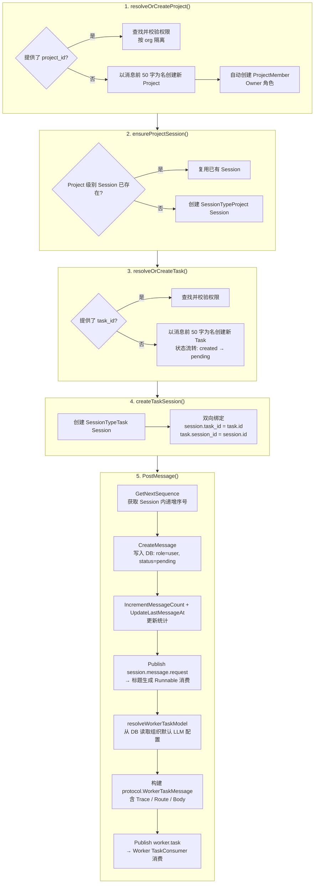
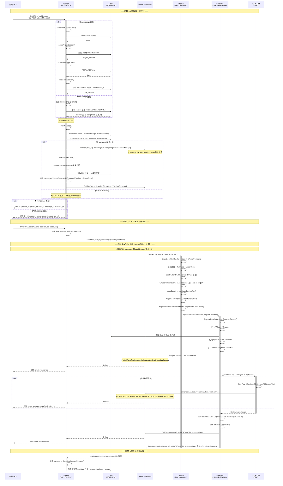
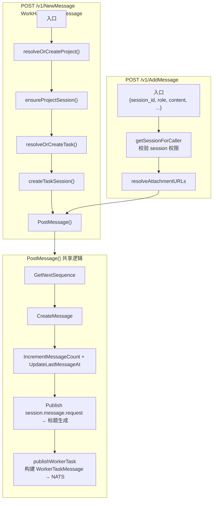
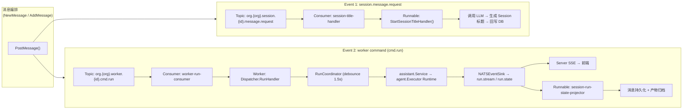

# Leros API 分析文档

> 分析 Leros 核心 API 的实现逻辑、数据流、关键设计。后续持续追加其他 API。

---

## 1. 消息类 API

消息类 API 包含两个入口：`NewMessage`（新消息入口，自动创建完整上下文树）和 `AddMessage`（已有会话追加消息，复用上下文）。两者共享核心的 `PostMessage()` 逻辑。

### 实现文件索引

| 文件 | 职责 |
|------|------|
| `backend/internal/api/handler/work_handler.go:41-55` | `POST /v1/NewMessage` Handler |
| `backend/internal/api/handler/session_handler.go:279-293` | `POST /v1/AddMessage` Handler |
| `backend/internal/service/message_poster.go:91-152` | `RunNewMessage()` 5 步编排 |
| `backend/internal/service/message_poster.go:40-89` | `PostMessage()` 共享逻辑 |
| `backend/internal/service/message_poster.go:314-402` | `publishWorkerTask()` 构建并发布 WorkerCommand |
| `backend/internal/service/session_service.go:257-281` | `AddMessage()` 实现 |
| `backend/internal/service/assistant_inferrer.go:7-9` | `AssistantInferrer` 接口定义 |
| `backend/internal/service/assistant_inferrer.go:21-33` | `DefaultAssistantInferrer` 默认实现 |
| `backend/pkg/messaging/command.go:83-96` | `RunCommandPayload` 类型定义（原 `protocol.WorkerTaskMessage`） |
| `backend/pkg/messaging/envelope.go:50-61` | `Envelope[T]` 泛型信封 |
| `backend/internal/api/contract/work_type.go:7-25` | `NewMessageRequest` / `NewMessageResponse` |

### 1.1 NewMessage — 消息入口 API

#### 1.1.1 基本信息

| 项目 | 内容 |
|------|------|
| 路由 | `POST /v1/NewMessage` |
| Handler | `WorkHandler.NewMessage`（`backend/internal/api/handler/work_handler.go`） |
| Service | `RunNewMessage()`（`backend/internal/service/message_poster.go:92-152`） |
| 定位 | 消息入口，承担"用户发一条消息 → 自动编排项目/会话/任务 → 持久化 → 异步触发 Worker 执行"的完整转换 |
| 幂等性 | 非幂等，每次调用都会创建新的 Message/Task/Session（除非显式传入已存在的 `project_id` / `task_id`） |

#### 1.1.2 请求 / 响应

**请求示例:**

```
POST /v1/NewMessage
Content-Type: application/json

{
  "content": "帮我分析下这个项目的架构",
  "project_id": "proj_xxx",     // 可选，不传则自动创建
  "task_id": "task_xxx",        // 可选，不传则自动创建
  "assistant_id": 1,            // 可选，指定数字员工，不传则由系统分配
  "message_type": "text",       // 可选，消息类型，默认 "text"
  "objective": "",              // 可选，任务目标
  "attachments": [...]          // 可选，附件列表
}
```

**成功响应:**

```
200 OK

{
  "session_id": "sess_xxx",
  "project_id": "proj_xxx",
  "task_id": "task_xxx",
  "message_id": "msg_xxx",
  "assistant_id": 1
}
```

客户端收到 `session_id` 后，发起 `POST /v1/SessionEvents` 建立 SSE 连接接收流式响应。

**错误响应:**

```
4xx/5xx
{
  "error": "...",
  "code": "..."
}
```

#### 1.1.3 5 步原子编排

`RunNewMessage()` 包含 5 个顺序执行步骤，整个编排是事务性的——任意步骤失败则请求失败，不产生脏数据。



**与 AddMessage 的对比：** NewMessage 执行完整的 5 步，AddMessage 直接进入第 5 步 `PostMessage()`，跳过前 4 步资源编排。

#### 1.1.4 核心交互时序

从客户端发起请求到收到最终响应的完整跨进程交互。时序图中用 `alt` 块展示 NewMessage 和 AddMessage 两条路径的分叉与汇合：



### 1.2 AddMessage — 会话追加消息 API

#### 1.2.1 基本信息

| 项目 | 内容 |
|------|------|
| 路由 | `POST /v1/AddMessage` |
| Handler | `SessionHandler.AddMessage`（`backend/internal/api/handler/session_handler.go`） |
| Service | `sessionService.AddMessage()`（`backend/internal/service/session_service.go:257-281`） |
| 定位 | 已有会话的追加消息入口，复用已存在的 Project/Task/Session 上下文树 |
| 请求方式 | `session_id` 在请求 JSON Body 中（非 URL 路径参数） |

#### 1.2.2 AddMessage 实现逻辑

AddMessage 是 NewMessage 的精简版本——它假设 Project/Task/Session 上下文已存在，直接进入消息处理流程：

```
SessionHandler.AddMessage(ctx)
  │
  ├─ 0. 从 Body 解析 JSON: {session_id, role, content, ...}
  │
  ├─ 1. getSessionForCaller() — 校验 Session 存在且当前用户有操作权限
  │
  ├─ 2. resolveAttachmentURLs() — 解析附件 URL
  │
  └─ 3. NewMessagePoster.PostMessage(ctx, session, buildMessage)
         ├─ buildMessage() 组装 types.SessionMessage
         └─ 与 NewMessage 完全相同的消息持久化 + NATS 发布逻辑
```

**请求示例:**

```
POST /v1/AddMessage
Content-Type: application/json

{
  "session_id": "sess_xxx",
  "role": "user",
  "content": "继续分析",
  "message_type": "text",
  "attachments": [...]
}
```

**成功响应:**

```
200 OK

{
  "id": "42",
  "session_id": "sess_xxx",
  "role": "user",
  "content": "继续分析",
  "sequence": 3,
  "message_type": "text",
  "timestamp": 1718611200000,
  "created_at": "2026-06-17T00:00:00Z"
}
```

#### 1.2.3 NewMessage vs AddMessage 对比



| 维度 | NewMessage | AddMessage |
|------|-----------|------------|
| 路由 | `POST /v1/NewMessage` | `POST /v1/AddMessage` |
| Handler | `WorkHandler.NewMessage` | `SessionHandler.AddMessage` |
| 前置操作 | 5 步原子编排（Project → Session → Task → TaskSession → PostMessage） | 校验 session 权限 + resolveAttachmentURLs → PostMessage |
| 是否创建 Project | 是（自动） | 否 |
| 是否创建 Task | 是（自动） | 否 |
| 是否创建 Session | 是（自动） | 否（从请求 Body 传入） |
| session_id 传递方式 | 响应返回 | 请求 Body 传入 |
| 请求必填字段 | `content` | `session_id` + `role` + `content` |
| 消息持久化 | 通过 PostMessage() | 通过 PostMessage()（共享同一函数） |
| NATS 事件发布 | 通过 PostMessage() | 通过 PostMessage()（共享同一函数） |
| Worker 执行 | 完全一致 | 完全一致 |
| 响应内容 | `{session_id, project_id, task_id, message_id, assistant_id}` | 完整的 `contract.SessionMessage`（含 id, session_id, role, content, sequence 等） |
| 使用场景 | 用户首次对话 | 用户在已有会话中继续对话 |

#### 1.2.4 设计意图

两个 API 的设计体现了"分而治之"的职责划分：

- **NewMessage** 是"一站式入口"，降低了客户端的复杂度——用户不需要理解 Project/Task/Session 的层次结构，一条消息自动构建完整上下文树。这适合第一次使用的场景，也是 CLI `leros chat` 命令的调用方式。

- **AddMessage** 是"快捷入口"，假设上下文已就绪，省去资源编排的开销。这适合前端在已有会话中继续对话的场景——用户已经在聊天界面中，session_id 已知，不需要重新创建任何资源。

本质上，`NewMessage` 做了 `AddMessage` 全部的工作，外加一个资源编排的前置阶段。两者在后半段（PostMessage → NATS → Worker → SSE）的路径完全重合。

### 1.3 PostMessage 子步骤详解

`PostMessage()` 是消息类 API 的核心逻辑，NewMessage 和 AddMessage 都调用它。包含消息持久化和事件触发两部分：

```
PostMessage(ctx, buildMessage func(sequence) *SessionMessage)
  │
  ├─ 1. db.GetNextSequence(ctx, db, session.ID)
  │      └─ DB SELECT MAX(sequence)+1 WHERE session_id = ?
  │
  ├─ 2. buildMessage(seq) 返回消息体，然后:
  │      ├─ message.SessionID = session.ID
  │      ├─ message.MessageType 默认 "text"
  │      └─ db.CreateMessage(ctx, db, message)
  │
  ├─ 3. db.IncrementMessageCount(ctx, db, session.ID)
  │      └─ UPDATE sessions SET message_count = message_count + 1
  │
  ├─ 4. db.UpdateLastMessageAt(ctx, db, session.ID, now)
  │      └─ UPDATE sessions SET last_message_at = NOW()
  │
  ├─ 5. Publish SessionMessageRequest（仅当 session.OrgID > 0）
  │      ├─ Topic: SessionMessageRequestSubject(orgID, session.PublicID)
  │      ├─ Payload: 完整的 types.SessionMessage 实体
  │      └─ Consumer: session_title_handler (Runnable)
  │           └─ 按需调用 LLM 生成标题
  │
  └─ 6. publishWorkerTask(ctx, session, message)  ← 核心异步触发
         ├─ [条件] 若 session.AssistantID == 0 && session.AllocatedAssistantID == 0
         │    └─ 调用 InferAssignedAssistantID(orgID, sessionType)
         │         └─ 当前: 硬编码返回 1, 未来: 智能推断
         │    └─ 若有分配, 回写 DB: UpdateAllocatedAssistantID
         │
         ├─ [守卫] 若 AllocatedAssistantID == 0
         │    └─ 跳过, 不发布 WorkerTask（Log 记录）
         │
         ├─ 构建 WorkerTaskTopic: WorkerTaskSubject(orgID, allocatedAssistantID)
         │
         ├─ resolveWorkerTaskModel(ctx, orgID)
         │    └─ 从 DB 读取组织默认 LLM 配置
         │    └─ 校验 provider / modelName / apiKey 非空
         │
         ├─ 构建 protocol.WorkerTaskMessage
         │    ├─ ID: "msg_{session.ID}_{message.Sequence}"
          │    ├─ Type: "worker.command"
          │    ├─ Trace: {TraceID=session.PublicID, RequestID, TaskID, RunID}
          │    ├─ Route: {OrgID, SessionID, WorkerID}
          │    ├─ Body: {
          │    │     CommandType: "agent.run",
          │    │     Payload: {
          │    │       TaskType:   "agent.run",
          │    │       Actor:      {UserID, DisplayName, Channel},
          │    │       Workspace:  {ProjectID, TaskID},
          │    │       Input:      {Type: "message", Messages: [{role, content}], Attachments: [...]},
          │    │       Model:      {Provider, Model, BaseURL, APIKey}
          │    │     }
          │    │   }
          │    └─ Metadata: {session_id, message_type, sequence}
          │
          └─ eventbus.Publish(ctx, WorkerCommandSubject(orgID, workerID, LaneRun), msg)
```

### 1.4 异步事件流与消费者映射

消息编排完成后产生两条独立的事件流：



**完整消费者列表:**

| Consumer | 订阅主题（通配符） | 所属进程 | 用途 |
|----------|-------------------|----------|------|
| `worker-run-consumer` | `org.*.worker.*.cmd.run` | Worker | 接收 Agent 执行命令，调度执行 |
| `worker-control-consumer` | `org.*.worker.*.cmd.control` | Worker | 接收取消/控制命令 |
| `worker-interaction-consumer` | `org.*.worker.*.cmd.interaction` | Worker | 接收审批/问答交互 |
| `worker-skill-consumer` | `org.*.worker.*.cmd.skill` | Worker | 接收技能管理命令 |
| `session-run-state-projector` | `org.*.session.*.run.state` | Server (Runnable) | 持久化运行状态、消息、产物

**通配符匹配说明:**
- `org.*.worker.*.cmd.run` → 匹配 `org.abc.worker.1.cmd.run`、`org.xyz.worker.2.cmd.run` 等任意 orgID 和 workerID
- `org.*.session.*.run.*` → 匹配任意 orgID 和 sessionID 下的所有运行事件
- Worker 和 Server 共享同一个 NATS 集群，通过 Stream 隔离：`WORKER_CMD_STREAM`（Server → Worker）、`SESSION_RUN_STREAM`（Worker → Server/UI）

### 1.5 关键设计要点

#### 1.5.1 无状态客户端友好

用户不需要预先创建 Project / Task / Session，一条消息自动构建完整上下文树：
- 消息前 50 字自动命名 Project 和 Task
- 自动分配 Owner 角色和权限
- 前端只需调用一个接口即可开始工作

#### 1.5.2 同步写 + 异步执行

| 操作 | 时机 | 方式 |
|------|------|------|
| DB 写入（Project/Task/Session/Message） | 编排中 | 同步，失败则整体回滚 |
| LLM 推理 | 编排后 | 异步，通过 NATS 触发 |
| 标题生成 | 编排后 | 异步，独立 Runnable |
| 回复持久化 | Agent 完成后 | 异步，session_completed Runnable |

#### 1.5.3 两阶段 Session 模型

| Session 类型 | 创建时机 | 生命周期 |
|-------------|---------|---------|
| `SessionTypeProject` | 步骤 2, 每个 Project 一个 | Project 存续期间 |
| `SessionTypeTask` | 步骤 4, 每个 Task 一个 | Task 存续期间 |

Project Session 用于维护项目级别的协作上下文（所有 Task 共享），Task Session 用于单次对话的消息序列。

#### 1.5.4 Worker 的消峰与去重

Worker 端 Worker 的三层处理机制：

```
WorkerCommand (cmd.run) → [1] Dispatcher.RunHandler
                                   解码 + 校验 (route/model/taskType)
                                  → [2] SeqTracker (SQLite)
                                    track processed_seq，防止 NATS 重投
                                  → [3] RunCoordinator (1.5s debounce)
                                    按 session_id 合并连续命令
                                  → [4] WorkerPool (20)
                                    控制并发度
                                  → [5] assistant.Service
                                    Preparer → Executor → Finalizer
```

#### 1.5.5 WorkerCommand 数据结构

```go
// WorkerCommand 是 Server → Worker 的统一命令消息
type WorkerCommand = Envelope[WorkerCommandBody]

// Envelope 是 MQ Topic 上的通用领域消息信封
type Envelope[T any] struct {
    ID        string            `json:"id"`
    Type      MessageType       `json:"type"`
    CreatedAt time.Time         `json:"created_at"`
    Trace     TraceContext      `json:"trace"`
    Route     RouteContext      `json:"route"`
    Body      T                 `json:"body"`
    Metadata  json.RawMessage   `json:"metadata,omitempty"`
}

type WorkerCommandBody struct {
    CommandType CommandType     `json:"command_type"` // "agent.run" | "run.cancel" | "approval.resolve" | ...
    Payload     json.RawMessage `json:"payload,omitempty"`  // RunCommandPayload / CancelRunCommandPayload / ...
    ReplyTo     string          `json:"reply_to,omitempty"` // NATS inbox for request/reply
}

// RunCommandPayload 是 agent.run 命令的 payload
type RunCommandPayload struct {
    TaskType      TaskType         `json:"task_type"`
    ExecutionMode string           `json:"execution_mode,omitempty"`
    Actor         ActorContext     `json:"actor"`
    Execution     ExecutionTarget  `json:"execution"`
    Workspace     WorkspaceOptions `json:"workspace,omitempty"`
    Input         TaskInput        `json:"input"`
    Model         ModelOptions     `json:"model,omitempty"`
    Runtime       RuntimeOptions   `json:"runtime,omitempty"`
    Policy        TaskPolicy       `json:"policy,omitempty"`
}
```

这个数据结构携带了 Worker 执行所需的所有上下文——Trace 用于链路追踪，Route 用于路由，Body 包含实际执行参数，无需 Worker 反查 DB。

#### 1.5.6 NATS Stream 隔离策略

| Stream | 包含 Subjects | 保留策略 | 用途 |
|--------|-------------|---------|------|
| `WORKER_CMD_STREAM` | `org.*.worker.*.cmd.>` | 72h, 200/subject | 任务分发，重要不可丢失 |
| `SESSION_RUN_STREAM` | `org.*.session.*.run.>` | 24h, 10000/subject | 运行事件，高吞吐可丢部分 |

---

### 1.6 前端调用链

```
用户输入消息
  │
  ├─ 首次对话: workApi.newMessage(payload)
  │    └─ POST /v1/NewMessage → 获得 {session_id, project_id, task_id, message_id, assistant_id}
  │
  ├─ 已有会话: sessionApi.addMessage(params)
  │    └─ POST /v1/AddMessage {session_id, role, content, ...}
  │         └─ 获得完整 SessionMessage {id, session_id, role, content, sequence, ...}
  │
  ├─ startSSE(session_id)
  │    └─ POST /v1/SessionEvents {session_ids: [sess_xxx]}
  │         └─ 建立 SSE 连接
  │
  └─ chatSlice 事件分发 (frontend/packages/store/slices/chatSlice.ts:882-944)
       ├─ run.started       → markRunStarted()
       ├─ message.delta     → appendStreamingContent(content)
       ├─ reasoning.delta   → appendReasoningContent(content)
       ├─ tool_call.started → addToolCall({id, name, arguments})
       ├─ tool_call.delta   → updateToolCallDelta({id, content})
       ├─ tool_call.completed → updateToolCallStatus({id, result})
       ├─ tool_call.failed  → updateToolCallStatus({id, error})
       ├─ todo.snapshot     → setTodos(items)
       ├─ todo.updated      → setTodos(items)
       ├─ artifact.declared → addArtifact(artifact)
       ├─ approval.requested → addApproval(request)
       ├─ approval.resolved → removeApproval(request_id)
       ├─ run.completed     → markCompleted() + stopSSE()
       └─ run.failed        → markFailed() + stopSSE()
```


