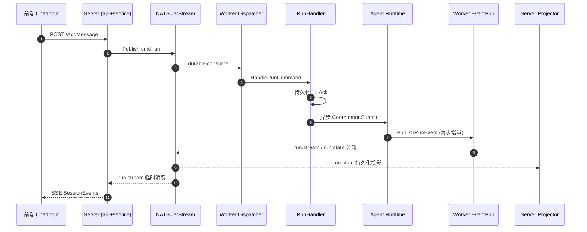

# 四平面架构与事件驱动

> Leros 的骨架：一套**事件驱动的分布式 Agent 执行系统**。控制面（Server）与执行面（Worker）是两个独立进程，靠 NATS JetStream 事件总线解耦。所有模块之间只能通过 Event Bus 通信 —— 这是系统可扩展、可审计、可演进的根因。

## 在项目中的角色

去掉这套总线，Leros 会退化成两条互不相通的死路：

- **Server 侧**：用户消息无处可发。`MessagePoster` 的唯一出口就是「把 RunCommand 投到 NATS subject」（`backend/internal/service/message_poster.go:945` 的 `p.eventbus.Publish(ctx, topic, cmd)`）。
- **Worker 侧**：Agent Runtime 跑出的每步增量（message.delta / tool_call.* / todo.*）无处回流。`NATSEventPublisher` 是 Worker 向外输出的唯一通道（`backend/internal/worker/eventpub/nats_publisher.go:50`）。
- **SSE 实时面**：前端的两条流（GlobalEvents + SessionEvents）全部由 Service 消费 NATS subject 驱动；没有 bus 就没有实时推送。
- **一致性**：`session_run_state_projector` 依赖 JetStream 持久化做断点续传与回放（`backend/internal/runnable/session_run_state_projector.go:36`）。

一句话：bus 是「Control/Execution 分离」与「Stateless Worker」的物化载体 —— Worker 不存状态，任务经 JetStream 投递、Worker 只做短暂执行，崩溃后由 stream 重放。

## 解决什么根因

对话式 AI 的根本缺陷是**结束即清零、产出无法管理**。要变成「可指派、可验收、可追踪」的劳动力，就必须把一次 Chat 拆成「一次可恢复的异步 Run」。这带来三个痛点，事件总线逐一回应：

| 痛点 | 事件驱动方案 |
|------|-------------|
| Server 判死、Worker 计算，两者是不同生命周期进程 | 跨进程解耦靠消息，禁止直调 |
| Run 是长任务，会跑几分钟，期间需要实时反推 AI 过程 | `run.stream`（高频增量）+ `run.state`（低频关键态）按 QoS 分 lane |
| Worker 可随时被销毁重建（Stateless Worker） | JetStream FileStorage 持久化 + at-least-once 投递 + Worker 本地 SQLite inbox 崩溃恢复 |

## 设计思路

### 为什么用 NATS JetStream，而非简单队列

- **持久化 + 回放**：`SubscribeFrom` 用 `DeliverByStartSequence` 支持断点续传；SSE replay 完全靠 stream 序号推进（`backend/internal/service/session_service.go:786-801` 从 message.metadata 读出 state_start_seq）。
- **FileStorage + Retention + 幂等**：`StreamConfigs` 里每个 stream 都强制 `Storage: nats.FileStorage`、`MaxMsgsPerSubject`、`DiscardOld`（`backend/pkg/messaging/subject.go:190-238`）。
- **精确确认语义**：`ManualDelivery` 抽象出 `Ack / Nak / NakWithDelay / Term / InProgress`（`backend/internal/infra/mq/delivery.go:14-36`），Redis/内存队列拿不到这套投递语义。
- **subject 天然路由 + 租户隔离**：subject 首段固定 `org.<org_id>.worker.<worker_id>.cmd.<lane>`，无需额外路由表。

**放弃的替代方案**：普通内存队列（丢消息、无多实例语义）；单机 Redis Stream（缺 NATS 的 subject 通配与 consumer 断点续传生态）；直接 HTTP 回调（丢消息无补偿、Worker 漂移无法重投）。设计上是「让消息队列当数据库使」——stream 成为事件的事实来源。

### subject / lane 契约统一生成（最精巧的一点）

**Subject 拼装完全不靠手搓字符串，全部收敛到 `backend/pkg/messaging/subject.go` 这一个契约层**：`WorkerCommandSubject`（:16）、`RunEventSubject`（:39）、`ProjectNotifySubject`（:70）、`LLMUsageSubject`（:90），每个都带参数校验（org_id/worker_id/session_id/lane 为空即 error）。

消费端只引用 wildcard 常量（`WorkerCommandWildcard()` 等），与生产端用同一套生成器，从根上消灭「Server 拼 cmd.run、Worker 拼 org.1.worker.2.run」这种错位。证据：

- Server 生产 `cmd.run`：`message_poster.go:824` 用 `messaging.WorkerCommandSubject(orgID, workerID, messaging.LaneRun)`
- Worker 消费 `cmd.run`：`backend/internal/worker/command/dispatcher.go:135` 用同一函数
- Server 消费 `run.state`：`runnable/session_run_state_projector.go:43` 用 `RunEventStateWildcard()` → `org.*.session.*.run.state`

**lane 语义分层**（`pkg/messaging/command.go:29-33` + `event.go:63-68`）：

```
Server → Worker（命令方向，cmd.go）:
  cmd.run        会话/task 执行命令，session-keyed debounce
  cmd.control    cancel run 控制命令，不经过防抖
  cmd.interaction  approval resolve / question answer
  cmd.file       project file restore，request/reply

Worker → Server/UI（事件方向，event.go）:
  run.stream     高频 SSE 增量（message/reasoning/tool delta）
  run.state      低频关键状态（run.started、artifact、approval、terminal）
```

事件归属 lane 由 `ClassifyRunEvent`（`pkg/messaging/event.go:72-93`）统一决定，是 worker 发布侧与 server 消费侧共享的同一套逻辑，保证事件不会「放错 lane」。

### Consumer 命名：持久化 consumer + wildcard 路由

Consumer 名称同样收敛在 messaging 契约层：按 org/worker/lane 隔离的 `WorkerLaneConsumer(orgID, workerID, lane)`（`subject.go:146-159`），保证一个 worker 一个 independent consumer、重启不互踢；Server 投影用进程级 `SessionRunStateConsumer()`（`subject.go:163`）。

`Subscribe` 在 `consumer == ""` 时用临时消费者 `OrderedConsumer`（`AckNone`），非空时用 `Durable + ManualAck`（`backend/internal/infra/mq/nats.go:207-209, 318-329`）。高频 stream lane 恰好用空 consumer（`session_run_stream_projector.go:25`），因为它只做「记一个 start seq」的轻活，不需要持久化游标。

## 关键数据结构

### EventBus 抽象层（`backend/internal/infra/mq/bus.go:13-36`）

```go
type Publisher interface {
    Publish(ctx context.Context, topic string, event any) error
    Request(ctx context.Context, topic string, event any) (*nats.Msg, error)
}
type Subscriber interface {
    Subscribe(ctx, topic, consumer string, handler func(*nats.Msg)) error
    SubscribeFrom(ctx, topic string, startSeq int64, handler func(*nats.Msg)) error
    SubscribeManualDurable(ctx, topic, consumer string, handler func(*nats.Msg)) error
}
type EventBus interface { Publisher; Subscriber }
```

### 手动确认语义（at-least-once 关键，`backend/internal/infra/mq/delivery.go:14-36`）

```go
type ManualDelivery interface {
    Metadata() (*Metadata, error)   // Stream/Consumer 序列号 + NumDelivered
    Ack() error
    Nak() error
    NakWithDelay(delay time.Duration) error
    Term() error                    // 永久错误，不再重投
    InProgress() error              // 延长确认超时
}
```

### 消息信封（跨进程契约，`backend/pkg/messaging/envelope.go:63-72`）

`Envelope[T]` 承载 `ID` / `Type`（worker.command | run.event）/ `CreatedAt` / `Trace` / `Route`（org/session/worker，租户隔离）/ `Body` / `Metadata`。Command 侧 `WorkerCommand = Envelope[WorkerCommandBody]`；Event 侧 `RunEvent = Envelope[RunEventBody]`，body 带 `Seq`（应用层序号，用于跨 lane 去重）——它与 JetStream 的 Stream 序号是两套：state projector 用 `meta.Sequence.Stream` 记游标，SSE 用 `Body.Seq` 去重。

### JetStream Stream 配置（`backend/pkg/messaging/subject.go:190-238`）

```go
const (
    StreamNameWorker       = "WORKER_CMD_STREAM"    // server→worker 命令，72h
    StreamNameSession      = "SESSION_RUN_STREAM"   // worker→server 事件，24h
    StreamNameGlobalNotify = "GLOBAL_NOTIFY_STREAM" // 全局通知，24h
    StreamNameLLMUsage     = "LLM_USAGE_STREAM"     // LLM usage 上报，72h
    StreamNameSkillPackage = "SKILL_PACKAGE_STREAM" // skill 包，72h
)
```

统一 `Retention: LimitsPolicy`、`Discard: DiscardOld`（积压删最旧，保证新命令永远能写入）。

## 核心流程

### 一次用户消息到 SSE 反推的完整事件流



关键标注（{路径:行号}）：

- **Server 生产命令**：`message_poster.go:824` 构造 cmd.run subject；`:893` `NewRunCommand` 装载 RunCommandPayload + Route/Trace；`:945` `Publish`。
- **Worker 消费命令**：`backend/internal/worker/command/dispatcher.go:126` 定义四 lane 的 consumer，run lane 标 `manual=true`；`:135` 拼 subject；`:147` `SubscribeManualDurable`。
- **at-least-once**：`backend/internal/worker/command/run/handler.go:305` `PutIfAbsent` 幂等入库后才 `Ack`；`:312-318` 已 terminal 直接 Ack；永久错误 `Term`、inbox 失败 `NakWithDelay(5s)`。崩溃后 `RecoverNonTerminal`（handler.go:490，worker.go:324 启动时调用）从 inbox 恢复非终态任务。
- **Worker 生产事件**：`backend/internal/worker/eventpub/nats_publisher.go:37` 用 `ClassifyRunEvent` 定 lane；`:38` 拼 `org.{org}.session.{sid}.run.{lane}`；`:50` Publish；`:63-67` 终端事件用 `withoutCancel + 5s timeout` 的 context，保证 run.completed/failed/cancelled 一定发得出去。
- **Server 状态投影（写库）**：`backend/internal/runnable/session_run_state_projector.go:36` 启动；`:49` `Subscribe` run.state wildcard；`:96` switch 事件类型 → run.started / artifact.declared（幂等）/ run.completed 生成 assistant 终态消息。
- **Server SSE 消费（不落库，实时转发）**：`session_service.go:754` `StreamSessionEvents`；`:867` 订阅 run.stream、`:872` 订阅 run.state；`:822-850` 按 `Body.Seq` 跨 lane 去重 + 终端事件触发 `innerCancel()` 关流；`:886` 把 RunEvent 投影成前端 `SessionEvent`。
- **全局通知流**：`session_service.go:926` `StreamGlobalEvents` 订阅 `org.{org}.project.*.notify` wildcard，handler 内 `db.IsProjectUserMember` 做成员鉴权（:945），带背压写。

前端先建立 GlobalEvents 长连接，收到 `message.created`(assistant) 带 runId 后，才启动 SessionEvents 订阅 run.stream/state —— 这个「开流信号 → 消费正文」的时序完全由事件驱动，前端不轮询。

## 与其他模块协同

- **Worker 进程内直调**：事件驱动并非全盘事件 —— 设计哲学明示「Runtime 内部（同进程）用函数调用，Runtime 外部（跨服务）用事件驱动」。Dispatcher 拿到 cmd 后通过 `Coordinator.Submit`（handler.go:289）**直调** `agentrun.Service`，不再走消息。跨进程一律走 bus。
- **Server 三类投影消费者**（router.go:198-210 集中启动）：`session_run_state_projector`（落库 session/artifact/plan）、`session_run_stream_projector`（只记首个流事件的 stream seq，供 SSE replay 定位起点）、`skill_package_consumer`（用 `SubscribeManualDurable`）。

## 关键设计决策与权衡

**决策一：FileStorage + LimitsPolicy + DiscardOld**

- 权衡：FileStorage 换持久性 vs MemoryStorage 换速度。任务命令和事件流都要在崩溃后重放，只有 FileStorage 够格。
- 代价：SSE 高频 run.stream 也进 FileStorage（24h 保留 + 10000 上限 + DiscardOld 防膨胀）；高频事件写盘有 IO 开销。对可靠性不敏感的 stream-start-seq 记录，已改用空 consumer（内存/临时）的轻量方案。

**决策二：Worker 本地 SQLite inbox + NATS stream 双持久化拿 at-least-once**

- 权衡：NATS durable consumer 只保证「消息不丢」，不能保证「消息被处理成功」——handler 可能入库一半就崩。inbox 的 `UNIQUE(topic, stream_seq)` 幂等 + `GetNonTerminal` 重启恢复补齐这一环。
- 代价：这看似与「Stateless Worker」哲学冲突。设计者的折衷：**inbox 是短期的执行登记账本，不是业务状态，可清空随 Worker 删**；真正的业务事实状态（session message/artifact）全部外置在 Server 投影层。即「把短暂登记与业务状态分离」。

**决策三：Request/Reply 用 JetStream + Reply inbox 注入 body**

- 证据：`nats.go:239` 注释明说 "JetStream does not preserve the NATS Reply header on delivered messages"，因此用 `injectReplyTo`（nats.go:282）把 inbox 塞进 JSON body 的 `body.reply_to`（command.go:65）。
- 权衡:若改用普通 NATS Request/Reply（不持久化），会丢失「命令先落库再投递」的 at-least-once 诉求。

## 亮点与问题

### 亮点

1. **subject 契约收敛、零手搓字符串**：所有 subject 生成/校验、consumer 命名、stream 配置、事件→lane 分类全在 `pkg/messaging` 一处。可直接迁移到任何多语言/多团队事件架构。
2. **按 QoS 分 lane（stream/state）**：高频可丢与低频必达物理隔离，用不同 consumer 语义实现，无需应用层写优先级。
3. **双写投影 + 序号分离**：SSE 用应用级 `Body.Seq` 去重、用 JetStream `Stream seq` 定 replay 游标，分工清晰。
4. **terminal 事件发布兜底**：`terminalPublishContext`（eventpub:69-74）用 `withoutCancel + 5s timeout`，确保 run 结束事件不因上游 ctx 取消而丢失。

### 问题 / 风险

1. **`pkg/event`（connector 事件）是悬空路径**：`interaction.github.*` subject 没有任何 JetStream stream 覆盖（subject.go:190 无此 stream），但 GitHub/GitLab connector 确实在经 `eventbus.Publisher` 发布（`webhook.go:63`）。要么这段发布是失效路径，要么存在未发现的消费方。这是「双事件体系」的第一嫌疑点，GitHub 自动化闭环的实际落地待确认。
2. **run.stream 高频写 FileStorage**：单 subject 10000 上限，长推理/长工具序列若超上限，`DiscardOld` 会丢最早增量，SSE replay「缺预告」。
3. **单进程单 Server 消费 run.state**：state projector 用固定 durable consumer，若 Server 多副本部署会抢同一 consumer 造成重复/分片问题，当前隐含「单控制面」假设。

> 覆盖：核心 mq 层、messaging 契约层、runnable 投影层、worker eventpub/dispatcher/inbox、api SSE 端点、连接器 webhook 100% 精读；大文件（session_service.go、message_poster.go、session_handler.go）按需读取关键段。整体约 69%（标准深度 ≥60% 达标）。
