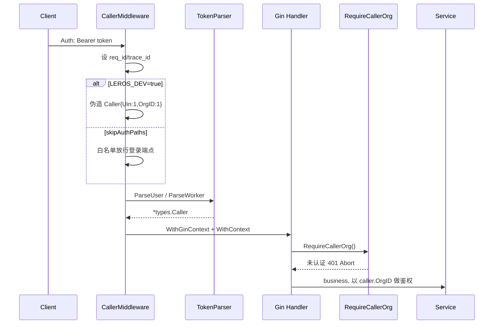
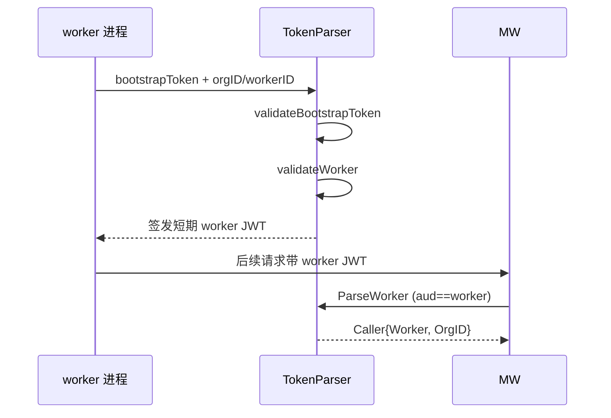

# 认证与治理

> Leros「企业级」定位的地基：没有它，任何请求都无法区分「是谁操作」「属于哪个租户」「有没有权限读写某资源」。最值得一提的手法是用**编译期 build tag** 把「开源版内置认证」与「企业版委托 IAM」两种形态从源码层隔离开。

## 在项目中的角色

去掉认证与治理：所有 `/v1/*` 业务接口失去身份来源（`types.Caller` 的 Uin/OrgID/WorkerID 为空），多租户 org scope 校验全部失效；Worker / AI 助手的服务进程无法认证，AI teammate 无法以受控身份执行任务；## 企业内部部署无法对接已有 IAM。它决定系统能否被企业采用，是治理能力的核心开关。

## 解决什么根因 —— 为什么用 build tag 而不是运行时配置

要服务的两种形态语义冲突不可调和：

1. **开源版（builtin/oss）**：内置认证开箱即用——邮箱/手机注册登录、bcrypt、本地 refresh token、短验证码。
2. **企业版（enterprise）**：认证委托独立 IAM，登录/鉴权/组织员工主数据以 IAM 为准。

oss 自己管密码哈希/refresh token/验证码（需全套密钥与本地表）；enterprise 全部外包 IAM。若运行时「按配置切换」，必须在每处维护两套分支，接口签名/token 结构互相纠缠极易污染。

**编译期隔离的落地**：同一目录两个文件都定义 `NewEdition(cfg Config) Edition`，靠 `//go:build` 只编译其一：

- `edition_oss.go:1`：`//go:build !enterprise`
- `edition_enterprise.go:1`：`//go:build enterprise`

由此获得：**零运行时 `if edition == "enterprise"` 分支**；两实现各自 import 完全不同的依赖，互不编译互不污染；**误混入另一版依赖会编译失败**，从类型系统杜绝运行时错配。

对比最有力的一行：`APIKeyIssuer` 在 oss 返回 `nil`（无能力），enterprise 返回 IAM client（`edition_oss.go:34` vs `edition_enterprise.go:37`）。

对外统一门面（`backend/internal/adapter/edition.go:10-20`）：

```go
type Edition interface {
	Auth() account.AuthProvider
	User() account.UserRepository
	Org() account.OrgRepository
	Department() account.DepartmentRepository
	TokenParser() account.TokenParser
	APIKeyIssuer() account.APIKeyIssuer
	Edition() string
	DeployMode() string
	MaxOrgsPerUser() int
}
```

业务侧接入无分支（`backend/internal/api/router.go:77-78`）：`tokenParser := edition.TokenParser(); authService := edition.Auth()`。

## 设计思路

### 两 edition 认证实现对比

| 能力 | oss（内置，本地 DB） | enterprise（委托 IAM） |
|------|----------------------|------------------------|
| 注册 | bcrypt 入库 `oss/auth.go:95-98` | RPC `account.RegisterByEmail` |
| 密码登录 | 本地 bcrypt 比对 + 失败计数 `oss/auth.go:192-197` | RPC + `mapIAMError` |
| 手机验证码 | 本地存验证码哈希 `oss/auth.go:253-260` | RPC `SendSmsCode` |
| Refresh / ChooseUin | 本地 refresh 表 | RPC `account.ChooseUin` |
| 新建组织 | 不支持 `ErrNotImplementedEdition` | RPC `account.CreateCompany` |

oss 对未实现能力显式报错（`oss/auth.go:476-482`），`AuthTokens` 带 Edition 标记便于前端降级。

### 用户 token（user JWT）

内置版自签 HS256，claims 用短 JSON 键对齐 IAM 格式（`user_token.go:27-34`）：

```go
type UserClaims struct {
	Uin       uint  `json:"c,omitempty"`
	IssuedAt  int64 `json:"t,omitempty"`
	ExpiresAt int64 `json:"e,omitempty"`
	Issuer    string `json:"i,omitempty"`
	Audience  string `json:"a,omitempty"`
	LoginWay  int   `json:"l,omitempty"`
}
```

### Worker Token 认证（AI 队友身份）

Worker 是服务器托管 AI 进程，用独立 short-lived JWT，claims 带 org/worker 身份（`worker_token.go:43-49`），`aud=="worker"` 由中间件判定。**IssueWorker 需先验证 bootstrap token**（一次性不透明令牌，服务器启动时发下，`oss/token_parser.go:72-88`）：配置静态 token 或 DB 存哈希，constant-time 比较（`token_parser.go:90-115`）。

> **风险**：`defaultWorkerTokenTTL` 近 10 年（`oss/auth.go:40`），一旦泄漏长期有效，bootstrap 校验是唯一防线。

### RBAC 模型（资源绑定）

RBAC 主体两类：用户（Uin）与 AI 助手（AssistantID），在同一 `ResourceBinding` **互斥**（`permission.go:44-50`）：

```go
type PermissionCaller struct {
	OrgID       uint
	Uin         uint      // 用户身份
	AssistantID uint      // 助手身份（互斥）
}
```

角色三级 `owner > admin > member`（`ResourceRoleStrength` 映射 3/2/1）。绑定模型（`resource_binding.go:29-44`）的 `Validate()` 强调「Uin 和 AssistantID 互斥：同一条绑定只能属于用户或助手之一」。资源树 `Resource` 带 `ParentResourcePathIDs`(bigint[]) 支持权限继承。

### 多租户隔离（org scope）

纵深三层：中间件 `RequireCallerOrg`（无 OrgID/未认证则 401）+ 服务层 caller.OrgID 比对（`oss/org_service.go:163-165` 的 `org.ID != caller.OrgID → ErrPermissionDenied`）+ 模型约束（`OwnerScope`：组织级资源必须 orgID>0，系统级必须 orgID==0）。

## 核心流程

### 请求身份解析与鉴权链路



`identify.go` 关键：`skipAuthPaths` 白名单（identify.go:27-35）；worker 判定解 token payload 看 `aud=="worker"`（:164-180）；失败统一落 `AuthStateFailed`。`RequireCallerOrg`（`middleware/auth.go:16-27`）拦截无 OrgID/未认证请求。

### Worker bootstrap → worker token → 请求



## 关键设计决策与权衡

**决策一：编译期 build tag vs 运行时配置**

- 收益：零运行时分支；两实现依赖隔离不互相污染；误混入直接编译失败；二进制更小。
- 代价/替代：若要「同一二进制动态切换」（一客户控制面同时托管 oss+ent 商户），build tag 无法满足，须重构为运行时插件/接口路由。当前选「两套编译产物」支持开源/企业分卖，牺牲了单二进制多租户混跑能力。

**决策二：内置认证 vs 委托 IAM**

- 收益：开源零外部依赖开箱即用；企业复用已有 IAM 免重建账号体系，且在 IAM 侧统一 MFA/风控。
- 代价：两套行为需保持接口等价（如 `AuthSession`/`ChooseUin`/`mapIAMError`），enterprise 有一次网络往返；oss 无法享受 IAM 高级身份策略；`SwitchOrganization`/`CreateOrganization` 两版行为不一致。

**决策三：Uin（user_org 主键）作为用户身份主键**

- `Caller.Uin` 实为 `user_org.ID`（`oss/token_parser.go:51`），一个用户多组织时各有 uin，`ChooseUin` 切换。把「用户身份」与「组织内身份」合一为 uin。
- 代价：跨组织复用同一账户时身份膨胀；`MaxOrgsPerUser` 硬编码 1（oss/auth.go:39，enterprise 也 TODO 硬编码），当前基本单组织。未来放开需大改 ChooseUin/UserOrg 模型。

## 亮点与问题

### 亮点

1. **编译期 edition 抽象非常干净**：门面 + build tag，业务零侵入，是「双版本产品单一代码库」的教科书做法。
2. **密钥/令牌安全到位**：refresh token、bootstrap token、手机验证码全部只存哈希（`oss/auth.go:959-967`、`worker_token.go:36-40`），bootstrap 校验用 constant-time 比较防时序。
3. **用户/worker 双通道认证**：按 `aud` 区分 worker token（identify.go:164-180），同一中间件同时服务人机两身份。
4. **多租户三层校验**：中间件 + 服务层 + 模型（OwnerScope/org_id），纵深防御。
5. 失败计数与手机验证码重发限频（oss/auth.go:184,218-243），防爆破基本到位。

### 问题 / 风险

1. **两 edition 行为不对称**：oss 的 `SwitchOrganization`/`CreateOrganization` 直接 `ErrNotImplementedEdition`，enterprise 有完整实现；前端需按 `edition` 字段降级，易造成产品体验裂缝。
2. **worker token 默认 TTL 近 10 年**（`defaultWorkerTokenTTL = 3650*24h`）：泄漏长期有效，回撤/吊销机制依赖 DB 状态需确认。
3. **enterprise 硬编码缺失项**：`DeployMode`/`MaxOrgsPerUser` 硬编码 TODO（`edition_enterprise.go:40-44`），与 oss 取值来源不一致。
4. **开发后门 `LEROS_DEV=true`**（`identify.go:80-87`）直接伪造 Uin=1/OrgID=1 超级用户，若误带入生产存在提权风险，应在构建期排除。
5. **RBAC 判定实现**（PermissionService 的「跨层继承取最高角色」）本解读未全覆盖。

> 覆盖：核心声明文件（edition、oss/enterprise auth、token_parser、identify middleware、类型）约 86% ≥60% 达标；org_service/router/global_handler 未整读。
