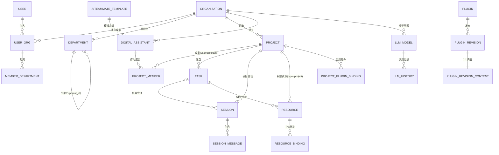
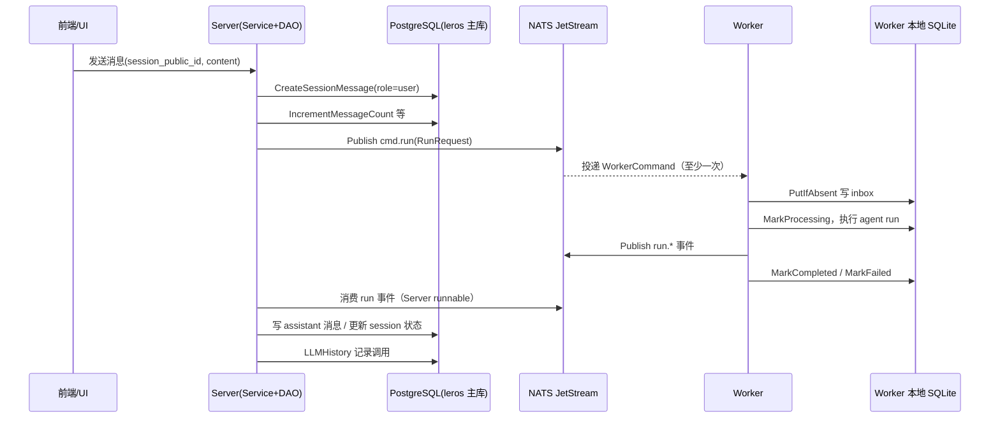

# 数据模型与存储

> Leros 采用**多存储混合**：PostgreSQL 存权威真相，NATS JetStream 管投递，Worker 本地 SQLite 做崩溃恢复，Gitea + S3 管文件。核心业务实体全在 `backend/types/`，建表迁移在 `backend/internal/infra/db/database.go`。

## 实体关系总览

所有表统一 `leros_` 前缀（`backend/types/tables.go:9`）。核心实体关系：

多对多经中间表：

- 用户↔组织：`leros_user_org`（UserID+OrgID 组合唯一）
- 用户↔部门：`leros_rel_user_org_department`（Uin+OrgID+DepartmentID+IsPrimary）
- 项目↔成员（用户或助手）：`leros_project_member`（MemberType 区分 user/assistant）
- 资源↔主体（权限）：`leros_resource_binding`（Uin 与 AssistantID 互斥）
- 项目↔插件：`leros_project_plugin_binding`

## 存储选型与理由

| 存储 | 承担内容 | 角色 |
|------|---------|------|
| **PostgreSQL**（GORM 主库 `leros`） | 全部业务实体：用户/组织/项目/任务/会话/消息/AI队友/插件/模型配置/调用记录 | 权威真相源 + 关系查询 + 权限 |
| **SQLite**（Worker 本地，WAL） | `worker_run_inbox`（命令收件箱）+ `provider_session_bindings` | Worker 崩溃恢复，无网络依赖 |
| **NATS JetStream**（事件流） | 5 条 Stream：Worker 命令 / Session 运行事件 / 全局通知 / LLM 用量 / Skill 包 | server↔worker 异步解耦 + 至少一次投递 |
| **Gitea + S3/MinIO**（文件层） | 大文件原始字节 + 小文件/记忆/产物元数据 | 文件对象存储 + 项目文件版本管理 |
| **Qdrant**（向量库） | 记忆/RAG 检索 | **未落地**，仅预留 `embedding_id` |

**分工理由与不选代价**：

- **Postgres = 权威真相源**：关系型承载全部实体，用 GORM `ObjectMetadata` JSONB 列吸收扩展字段（`backend/types/project.go:49`），兼顾关系查询与灵活扩展。统一软删除（`gorm.Model`）+ `public_id` 外部稳定 ID。不选代价：多存储源下关系/事务割裂，跨表 JOIN 无法保证事务一致性。
- **SQLite = 崩溃恢复的本地缓存**（`worker_run_inbox`）：完整 WorkerCommand JSON 按 `topic+stream_seq` 持久化，提供 at-least-once。选择 WAL + `busy_timeout` + `SetMaxOpenConns(1)`（`inbox.go:78,82`）——单写者本地低延迟。与 NATS 配合：NATS 负责跨进程投递，SQLite 负责到 Worker 后的本地落地。不选代价：仅本 Worker 自用，非分布式队列。
- **NATS JetStream = 事件流解耦**：5 条 FileStorage Stream，LimitsPolicy/DiscardOld（`backend/pkg/messaging/subject.go:190-238`）。角色是投递语义（跨进程/至少一次/重投），真相仍在 Postgres。不选代价：改同步 HTTP 则 Worker 慢处理会阻塞或丢任务。
- **Gitea + S3 = 文件与版本管理**：`docs/design/git-storage.md:18-19` 每 project 一 gitea 仓库，存小文件/记忆/大文件元数据；s3 存大文件字节；**按大小阈值路由**（默认 1MB）：≤阈值纯 gitea，>阈值 s3+gitea 双写。推荐 gitea LFS 而非自定义 `.lfs-pointer.json` 以零代码改造。
- **Qdrant = 记忆向量检索（未落地）**：`DigitalAssistantMemory.EmbeddingID` 为预留字段（`digital_assistant_evolution.go:46-47`）；第一版动态检索用数据库关键词匹配。

## 核心表设计

> 每表首句为职责；字段表由 {文件:行号} 指向真实定义，类型/约束逐字来自 GORM tag。

### `leros_project` —— 长期协作容器（`backend/types/project.go:16-50`）

| 字段 | 类型 | 约束 | 说明 |
|------|------|------|------|
| public_id | varchar(255) | NOT NULL, uniqueIndex | 外部唯一标识 `prj_xxx` |
| org_id / owner_id | integer | NOT NULL, index | 所属组织 / 创建者 |
| name | varchar(255) | NOT NULL | 项目名 |
| description / objective | text | — | 描述 / 目标 |
| status | varchar(50) | NOT NULL, default 'active' | 生命周期 |
| gitea_repo_full_name / gitea_repo_id / gitea_default_branch | varchar/bigint/varchar | / / default 'main' | gitea 仓库关联 |
| metadata | jsonb | — | `ObjectMetadata` 扩展 |

### `leros_project_member` —— 项目成员（用户或 AI 队友）（`backend/types/project.go:98-117`）

| 字段 | 类型 | 约束 | 说明 |
|------|------|------|------|
| project_id / member_id | bigint | NOT NULL, index | 关联项目 / 成员 ID |
| member_type | varchar(50) | NOT NULL, default 'user' | `user` / `assistant` |
| member_role | varchar(50) | NOT NULL, default 'member' | owner/admin/member/viewer |
| is_default | boolean | NOT NULL, default false | 系统默认 AI 队友，不可移除 |

### `leros_task` —— 最小执行单元（`backend/types/task.go:13-32`）

| 字段 | 类型 | 约束 | 说明 |
|------|------|------|------|
| public_id | varchar(255) | NOT NULL, uniqueIndex | 外部唯一标识 |
| org_id / owner_id / project_id | integer/bigint | NOT NULL, index | 归属 |
| session_id | bigint | index | 关联会话，可空 |
| task_type | varchar(16) | NOT NULL, default 'general' | general/cron |
| assignee_id | bigint | index | 负责人（助手） |
| status | varchar(50) | NOT NULL, default 'created' | 状态机 |
| deadline | timestamp | index | 截止时间 |
| metadata | jsonb | — | 扩展 |

> 注：Task **没有 ParentTaskID**（草稿注释提到但未实现），子任务维度实际靠 `session_id` 会话维系。

### `leros_session` —— 一次对话会话（`backend/types/session.go:73-119`）

| 字段 | 类型 | 约束 | 说明 |
|------|------|------|------|
| public_id | varchar(255) | NOT NULL, uniqueIndex | 外部标识 `sess_xxx` |
| type | varchar(50) | NOT NULL | chat/task/project |
| uin / org_id | bigint/integer | default 0, index | 用户 / 组织 |
| assistant_id / allocated_assistant_id | bigint | default 0, index | 关联 / 分配的数字员工 |
| task_id / project_id | bigint | uniqueIndex(uni_session_project_task) | 任务/项目会话绑定 |
| status | varchar(50) | NOT NULL, default 'active' | active/paused/ended/expired |
| message_count | integer | default 0 | 消息计数 |
| last_message_at / expired_at | timestamp | index | 最后消息 / 过期 |

### `leros_session_message` —— 会话消息（`backend/types/session.go:127-178`）

| 字段 | 类型 | 约束 | 说明 |
|------|------|------|------|
| session_id | bigint | NOT NULL, index | FK → Session |
| role | varchar(50) | NOT NULL | user/assistant/system/tool |
| content | text | NOT NULL | 消息正文 |
| message_type / status | varchar(50) | default 'text' / default 'complete' | 类型与状态 |
| chunks / artifacts / attachments | jsonb | — | 流式片段/artifact 引用/附件 |
| usage | jsonb | — | `MessageUsage` token 用量 |
| sequence | bigint | NOT NULL, index | 排序序号 |
| run_id / assistant_id | varchar(255)/bigint | /default 0 | agent run 与 AI 队友 |

### `leros_digital_assistant` —— AI 队友身份与配置（`backend/types/digital_assistant.go:11-43`）

| 字段 | 类型 | 约束 | 说明 |
|------|------|------|------|
| public_id | varchar(255) | NOT NULL, uniqueIndex | 组织内唯一 |
| org_id / owner_id | integer | NOT NULL, index | 组织 / 拥有者 |
| name / role_name / avatar | varchar(255)/varchar | NOT NULL / / | 名称 / 角色名 / 头像 |
| status | varchar(50) | NOT NULL | 运行状态 |
| version | integer | default 0 | 配置版本 |
| system_prompt | text | — | 系统提示词 |
| expertise | jsonb | — | `SkillStringList` 擅长领域 |
| template_id / source | integer/varchar | index | 来源模板 / 创建来源 |

### `leros_resource` / `leros_resource_binding` —— 权限资源与绑定（`backend/types/resource.go:87-102` / `resource_binding.go:31-44`）

- **Resource**：统一权限资源，`org_id+type+biz_id` 活跃唯一（partial unique index），树形 `parent_resource_id` + `parent_resource_path_ids(bigint[])` 支持权限继承。
- **ResourceBinding**：Uin 与 AssistantID 互斥绑定 + role（owner/admin/member），`Validate()`（resource_binding.go:62-71）。

### `leros_llm_model` / `leros_llm_history` —— 模型配置与调用记录

- **LLMModel**（`backend/types/llm_model.go:29-71`）：`org_id+code` 唯一；`idx_llm_model_org_default` 部分唯一索引（仅 is_default=true）；`api_key_encrypted`/`api_key_masked`。注释坦言 MVP 把供应商/模型/凭证/默认参数放同一张表。
- **LLMHistory**（`llm_history.go:13-88`）：调用耗时/Token/成功状态 + 追踪字段（project/session/message/assistant/trace/req_id），为用量统计与成本分析服务。

### `leros_plugin` 域（`backend/types/plugin.go`, `plugin_revision_content.go`）

Plugin（scope 归属组织/system）→ PluginRevision（不可变发布包）→ PluginRevisionContent（1:1 不可变内容）；ProjectPluginBinding（项目启用）；PluginMarketplaceItem（系统公开市场条目）。

## Schema 演进策略

**以 GORM AutoMigrate 为主、手工 SQL 迁移脚本为辅。** 主入口 `db.runMigrations` 维护 37 个模型的迁移列表（`backend/internal/infra/db/database.go:138-175`），最终调 `dbtools.InitModel`（:192）。

分层机制：

- **AutoMigrate 建表/加列**：新表/新列只需把模型加进 `models` 切片，自动 CREATE TABLE / ADD COLUMN / 建索引。
- **手工迁移步骤**（`runMigrations` 顺序，database.go:177-266）：`renameLegacyColumns`（列重命名）→ `renameLegacyTables`（表重命名）→ `backfillWorkerDeploymentPublicIDs`（雪花 ID 回填）→ `dropLegacyIndexes` / `createPluginIndexes` → 多个 SQL backfill（MCP 授权、资源绑定、文件产物、默认部门、系统 LLM 等）→ `dropLegacyColumns` / `dropLegacyTables` → `verifyProjectResourceBindings` 校验。

**关键约束与风险**：

- AutoMigrate **不删列**（database.go:27-32）、**不改列名**（:29），依赖 `legacyColumns` + `Migrator().DropColumn/RenameColumn` 显式处理。
- **幂等回填**：backfill SQL 用 `NOT EXISTS` / `ON CONFLICT ... DO NOTHING` 去重（:569-647, 493-522）。
- **方言分支**：`migratePluginDefinitions` 仅 Postgres 执行 JSONB 数据转换。
- **partial unique index / where 子句**：`idx_llm_model_org_default`、`ux_leros_resource_active_biz` 等，是「软删除行不冲突唯一索引」的关键手段（AutoMigrate 无法直接表达部分唯一索引，需手工迁移）。
- **风险**：无版本化迁移文件（无 golang-migrate/atlas），演进靠每次启动跑同一组幂等 SQL；大量 backfill 失败仅 `logs.Warnf` 不阻断启动，存量数据缺口靠 `verify*` 人工排查。

## 读写路径

### 一条消息从发送到落库

关键点（{路径:行号}）：

- **谁写**：Server Service+DAO 写会话/消息/项目/任务（`session_dao.go:199,204`）；Worker 写 SQLite inbox；LLM 调用由统一 `llm` 包 Recorder 持久化 `leros_llm_history`。
- **谁读**：前端经 Server DAO 读会话/消息/项目；模型配置经 `llm` 包的 GORM Manager。
- **中间层**：NATS 事件流承载 server↔worker（`domain/RunResult` 回传终态）；Worker **不直连主库**，模型/配置经 NATS 命令下发快照（RunRequest）。

### 项目权限读写范式

项目可访问列表经 `ListProjectIDsByUser` JOIN `resource`+`resource_binding`（`project_dao.go:96-108`）；`IsProjectUserMember`（:66-78）。迁移把存量 project_member 回填为 resource_binding。

## 关键设计决策

1. **`public_id` 外部稳定 ID + internal bigint PK**（gorm.Model）：接口不泄露自增 ID、跨端稳定引用；WorkerDeployment.PublicID 雪花回填 `wrk_%s`。代价：双 ID 体系，部分表需迁移回填。
2. **JSONB 列承担一切扩展字段**（`metadata`）：快速迭代、避免频繁 DDL、Postgres JSONB 可查询；代价：无 Schema 约束、难建 B-tree 索引、易脏数据。
3. **partial unique index (WHERE deleted_at IS NULL)** 保障软删除下唯一：使软删除行不占用唯一键；代价：索引更宽、需手工迁移（AutoMigrate 无法表达）。

## 亮点与问题

### 亮点

1. **多存储职责切割清晰**：Postgres 存真相 + NATS 管投递 + SQLite 本地落地，三者互补而非重叠。
2. **手工迁移脚本体系完整**：rename/backfill/drop 分层、幂等、方言分支，能承接 AutoMigrate 做不到的事。
3. **partial unique index** 系统性解决软删除 + 唯一约束冲突。
4. **统一资源权限模型**：resource + resource_binding 把项目/任务/文件/产物纳入同一棵树，权限继承（parent_resource_path_ids）设计清晰。

### 问题 / 风险

1. **无版本化迁移**：演进依赖每次启动幂等重放，缺迁移文件与版本控制，audit/回滚困难。
2. **迁移失败仅告警不阻断**：backfill 用 `logs.Warnf`，存量缺口可能静默，靠 verify 人工兜底。
3. **JSONB 滥用**：usage/chunks/artifacts/attachments 本可结构化，查询/统计成本高。
4. **Task 无 ParentTaskID**：注释声称支持子任务但模型未实现，语义与实现有 gap。
5. **向量库未落地**：`embedding_id` 预留但检索仍是 DB 关键词，RAG 能力为预留状态。

> 覆盖：backend/types 全部 32 文件 100%，DB 层 + worker 存储关键文件全读，整体约 86% ≥60% 达标。
