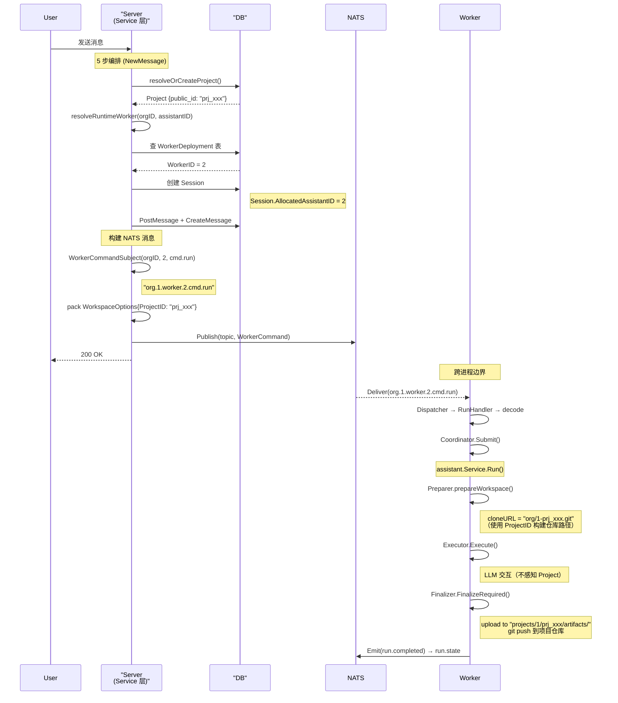

# Leros Project 与 Worker 关系分析

> 文档追踪从 Project → Worker 选择的完整路径，以及 Worker 执行时如何使用 Project 上下文。
> 核心发现：Project 和 Worker **不直接关联**，中间经过三层间接映射。

---

## 1. 角色定义

| 概念 | 类型 | 说明 | 对应代码 |
|------|------|------|----------|
| **Project** | 业务容器 | 长期工作空间，聚合 Task/Session/Member/Artifact | `types.Project` |
| **DigitalAssistant** | 逻辑身份 | AI 队友的定义（code, name, system_prompt） | `types.DigitalAssistant` |
| **WorkerDeployment** | 绑定表 | 将 DigitalAssistant 绑定到具体 Worker 进程 | `types.WorkerDeployment` |
| **Worker** | 运行时进程 | 独立的 Agent 执行进程（或容器） | `internal/worker/` |

---

## 2. 间接映射链

```
Project (业务容器)
  │
  ├── Task (执行单元) ── Session (对话上下文)
  │                              │
  │                     AllocatedAssistantID = WorkerID
  │
  ├── ProjectMember: user | assistant (关联的是 DigitalAssistant.ID)
  │
  └── WorkerDeployment (绑定表)
       ├── DigitalAssistantID — 逻辑身份
       ├── WorkerID — 运行时进程编号
       └── OrgID — 组织隔离
```

**Project 不直接指定 Worker。** 选择路径是：

```
Project → Session.AllocatedAssistantID → WorkerID → NATS Subject → Worker 进程
```

---

## 3. Worker 选择逻辑

### 3.1 触发时机

Session 创建时调用 `resolveRuntimeWorker()`，位于 `backend/internal/service/session_service.go`：

```go
assistantID, workerID, err := s.resolveRuntimeWorker(ctx, caller.OrgID, req.AssistantID)
```

### 3.2 决策树

**文件**: `backend/internal/service/worker_resolution.go`

```
resolveRuntimeWorker(orgID, assistantID)
  │
  ├── assistantID > 0 (客户端指定了 DigitalAssistant)
  │    └─ db.GetWorkerDeploymentByAssistantID()
  │         └─ 查 leros_worker_deployment 表
  │              └─ digital_assistant_id = assistantID
  │                   → 返回 deployment.WorkerID
  │
  └── assistantID == 0 (未指定)
       └─ resolveDefaultRuntimeWorker()
            ├─ 查 leros_worker_deployment 表
            │    └─ org_id = orgID
            │         → 返回第一个部署的 WorkerID
            ├─ 无部署 → inferrer.InferAssignedAssistantID()
            │         → 当前 hardcode 返回 1
            └─ 最终 fallback → legacyDefaultWorkerID = 1
```

### 3.3 WorkerID 写入 Session

```go
session := &types.Session{
    AssistantID:          assistantID,   // 逻辑 DigitalAssistant.ID
    AllocatedAssistantID: workerID,      // 运行时 Worker ID（消息投递目标）
}
```

**`Session.AllocatedAssistantID` 中存储的是 WorkerDeployment.WorkerID，不是 DigitalAssistantID。**

---

## 4. 信息传递：Project → Worker

### 4.1 NATS 消息构造

**文件**: `backend/internal/service/message_poster.go` — `publishWorkerTask()`

```go
// 确定 Worker 目标
topic, _ := messaging.WorkerCommandSubject(orgID, session.AllocatedAssistantID, messaging.LaneRun)
// → "org.{orgID}.worker.{workerID}.cmd.run"

// 解析 Project/Task 的 public_id
projectPublicID, taskPublicID, _ := p.resolveWorkspaceIDs(ctx, session)

// 构造命令 payload
cmd := messaging.NewRunCommand(
    envID,
    messaging.RouteContext{OrgID: orgID, SessionID: session.PublicID, WorkerID: workerID},
    messaging.TraceContext{...},
    messaging.RunCommandPayload{
        Workspace: messaging.WorkspaceOptions{
            ProjectID: projectPublicID,   // "prj_xxx" 格式
            TaskID:    taskPublicID,      // "task_xxx" 格式
        },
        Input: messaging.TaskInput{Messages, Attachments},
        Model: messaging.ModelOptions{...},
    },
)

eventbus.Publish(ctx, topic, cmd)
```

### 4.2 传递的数据结构

```go
type WorkspaceOptions struct {
    ProjectID string `json:"project_id"` // Project 的 PublicID（prj_xxx）
    TaskID    string `json:"task_id"`    // Task 的 PublicID（task_xxx）
}
```

**关键设计：Worker 无数据库访问权限。** 所有 Project/Org 信息都通过 NATS 消息显式传递。

---

## 5. Worker 端执行流程

```
Dispatcher 收到 cmd.run 消息
  │
  └─ RunHandler.HandleRunCommand()
       ├─ Decode → runTask{Workspace.ProjectID}
       ├─ RequestFromWorkerTask() → domain.RunRequest{Workspace.ProjectID}
       └─ Coordinator.Submit() → executeFunc
            └─ assistant.Service.Run(ctx, request, sink)
```

### 5.1 Preparer：用 ProjectID 准备 Workspace

**文件**: `backend/internal/assistant/preparer_impl.go`

```go
func prepareWorkspace(ctx context.Context, req *assistantdomain.RunRequest) {
    projectID := strings.TrimSpace(req.Workspace.ProjectID)

    if projectID == "" {
        workDir, _ := agentworkspace.PrepareTempWorkspace()  // 无项目 → 临时目录
        return
    }

    if p.workspaceMgr != nil {
        return p.workspaceMgr.PrepareWorkspace(ctx, req)     // Gitea clone
    }

    // 本地模式
    agentworkspace.PrepareTaskWorkspace(ctx, agentworkspace.TaskWorkspaceRequest{
        OrgID:     req.Workspace.OrgID,
        ProjectID: projectID,    // ← "prj_xxx" 用于构建仓库路径
        TaskID:    taskID,
    })
}
```

Gitea clone URL 格式：
```
https://token@git.example.com/org/{env}-{orgID}-{projectID}.git
```

### 5.2 Executor：不感知 Project

`agent.Executor.Execute()` 和 Runtime 实现（native/claude/codex/opencode）**不直接使用 ProjectID**。它们只处理 `ExecutionRequest`（含 messages, tools, model 等），Project 上下文已由 Preparer 转换为工作目录和文件系统。

### 5.3 Finalizer：用 ProjectID 归档产物

**文件**: `backend/internal/assistant/finalizer_impl.go`

```go
// Artifact 上传路径
key := fmt.Sprintf(
    "projects/%d/%s/artifacts/%s",
    identity.OrgID(),
    projectPublicID,    // ← "prj_xxx"
    storageFilename,
)

// Git push（向项目仓库推送代码变更）
pushWorkspace(ctx, run.Workspace)
// → git add → git commit → git push origin
```

---

## 6. 完整路径时序



---

## 7. 关键设计要点

### 7.1 Worker 无状态

Worker 是独立进程（或容器），**不连接数据库**。所有 Project/Org 信息通过 NATS 消息显式传递。这使得 Worker 可以水平扩展而不依赖共享状态。

### 7.2 间接绑定

通过 `WorkerDeployment` 表解耦逻辑身份和运行时实例：

| 层 | 标识 | 数据库表 |
|----|------|---------|
| 业务层 | `DigitalAssistant.ID` | `leros_digital_assistant` |
| 绑定层 | `WorkerDeployment.WorkerID` | `leros_worker_deployment` |
| 运行时 | `Session.AllocatedAssistantID` | `leros_session` |

变更运行时实例（如 Worker 扩容）只需更新 `WorkerDeployment` 表，不影响已有 Session。

### 7.3 单 Worker 多 Session

一个 Worker 可服务多个 Session：
- 并发上限：`MaxConcurrency = 20`
- Per-session 串行：同一 Session 的任务顺序执行
- Debounce：1.5s 窗口内同一 Session 的多次提交合并

### 7.4 Project 隔离

| 维度 | 隔离方式 |
|------|---------|
| 组织隔离 | `OrgID` 在所有表中作为分区键 |
| 仓库隔离 | Gitea 仓库路径以 `{orgID}-{projectID}` 区分 |
| 产物隔离 | 存储路径以 `projects/{orgID}/{projectID}/` 区分 |
| 命令隔离 | NATS subject 以 `org.{orgID}.worker.{workerID}` 区分 |

---

## 8. 核心文件索引

| 文件 | 职责 |
|------|------|
| `backend/internal/service/worker_resolution.go` | Worker 选择决策（resolveRuntimeWorker） |
| `backend/internal/service/message_poster.go` | NATS 消息构造（publishWorkerTask） |
| `backend/types/worker_deployment.go` | WorkerDeployment 模型 |
| `backend/types/session.go` | Session 模型（AllocatedAssistantID） |
| `backend/internal/assistant/preparer_impl.go` | 基于 ProjectID 准备 Workspace |
| `backend/internal/assistant/finalizer_impl.go` | 基于 ProjectID 归档产物 |
| `backend/internal/worker/command/run/handler.go` | Worker 端命令处理 |
| `backend/internal/worker/command/run/mapper.go` | 消息 → 领域模型映射 |
| `backend/internal/worker/run/coordinator.go` | Per-session 调度 |
| `backend/pkg/messaging/command.go` | WorkerCommand / RunCommandPayload / WorkspaceOptions |
