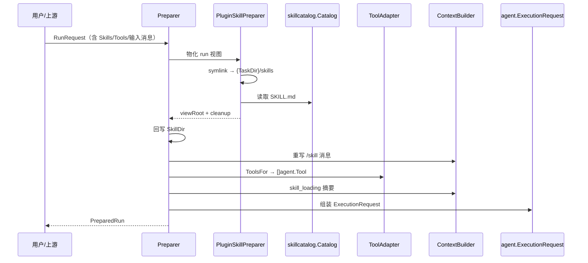

# Skill / Tool 能力分层系统

> Skill 是 Leros 的「能力总线」：让 AI 队友能**复用、注册、发现、调度**能力单元，而非把每种能力硬编码进 agent 循环。核心分层是 **Tool = 原子执行能力，Skill = 可组合的流程性记忆**，关系 `Agent → Skill → Tool`。

## 在项目中的角色

去掉 Skill 系统，AI 队友只剩一堆硬编码的特判能力：复杂工作流（如投标文件编写）做完后，「怎么做」的流程性知识无法沉淀，每次都要重新交代；能力也无法注册、发现、调度，更没有权限边界。

文档自我定位：「Skill 是可复用的 AI 能力单元，是 Lework 的核心构建块」（`docs/architecture/overview.md:246`）。能力分层的表格如下（overview.md:284-296）：

| 维度 | Tools | Skills |
|------|-------|--------|
| 粒度 | 原子操作 | 可组合 |
| 注册 | 系统注册 | 用户可创建 |
| 侧重 | 执行 | 智能决策 |

一句话：**Skill 偏「怎么做事」（procedural / 流程性记忆），Tool 偏「能做什么」（primitive / 原子能力）**。`skill_manage` 工具描述明言「技能是你的流程性记忆」（`backend/tools/skill_manage/skill_manage.go:32`）。

## 解决什么根因

AI 同伴需要可复用、可注册、可发现、可调度的能力单元，否则要么每次重教模型做事流程，要么把能力硬编码进 agent 主循环。具体四类痛点：

1. **复用/沉淀**：复杂任务做完后，「怎么做」的流程性知识不沉淀就得重来。
2. **发现/调度**：模型需从目录 `list` 可用 Skill、按名 `get` 全量、`read_file` 读附属文件，动态决策（`backend/tools/skill_use/skill_use.go:59-84`）。
3. **运行时隔离与安全**：Skill 来源多（本地/GitHub/ClawHub/url/组织服务器），不可全信；run 并发，每个 run 须拿严格裁剪的自己那份 Skill 视图，且不污染全局 CLI 目录。
4. **权限绑定**：能力绑 Tool、默认拒绝（Capability-based Security / Deny by Default），`CapabilityContext.AllowedTools` 在 run 级授权（`agentrun/domain/request.go:169-171`）。

## 设计思路

### Skill 如何定义（SKILL.md 规范）

Skill 是**文件型**（目录 + `SKILL.md`），目录名即默认 skill 名；`SKILL.md` 顶部为可选 YAML frontmatter，其余为 Markdown 正文。frontmatter 结构（`internal/skill/catalog/types.go:11-38`）：

- 顶层：`name` / `description` / `version`。
- `metadata` 子对象：`category` / `tags` / `always` / `requires_tools` / `source` / `trust`。

关键**兼容层**：`catalog.ParseDocument` 先整体 `yaml.Unmarshal` 进 `Manifest`；失败时走 `quotePlainDescription` 把顶层 `description:` 补引号重试（`catalog/types.go:166-212`）。这解释了为何社区 Skill 能直接解析（如 `backend/skills/worker/weather/SKILL.md:1-6` 用 `metadata: {"clawdbot":{...}}` JSON），而 Leros 原生 server 端 Skill 只用 `name`+`description`（如 `backend/skills/server/bid-content/SKILL.md:1-4`）。

「正文 + 附件」清单式定义：除 `SKILL.md` 外可带 `references/`、`templates/`、`scripts/` 附属文件。正文只写「怎么做」的契约（职责边界/输入输出/写作风格），细节全放 `references/*.md`，由正文触发「按需读取」——这正是 **Skill is Composition Not Encapsulation**：正文是编排层、附件是惰性素材库。

### Skill 如何加载（三形态并存）

| 形态 | 模块 | 说明 |
|------|------|------|
| 文件系统 | `catalog.NewCatalog(rootDir)` | run-scoped 目录扫描 + frontmatter 解析（`catalog/catalog.go:50-59`） |
| 内置/打包 | `links.SyncToLerosDir` | 把内置 Skill 同步到受保护缓存 `.leros/skills/.system`，用 `.seed-manifest`+SHA256 目录哈希增量（`links/skills_sync.go:25-47,104-153`） |
| 远程/市场 | `fetch` 包 + `skill_preparer.installSkillFromURL` | GitHub/ClawHub/url/skills.sh 多源；组织 Skill 走 `POST /v1/plugins/skills/download-urls` → sha256 校验 → zip 解压（`worker/agentrun/skill_preparer.go:310-424`） |

本地加载核心是 `Catalog.Get`：两阶段按名找（直接路径 → 递归大小写不敏感匹配）；名字存在但 manifest name 不符返回类型化错误 `ErrSkillManifestMismatch`（catalog.go:135-239）。Catalog 设计为不可变、可并发共享。

### Skill 运行时如何管理

> **文档漂移说明（代码快照为准）**：`docs/architecture/overview.md:265-267` 声称有 `internal/skill/runtime/`（Manager + PostProcessor）目录，**当前源码中不存在**。`backend/internal/skill/` 实际只有 `archive/ builtin/ cache/ catalog/ fetch/ links/ store/`。真正的运行时编排在 `internal/worker/agentrun/`（skill_preparer + preparer_impl + context）。

核心两件事：

1. **Materialize（物化为 run 专属视图）**：`PluginSkillPreparer.PrepareSkills` 在 task 目录下建**符号链接视图**，把 worker 系统 Skill + 组织/项目 Skill + 被显式调用的 Skill 链接进 `{TaskDir}/skills`（`skill_preparer.go:90-111`）。要点：
   - 用 **symlink 而非 copy**，共享缓存且省 I/O；`resetTaskSkillView` 严格拒绝视图里任何非 symlink 项（`skill_preparer.go:471-497`）。
   - 显式调用（`/skillname` 前缀）不在已就绪视图时，临时从服务端安装最新版（`prepareInvokedSkills`，skill_preparer.go:207-238）。
   - 安装并发经 `skillInstallLocks`（以 skills root 为 key 的 `sync.Map` 锁）串行化，防多 run 竞争写缓存（skill_preparer.go:70,119-122）。

2. **PostProcess（拼进 prompt / 消息）**：
   - **skill_loading**：`buildSkillLoadingContext` 把可发现 skill 摘要（name+description 清单）填充 `{skills_data}` 占位，作为系统提示一部分（`context/system_prompt.go:20-45,81-84`）。
   - **invoked skill**：`ApplyInvokedSkills` 解析 user 消息开头 `/skill` token，加载 SKILL.md 正文并**重写消息**为 `[IMPORTANT: The user has invoked N skill(s)...]` + 正文全文 + 附属文件清单（`context/skill_invoke.go:16-110,125-167`）。

### Tool 与 Skill 分工

Tool 是最小执行抽象（`backend/tools/tool.go:28-34`）：

```go
type Tool interface {
	Name() string
	Description() string
	InputSchema() Schema
	Execute(ctx context.Context, input json.RawMessage) (string, error)
}
```

- 可选 `Validator` 接口做执行前本地校验（tools/tool.go:37-39）。
- run 级上下文透传：`ToolContext` 携带 RunID/TraceID/UserID/WorkDir 等元数据（tools/tool.go:105-138）。

**Skill 复用 Tool 而非被 Tool 复用**：Skill 是文档，被模型读进上下文后作为 guidance 决策调用哪些 Tool，自身不直接执行。`skill_use`（发现/读取 Skill 文档）与 `skill_manage`（创建/修改 Skill）本身就是 Tool，注册中心是 `tools.Registry`（`backend/tools/registry.go:12-104`）。关系：`backend/skills/` 放定义、`backend/tools/` 放加载/检索/管理工具、`backend/tools/node` 做 OS 级执行。Tool 是 Skill 生态的执行底座与访问入口。

## 关键数据结构

### SKILL.md frontmatter（`backend/internal/skill/catalog/types.go:11-38,49-86`）

```go
type Manifest struct {
	Name        string           `yaml:"name"`
	Description string           `yaml:"description"`
	Version     string           `yaml:"version,omitempty"`
	Metadata    ManifestMetadata `yaml:"metadata,omitempty"`
}
type ManifestMetadata struct {
	Category      string   `yaml:"category,omitempty"`
	Tags          []string `yaml:"tags,omitempty"`
	Always        bool     `yaml:"always,omitempty"`
	RequiresTools []string `yaml:"requires_tools,omitempty"`
	Source        string   `yaml:"source,omitempty"`
	Trust         string   `yaml:"trust,omitempty"`
}
// Entry = 解析后的完整 Skill（manifest + body + 目录信息）
```

### Tool 的两层契约

- **执行层**（`backend/tools/tool.go`）：`Tool` + `ToolContext`（携带 RunID/TraceID/WorkDir 等 run 级元数据）。
- **Agent 运行时契约**（`backend/agent/tool.go:9-30`）：`ToolDefinition`（Name/Description/Parameters）+ `ToolResult`（Content/Error/IsError）。

两层经 `agentrun.tool_adapter.Adapt` 桥接：包业务 `tools.Tool` 成 `agent.Tool`，注入 run-scoped ToolContext（`backend/internal/worker/agentrun/tool_adapter.go:15-52`）。

## 核心流程

### 一个 Skill 从定义到被调用的完整链路



要点（{路径:行号}）：

1. **定义**：写 `backend/skills/{category}/{skill}/SKILL.md`（frontmatter + 正文 + 可选 references/templates/scripts）。
2. **同步缓存**：worker 用 `SyncToLerosDir` 把内置 skills 拷到 `.leros/skills/.system`，`.seed-manifest` 记 `skillName:sha256` 增量。
3. **物化 run 视图**：`preparer.Prepare` 调 `PrepareSkills` 建 symlink 视图（`preparer_impl.go:319-327`；skill_preparer.go:90-111）。
4. **工具注入**：`toolProvider.ToolsFor` 把 `tools.Registry` 适配成 `[]agent.Tool`（`tool_adapter.go:63-100`），`SkillDir` 写进 ToolContext 供 skill_use 执行时用 run 自己的视图（`skill_use.go:157-164`）。
5. **prompt 注入**：`BuildSystemPrompt` 拼 skill_loading 摘要（`system_prompt.go:81-84`）；`ApplyInvokedSkills` 重写消息（`preparer_impl.go:340-342`）。
6. **组装 ExecutionRequest**：`{SystemPrompt, Prompt, Messages, Tools, Filesystem:{SkillDir}, ExtraEnv, Policy:{AllowedTools}}`。

## 与其他模块协同

- **Workspace/Repo 解耦**：Skill 视图建在 task workspace 内，`SkillDir` 是 worker 产物、**显式不被 server 提供**（`domain/request.go:105-107`）——服务端不控制 worker 文件布局，属运行隔离设计。
- **Permission/Policy**：run 级 `CapabilityContext.AllowedTools` + `PolicyContext` 流入 `ExecutionRequest.Policy`，构成 Deny-by-Default 授权面；工具描述多次提醒「创建/删除技能前应先向用户确认」（`skill_manage.go:54`）。
- **Memory**：Skill 被描述为「流程性记忆」，与 `backend/tools/memory` 的对话记忆互补。
- **安全防御**：远程 zip 走 `skillarchive.Validate/Extract`（包 64MB/解压 256MB/拒链接·穿越·重复 SKILL.md，`archive/archive.go:17-152`）；文件写入统一 `atomicWrite` tmp+rename（`store/store.go:738-765`）；路径防穿越 `resolveInside`。

## 关键设计决策与权衡

**决策一：Skill 视图 = symlink 视图，且严格拒绝非符号链接**

- Why：多 run 并发共享同一 worker 系统 Skill 缓存，copy 放 I/O/磁盘；symlink 共享且廉。
- 权衡：用 `Lstat`+`ModeSymlink` 校验，非 symlink 直接报错——「fail closed」换安全。copy 引入视图/缓存不一致；硬链接跨文件系统受限。symlink 是「共享+隔离+一致性」最简方案。

**决策二：文件型 Skill + YAML frontmatter，兼容社区 schema**

- Why：Skill 本质「文档即代码」，能被 agent 自然读、被用户 markdown 编辑、跨工具迁移。
- 权衡：为兼容社区格式（`metadata: {"clawdbot":...}`），`ParseDocument` 在 YAML 解析失败时自动给顶层 plain description 补引号重试（catalog/types.go:166-212）。代价是解析两条分支，换来「社区 skill 能加载」的实际收益。schema 刻意最小（name/description 强约束，metadata 全 optional）。

**决策三：安装/同步全程「校验 + 原子 + 备份恢复」**

远程 skill：sha256 校验包 → 临时目录暂存 → `replaceInstalledSkill`（旧目录备份 rename → 新目录 rename → 删备份，任一步失败可回滚）（`skill_preparer.go:388-424,641-659`）。用户 Skill 写入全部 `atomicWrite`，supporting file 路径严格白名单（禁绝对路径/`..`/反斜杠/`.git`/symlink）（`store/store.go:651-678`）。

## 亮点与问题

### 亮点

1. **run-scoped Skill 视图 + symlink**：把「共享缓存」与「run 隔离」解耦，视图只含当次所需 skill。
2. **双触发路径**：系统提示只给摘要降 token，细节靠模型主动 `skill_use get`；`/skill` 显式调用强制加载全量正文。互补。
3. **工具描述即提示工程**：`skill_manage`/`skill_use` 的 Description 把「何时 create/patch/delete、何时不该」写进 schema，行为策略沉淀在 tool 描述。
4. **路径/安全防御系统化**：从 zip（zip-slip/链接/重复）、文件写入（原子写/白名单/防穿越/禁 symlink）到视图（symlink-only）层层设防。
5. **迁移友好**：legacy 全局投影一次性清理（`legacy_global_cleanup.go`）、`.seed-manifest` hash 增量同步——子系统经过真实演进且有意识做干净迁移。

### 问题 / 风险

1. **文档与实现漂移**：`overview.md:265-267` 声称有 `internal/skill/runtime/`，实测不存在；真实运行时在 `agentrun`。
2. **`skill_use` 每次调用动态扫描文件系统，无缓存**（`skill_use.go:49` 注释 "no cached state"），list/get 高频时对大盘可能有压力。
3. **prompt 组装把 Skill 正文直接拼接进 user 消息**（`skill_invoke.go:125-167`）：大 Skill 放大 token，正文本身可能很长，缺正文体积软限制（store 只限 1MB）。

> 覆盖：生产源码口径 89.3%（6386/7153）达标；internal/skill 全部生产文件 + tools + agentrun skill_preparer 等全读。
