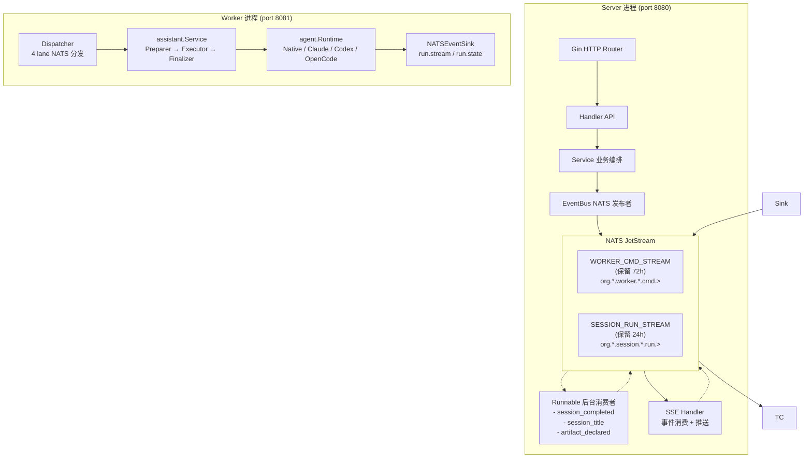
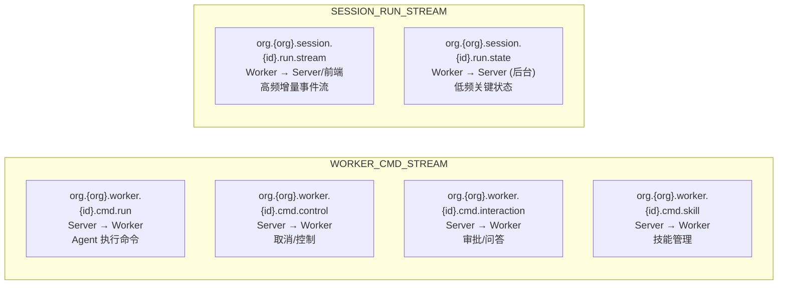
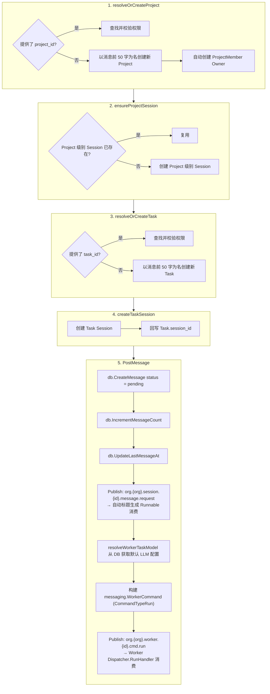
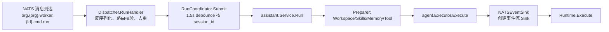
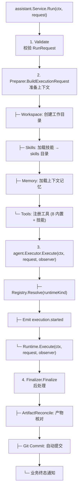
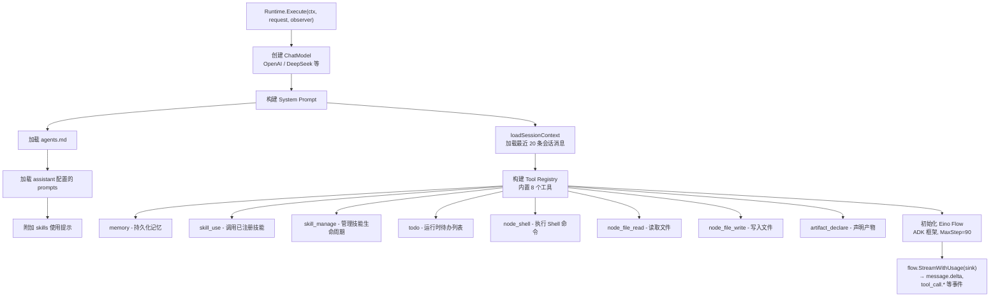
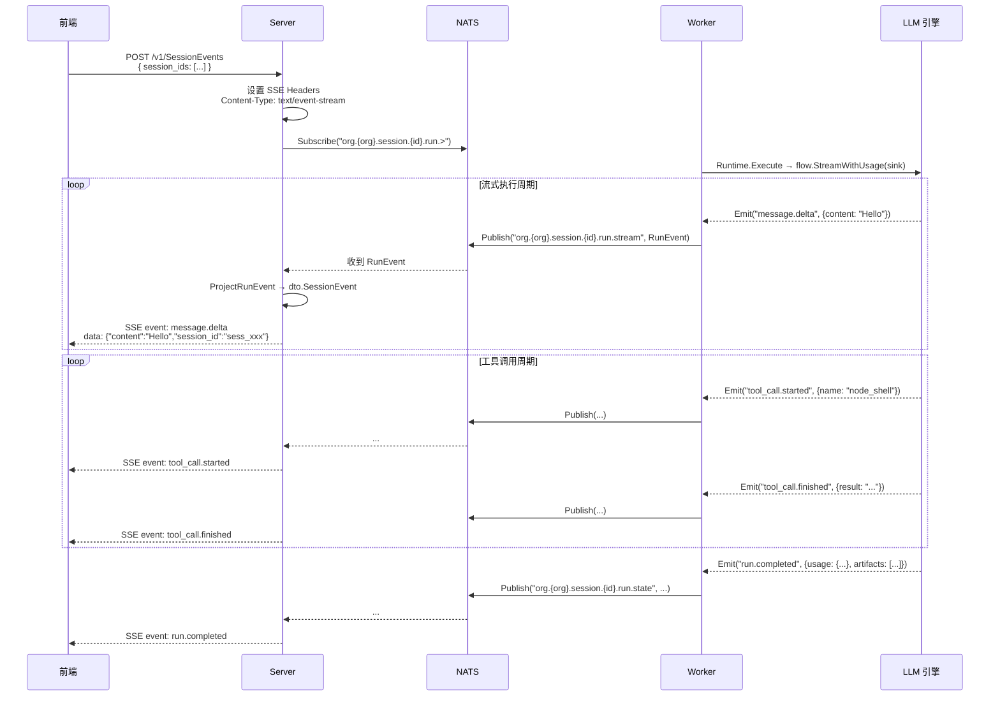

# Leros 用户会话全链路业务流程

> 文档描述从用户发起会话到页面接收到流式响应的完整数据流。

---

## 1. 架构概览



### 关键组件

| 组件 | 位置 | 职责 |
|------|------|------|
| Gin HTTP Router | `backend/internal/api/router.go` | 注册所有 HTTP 路由、中间件、后台 Runnable |
| Handler | `backend/internal/api/handler/` | 请求解析、参数校验、DTO 转换 |
| Service | `backend/internal/service/message_poster.go` | 业务编排：Project → Task → Session → WorkerCommand |
| EventBus | `backend/internal/infra/mq/nats.go` | NATS JetStream 发布/订阅 (双 Stream: WORKER_CMD_STREAM + SESSION_RUN_STREAM) |
| Dispatcher | `backend/internal/worker/command/dispatcher.go` | 4 lane 命令分发（run/control/interaction/skill） |
| RunCoordinator | `backend/internal/worker/run/coordinator.go` | Session 级别去抖合并 + 并发控制 |
| assistant.Service | `backend/internal/assistant/service.go` | 业务运行包装：Preparer → agent.Executor → Finalizer |
| agent.Executor | `backend/agent/executor.go` | Runtime 解决 + 执行生命周期 |
| Runtime (Native) | `backend/agent/runtime/native/` | 基于 CloudWeGo Eino 的内置 LLM 引擎 |
| NATSEventSink | `backend/internal/worker/eventpub/nats_sink.go` | agent.Event → NATS SESSION_RUN_STREAM（双 lane） |
| SSE Handler | `backend/internal/api/handler/session_handler.go` | NATS SESSION_RUN_STREAM → SSE → 前端 |
| Runnable | `backend/internal/runnable/` | 后台异步消费者（state 投影、stream 投影） |
| 前端 Store | `frontend/packages/store/slices/chatSlice.ts` | SSE 消费 + Redux 状态管理 |

### NATS Topic 拓扑 & 消息协议



**消息协议:**

| Topic | 消息类型 | 协议结构 | 说明 |
|-------|---------|---------|------|
| `org.{org}.worker.{id}.cmd.run` | `messaging.WorkerCommand` | Envelope{Trace, Route} + Body{CommandType, Payload} | Worker 执行命令 |
| `org.{org}.session.{id}.run.stream` | `messaging.RunEvent` | Envelope + RunEventBody{Seq, Event, Payload} | 高频实时事件流 |
| `org.{org}.session.{id}.run.state` | `messaging.RunEvent` | Envelope + RunEventBody{Seq, Event, Payload, RunCompleted(终端)} | 低频关键状态

---

## 2. 完整流程（按阶段）

### 阶段 1：用户输入入口

**入口方式一：CLI 命令行**

- 命令: `leros chat "hello"`
- CLI 入口: `backend/cmd/leros/chat.go`
- 发起 `POST /v1/NewMessage` 请求到 Server
- 获得 `session_id` 后, 发起 `POST /v1/SessionEvents` SSE 连接

**入口方式二：Web UI 前端**

- 前端调用 `workApi.newMessage()` → `POST /v1/NewMessage`
- 或 `sessionApi.addMessage()` → `POST /v1/sessions/{id}/messages`
- 然后调用 `#startSSE()` → `POST /v1/SessionEvents`

**HTTP 路由注册:**

```
POST /v1/NewMessage                → WorkHandler.NewMessage
POST /v1/sessions/{id}/add-message → SessionHandler.AddMessage
POST /v1/SessionEvents             → SessionHandler.SessionEvents
```

---

### 阶段 2：NewMessage 原子编排

**代码位置:** `backend/internal/service/message_poster.go:92-152` (`RunNewMessage`)

**涉及的事件发布:**

| 步骤 | 事件 | NATS Topic | 消息内容 |
|------|------|-----------|---------|
| PostMessage → Publish | `session.message.request` | `org.{org}.session.{id}.message.request` | 完整的 `types.SessionMessage` 实体 |
| PostMessage → publishWorkerTask | `worker.command (cmd.run)` | `org.{org}.worker.{id}.cmd.run` | `messaging.WorkerCommand`（含 RunCommandPayload, Session 上下文、模型配置、用户消息） |



**事件之后:**

- `message.request` → **Session Title Runnable** 消费，调用 LLM 生成标题
- `worker.task` → **Worker TaskConsumer** 消费，进入阶段 3

**关键数据结构:** `protocol.WorkerTaskMessage`

```go
type WorkerTaskMessage struct {
    ID        string            // "msg_{sessionID}_{sequence}"
    Type      string            // "worker.task"
    CreatedAt time.Time
    Trace     TraceContext      // TraceID, RequestID, TaskID, RunID
    Route     RouteContext      // OrgID, SessionID, WorkerID
    Body      WorkerTaskBody    // TaskType, Actor, Workspace, Input, Model
    Metadata  map[string]any    // session_id, message_type, sequence
}
```

---

### 阶段 3：Worker 消费命令

**代码位置:** `backend/internal/worker/command/dispatcher.go` / `backend/internal/worker/command/run/handler.go`

**事件流:**

| 方向 | 事件 | NATS Topic |
|------|------|-----------|
| 输入 | `worker.command (cmd.run)` | `org.{org}.worker.{id}.cmd.run` |



#### assistant.Service Run

**位置:** `backend/internal/assistant/service.go` → `backend/agent/executor.go`

三阶段执行流程（Preparer → Executor.Runtime → Finalizer）:



**执行中产生的事件:**

| 阶段 | 事件类型 | 发布到 |
|-----|---------|-------|
| Executor execution.started | `run.started` | NATSEventSink → `run.state` |
| Runtime.Execute | `message.delta`、`reasoning.delta`、`tool_call.*`、`todo.*`、`artifact.declared`、`approval.*`、`question.*` | NATSEventSink → `run.stream` / `run.state` |
| Executor terminal | `run.completed` / `run.failed` / `run.cancelled` | NATSEventSink → `run.state`（含 RunCompletedPayload） |

---

### 阶段 4：Native Engine 执行

**代码位置:** `backend/agent/runtime/native/`

**输入:** `agent.ExecutionRequest`（含 Session 历史、模型配置、系统 Prompt）

**输出:** 通过 `observer` 回调持续发出运行时事件



**引擎发出的运行时事件类型 (通过 observer.Emit):**

| 事件类型 | 产生时机 | Payload 结构 |
|---------|---------|-------------|
| `message.delta` | LLM 逐 token 输出 | `{message_id, role, content}` |
| `reasoning.delta` | LLM 推理过程输出 | `{message_id, role, content}` |
| `message.completed` | LLM 单次回复完成 | `{content, usage}` |
| `tool_call.started` | LLM 请求调用工具 | `{tool_call_id, name, arguments}` |
| `tool_call.finished` | 工具执行完成/失败 | `{tool_call_id, name, result, error, elapsed_ms}` |
| `todo.snapshot` / `todo.updated` | 待办列表变更 | `[{id, title, status, priority}]` |
| `artifact.declared` | 新产物被声明 | `{artifact_id, title, filename, mime_type, ...}` |
| `approval.requested` | 需要用户审批 | `{request_id, tool_name, description, arguments}` |
| `approval.resolved` | 审批被处理 | `{request_id, action, reason}` |
| `question.asked` | 需要用户回答 | `{request_id, questions, ...}` |
| `question.answered` | 用户回答提交 | `{request_id, answers}` |
| `run.completed` / `run.failed` / `run.cancelled` | 引擎运行结束 | `{status, result, usage, artifacts, events}` |

---

### 阶段 5：事件流 Worker → NATS → Server SSE → 前端

#### NATSEventSink：Agent 事件 → NATS Session Run Stream

**代码位置:** `backend/internal/worker/eventpub/nats_sink.go:60-154`

```
Emit(ctx, event *agent.Event)
  ├── 映射 agent.EventType → messaging.RunEventType
  │     ├── "run.started"             → RunEventRunStarted
  │     ├── "run.completed"           → RunEventRunCompleted
  │     ├── "message.delta"           → RunEventMessageDelta
  │     ├── "tool_call.started"       → RunEventToolCallStarted
  │     └── ...
  │
  ├── 构建 messaging.RunEvent
  │     ├── Envelope{Trace, Route}
  │     ├── Body: {
  │     │     Seq:   递增序号,
  │     │     Event: RunEventType,
  │     │     Payload: 结构化数据 (ToolCallPayload/ArtifactPayload 等),
  │     │     RunCompleted: (仅终端事件) 完整运行结果
  │     │   }
  │
  ├── ClassifyRunEvent → lane
  │     ├── 高频增量 → RunEventLaneStream ("run.stream")
  │     └── 关键状态 → RunEventLaneState ("run.state")
  │
  └── eventbus.Publish("org.{org}.session.{session_id}.{lane}", msg)
```

#### Server 端 SSE 推送

**代码位置:** `backend/internal/api/handler/session_handler.go:214-260`

**事件流:**

| 方向 | Topic | 事件类型 |
|------|-------|---------|
| Worker → NATS | `org.{org}.session.{id}.run.stream` / `run.state` | 所有运行时事件 |
| NATS → Server | `org.{org}.session.{id}.run.stream` / `run.state` | 同上（Server Subscribe 后推 SSE） |
| Server → 前端 | SSE | `run.started`、`message.delta`、`reasoning.delta`、`tool_call.*`、`todo.*`、`artifact.declared`、`approval.*`、`question.*`、`run.completed` / `run.failed` / `run.cancelled` |



**SSE 帧格式（Gin `ctx.SSEvent()` 输出）:**

```
event: message.delta
data: {"message_id":"","role":"assistant","content":"Hello","session_id":"sess_xxx"}

event: tool_call.started
data: {"tool_call_id":"call_xxx","name":"node_shell","arguments":{"cmd":"ls"},"session_id":"sess_xxx"}

event: run.completed
data: {"status":"completed","result":{"message":"Done"},"usage":{"prompt_tokens":100,"completion_tokens":50},"session_id":"sess_xxx"}
```

#### 前端 SSE 消费

**代码位置:** `frontend/packages/ui/lib/fetch-sse.ts`

```
FetchSSEClient
  ├── fetch() + ReadableStream (POST 请求)
  ├── 逐行解析 event: / data: 字段
  └── onMessage 回调 → chatSlice 事件处理器
```

**前端 Store 事件分发** (`frontend/packages/store/slices/chatSlice.ts:882-944`):

```
event: run.started       → markRunStarted()
event: message.delta     → appendStreamingContent(content)
event: reasoning.delta   → appendReasoningContent(content)
event: tool_call.started → addToolCall({id, name, arguments})
event: tool_call.delta   → updateToolCallDelta({id, content})
event: tool_call.completed → updateToolCallStatus({id, result})
event: tool_call.failed  → updateToolCallStatus({id, error})
event: todo.snapshot     → setTodos(items)
event: todo.updated      → setTodos(items)
event: artifact.declared → addArtifact(artifact)
event: approval.requested → addApproval(request)
event: approval.resolved → removeApproval(request_id)
event: run.completed     → markCompleted() + stopSSE()
event: run.failed        → markFailed() + stopSSE()
```

---

### 阶段 6：异步消息持久化（Runnable）

两个后台 Runnable 作为 NATS 持久化消费者运行于 Server 进程:

#### 6.1 Session Run State Projector

**路径:** `backend/internal/runnable/session_run_state_projector.go`

**订阅:** `org.{org}.session.{id}.run.state`

**触发时机:** Worker 端 NATSEventSink 发布低频关键状态事件

**消费的 RunEventType:**
- `run.started` — 标记消息状态为 processing
- `run.completed` — 持久化完整 assistant 回复（含 chunks/artifacts/usage）
- `run.failed` — 持久化失败消息
- `run.cancelled` — 持久化取消消息
- `artifact.declared` — 持久化产物元数据到 DB
- `approval.*`、`question.*` — 互动事件处理

**消息内容:** `messaging.RunEvent`（终端事件含 `RunCompletedPayload`）

```go
// RunCompletedPayload 归档完整的运行结果
type RunCompletedPayload struct {
    Status      string              // "completed" | "failed" | "cancelled"
    Result      RunResultPayload    // 最终消息内容
    Usage       *UsagePayload       // token 使用量
    Artifacts   []ArtifactPayload   // 生成的产物
    Events      []RunEventRecord    // 事件归档
    StartedAt   string
    CompletedAt string
    Metadata    *RunMetadataPayload
}
```

**消费后操作:**
- 创建完整的 Assistant Message 记录至 DB（含最终内容）
- 保存消息 chunks（流式片段）
- 保存 artifacts 元数据
- 保存 usage 信息

#### 6.2 Session Run Stream Projector

**路径:** `backend/internal/runnable/session_run_stream_projector.go`

**订阅:** `org.{org}.session.{id}.run.stream`

**触发时机:** Worker 端 NATSEventSink 发布高频增量事件

**消费的 RunEventType:**
- `message.delta` — 增量持久化流式片段
- `reasoning.delta` — 增量持久化推理片段

---

## 3. 完整时序图

```mermaid
sequenceDiagram
    participant Client as 前端/CLI
    participant Server as "HTTP Server<br/>(Gin + Service)"
    participant NATS as "NATS JetStream"
    participant Worker as "Worker<br/>(TaskConsumer)"
    participant Runtime as "Runtime<br/>(Lifecycle Pipeline)"
    participant Engine as "LLM 引擎<br/>(Eino)"

    Note over Client,Engine: === 阶段 1-2: 用户发起消息 → NewMessage 原子编排 ===

    Client->>+Server: POST /v1/NewMessage
    Server->>Server: resolveOrCreateProject()
    Server->>Server: ensureProjectSession()
    Server->>Server: resolveOrCreateTask()
    Server->>Server: createTaskSession()
    Server->>Server: PostMessage()
    Server->>Server: db.CreateMessage (status=pending)
    Server->>NATS: Publish("org.{org}.session.{id}.message.request", types.SessionMessage)
    Note over NATS: → session_title_handler Runnable 消费
    Server->>Server: publishWorkerTask()
    Server->>NATS: Publish("org.{org}.worker.{id}.cmd.run", messaging.WorkerCommand)
    Server-->>Client: 200 OK {session_id, project_id, task_id, message_id}
    deactivate Server

    Note over Client,Engine: === 阶段 3: Worker 消费 Task ===

    Client->>+Server: POST /v1/SessionEvents {session_ids: [...]}
    Server->>Server: 设置 SSE Headers + 创建 ChannelSink
    Server->>Server: goroutine → StreamSessionEvents(ctx, sessionID, sink)
    Server->>NATS: Subscribe("org.{org}.session.{id}.run.>")

    NATS-->>Worker: Deliver("org.{org}.worker.{id}.cmd.run")
    activate Worker
    Worker->>Worker: Dispatcher.RunHandler → 解码 + 校验路由 + seqTracker 去重
    Worker->>Worker: RunCoordinator.Submit → 1.5s debounce (按 session_id)
    Worker->>Worker: enqueueTask() → pool.Submit()
    Worker->>Worker: executorService.Run()
    Worker->>Worker: Preparer: Workspace/Skills/Memory/Tools
    Worker->>Worker: NewNATSEventSink(publisher, runContext) → 绑定 NATS 双 lane 发布
    Worker->>+Runtime: agent.Executor.Execute(ctx, request, observer)

    Note over Client,Engine: === 阶段 4: assistant.Service (Preparer → Executor → Finalizer) ===

    Runtime->>Runtime: Registry.Resolve(kind) → Runtime.Execute()
    Runtime->>Runtime: [Pre] Validate + Prepare
    Runtime->>Runtime: [Execute] ChatModel + SystemPrompt + 历史消息
    Runtime->>Runtime: 构建 Tool Registry (8 内置工具)
    Runtime->>Runtime: 初始化 Eino Flow → flow.StreamWithUsage(sink)

    loop 实时事件流推送
        Engine->>NATS: Emit("message.delta") → NATSEventSink (run.stream)
        NATS-->>Server: Deliver
        Server-->>Client: SSE event: message.delta
        Engine->>NATS: Emit("reasoning.delta") → NATSEventSink (run.stream)
        NATS-->>Server: Deliver
        Server-->>Client: SSE event: reasoning.delta
        Engine->>NATS: Emit("tool_call.started/finished") → NATSEventSink (run.stream)
        NATS-->>Server: Deliver
        Server-->>Client: SSE event: tool_call.*
        Engine->>NATS: Emit("todo.snapshot/updated") → NATSEventSink (run.stream)
        NATS-->>Server: Deliver
        Server-->>Client: SSE event: todo.*
        Engine->>NATS: Emit("artifact.declared") → NATSEventSink (run.state)
        NATS-->>Server: Deliver
        Server-->>Client: SSE event: artifact.declared
        Engine->>NATS: Emit("approval.requested/resolved") → NATSEventSink (run.state)
        NATS-->>Server: Deliver
        Server-->>Client: SSE event: approval.*
        Engine->>NATS: Emit("question.asked/answered") → NATSEventSink (run.state)
        NATS-->>Server: Deliver
        Server-->>Client: SSE event: question.*
    end

    Note over Client,Engine: === 阶段 4(续): 完成与持久化 ===

    Engine-->>-Runtime: Emit("run.completed")
    Runtime->>Runtime: Finalizer.Finalize()
    Runtime->>Runtime: ArtifactReconcile / Git Commit / 业务终态
    Runtime->>NATS: Emit("run.completed") → NATSEventSink (run.state lane, 含 RunCompletedPayload)
    Note over NATS: Publish("org.{org}.session.{id}.run.state", RunEventRunCompleted)
    NATS-->>Server: Deliver
    Server-->>Client: SSE event: run.completed
    deactivate Runtime

    Note over Client,Engine: === 阶段 5: Runnable 异步持久化 ===

    NATS-->>+Server: session-run-state-projector Runnable
    Note over NATS: 消费 "org.{org}.session.{id}.run.state" 中的 terminal 事件
    Server->>Server: CompleteSessionMessage() — 持久化助理消息(chunks/artifacts/usage)
    deactivate Server

    Note over NATS: session-run-stream-projector (独立):<br/>增量持久化 message.delta / reasoning.delta
    Note over NATS: session-title 由 API 层 POST /v1/NewMessage 后<br/>通过独立 NATS subject (message.request) 触发
```

---

## 4. 关键设计决策

### 4.1 为什么用 SSE 而非 WebSocket

| 考量 | SSE | WebSocket |
|------|-----|-----------|
| 单向流推送 | 原生支持（Server → Client） | 双向, 但本场景只用单向 |
| 实现复杂度 | Gin 原生 `ctx.SSEvent()` | 需要额外库（Gorilla） |
| 浏览器兼容性 | 主流浏览器原生支持 | 需要 polyfill |
| 自动重连 | 原生支持 `EventSource` | 需自行实现 |
| 请求方式 | 可用 POST（传递 session_ids） | 仅支持 GET |

虽然有 WebSocket 实现（`backend/internal/infra/websocket/`），但当前前端仅使用 SSE。

### 4.2 为什么用 NATS 作为事件总线

Worker 和 Server 是独立进程，需要解耦：
- Server 只管编排 + 投递 + 推送到前端
- Worker 只管执行 Agent Run
- NATS 提供 at-least-once 投递、持久化、消费组

### 4.3 为什么分 WORKER_CMD_STREAM 和 SESSION_RUN_STREAM 两个 Stream

| Stream | 用途 | 保留策略 | 差异点 |
|--------|------|---------|--------|
| WORKER_CMD_STREAM | Worker 命令分发（run/control/interaction/skill） | 72h, 200/subject | 重要, 不可丢失 |
| SESSION_RUN_STREAM | 运行事件流（stream 增量 + state 状态） | 24h, 10000/subject | 高吞吐, 可丢部分 |

### 4.4 幂等与去重

- Worker 端：SQLite 维护 `processed_seq` 表, 防止重复消费同一 Worker Task
- Session Stream：通过 `SequenceNumber` 保证事件顺序

### 4.5 Debounce 机制

Worker TaskConsumer 按 `session_id` 做 1.5s debounce：
- 同一 Session 的连续 Task 会被合并
- 避免 LLM 被重复请求打满

---

## 5. 当前实现状态

| 模块 | 状态 | 说明 |
|------|------|------|
| HTTP API Server (Gin) | ✅ 已实现 | 所有路由注册 |
| NewMessage 编排 | ✅ 已实现 | Project/Task/Session 原子创建 |
| Session CRUD | ✅ 已实现 | Create/Retrieve/Update/Delete |
| NATS EventBus | ✅ 已实现 | Publisher + Subscriber 接口, JetStream 实现 |
| Worker 命令分发 | ✅ 已实现 | 4 lane 分发 (run/control/interaction/skill) |
| RunCoordinator | ✅ 已实现 | 去重、debounce、并发池、崩溃恢复 |
| Native Engine (Eino) | ✅ 已实现 | 内置 Go 运行时, CloudWeGo Eino, `agent/runtime/native/` |
| External CLI Runtimes | ✅ 已实现 | Claude/Codex/OpenCode, `agent/runtime/` |
| SSE Streaming | ✅ 已实现 | Server → Frontend (Gin SSEvent) |
| CLI Chat | ✅ 已实现 | 交互式 + SSE |
| 消息持久化 | ✅ 已实现 | 异步 Runnable 消费 run.state lane |
| 增量流式持久化 | ✅ 已实现 | 异步 Runnable 消费 run.stream lane |
| 产物持久化 | ✅ 已实现 | 异步 Runnable + FileStore (通过 run.state artifact.declared) |
| 审批流程 | ✅ 已实现 | Frontend → API → NATS cmd.interaction → Worker |
| 问答流程 | ✅ 已实现 | question.asked/answered 事件流 |
| 自动会话标题 | 🔄 计划中 | 原 Runnable 已移除, 待重建 |
| 忆系统 | ⚠️ 基础 | 工具已注册, 功能基础 |
| 会话恢复 (Resume) | 🔄 计划中 | 状态机支持, 无消费端实现 |
| Orchestrator | 🔄 计划中 | GitHub 事件解析是桩代码 |

---

## 6. 附录：核心文件索引

| 文件 | 关键内容 |
|------|---------|
| `backend/cmd/leros/server.go` | HTTP Server 启动入口 |
| `backend/cmd/leros/worker.go` | Worker 进程启动入口 |
| `backend/internal/api/router.go` | 全量路由注册 |
| `backend/internal/api/handler/work_handler.go` | POST /v1/NewMessage |
| `backend/internal/api/handler/session_handler.go` | POST /v1/SessionEvents (SSE) |
| `backend/internal/service/message_poster.go` | NewMessage 编排 + WorkerCommand 发布 |
| `backend/internal/worker/command/dispatcher.go` | Worker 4 lane 命令分发 |
| `backend/internal/worker/command/run/handler.go` | cmd.run lane 处理 |
| `backend/internal/worker/eventpub/nats_sink.go` | Agent 事件 → NATS run.stream/run.state |
| `backend/internal/worker/run/coordinator.go` | RunCoordinator (去抖/并发/取消) |
| `backend/internal/assistant/service.go` | 业务运行包装 (Preparer → Executor → Finalizer) |
| `backend/agent/executor.go` | agent.Executor 执行器 |
| `backend/agent/runtime.go` | Runtime 接口 |
| `backend/agent/runtime/native/` | Eino 引擎实现 |
| `backend/pkg/messaging/` | 统一消息契约包 |
| `backend/internal/infra/mq/nats.go` | NATS JetStream 实现 |
| `backend/internal/runnable/session_run_state_projector.go` | run.state 持久化投影 |
| `backend/internal/runnable/session_run_stream_projector.go` | run.stream 持久化投影 |
| `frontend/packages/store/slices/chatSlice.ts` | 前端 SSE 消费 + 状态管理 |
| `frontend/packages/ui/lib/fetch-sse.ts` | 前端 SSE Client |

---

*文档生成时间: 2026-06-17*
*基于 Leros commit: 请参见 Git log*
