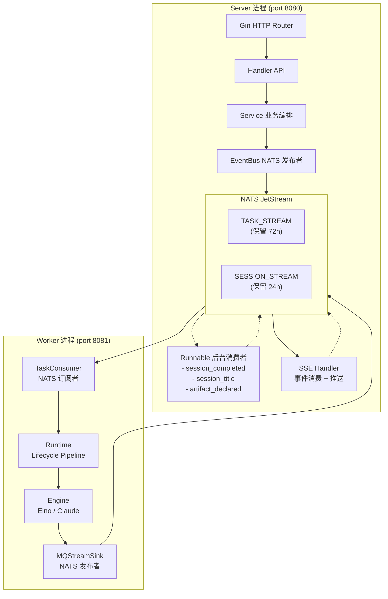
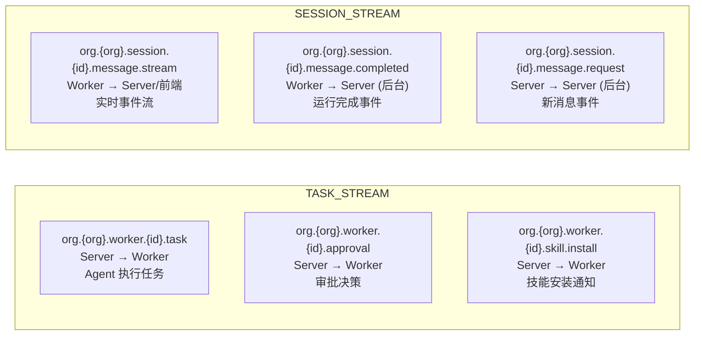
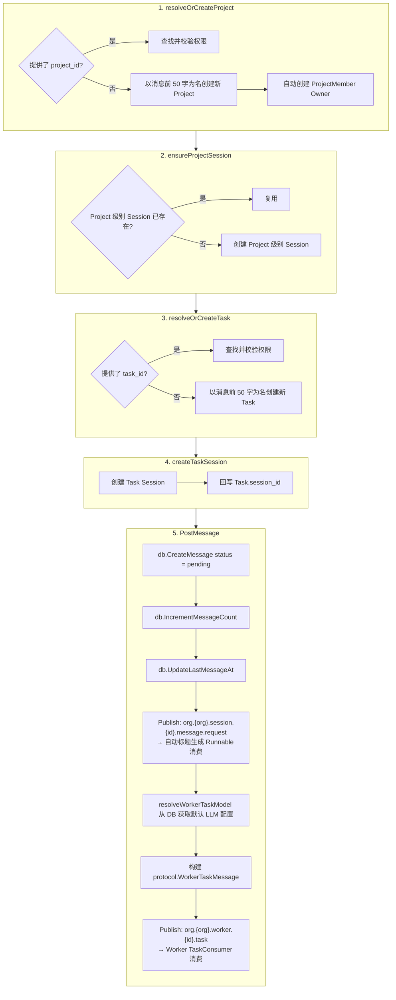
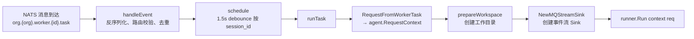
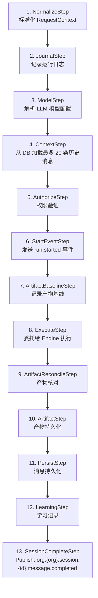
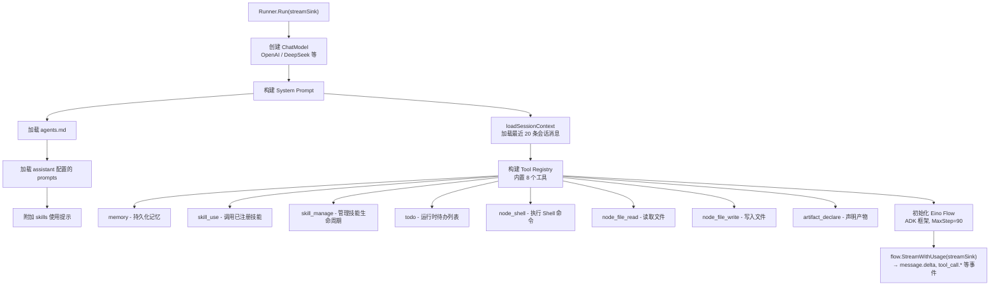
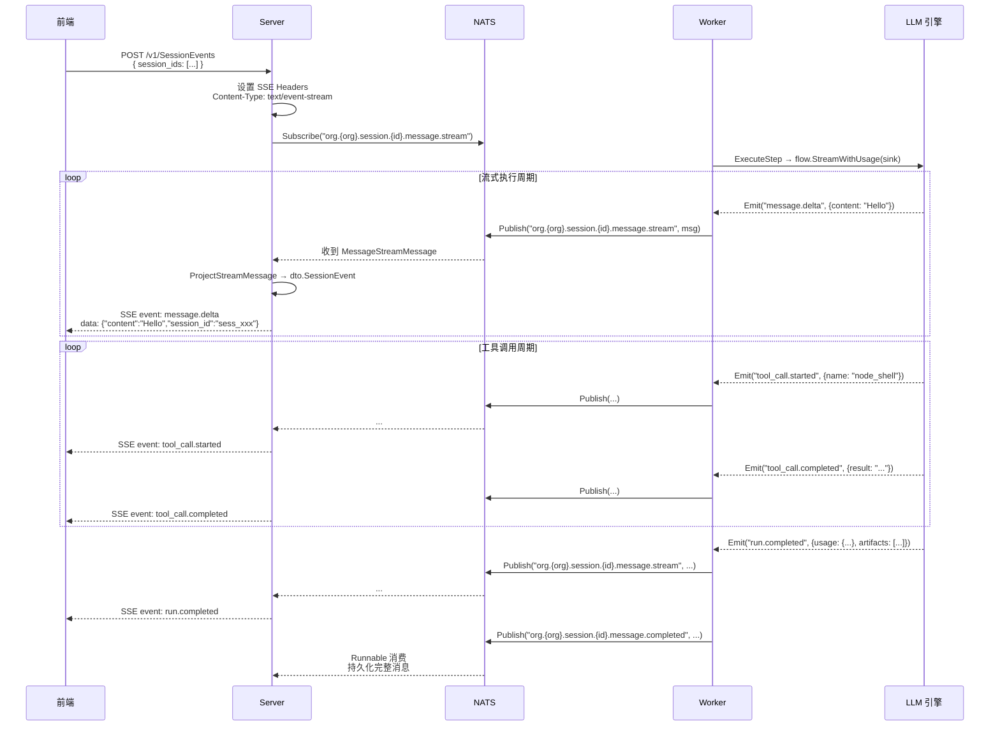

# Leros 用户会话全链路业务流程

> 文档描述从用户发起会话到页面接收到流式响应的完整数据流。

---

## 1. 架构概览



### 关键组件

| 组件 | 位置 | 职责 |
|------|------|------|
| Gin HTTP Router | `backend/internal/api/router.go` | 注册所有 HTTP 路由、中间件、后台 Runnable |
| Handler | `backend/internal/api/handler/` | 请求解析、参数校验、DTO 转换 |
| Service | `backend/internal/service/message_poster.go` | 业务编排：Project → Task → Session → WorkerTask |
| EventBus | `backend/internal/infra/mq/nats.go` | NATS JetStream 发布/订阅 (双 Stream: TASK_STREAM + SESSION_STREAM) |
| TaskConsumer | `backend/internal/worker/taskconsumer/consumer.go` | 订阅 Worker Task, 调度 Agent Run |
| Runtime (Lifecycle) | `backend/internal/runtime/lifecycle/runner.go` | Pipeline 式执行（13 个步骤） |
| Engine (Native) | `backend/engines/native/runner.go` | 基于 CloudWeGo Eino 的内置 LLM 引擎 |
| MQStreamSink | `backend/internal/worker/taskconsumer/stream_sink.go` | Agent 运行时事件 → NATS Session Stream |
| SSE Handler | `backend/internal/api/handler/session_handler.go` | NATS Session Stream → SSE → 前端 |
| Runnable | `backend/internal/runnable/` | 后台异步消费者（完成持久化、标题生成、产物存储） |
| 前端 Store | `frontend/packages/store/slices/chatSlice.ts` | SSE 消费 + Redux 状态管理 |

### NATS Topic 拓扑 & 消息协议



**消息协议:**

| Topic | 消息类型 | 协议结构 | 说明 |
|-------|---------|---------|------|
| `org.{org}.worker.{id}.task` | `protocol.WorkerTaskMessage` | Envelope{Trace, Route} + Body{Actor, Workspace, Input, Model} | Worker 任务分派 |
| `org.{org}.session.{id}.message.stream` | `protocol.MessageStreamMessage` | Envelope + Event{Type, Payload, Seq} | 实时事件流 |
| `org.{org}.session.{id}.message.completed` | `protocol.RunCompletedMessage` | Envelope + RunResult{Status, Usage, Artifacts} | 运行完成通知 |
| `org.{org}.session.{id}.message.request` | `types.SessionMessage` | 标准消息实体 | 新消息通知 |

---

## 2. 完整流程（按阶段）

### 阶段 1：用户输入入口

**入口方式一：CLI 命令行**

- 命令: `leros chat "hello"`
- CLI 入口: `backend/cmd/leros/chat.go`
- 发起 `POST /v1/NewMessage` 请求到 Server
- 获得 `session_id` 后, 发起 `POST /v1/SessionEvents` SSE 连接

**入口方式二：Web UI 前端**

- 前端调用 `workApi.newMessage()` → `POST /v1/NewMessage`
- 或 `sessionApi.addMessage()` → `POST /v1/sessions/{id}/messages`
- 然后调用 `#startSSE()` → `POST /v1/SessionEvents`

**HTTP 路由注册:**

```
POST /v1/NewMessage                → WorkHandler.NewMessage
POST /v1/sessions/{id}/add-message → SessionHandler.AddMessage
POST /v1/SessionEvents             → SessionHandler.SessionEvents
```

---

### 阶段 2：NewMessage 原子编排

**代码位置:** `backend/internal/service/message_poster.go:92-152` (`RunNewMessage`)

**涉及的事件发布:**

| 步骤 | 事件 | NATS Topic | 消息内容 |
|------|------|-----------|---------|
| PostMessage → Publish | `session.message.request` | `org.{org}.session.{id}.message.request` | 完整的 `types.SessionMessage` 实体 |
| PostMessage → publishWorkerTask | `worker.task` | `org.{org}.worker.{id}.task` | `protocol.WorkerTaskMessage`（含 Session 上下文、模型配置、用户消息） |



**事件之后:**

- `message.request` → **Session Title Runnable** 消费，调用 LLM 生成标题
- `worker.task` → **Worker TaskConsumer** 消费，进入阶段 3

**关键数据结构:** `protocol.WorkerTaskMessage`

```go
type WorkerTaskMessage struct {
    ID        string            // "msg_{sessionID}_{sequence}"
    Type      string            // "worker.task"
    CreatedAt time.Time
    Trace     TraceContext      // TraceID, RequestID, TaskID, RunID
    Route     RouteContext      // OrgID, SessionID, WorkerID
    Body      WorkerTaskBody    // TaskType, Actor, Workspace, Input, Model
    Metadata  map[string]any    // session_id, message_type, sequence
}
```

---

### 阶段 3：Worker 消费 Task

**代码位置:** `backend/internal/worker/taskconsumer/consumer.go`

**事件流:**

| 方向 | 事件 | NATS Topic |
|------|------|-----------|
| 输入 | `worker.task` | `org.{org}.worker.{id}.task` |



#### Agent Runtime Pipeline

**位置:** `backend/internal/runtime/service.go` → `backend/internal/runtime/lifecycle/runner.go`

Pipeline 式 13 步执行流程（SyncPipeline, 按序执行）:



**Pipeline 中产生的事件:**

| Pipeline 步骤 | 事件类型 | 发布到 |
|-------------|---------|-------|
| 6. StartEventStep | `run.started` | MQStreamSink → `message.stream` |
| 8. ExecuteStep | `message.delta`、`reasoning.delta`、`tool_call.*`、`todo.*`、`artifact.declared`、`approval.*` | MQStreamSink → `message.stream` |
| 13. SessionCompleteStep | `run.completed` / `run.failed` | `message.completed` |

---

### 阶段 4：Native Engine 执行

**代码位置:** `backend/engines/native/runner.go`

**输入:** `agent.RequestContext`（含 Session 历史、模型配置、系统 Prompt）

**输出:** 通过 `streamSink` 回调持续发出运行时事件



**引擎发出的运行时事件类型 (通过 streamSink.Emit):**

| 事件类型 | 产生时机 | Payload 结构 |
|---------|---------|-------------|
| `message.delta` | LLM 逐 token 输出 | `{message_id, role, content}` |
| `reasoning.delta` | LLM 推理过程输出 | `{message_id, role, content}` |
| `message.result` | LLM 单次回复完成 | `{message, usage}` |
| `tool_call.started` | LLM 请求调用工具 | `{tool_call_id, name, arguments}` |
| `tool_call.delta` | 工具流式输出 | `{tool_call_id, content}` |
| `tool_call.completed` | 工具执行成功 | `{tool_call_id, name, result, elapsed_ms}` |
| `tool_call.failed` | 工具执行失败 | `{tool_call_id, name, error, elapsed_ms}` |
| `todo.snapshot` / `todo.updated` | 待办列表变更 | `[{id, title, status, priority}]` |
| `artifact.declared` | 新产物被声明 | `{artifact_id, title, filename, mime_type, ...}` |
| `approval.requested` | 需要用户审批 | `{request_id, tool_name, description, arguments}` |
| `approval.resolved` | 审批被处理 | `{request_id, action, reason}` |
| `run.completed` / `run.failed` | 引擎运行结束 | `{status, result, usage, artifacts, events}` |

---

### 阶段 5：事件流 Worker → NATS → Server SSE → 前端

#### MQStreamSink：Agent 事件 → NATS Session Stream

**代码位置:** `backend/internal/worker/taskconsumer/stream_sink.go:35-75`

```
Emit(event *agent.Event)
  ├── 封装为 protocol.MessageStreamMessage
  │     ├── Envelope{Trace, Route, SessionID}
  │     ├── Type = EventType (如 "message.delta")
  │     ├── Payload = JSON(raw payload)
  │     └── Seq = 递增序号
  └── eventbus.Publish("org.{org}.session.{session_id}.message.stream", msg)
```

#### Server 端 SSE 推送

**代码位置:** `backend/internal/api/handler/session_handler.go:214-260`

**事件流:**

| 方向 | Topic | 事件类型 |
|------|-------|---------|
| Worker → NATS | `org.{org}.session.{id}.message.stream` | 所有运行时事件 |
| NATS → Server | `org.{org}.session.{id}.message.stream` | 同上（Server Subscribe 后推 SSE） |
| Server → 前端 | SSE | `run.started`、`message.delta`、`tool_call.*`、`todo.*`、`artifact.declared`、`approval.*`、`run.completed` / `run.failed` |



**SSE 帧格式（Gin `ctx.SSEvent()` 输出）:**

```
event: message.delta
data: {"message_id":"","role":"assistant","content":"Hello","session_id":"sess_xxx"}

event: tool_call.started
data: {"tool_call_id":"call_xxx","name":"node_shell","arguments":{"cmd":"ls"},"session_id":"sess_xxx"}

event: run.completed
data: {"status":"completed","result":{"message":"Done"},"usage":{"prompt_tokens":100,"completion_tokens":50},"session_id":"sess_xxx"}
```

#### 前端 SSE 消费

**代码位置:** `frontend/packages/ui/lib/fetch-sse.ts`

```
FetchSSEClient
  ├── fetch() + ReadableStream (POST 请求)
  ├── 逐行解析 event: / data: 字段
  └── onMessage 回调 → chatSlice 事件处理器
```

**前端 Store 事件分发** (`frontend/packages/store/slices/chatSlice.ts:882-944`):

```
event: run.started       → markRunStarted()
event: message.delta     → appendStreamingContent(content)
event: reasoning.delta   → appendReasoningContent(content)
event: tool_call.started → addToolCall({id, name, arguments})
event: tool_call.delta   → updateToolCallDelta({id, content})
event: tool_call.completed → updateToolCallStatus({id, result})
event: tool_call.failed  → updateToolCallStatus({id, error})
event: todo.snapshot     → setTodos(items)
event: todo.updated      → setTodos(items)
event: artifact.declared → addArtifact(artifact)
event: approval.requested → addApproval(request)
event: approval.resolved → removeApproval(request_id)
event: run.completed     → markCompleted() + stopSSE()
event: run.failed        → markFailed() + stopSSE()
```

---

### 阶段 6：异步消息持久化（Runnable）

三个后台 Runnable 独立运行于 Server 进程内, 作为常规 NATS 消费者：

#### 6.1 Session Completed Runnable

**路径:** `backend/internal/runnable/session_completed.go`

**订阅:** `org.{org}.session.{id}.message.completed`

**触发时机:** Worker Lifecycle Pipeline 的 `SessionCompleteStep` 发布运行结果

**消息内容:** `protocol.RunCompletedMessage`

```go
type RunCompletedMessage struct {
    Status    string              // "completed" | "failed"
    Result    RunResult           // 最终消息内容
    Usage     *UsagePayload       // token 使用量
    Artifacts []ArtifactPayload   // 生成的产物
    Events    []RunEventRecord    // 事件归档
    Metadata  map[string]any
}
```

**消费后操作:**
- 创建完整的 Assistant Message 记录至 DB（含最终内容）
- 保存消息 chunks（流式片段）
- 保存 artifacts 元数据
- 保存 usage 信息

#### 6.2 Session Title Auto-Generation

**路径:** `backend/internal/runnable/session_title_handler.go`

**订阅:** `org.{org}.session.{id}.message.request`

**触发时机:** Server 端 PostMessage 后发布

**消息内容:** `types.SessionMessage`

**操作:** 调用 LLM 根据用户消息内容生成 Session 标题，回写 DB

#### 6.3 Artifact Persistence

**路径:** `backend/internal/runnable/session_artifact_declared.go`

**订阅:** `org.{org}.session.{id}.message.stream`（过滤 `artifact.declared` 事件）

**触发时机:** Engine 执行期间调用 `artifact_declare` 工具时

**消息内容:** `protocol.MessageStreamMessage`（其中 Event.Type = `artifact.declared`）

**操作:**
- 持久化产物数据到文件存储
- 记录产物元数据到 DB

---

## 3. 完整时序图

```mermaid
sequenceDiagram
    participant Client as 前端/CLI
    participant Server as "HTTP Server<br/>(Gin + Service)"
    participant NATS as "NATS JetStream"
    participant Worker as "Worker<br/>(TaskConsumer)"
    participant Runtime as "Runtime<br/>(Lifecycle Pipeline)"
    participant Engine as "LLM 引擎<br/>(Eino)"

    Note over Client,Engine: === 阶段 1-2: 用户发起消息 → NewMessage 原子编排 ===

    Client->>+Server: POST /v1/NewMessage
    Server->>Server: resolveOrCreateProject()
    Server->>Server: ensureProjectSession()
    Server->>Server: resolveOrCreateTask()
    Server->>Server: createTaskSession()
    Server->>Server: PostMessage()
    Server->>Server: db.CreateMessage (status=pending)
    Server->>NATS: Publish("org.{org}.session.{id}.message.request", types.SessionMessage)
    Note over NATS: → session_title_handler Runnable 消费
    Server->>Server: publishWorkerTask()
    Server->>NATS: Publish("org.{org}.worker.{id}.task", protocol.WorkerTaskMessage)
    Server-->>Client: 200 OK {session_id, project_id, task_id, message_id}
    deactivate Server

    Note over Client,Engine: === 阶段 3: Worker 消费 Task ===

    Client->>+Server: POST /v1/SessionEvents {session_ids: [...]}
    Server->>Server: 设置 SSE Headers + 创建 ChannelSink
    Server->>Server: goroutine → StreamSessionEvents(ctx, sessionID, sink)
    Server->>NATS: Subscribe("org.{org}.session.{id}.message.stream")

    NATS-->>Worker: Deliver("org.{org}.worker.{id}.task")
    activate Worker
    Worker->>Worker: handleEvent() → 反序列化 + 校验路由 + seqTracker 去重
    Worker->>Worker: scheduleAndWait() → 1.5s debounce (按 session_id)
    Worker->>Worker: enqueueTask() → pool.Submit()
    Worker->>Worker: executeWithTracker() → seqTracker.MarkProcessing
    Worker->>Worker: runTask()
    Worker->>Worker: RequestFromWorkerTask(taskMsg) → *agent.RequestContext
    Worker->>Worker: prepareWorkspace() → 创建工作目录
    Worker->>Worker: NewMQStreamSink(publisher, taskMsg) → 绑定 NATS 事件发布
    Worker->>Worker: req.EventSink = MQStreamSink
    Worker->>+Runtime: runner.Run(ctx, req)

    Note over Client,Engine: === 阶段 4: Agent Runtime Pipeline (13 步) ===

    Runtime->>Runtime: RunPipeline(ctx, defaultPipeline, state)
    Runtime->>Runtime: [1] NormalizeStep — 标准化 RequestContext
    Runtime->>Runtime: [2] JournalStep — 运行日志记录
    Runtime->>Runtime: [3] ModelStep — 校验/补全 LLM 配置
    Runtime->>Runtime: [4] ContextStep — 加载历史消息 + 构建 SystemPrompt + 创建 Emitter
    Runtime->>Runtime: [5] AuthorizeStep — 权限校验
    Runtime->>Runtime: [6] StartEventStep

    Runtime->>NATS: Emit("run.started") → MQStreamSink
    Note over NATS: Publish("org.{org}.session.{id}.message.stream", StreamEventRunStarted)
    NATS-->>Server: Deliver
    Server-->>Client: SSE event: run.started

    Runtime->>Runtime: [7] ArtifactBaselineStep
    Runtime->>+Engine: [8] ExecuteStep → Delegate.Run(ctx, req)

    Note over Client,Engine: === 阶段 4(续): LLM 流式执行 ===

    Engine->>Engine: 创建 ChatModel + SystemPrompt + 加载历史消息
    Engine->>Engine: 构建 Tool Registry (8 内置工具)
    Engine->>Engine: 初始化 Eino Flow → flow.StreamWithUsage(sink)

    loop 实时事件流推送
        Engine->>NATS: Emit("message.delta") → MQStreamSink
        NATS-->>Server: Deliver
        Server-->>Client: SSE event: message.delta
        Engine->>NATS: Emit("reasoning.delta") → MQStreamSink
        NATS-->>Server: Deliver
        Server-->>Client: SSE event: reasoning.delta
        Engine->>NATS: Emit("tool_call.started/completed/failed") → MQStreamSink
        NATS-->>Server: Deliver
        Server-->>Client: SSE event: tool_call.*
        Engine->>NATS: Emit("todo.snapshot/updated") → MQStreamSink
        NATS-->>Server: Deliver
        Server-->>Client: SSE event: todo.*
        Engine->>NATS: Emit("artifact.declared") → MQStreamSink
        NATS-->>Server: Deliver
        Server-->>Client: SSE event: artifact.declared
        Engine->>NATS: Emit("approval.requested/resolved") → MQStreamSink
        NATS-->>Server: Deliver
        Server-->>Client: SSE event: approval.*
    end

    Note over Client,Engine: === 阶段 4(续): Pipeline 后置步骤 ===

    Engine-->>-Runtime: Emit("run.completed")
    Runtime->>Runtime: [9] ArtifactReconcileStep
    Runtime->>Runtime: [10] ArtifactStep
    Runtime->>Runtime: [11] PersistStep
    Runtime->>Runtime: [12] LearningStep
    Runtime->>Runtime: [13] SessionCompleteStep
    Runtime->>NATS: Emit("run.completed") → MQStreamSink
    Note over NATS: Publish("org.{org}.session.{id}.message.stream", StreamEventRunCompleted)
    NATS-->>Server: Deliver
    Server-->>Client: SSE event: run.completed

    Runtime->>NATS: emitCompleted() → Publish("org.{org}.session.{id}.message.completed", RunCompletedMessage)
    deactivate Runtime

    Note over Client,Engine: === 阶段 5: 异步消息持久化 ===

    NATS-->>+Server: session_completed Runnable 消费<br/>   "org.{org}.session.{id}.message.completed"
    Server->>Server: CompleteSessionMessage() — 持久化助理消息(chunks/artifacts/usage)
    deactivate Server

    Note over NATS: session_completed Runnable (run.failed 分支):<br/>FailedSessionMessage() — 持久化失败消息
    Note over NATS: session_title Runnable (独立):<br/>按需调用 LLM 生成会话标题 → 回写 DB
    Note over NATS: session_artifact Runnable (独立):<br/>过滤 artifact.declared → 产物持久化到 FileStore + DB
```



---

## 4. 关键设计决策

### 4.1 为什么用 SSE 而非 WebSocket

| 考量 | SSE | WebSocket |
|------|-----|-----------|
| 单向流推送 | 原生支持（Server → Client） | 双向, 但本场景只用单向 |
| 实现复杂度 | Gin 原生 `ctx.SSEvent()` | 需要额外库（Gorilla） |
| 浏览器兼容性 | 主流浏览器原生支持 | 需要 polyfill |
| 自动重连 | 原生支持 `EventSource` | 需自行实现 |
| 请求方式 | 可用 POST（传递 session_ids） | 仅支持 GET |

虽然有 WebSocket 实现（`backend/internal/infra/websocket/`），但当前前端仅使用 SSE。

### 4.2 为什么用 NATS 作为事件总线

Worker 和 Server 是独立进程，需要解耦：
- Server 只管编排 + 投递 + 推送到前端
- Worker 只管执行 Agent Run
- NATS 提供 at-least-once 投递、持久化、消费组

### 4.3 为什么分 TASK_STREAM 和 SESSION_STREAM 两个 Stream

| Stream | 用途 | 保留策略 | 差异点 |
|--------|------|---------|--------|
| TASK_STREAM | Worker 任务分发 + 审批控制 | 72h, 200/subject | 重要, 不可丢失 |
| SESSION_STREAM | 会话事件流（增量推送） | 24h, 10000/subject | 高吞吐, 可丢部分 |

### 4.4 幂等与去重

- Worker 端：SQLite 维护 `processed_seq` 表, 防止重复消费同一 Worker Task
- Session Stream：通过 `SequenceNumber` 保证事件顺序

### 4.5 Debounce 机制

Worker TaskConsumer 按 `session_id` 做 1.5s debounce：
- 同一 Session 的连续 Task 会被合并
- 避免 LLM 被重复请求打满

---

## 5. 当前实现状态

| 模块 | 状态 | 说明 |
|------|------|------|
| HTTP API Server (Gin) | ✅ 已实现 | 所有路由注册 |
| NewMessage 编排 | ✅ 已实现 | Project/Task/Session 原子创建 |
| Session CRUD | ✅ 已实现 | Create/Retrieve/Update/Delete |
| NATS EventBus | ✅ 已实现 | Publisher + Subscriber 接口, JetStream 实现 |
| Worker TaskConsumer | ✅ 已实现 | 去重、debounce、并发池、崩溃恢复 |
| Native Engine (Eino) | ✅ 已实现 | 内置 Go 运行时, CloudWeGo Eino |
| SSE Streaming | ✅ 已实现 | Server → Frontend (Gin SSEvent) |
| CLI Chat | ✅ 已实现 | 交互式 + SSE |
| 消息持久化 | ✅ 已实现 | 异步 Runnable 消费 completed topic |
| 自动会话标题 | ✅ 已实现 | 异步 Runnable + LLM Prompt |
| 产物持久化 | ✅ 已实现 | 异步 Runnable + FileStore |
| 审批流程 | ✅ 已实现 | Frontend → API → NATS → Worker |
| 技能管理 | ✅ 已实现 | 注册/管理/使用 |
| Claude/Codex Engine | ✅ 已实现 | 外部 CLI 适配器 |
| 会话历史加载 | ✅ 已实现 | 最多 20 条历史消息 |
| Assistant 推断 | ⚠️ 硬编码 | 总是返回 assistant_id=1, 待实现智能推断 |
| Orchestrator | ⚠️ 部分实现 | GitHub 事件解析是桩代码 |
| WebSocket 端点 | ⚠️ 未集成 | Server 端存在, 前端未使用 |
| 记忆系统 | 🔄 计划中 | 工具已注册, 功能基础 |
| 会话恢复 (Resume) | 🔄 计划中 | 状态机支持, 无消费端实现 |

---

## 6. 附录：核心文件索引

| 文件 | 关键内容 |
|------|---------|
| `backend/cmd/leros/server.go` | HTTP Server 启动入口 |
| `backend/cmd/leros/worker.go` | Worker 进程启动入口 |
| `backend/internal/api/router.go` | 全量路由注册 |
| `backend/internal/api/handler/work_handler.go` | POST /v1/NewMessage |
| `backend/internal/api/handler/session_handler.go` | POST /v1/SessionEvents (SSE) |
| `backend/internal/service/message_poster.go` | NewMessage 编排 + WorkerTask 发布 |
| `backend/internal/worker/taskconsumer/consumer.go` | Worker Task 消费 |
| `backend/internal/worker/taskconsumer/stream_sink.go` | Agent 事件 → NATS |
| `backend/internal/runtime/lifecycle/runner.go` | Pipeline 13 步执行 |
| `backend/internal/runtime/events/events.go` | 事件类型定义 + Payload 结构 |
| `backend/engines/native/runner.go` | Eino 引擎实现 |
| `backend/internal/infra/mq/nats.go` | NATS JetStream 实现 |
| `backend/internal/runnable/session_completed.go` | 完成消息持久化 |
| `backend/internal/runnable/session_title_handler.go` | 会话标题生成 |
| `backend/internal/runnable/session_artifact_declared.go` | 产物持久化 |
| `frontend/packages/store/slices/chatSlice.ts` | 前端 SSE 消费 + 状态管理 |
| `frontend/packages/ui/lib/fetch-sse.ts` | 前端 SSE Client |

---

*文档生成时间: 2026-06-17*
*基于 Leros commit: 请参见 Git log*
