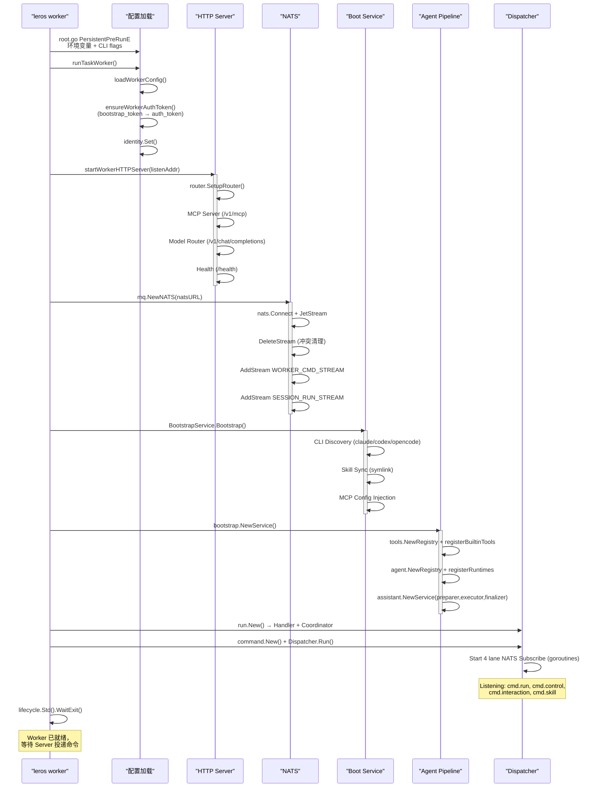

# Leros Worker 初始化流程深度分析

> 文档基于 Leros commit 9bf5d4f (2026-06-30) 的代码仓库。
> 分析范围：从 CLI 入口到 Dispatcher 启动的完整初始化链条。

---

## 1. 调用链概览

```
leros worker [runtime]                          # CLI 入口
  └─ root.go PersistentPreRunE                  # 配置加载
      └─ runTaskWorker(defaultRuntime)           # Worker 主函数
          ├─ loadWorkerConfig()                  # Worker 配置加载
          ├─ ensureWorkerAuthToken()             # (可选) Token 交换
          ├─ identity.Set()                      # 身份注入
          ├─ startWorkerHTTPServer()             # HTTP 服务启动
          │   └─ router.SetupRouter()            # MCP + Model Router + Health
          ├─ mq.NewNATS()                        # NATS 连接 + Stream 初始化
          ├─ builtin.BootstrapService.Bootstrap() # CLI 发现 + Skill 同步
          ├─ bootstrap.NewService()              # Agent 管线装配
          │   ├─ tools.Registry                  # 工具注册
          │   ├─ agent.Registry                  # Runtime 注册
          │   └─ assistant.Service               # 业务运行器
          ├─ run.New()                           # run.Handler + Coordinator
          ├─ command.New() + Dispatcher.Run()    # 4 lane 命令分发
          └─ lifecycle.Std().WaitExit()          # 等待退出信号
```

---

## 2. CLI 入口层

### 2.1 命令层级

```
leros
  └── worker              基础命令，--default-runtime 参数
      ├── claude          默认 runtime = claude
      ├── codex           默认 runtime = codex
      └── opencode        默认 runtime = opencode
```

**文件**: `backend/cmd/leros/worker.go`

```go
// 基础命令
var workerCmd = &cobra.Command{
    Use:   "worker [flags]",
    RunE: func(cmd *cobra.Command, _ []string) error {
        return runTaskWorker(defaultRuntime)
    },
}

// 子命令（只是预设 default-runtime 的快捷方式）
var workerWithClaudeCmd = &cobra.Command{
    Use:   "claude",
    RunE: func(cmd *cobra.Command, _ []string) error {
        return runTaskWorker("claude")
    },
}
```

### 2.2 命令行参数

| 参数 | 默认值 | 用途 |
|------|--------|------|
| `--org-id` | 0 | 组织 ID（必填） |
| `--worker-id` | 0 | Worker 编号（必填） |
| `--server-addr` | | Server 地址（推荐填写） |
| `--listen-addr` | `:8081` | Worker HTTP 监听地址 |
| `--auth-token` | | 认证令牌 |
| `--bootstrap-token` | | 启动令牌（可选，用于换取 auth-token） |
| `--workspace-root` | | 工作空间根目录 |
| `--default-runtime` | `leros` | 默认 Runtime 类型 |
| `--config` | `~/.leros/config.yaml` | 配置文件路径 |

### 2.3 环境变量覆盖

在 `root.go` 的 `PersistentPreRunE` 中加载并覆盖：

| 环境变量 | 覆盖配置项 |
|----------|-----------|
| `LEROS_ORG_ID` | `org_id` |
| `LEROS_WORKER_ID` | `worker_id` |
| `LEROS_SERVER_ADDR` / `LEROS_SERVER_URL` | `server_addr` |
| `LEROS_AUTH_TOKEN` | `auth_token` |
| `LEROS_WORKER_BOOTSTRAP_TOKEN` | `bootstrap_token` |
| `LEROS_WORKSPACE_ROOT` | `workspace_root` |
| `LEROS_DEV` | 开发模式标志 |

优先级：**环境变量 > CLI flags > 配置文件**

---

## 3. 配置加载

### 3.1 加载管线

```
root.go PersistentPreRunE
  └─ config.LoadConfig(cfgFile)
       ├─ 读取 YAML 配置文件
       └─ 环境变量覆盖

worker.go runTaskWorker()
  └─ loadWorkerConfig(cliConfig, orgID, workerID, ...)
       ├─ 从 cliConfig 提取 WorkerConfig
       ├─ 以 CLI flags 覆盖 NatsURL、ServerAddr 等
       └─ 校验必填项
```

### 3.2 WorkerConfig 结构

**文件**: `backend/config/worker.go`

```go
type WorkerConfig struct {
    OrgID           uint              // 组织 ID（必填）
    WorkerID        uint              // Worker 编号（必填）
    ServerAddr      string            // Server 地址（如 127.0.0.1:8080）
    AuthToken       string            // 认证令牌
    BootstrapToken  string            // 启动令牌（可选）
    WorkspaceRoot   string            // 工作空间根目录
    Env             string            // 运行环境
    NATS            *NATSConfig       // NATS 连接配置
    CLI             *CLIEnginesConfig // 外部 CLI 引擎配置
    Gitea           *GiteaConfig      // Gitea 配置
}
```

### 3.3 校验规则

`validateTaskWorkerConfig()` 检查：
- `org_id` > 0
- `worker_id` > 0
- 如果配置了 `server_addr`，必须配置 `auth_token`（或 `bootstrap_token`）

---

## 4. Auth Token 交换（可选）

**文件**: `backend/cmd/leros/worker.go` — `ensureWorkerAuthToken()`

当 Worker 配置了 `bootstrap_token` 但未配置 `auth_token` 时触发：

```
Worker → POST /v1/workers/token (HTTP)
          Header: X-Bootstrap-Token: {bootstrap_token}
          Body:   {org_id, worker_id}
          Response: 200 OK {auth_token: "..."}
```

交换结果写回配置文件的 `worker.auth_token` 字段，后续启动不再触发。

如果配置了 `auth_token` 或没有 `bootstrap_token`，则跳过此步骤。

---

## 5. 身份注入

**文件**: `backend/internal/worker/identity/profile.go`

```go
identity.Set(identity.Profile{
    OrgID:      cfg.OrgID,
    WorkerID:   cfg.WorkerID,
    ServerAddr: cfg.ServerAddr,
    WorkerAddr: listenAddr,
})
```

使用 `atomic.Value` 存储为进程级单例。`GitAuthorEnv()` 提供 Git 提交身份信息：
- Author: `leros-worker-o{org}-w{worker}`
- Email: `worker-w{id}@org{id}.leros.local`

---

## 6. HTTP 服务启动

**文件**: `backend/cmd/leros/worker.go` — `startWorkerHTTPServer()`

在指定地址启动 Gin HTTP 服务器，返回 `*http.Server` 句柄。

### 6.1 路由表

**文件**: `backend/internal/worker/router/router.go`

| 路径 | 功能 | 实现 |
|------|------|------|
| `GET /health` | 健康检查 | 内联 handler，返回 org_id, worker_id, healthy |
| `/v1/mcp` | MCP 协议端点 | `runtimemcp.Server` — 暴露 Leros 业务工具给外部 CLI |
| `/v1/chat/completions` | OpenAI 兼容模型代理 | `modelrouter` — 请求级模型路由 |
| `/v1/messages` | Anthropic Messages 兼容 | `modelrouter` — 同上 |
| `/v1/responses` | OpenAI Responses 兼容 | `modelrouter` — 同上 |

### 6.2 MCP 服务

**文件**: `backend/internal/worker/mcp/server.go`

基于 `mark3labs/mcp-go` 构建的 MCP 服务器，注册的工具：
- `memory` — 持久化记忆读写
- `skill_manage` — 技能安装/卸载/列表查询
- `artifact_declare` — 产物声明

**认证**: Bearer token / X-API-Key，`constantTimeCompare` 防时序攻击。

**目的**: 外部 CLI（Claude/Codex/OpenCode）通过 MCP 协议调用 Leros 的业务能力。

---

## 7. NATS 连接

**文件**: `backend/internal/infra/mq/nats.go` — `NewNATS()`

```
NewNATS(url)
  ├─ nats.Connect(url)               // 建立连接
  ├─ js = conn.JetStream()           // 获取 JetStream 上下文
  ├─ DeleteStream (冲突清理)          // 清理与本进程冲突的同名 stream
  ├─ AddStream / UpdateStream        // 创建/更新 WORKER_CMD_STREAM + SESSION_RUN_STREAM
  └─ return EventBus                  // 返回 Publisher + Subscriber
```

### 7.1 NATS Server 地址来源

优先级：
1. CLI `--nats-url` 参数
2. 配置文件中的 `nats.url`
3. 默认值：`nats://127.0.0.1:4222`

### 7.2 Stream 配置

**文件**: `backend/pkg/messaging/subject.go` — `StreamConfigs()`

| Stream | Subjects | 存储 | 保留策略 | 用途 |
|--------|----------|------|----------|------|
| `WORKER_CMD_STREAM` | `org.*.worker.*.cmd.>` | FileStorage | 72h, 200/subject | Server → Worker 命令 |
| `SESSION_RUN_STREAM` | `org.*.session.*.run.>` | FileStorage | 24h, 10000/subject | Worker → Server 事件 |

---

## 8. 引擎初始化 (Bootstrap)

**文件**: `backend/internal/assistant/bootstrap/builtin/bootstrap.go`

`BootstrapService.Bootstrap()` 在 Worker 进程启动时执行一次：

### 8.1 CLI 发现

```go
// provider.DiscoverAvailableCLI()
// 返回 []CLIProvider{Name, Path, Version}
// 检查可执行文件：
//   - which claude   → provider "claude"
//   - which codex    → provider "codex"
//   - which opencode → provider "opencode"
```

### 8.2 Skill 同步

**文件**: `backend/internal/assistant/bootstrap/skilllinks/skills_sync.go`

```go
SyncToLerosDir()
  ├─ 将内置 skills（backend/skills/）同步到 .leros/skills/
  └─ 使用 .seed-manifest 做增量同步（SHA256 比较）

ReconcileExternalSkillLinks()
  ├─ 在 claude CLI 的 skills 目录下创建 symlink
  ├─ 在 codex CLI 的 skills 目录下创建 symlink
  └─ 在 opencode CLI 的 skills 目录下创建 symlink
```

### 8.3 MCP 配置注入

将 Worker 的 MCP 服务地址注入到外部 CLI 的配置文件中（`claude.json` 等），使外部 CLI 能连接 Leros MCP 工具。

---

## 9. Agent 管线装配

**文件**: `backend/internal/assistant/bootstrap/service.go` — `NewService()`

这是 Worker 最复杂的初始化步骤，整个 pipeline 在此组装：

### 9.1 工具注册

```go
registry := tools.NewRegistry(tools.DefaultOptions{
    Memory: localMemoryStore,
    LerosHome: lerosHome,
}).WithBuiltinTools(
    tool_artifact_declare,    // 产物声明
    tool_skill_use,           // 技能使用
    tool_skill_manage,        // 技能管理
    tool_memory,              // 记忆读写
    tool_todo,                // TODO 管理
    tool_node_shell,          // Shell 执行
    tool_node_file_read,      // 文件读取
    tool_node_file_write,     // 文件写入
)
```

### 9.2 Runtime 注册

```go
runtimeRegistry := agent.NewRegistry()

// 始终注册 native 运行时
runtimeRegistry.Register(runtimenative.NewRuntime(
    toolsRegistry,
    modelStore,
    lifecycleContext,
    systemPrompt,
))

// 发现并注册外部 CLI 运行时
for _, provider := range discoveredCLI {
    switch provider.Name {
    case "claude":
        runtimeRegistry.Register(
            runtimeclaude.NewRuntime(claudeOpts))
    case "codex":
        runtimeRegistry.Register(
            runtimecodex.NewRuntime(codexOpts))
    case "opencode":
        runtimeRegistry.Register(
            runtimeopencode.NewRuntime(opencodeOpts))
    }
}
```

### 9.3 agent.Executor 构造

```go
executor := agent.NewExecutor(runtimeRegistry)
```

Executor 的职责：
1. `Registry.Resolve(kind)` — 按名称查找 Runtime
2. 发送 `execution.started` 事件
3. 调用 `Runtime.Execute()`
4. 发送 `execution.completed/failed/cancelled` 事件

### 9.4 Preparer + Finalizer

```go
preparer := assistant.NewPreparerWithTools(
    db, modelRouterStore, sessionService, projectService,
    memoryStore, toolsRegistry, lifecycleContext,
)

finalizer := assistant.NewFinalizer(
    db, workspaceStore, artifactService, projectService, sessionService,
)
```

### 9.5 assistant.Service 组合

```go
assistantSvc := assistant.NewService(
    preparer,
    executor,
    finalizer,
    journalFactory,
)
```

`Service.Run()` 是 Worker 业务执行的完整流水线：
```
validate → run.started → Preparer.Prepare → Executor.Execute
  → Finalizer.FinalizeRequired → artifact events → terminal event → PostRunBestEffort
```

---

## 10. Run Handler 构造

**文件**: `backend/internal/worker/command/run/handler.go`

```go
runHandler := run.New(run.Config{
    OrgID:            cfg.OrgID,
    WorkerID:         cfg.WorkerID,
    MaxConcurrency:   20,
    DebounceWindow:   1500 * time.Millisecond,
    AssistantService: assistantSvc,
    ModelStore:       modelStore,
    Publisher:        bus,
})
```

Handler 内部构建：
1. **SeqTracker** — SQLite 文件，用于 crash recovery 去重
2. **Coordinator** — 本地执行调度器

### 10.1 RunCoordinator

**文件**: `backend/internal/worker/run/coordinator.go`

核心调度机制：

| 机制 | 实现 | 参数 |
|------|------|------|
| 并发控制 | `chan struct{}` slot | `maxConcurrency=20` |
| 串行执行 | per-session goroutine | Key=`{org}:{worker}:{session_id}` |
| Debounce | TrailingDebouncer, 1.5s | 同一 session 窗口内合并 |
| 合并策略 | 合并 Messages/Attachments/Seqs | 首条等待，后续合并 |
| 取消 | context cancel func | `coordinator.Cancel(runID)` |
| 关闭 | 等待所有 in-flight 完成 | `coordinator.Close()` |

### 10.2 命令处理流程

```
Dispatcher 收到 cmd.run 消息
  → json.Unmarshal → WorkerCommand
  → RunHandler.HandleRunCommand
     ├─ decode payload → runTask (RunCommandPayload)
     ├─ 路由校验 (org_id, worker_id)
     ├─ 任务类型校验 (agent.run)
     ├─ 模型配置校验 (provider, model, api_key)
     ├─ SeqTracker.TrackReceived (SQLite)
     ├─ 构建 RunSubmission
     └─ Coordinator.Submit(orgID, workerID, sessionID, submission)

Coordinator.Submit
  └─ 按 sessionKey 进入 debounce 窗口
       └─ 超时后调度执行
            └─ executeSubmission()
                 ├─ NewNATSEventSink (事件发布器)
                 └─ assistantSvc.Run(ctx, request, sink)
```

---

## 11. Dispatcher 启动

**文件**: `backend/internal/worker/command/dispatcher.go`

```go
dispatcher := command.New(command.Config{
    OrgID:    cfg.OrgID,
    WorkerID: cfg.WorkerID,
    Bus:      bus,
    Handlers: command.Handlers{
        Run:         runHandler.HandleRunCommand,
        Control:     runHandler.HandleControlCommand,
        Interaction: interactionHandler,
        Skill:       skillHandler,
    },
})

go dispatcher.Run(ctx)
```

### 11.1 四 lane 订阅

| Lane | Subject | Consumer | Handler |
|------|---------|----------|---------|
| `cmd.run` | `org.{org_id}.worker.{worker_id}.cmd.run` | `worker-run-consumer` | Run — 执行 Agent |
| `cmd.control` | `org.{org_id}.worker.{worker_id}.cmd.control` | `worker-control-consumer` | Control — 取消 |
| `cmd.interaction` | `org.{org_id}.worker.{worker_id}.cmd.interaction` | `worker-interaction-consumer` | Interaction — 审批/问答 |
| `cmd.skill` | `org.{org_id}.worker.{worker_id}.cmd.skill` | `worker-skill-consumer` | Skill — 技能管理 |

### 11.2 并发特性

- 每个 lane 在独立 goroutine 中启动 NATS 订阅
- 任一 lane 异常退出会通过 `context.WithCancel` 取消其他 lane
- 采用 NATS 持久化订阅（Durable Consumer），支持崩溃恢复

---

## 12. 启动时序图



---

## 13. 完整数据结构

### 13.1 消息信封

**文件**: `backend/pkg/messaging/envelope.go`

```go
type Envelope[T any] struct {
    ID        string            `json:"id"`
    Type      MessageType       `json:"type"`
    CreatedAt time.Time         `json:"created_at"`
    Trace     TraceContext      `json:"trace"`
    Route     RouteContext      `json:"route"`
    Body      T                 `json:"body"`
    Metadata  json.RawMessage   `json:"metadata,omitempty"`
}
```

### 13.2 Worker 命令

**文件**: `backend/pkg/messaging/command.go`

```go
type WorkerCommand = Envelope[WorkerCommandBody]

type WorkerCommandBody struct {
    CommandType CommandType     `json:"command_type"`
    Payload     json.RawMessage `json:"payload,omitempty"`
    ReplyTo     string          `json:"reply_to,omitempty"`
}

type RunCommandPayload struct {
    TaskType      TaskType         `json:"task_type"`
    Actor         ActorContext     `json:"actor"`
    Execution     ExecutionTarget  `json:"execution"`
    Workspace     WorkspaceOptions `json:"workspace,omitempty"`
    Input         TaskInput        `json:"input"`
    Model         ModelOptions     `json:"model,omitempty"`
    Runtime       RuntimeOptions   `json:"runtime,omitempty"`
    Policy        TaskPolicy       `json:"policy,omitempty"`
}
```

### 13.3 运行事件

**文件**: `backend/pkg/messaging/event.go`

```go
type RunEvent = Envelope[RunEventBody]

type RunEventBody struct {
    Seq               int64           `json:"seq"`
    Event             RunEventType    `json:"event"`
    Payload           RunEventPayload `json:"payload"`
    ReplyToMessageIDs []string        `json:"reply_to_message_ids,omitempty"`
    RunCompleted      *RunCompletedPayload `json:"run_completed,omitempty"`
    Error             *RunEventError       `json:"error,omitempty"`
}
```

---

## 14. 关键设计要点

### 14.1 Server/Worker 解耦

Worker 不直接依赖 Server 的 HTTP API（除了可选的 token 交换）。所有任务通过 NATS 异步投递，Worker 启动后即可接收命令，无需 Server 在线。

### 14.2 四 lane 隔离

四个 NATS subject lane 使用独立的持久化消费者，任一 lane 的处理异常不会影响其他 lane。特别是 `cmd.control` 独立一个 lane，确保取消命令不会被 run 命令的积压阻塞。

### 14.3 Coordinator 本地调度

Worker 内部的 RunCoordinator 实现了 session 级别的串行化和 debounce 合并，在本地做决策而非依赖 Server：

- **并发控制**: 全局 slot 限制，防止资源耗尽
- **Debounce**: 同一 Session 的快速连续提交合并为一次执行
- **Crash Recovery**: SeqTracker (SQLite) 记录已处理的序列号

### 14.4 双 lane 事件发布

NATSEventSink 按事件类型分类到两个 lane：

- **run.stream**: 高频增量（message.delta, tool_call.*），高吞吐
- **run.state**: 低频状态（run.started, artifact.declared, terminal），低延迟关键

终端事件（run.completed/failed/cancelled）使用 `WithoutCancel` + 5s 超时发布，确保不被取消 context 阻塞。

### 14.5 Runtime 职责边界

Runtime 接口是纯执行层：

- **不得** 发射 `run.started/completed/failed/cancelled`（由 executor 负责）
- **不得** 访问 NATS、messaging 或 Session 持久化
- **只需** 接收 `ExecutionRequest`，返回 `ExecutionResult`

这保证了 Runtime 实现（native/claude/codex/opencode）的可替换性和可测试性。

### 14.6 MCP 双向集成

Worker HTTP 服务同时承担两个角色：
1. **MCP 服务端**: 外部 CLI 通过 MCP 协议连接 Worker，调用 Leros 业务工具
2. **模型路由代理**: 为外部 CLI 提供请求级的模型路由（通过 `modelrouter`）

---

## 15. 核心文件索引

| 文件 | 职责 |
|------|------|
| `backend/cmd/leros/worker.go` | CLI 入口，初始化编排 |
| `backend/cmd/leros/root.go` | 配置加载 + 环境变量覆盖 |
| `backend/config/worker.go` | WorkerConfig 结构定义 |
| `backend/internal/worker/command/dispatcher.go` | 4 lane 命令分发器 |
| `backend/internal/worker/command/run/handler.go` | cmd.run 处理器 |
| `backend/internal/worker/run/coordinator.go` | 执行调度器（去抖/并发/取消） |
| `backend/internal/worker/eventpub/nats_sink.go` | 事件发布器（双 lane） |
| `backend/internal/worker/mcp/` | Worker MCP 服务端 |
| `backend/internal/worker/router/router.go` | Worker HTTP 路由 |
| `backend/internal/worker/identity/profile.go` | 进程级身份单例 |
| `backend/internal/assistant/service.go` | 业务运行流水线 |
| `backend/internal/assistant/bootstrap/service.go` | Agent 管线装配 |
| `backend/internal/assistant/bootstrap/builtin/bootstrap.go` | CLI 发现 + Skill 同步 |
| `backend/internal/assistant/preparer_impl.go` | 执行前准备 |
| `backend/internal/assistant/finalizer_impl.go` | 执行后处理 |
| `backend/agent/executor.go` | Runtime 生命周期管理 |
| `backend/agent/runtime.go` | Runtime 接口 |
| `backend/agent/runtime/native/` | Native Eino 运行时 |
| `backend/agent/runtime/claude/` | Claude 外部 CLI 运行时 |
| `backend/agent/runtime/codex/` | Codex 外部 CLI 运行时 |
| `backend/agent/runtime/opencode/` | OpenCode 外部 CLI 运行时 |
| `backend/agent/runtime/externalcli/` | 外部 CLI 共享设施 |
| `backend/pkg/messaging/` | 统一消息契约包 |
| `backend/internal/infra/mq/nats.go` | NATS JetStream 实现 |
