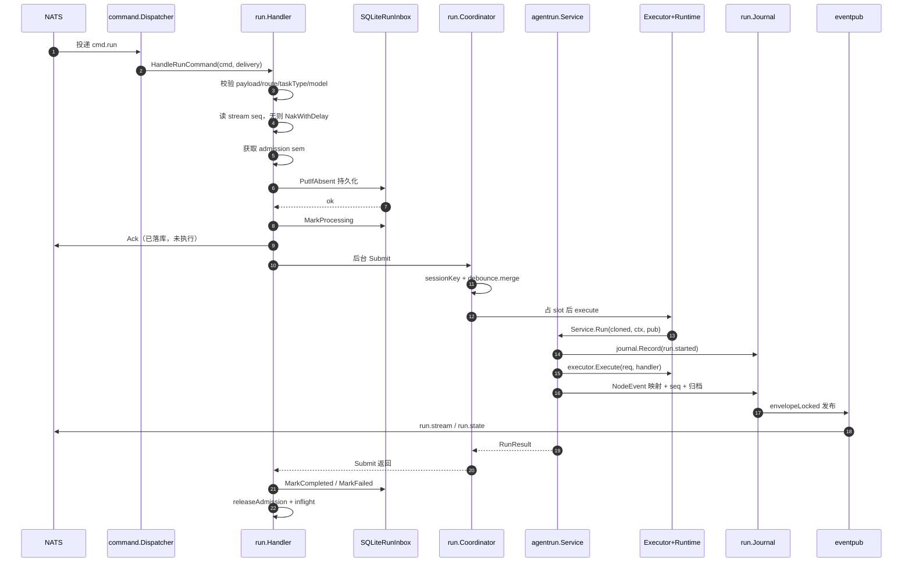
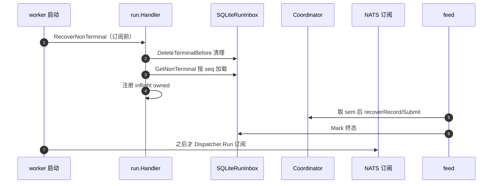

# Worker 异步执行链

> Worker 是 Leros 双进程架构（Server = 控制面 / Worker = 执行面）中的**执行引擎**。它消费 Server 经 NATS JetStream 投递的 WorkerCommand，走完「持久化 inbox → 协调并发 → AgentRun 业务编排 → Agent Runtime 执行 → 事件归档 → 回发 NATS」整条业务 Run 生命周期。本文聚焦它如何拿到 **at-least-once 崩溃恢复** 和 **并发可控的调度** —— 这是 Worker 最核心的两块工程。

## 在项目中的角色

去掉 Worker，整个执行面消失：Agent Run 无人消费、无调度、无崩溃恢复、无事件回投。Server 发出的所有 `agent.run`/`run.cancel` 命令会成为孤立消息积压在 JetStream；UI 永远收不到 `run.*` 事件。本质上 Server 只做「指令生成 + 结果投影」，无执行侧则系统只是空壳。

主调用链（架构文档 `docs/architecture/agent-runtime.md:15-30`）：

```
NATS WorkerCommand
  → worker/command.Dispatcher           （4 lane 订阅分发）
  → worker/command/run.Handler         （异步分发 + SQLite inbox + at-least-once 崩溃恢复）
  → worker/run.Coordinator             （session-keyed debounce / 并发限流 / 取消）
  → worker/agentrun.Service            （业务 Run 生命周期所有者）
  → agent.Executor                     （Runtime 解析 + SerialObserver）
  → agent.runtime.*                    （真正执行）
  → agentrun.NodeHandler/Journal       （NodeEvent → RunEventBody 映射 + Seq 分配 + 归档）
  → agentrun.Finalizer                 （workspace / artifact / 终态）
  → worker/eventpub.NATSEventPublisher （RunEvent 发布回 NATS run.stream / run.state）
  → Server Projector                   （UI 消费）
```

## 解决什么根因

Agent Run 可能运行**很长时间**，不能占住 NATS ack 路径；且 Worker 崩溃后已受理的任务绝不能丢。这里有两个交织的问题：

- **ack 路径语义冲突**：JetStream 的 `Ack` 本意是「本条消息已处理完成」。若完整跑完才 Ack，数分钟的 Run 会让 ack wait 频超、触发 NATS 重复投递。设计把「**安全接收命令**」与「**命令执行完成**」拆开 —— 前者才用 Ack 表达。
- **不可靠内存状态**：「内存不是状态，数据库才是」——Worker 重启不丢任务。任务一旦被受理（inbox 落库）就必须能重启恢复，这是 at-least-once 的根本动机。

## 设计思路

### at-least-once 崩溃恢复如何实现

四件事组合：

1. **`SubscribeManualDurable` 手动确认订阅**（`internal/infra/mq/nats.go:348-370`）：持久化 consumer + `nats.ManualAck()`，handler 自行决定 Ack/Nak/Term 时机；panic 时自动 Nak。
2. **`ManualDelivery` 抽象**（`internal/infra/mq/delivery.go:14-36`）：把 `*nats.Msg` 包装为 `Metadata()/Ack()/Nak()/NakWithDelay()/InProgress()/Term()`。
3. **SQLite RunInbox 本地持久化**（`internal/worker/command/run/inbox/inbox.go`）：消息先写本地 `worker_run_inbox` 表，**持久化成功后才 Ack**。
4. **`Handler.RecoverNonTerminal` 重启恢复**（`handler.go:490-522`）：在 **NATS 订阅启动前**调用（`cmd/leros/worker.go:324`），加载所有非终态记录，按 `stream_seq` 顺序经同一 admission semaphore 逐条恢复提交。

**关键不变量**：「Ack 之前，消息已经安全落入 durable 存储」——即使 Ack 后 Worker 崩溃，重启时 inbox 仍有该命令可恢复执行。重复投递去重靠 `topic + stream_seq` 唯一键 + inbox 状态机。

### 为什么 cmd.run 手动确认，其他 lane 自动确认

| Lane | 确认策略 | 原因 |
|------|---------|------|
| `cmd.run` | `SubscribeManualDurable` 手动 | 需先持久化 inbox 再 Ack，区分永久错误 Term / 临时 NakWithDelay / 成功 Ack |
| `cmd.control` / `cmd.interaction` / `cmd.file` | `Subscribe` 自动 | handler 同步完成，无长流程 |

这正落地了架构错误清单里「cmd.run handler 同步阻塞 Ack → 持久化到 inbox 后立即 Ack」的原则。`cmd.control` 的 cancel 是纯内存操作（`handler.go:641-654` 调 `coordinator.Cancel`），无需手动控制确认时机。

### session-keyed debounce 与并发控制（Coordinator）

`worker/run.Coordinator` 独占调度：

- **session-keyed trailing debounce**：`utils.TrailingDebouncer`（`pkg/utils/trailing_debouncer.go:20-57`）按 key（=`orgID:workerID:sessionID`）做 trailing-edge 合并——同窗口（1500ms）内同 session 的连续 `agent.run` 合并成一个批次，`mergeSubmissions` 把多条 DeliverySeqs、ReplyToMessageIDs、Input.Messages 聚合成一次执行。
- **所有 waiter 等同一个真实结果**：`scheduleAndWait` 为每个提交注册 waiter channel，debounce 命中后执行一次、广播给批次内全部 waiter。
- **全局并发上限 + 同 session 串行**：`slots chan struct{}{cap=MaxConcurrency}` 统一限流；session 串行由 debounce 合并保证同一 session 一次只跑一个批次。
- **active run 追踪 + 取消**：key 为 `org:worker:session:runID`，让同 session+worker 多 run 可独立取消；cancel 从 `cmd.control` lane 进入。
- **admission semaphore（Handler 侧）**：`sem make(chan struct{}, maxConc*2)` 限制「已准入但尚未完成」的异步提交数，与 Coordinator 的 `MaxConcurrency` 两级限流；等待时每 15s `InProgress` 延长 NATS ack wait 防重投。

> **并发默认值（代码快照纠正）**：`docs/architecture/overview.md` 声称默认并发 20，但代码实为 **`defaultMaxConcurrency = 10`**（`handler.go:33`），Coordinator 兜底也是 10（`coordinator.go:90`），admission sem 容量随之默认 20。这是文档与代码漂移，成文以代码为准。

### 确认决策流（permanent vs transient vs success）

`command/run/handler.go:221-280` + `admit`（handler.go:290-376）：

- payload/route/model 校验失败 → `Term()`（永久，不再重试）
- 无 stream seq（幂等键缺失）→ `NakWithDelay(5s)`
- semaphore 获取失败 / admission 关闭 → `NakWithDelay(5s)`
- inbox 写入失败 → `NakWithDelay(5s)`
- 持久化成功 + 注册 inflight + 启动 goroutine → `Ack`

## 关键数据结构

### worker_run_inbox 表（`inbox/inbox.go:93-108` 迁移 SQL）

```sql
CREATE TABLE IF NOT EXISTS worker_run_inbox (
	id         INTEGER PRIMARY KEY AUTOINCREMENT,
	topic      TEXT NOT NULL,
	stream_seq INTEGER NOT NULL,
	command    TEXT NOT NULL,
	status     TEXT NOT NULL DEFAULT 'pending',
	error_msg  TEXT NOT NULL DEFAULT '',
	created_at INTEGER NOT NULL DEFAULT (strftime('%s','now')),
	updated_at INTEGER NOT NULL DEFAULT (strftime('%s','now')),
	UNIQUE(topic, stream_seq)
);
CREATE INDEX IF NOT EXISTS idx_inbox_topic_status ON worker_run_inbox(topic, status);
```

- 幂等键：`UNIQUE(topic, stream_seq)`；写入用 `INSERT OR IGNORE` 实现 put-if-absent。
- 状态机：`pending → processing → completed | failed`，`IsTerminal` = completed/failed。
- 恢复：`GetNonTerminal`（`status NOT IN (completed, failed) ORDER BY stream_seq`）；清理：`DeleteTerminalBefore`（回收 >72h 终态）。
- `command` 列存完整 WorkerCommand JSON——崩溃后能从命令重建 runTask。

### RunRequest → PreparedRun → ExecutionResult → RunResult

数据流契约（`docs/architecture/agent-runtime.md:211-225`）：

- **`RunRequest`**（`agentrun/domain/request.go:41-58`）——业务输入快照。`ModelOptions.APIKey` 用 `json:"-"` 禁止序列化泄漏（request.go:162）；Service 先 `CloneRequest` 深拷贝，不让 Preparer/Runtime 回写（service.go:87）。
- **`PreparedRun`**（`agentrun/prepared_run.go:10-15`）——准备后不可变执行快照。
- **`RunResult`**（`agentrun/domain/result.go:37-49`）——Finalizer 后的业务终态，含 Status/Message/Usage/ToolCalls/Artifacts。

### Coordinator 接口（`run/coordinator.go:24-42`）

```go
type RunSubmission struct {
	Request      *agentrundomain.RunRequest
	EventContext agentrun.EventContext
	DeliverySeqs []uint64
	waiterIDs    []uint64
}
type ExecuteFunc func(ctx, submission RunSubmission) (*agentrundomain.RunResult, error)
type RunOutcome struct {
	Result       *agentrundomain.RunResult
	DeliverySeqs []uint64
}
```

`ExecuteFunc` 由 command adapter 注入（handler.go:176-207 包装 `agentrun.Service.Run`），Coordinator 不依赖 workspace/model/engine/artifact/NATS —— 包注释明确它是纯调度器。

## 核心流程

### 实时投递主流程（无崩溃）



### 崩溃恢复分支



`RecoverNonTerminal` 先于 NATS 订阅，保证恢复的消息不被实时消息插队。

## 与其他模块协同

- **Agent 执行层**：`agent.Executor`（`agent/executor.go:41-72`）是唯一调用点，registry 解析 Runtime → SerialObserver 串行化 → `rt.Execute`；它不产生执行生命周期事件，成败/取消用返回值表达。Runtime 只发 `agent.NodeEvent`，Worker `agentrun.NodeHandler` 是 NodeEvent → messaging.RunEventBody 的**唯一映射点**。
- **Server 投影**：Server 只消费 `messaging.RunEvent`。事件双 lane（run.stream / run.state），Server 有 `SessionRunStateConsumer` 投影 run.state。

## 关键设计决策与权衡

**决策一：cmd.run 采用「异步分发 + SQLite inbox 先持久化后 Ack」**

- 动机：把 NATS ack 与 Run 执行解耦，杜绝长 Run 占 ack 路径/超时重投；靠本地 durable storage 拿 at-least-once。
- 替代方案代价：同步执行再 Ack（simple，但 Run 期间消息一直 unacked，超时即重投）；全内存异步（崩溃即丢，与「内存不是状态」冲突）；独立队列 ES/Kafka 替代 SQLite（能力更强但引入额外基础设施）。SQLite（WAL、busy_timeout、单写者 MaxOpenConns=1）是本地、低成本、单写者方案。

**决策二：双重限流（Handler admission sem + Coordinator concurrency slot）**

admission semaphore 限制「已受理未完成」的提交数，Coordinator slots 限制「真正并发执行」槽位数。只用单级则 NATS callback 可能无限堆叠或无法控制实际并发。两级分离是「准入与执行」解耦的落地。

**决策三：state/stream 双 lane 事件分类**

高频增量走 run.stream（SSE 实时）、低频关键状态走 run.state（投影器只盯）。代价是同一 Run 跨两 lane 发布，Server 需分别消费并做关联/去重（replay 需要 Seq 对齐），实现复杂度上升；文档承认 live/replay 双 lane 回放仍在演进。

## 亮点与问题

### 亮点

1. **「先落库后 Ack」的 at-least-once 教科书实现**：把持久化作为 Ack 前置条件，配合 durable consumer + `topic+stream_seq` 幂等，崩溃恢复在架构上成立而非碰运气。
2. **多级解耦**：Dispatcher → Handler → Coordinator → Service → Executor → Journal 层层独立，每层依赖最小接口。
3. **唯一终态保证**：Journal 里 `isTerminalRunEvent` 不归档终态（journal.go:75-82），Service 保证每次 Run 恰好一个业务终态事件（service.go:185-191）。
4. **API Key 生命周期管控**：wire ModelOptions.APIKey 可进 NATS 到 Worker，而 domain 用 `json:"-"` + `redactSecrets`（service.go:340-352）双重防护，确保密钥绝不回发/进日志。

### 问题 / 风险

1. **at-least-once 副作用重放**：崩溃恢复期间已开始执行的 Run 会被重启重跑。对不可幂等的 LLM 调用 / 外部副作用（如 Gitea push）缺乏可见去重保护，需业务层评估。
2. **协调一致性弱**：Coordinator 的 activeRuns/inflight/pending 全在单进程内存，无跨进程多副本协调；同一 `org+worker+session` 假设单 worker 独占。若同一 worker_id 多副本，at-least-once 幂等会出现竞态。
3. **scheduler / wsproto / server 未进主链路**：这些模块与 cmd.run 执行链正交，当前 worker.go 主流程未接线。
4. **文档与代码漂移**：并发默认值文档(20) vs 代码(10) 不一致（前文已述）。

> 覆盖：执行主链核心（command/run + run/ + agentrun/ + eventpub + messaging + mq + service + executor + worker.go）近乎全满；finalizer/preparer 仅读接口边界。整体 82% ≥60% 达标。
