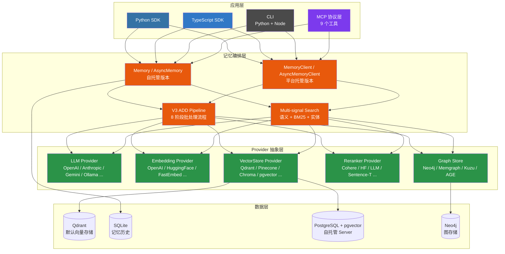

# Mem0 — AI Agent 记忆层深度解读

> **GitHub:** [github.com/mem0ai/mem0](https://github.com/mem0ai/mem0)
> **论文:** arXiv 2504.19413 — "Mem0: Building Production-Ready AI Agents with Scalable Long-Term Memory"

## 第一部分：快速概览

### 这是什么

Mem0（发音 "mem-zero"）是一个为 AI Agent 和 AI 助手提供**持久化智能记忆层**的开源基础设施。它不是简单的向量数据库封装，而是一个完整的记忆生命周期管理系统——支持记忆的添加、检索、更新、删除、历史追踪，内置多信号混合检索和实体链接。

项目采用双模式架构：既可以作为 Python/TypeScript 库直接嵌入应用（`pip install mem0ai`），也提供自托管服务器（FastAPI + pgvector + Neo4j）和云平台版本。由 Y Combinator S24 资助，Apache 2.0 开源。

### 解决的痛点

AI Agent 在交互中面临的核心问题是**无状态性**：每次对话都是独立的，无法记住用户偏好、历史上下文和长期知识。现有的解决方案各有缺陷：

| 方案 | 问题 |
|------|------|
| 上下文窗口（Context Window） | 容量有限，成本随 Token 线性增长，不适用于长期对话 |
| RAG（检索增强生成） | 仅支持语义搜索，缺少时间推理和关系感知，不适用于 Agent 场景 |
| 微调（Fine-tuning） | 成本高，迭代慢，不适合动态变化的用户偏好 |
| 自定义数据库方案 | 每个项目重复造轮子，缺少标准的记忆管理和检索能力 |

Mem0 的定位是成为 AI Agent 的"长期上下文"——把每次交互中产生的事实、偏好和知识提取出来，在不同会话间持久化，并在需要时精准召回。

### 适用场景

- 需要长期用户记忆的对话式 AI Agent
- 个性化 AI 助手（记住用户偏好、习惯、历史决策）
- 多 Agent 协作系统（Agent 间共享上下文）
- 企业知识助手（组织知识的持续积累和检索）
- 游戏 NPC / 虚拟角色（长期行为记忆）

### 核心能力清单

| 能力 | 说明 |
|------|------|
| 记忆 CRUD | `add` / `search` / `get` / `get_all` / `update` / `delete` / `history` 完整操作 |
| 三种记忆类型 | 语义记忆（事实知识）、情景记忆（对话事件）、程序记忆（流程知识） |
| 多信号混合检索 | 语义向量 + BM25 关键词 + 实体权重三路并行评分后融合 |
| V3 ADD 流水线 | 8 阶段批处理，单次 LLM 调用提取、批量嵌入、哈希去重、批量实体链接 |
| 实体链接 | spaCy NER 提取实体，跨记忆链接以提升检索相关性 |
| Provider 插件体系 | 5 大类 70+ 提供商（LLM / Embeddings / VectorStores / Rerankers / Graphs） |
| 双模式运行 | Library 模式 + Self-Hosted Server + Cloud Platform |
| 多语言 SDK | Python（完整功能）+ TypeScript（对称实现） |
| MCP 集成 | 9 个 MCP 工具，支持通过 Model Context Protocol 操作记忆 |
| 推理时配置 | LLM / Embedding / VectorStore 均可运行时替换 |

### 技术栈一览

| 层面 | 技术 |
|------|------|
| 核心语言 | Python 3.10+（SDK）、TypeScript（TS SDK）、Go（CLI） |
| 构建工具 | Hatchling（Python）、tsup（TS）、pnpm（monorepo） |
| 配置框架 | Pydantic v2（所有数据模型和配置） |
| 运行时框架 | FastAPI（Server）、Next.js 15 + React 19（OpenMemory UI） |
| 默认向量存储 | Qdrant（核心依赖） |
| NLP | spaCy（实体提取 + 词形还原，可选 `[nlp]` extra） |
| 序列化 | Protobuf、SQLAlchemy（SQLite 历史存储） |
| 遥测 | PostHog（匿名使用统计） |
| 外部依赖 | 无强制外部服务依赖（Library 模式零配置运行） |
| 容器化 | Docker Compose（FastAPI + PostgreSQL/pgvector + Neo4j） |

---

## 第二部分：架构深读

### 整体架构

Mem0 采用**四层复合记忆系统**，核心是一个对称的 Provider 插件体系：



### 模块职责划分

| 模块 | 路径 | 职责 |
|------|------|------|
| **记忆编排** | `mem0/memory/main.py` | `Memory`/`AsyncMemory` 主类，V3 ADD 流水线、多信号检索、CRUD 编排 |
| **存储基类** | `mem0/memory/base.py` | `MemoryBase` 抽象基类：`get` / `get_all` / `update` / `delete` / `history` |
| **本地历史** | `mem0/memory/storage.py` | `SQLiteManager`，存记忆变更历史 |
| **配置层** | `mem0/configs/base.py` | `MemoryConfig` Pydantic 模型，组合所有子配置 |
| **LLM 层** | `mem0/llms/` | 24 个 LLM Provider，统一继承 `LLMBase` |
| **嵌入层** | `mem0/embeddings/` | 14 个 Embedding Provider，统一继承 `EmbeddingBase` |
| **向量存储** | `mem0/vector_stores/` | 26 个向量库 Provider，统一继承 `VectorStoreBase` |
| **重排序** | `mem0/reranker/` | 6 个 Reranker Provider，统一继承 `BaseReranker` |
| **工厂层** | `mem0/utils/factory.py` | `load_class()` 反射加载，`XxxFactory` 按配置实例化 Provider |
| **评分** | `mem0/utils/scoring.py` | BM25 归一化 + 多信号融合评分 |
| **实体提取** | `mem0/utils/entity_extraction.py` | spaCy NER + 规则混合提取，5 种实体类型 |
| **词形还原** | `mem0/utils/lemmatization.py` | BM25 增强用的 spaCy 词形还原 |

### Provider 插件模式详解

Mem0 最引人注目的设计是其**一致的 Provider 插件体系**。5 个类别共享相同模式：

```
每个类别 = 抽象基类 + N 个具体实现 + 工厂注册
```

以 LLM 为例（`mem0/llms/base.py`）：

```python
class LLMBase(ABC):
    def __init__(self, config: Optional[Union[BaseLlmConfig, Dict]] = None):
        if config is None:
            self.config = BaseLlmConfig()
        ...

    @abstractmethod
    def generate_response(
        self, messages: List[Dict[str, str]], tools: Optional[List[Dict]] = None,
        tool_choice: str = "auto", **kwargs
    ):
        """Generate a response based on the given messages."""
```

工厂层通过反射实现动态加载（`mem0/utils/factory.py`）：

```python
def load_class(class_type):
    module_path, class_name = class_type.rsplit(".", 1)
    module = importlib.import_module(module_path)
    return getattr(module, class_name)
```

配置层通过 Pydantic v2 模型组合（`mem0/configs/base.py`）：

```python
class MemoryConfig(BaseModel):
    vector_store: VectorStoreConfig
    llm: LlmConfig
    embedder: EmbedderConfig
    graph: Optional[GraphConfig]
    ...
```

这种设计的优势：
- **单一职责**：每个 Provider 只做一件事
- **可插拔**：用户可通过配置替换任意组件
- **一致性**：所有 Provider 遵循统一接口，使用体验一致
- **可测试性**：可以 Mock 任意层进行测试
- **扩展性**：新增 Provider 只需创建新文件 + 继承基类 + 注册

### 核心流程：添加记忆（V3 ADD Pipeline）

`add()` 方法是 Mem0 的核心入口（`mem0/memory/main.py:721`），内部调用 `_add_to_vector_store()` 实现 V3 分阶段批处理流水线：

| 阶段 | 职责 |
|------|------|
| **Phase 0**: 上下文收集 | 获取最后 10 条消息（`self.db.get_last_messages`） |
| **Phase 1**: 现有记忆检索 | 向量搜索 + UUID 到整数的映射（抗幻觉） |
| **Phase 2**: LLM 单次提取 | 调用 `ADDITIVE_EXTRACTION_PROMPT`，一次 LLM 调用完成所有记忆提取（关键：**单次提取，无 UPDATE/DELETE**，记忆只增不删） |
| **Phase 3**: 批量嵌入 | `embedding_model.embed_batch` 批量向量化 |
| **Phase 4+5**: 去重处理 | MD5 哈希去重，检查 `existing_hashes` + `seen_hashes` |
| **Phase 6**: 批量持久化 | `vector_store.insert` 批量写入向量存储 |
| **Phase 7**: 批量实体链接 | 提取实体 → 批量嵌入 → 批量搜索 → 去重 → 批量插入 |
| **Phase 8**: 保存消息 | `self.db.save_messages` |

**关键设计**：V3 采用**ADD-only**模式，一次 LLM 调用提取所有记忆，不涉及 UPDATE/DELETE。这是 2025-2026 年重构的结果（相关 commit：`perf: batch BM25 sparse encoding in Qdrant insert`、`fix(memory): guard entity embed_batch count mismatch`）。

### 核心流程：检索记忆（Multi-signal Search Pipeline）

`search()` 方法（`mem0/memory/main.py:1335`）实现多信号混合检索：

```
查询输入
  │
  ├─→ 1. 预处理：词形还原 + 实体提取
  │
  ├─→ 2. 嵌入查询向量
  │
  ├─→ 3. 语义搜索（VectorStore.search，over-fetch: top_k * 4）
  │
  ├─→ 4. BM25 关键词搜索（利用词形还原后的文本）
  │
  ├─→ 5. 实体权重提升（每个匹配实体 +0.5 权重）
  │
  ├─→ 6. 阈值门控（semantic_score < threshold 直接排除）
  │
  └─→ 7. 多信号评分融合：
        combined = (semantic + bm25_norm + entity_boost) / max_possible
```

评分融合算法（`mem0/utils/scoring.py:60`）：

```python
def score_and_rank(semantic_results, bm25_scores, entity_boosts,
                   threshold, top_k, explain=False):
    # 阈值门控
    if semantic_score < threshold:
        continue
    # 自适应最大分
    max_possible = 1.0  # 仅语义
    max_possible += 1.0 if has_bm25 else 0.0       # +BM25 → 2.0
    max_possible += 0.5 if has_entity else 0.0     # +实体 → 2.5
    # 融合
    combined = (semantic + bm25_norm + entity_boost * ENTITY_BOOST_WEIGHT) / max_possible
```

---

## 第三部分：核心实现详解

### 3.1 V3 记忆算法设计

2025-2026 年间，Mem0 完成了从 V2 到 V3 的核心重写。变化集中在两个方向：

**ADD 流水线重构（从"逐条处理"到"批量流水线"）**：
- V2：逐条提取 → 逐条嵌入 → 逐条写入，每次一次 LLM 调用
- V3：单次 LLM 提取所有记忆 → 批量嵌入 → 批量写入，8 阶段流水线并行化

**检索升级（从"单一语义"到"多信号融合"）**：
- V2：纯向量相似度搜索
- V3：语义 + BM25 + 实体重量三重信号融合

这种设计确保了 **ADD-only 模式下依然能实现高精度检索**——因为多信号融合可以补偿纯语义搜索的盲区。

**性能数据**（来自 arXiv 论文）：
- LoCoMo 基准：**92.5**
- LongMemEval 基准：**94.4**
- BEAM (1M 对话) 基准：**64.1**

### 3.2 实体提取与链接

实体系统采用**规则 + NLP 混合策略**（`mem0/utils/entity_extraction.py`），不做端到端训练：

| 实体类型 | 来源 | 置信度 | 优先级 |
|----------|------|--------|--------|
| `PROPER` | spaCy NER 命名实体识别 | 0.95 | 0（最高） |
| `IDENTIFIER` | 技术标识符（如 `foo.bar.baz`） | 0.9 | 1 |
| `PROPER` | 专有名词跨度（大写连续词序列） | 0.8 | 2 |
| `QUOTED` | 引号内文本 | 0.75 | 3 |
| `TOPIC` | 名词短语（带特定修饰语的复合名词） | 0.45 | 4 |

**候选解析**：按优先级去重 + 重叠跨度消除（`PROPER` 优先覆盖 `TOPIC`），全局去重以 normalized key 为键（`_resolve_candidates()`，第 705 行）。

### 3.3 BM25 自适应评分

BM25 部分针对不同长度查询做了**自适应参数**（`mem0/utils/scoring.py:16`）：

```python
def get_bm25_params(query, lemmatized):
    word_count = len(lemmatized)
    if word_count <= 3:
        midpoint, steepness = 5.0, 0.7
    elif word_count <= 6:
        midpoint, steepness = 7.0, 0.6
    elif word_count <= 9:
        midpoint, steepness = 9.0, 0.5
    ...
```

原始 BM25 分数通过 **Logistic Sigmoid** 归一化到 [0, 1] 区间：
```python
def normalize_bm25(raw_score, midpoint, steepness):
    return 1.0 / (1.0 + math.exp(-steepness * (raw_score - midpoint)))
```

### 3.4 双模式对称设计

| 维度 | Library 模式 | Server 模式 | Cloud 模式 |
|------|-------------|-------------|------------|
| 入口 | `Memory` / `AsyncMemory` | FastAPI REST API | `MemoryClient` / `AsyncMemoryClient` |
| 配置 | `MemoryConfig` 代码内配置 | `.env` / Docker Compose | API Key + 项目 ID |
| 部署 | `pip install mem0ai` | Docker Compose（3 服务） | 托管平台 |
| 向量存储 | 用户指定 | PostgreSQL + pgvector | 托管 |
| 图存储 | 可选 | Neo4j | 托管 |

所有模式共享相同的 Provider 插件体系，区别仅在于编排方式和配置来源。

### 3.5 多语言 SDK 对称性

TypeScript SDK（`mem0-ts/`）实现了与 Python SDK 几乎完全对称的功能：

| 功能 | Python 实现 | TypeScript 实现 |
|------|------------|----------------|
| BM25 算法 | `utils/scoring.py` | `src/utils/bm25.ts` |
| 评分融合 | `utils/scoring.py` | `src/utils/scoring.ts` |
| 词形还原 | `utils/lemmatization.py`（spaCy） | `src/utils/lemmatization.ts`（Porter stemmer） |
| 实体提取 | `utils/entity_extraction.py`（spaCy） | 内置简化实现 |
| Memory 类 | `memory/main.py` | `src/memory/index.ts` |
| 搜索管道 | 7 步 | 9 步（实现细节略有差异但逻辑对齐） |

---

## 第四部分：项目生态

### 4.1 CLI 工具

| CLI | 语言 | 框架 | 入口 |
|-----|------|------|------|
| Python CLI | Python 3.10+ | Typer + Rich | `mem0` |
| Node CLI | Node 18+ | Commander + Chalk + ora | `mem0` |

Python CLI 支持可选集成 `mem0ai`（OSS 模式），Node CLI 则专注于 API 调用。

### 4.2 MCP 集成

Mem0 通过 MCP（Model Context Protocol）提供了 9 个工具，支持 Claude Code、Cursor、Codex 等编辑器直接操作记忆：

| 工具 | 说明 |
|------|------|
| `add_memory` | 添加新记忆 |
| `search_memories` | 搜索记忆 |
| `get_memories` | 列出记忆 |
| `get_memory` | 获取单条记忆 |
| `update_memory` | 更新记忆 |
| `delete_memory` | 删除记忆 |
| `delete_all_memories` | 删除全部记忆 |
| `delete_entities` | 删除实体 |
| `list_entities` | 列出实体 |

MCP 集成分布在多个位置：远程 `mcp.mem0.ai`、本地 `openmemory/api/`、以及 `integrations/mem0-plugin/`。

### 4.3 Skills 系统（AI Agent 工作流）

`skills/` 目录按照"参考技能 + 管道技能"分层：

| 类型 | 技能 | 用途 |
|------|------|------|
| 参考技能（always-on） | `mem0` | SDK 知识（Python + TS） |
| | `mem0-cli` | CLI 终端工作流 |
| | `mem0-vercel-ai-sdk` | Vercel AI Provider 集成 |
| 管道技能（on-demand） | `mem0-integrate` | TDD 管道：将 Mem0 集成到已有项目 |
| | `mem0-test-integration` | 验证集成正确性 |
| | `mem0-oss-to-platform` | OSS → 托管平台迁移 |

这套 Skills 系统是 Mem0 团队为 AI 编码助手设计的一套结构化工作流，体现了"用 AI 维护 AI 项目"的理念。

### 4.4 CI/CD 体系

Mem0 的 CI/CD 设计有两点值得关注：

**CI Gate 架构**：单一 `ci-gate.yml` 作为 PR 测试入口，检测变更路径后路由到对应的工作流。只有 CI Gate 的最终聚合 job 需要在分支保护中设为 required，避免了"每加一个包就要改一次分支保护规则"的问题。

**CD 路由机制**：`release.yml` 监听 GitHub Release 事件，按 tag 前缀（`v*`、`ts-v*`、`cli-v*`、`vercel-ai-v*` 等）路由到对应包发布工作流。所有发布使用 OIDC trusted publishing，无需密钥。

### 4.5 同类项目对比

| 维度 | Mem0 | OpenHuman Memory | Chroma |
|------|------|-----------------|--------|
| 定位 | Agent 记忆层 | Agent 记忆系统 | 向量数据库 |
| 记忆模型 | 语义/情景/程序 | 分层（块→摘要→图谱） | 纯向量 |
| 检索策略 | 语义+BM25+实体融合 | 智能遍历+钻取 | 语义搜索 |
| 存储引擎 | 30+ VectorStore Provider | SQLite + .md 文件 + 自定义 | 内置 DuckDB/Clickhouse |
| Agent 工具 | MCP 9 工具 | 内置 RPC recall/store/forget | 无 |
| 多语言 | Python + TypeScript | Rust + React | Python + JS |
| 部署模式 | Library / Server / Cloud | 桌面应用（进程内） | Library / Server / Cloud |
| 图谱支持 | Neo4j / Memgraph / Kuzu / AGE | 自定义内存图谱 | 无 |
| Provider 生态 | 70+ | 无（自研全栈） | 依赖外部 Embedding |
| 外部依赖 | 无（Library 模式），可选 70+ Provider | 无（自研全栈） | 最小 |

Mem0 的独特优势在于其 **Provider 生态规模**和**多模式部署**——无论你用什么 LLM、什么向量库、什么部署方式，Mem0 都有对应的方案。代价是代码体积较大（`mem0/memory/main.py` 约 3800 行，单文件职责偏重）。

---

## 总结与评价

Mem0 是当前 AI Agent 记忆层领域最成熟的开源方案之一。它的设计有以下亮点：

- **Provider 插件体系**是真正的工程实践——70+ 提供商覆盖了几乎所有主流 AI 基础设施，用户无需替换既有技术栈
- **V3 算法**的 ADD-only + 多信号检索设计，在 Agent 场景下比传统向量搜索更适合（2026 年 4 月版本的关键改进）
- **双模式 + 多语言 + MCP** 的完整生态，使其在个人开发和生产环境中都能使用
- **CI/CD 架构设计**中的 CI Gate 和 CD 路由机制本身也值得参考

需要关注的问题：
- `mem0/memory/main.py` ~3800 行，单文件承载了过多职责（V3 流水线、检索、CRUD、所有推理逻辑），从架构角度看有拆分空间
- TypeScript SDK 的功能对称性尚未 100% 达成（实体提取等部分为简化实现）
- OSS 版本的时间推理功能尚未完全实现，部分时间感知能力仅在平台端可用

> **GitHub:** [github.com/mem0ai/mem0](https://github.com/mem0ai/mem0)
> **文档:** [docs.mem0.ai](https://docs.mem0.ai)
> **论文:** [arXiv 2504.19413](https://arxiv.org/abs/2504.19413)
