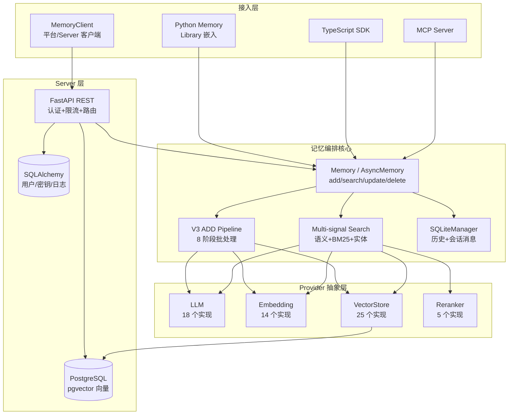

# Mem0 — AI Agent 智能记忆层

> **GitHub:** [github.com/mem0ai/mem0](https://github.com/mem0ai/mem0)
> **论文:** arXiv 2504.19413 — "Mem0: Building Production-Ready AI Agents with Scalable Long-Term Memory"
> **本解读按 agent ⊗ framework 类规格产出（全新分析，非增量 patch）**

## 子文档索引

- [`memory-core.md`](memory-core.md) — V3 记忆编排核心：ADD 流水线与多信号检索
- [`provider-system.md`](provider-system.md) — Provider 插件体系：抽象基类 + 反射工厂
- [`data-model.md`](data-model.md) — 持久化数据模型：本地 SQLite 历史 + Server 元数据表
- [`server.md`](server.md) — 自托管 Server：认证鉴权、限流与平台 Client

## 根因：AI Agent 的无记忆

每次对话都是独立事件的 Agent，无法记住用户偏好、历史决策与长期知识。Mem0 要解决的根本问题：**把 Agent 的每一次交互沉淀为可持久、可精准召回、可随用户变化的"长期上下文"**——而不是让每次对话从零开始。

它不是又一个向量数据库封装，而是完整的**记忆生命周期管理系统**：添加、检索、更新、删除、历史追踪，并内置多信号混合检索与实体链接，让记忆在检索阶段跨越纯语义相似度的盲区。

## 概览

| 维度 | 说明 |
|------|------|
| 是什么 | AI Agent 的持久化智能记忆层，将交互事实提取、存储、召回 |
| 痛点 | Agent 无状态；上下文窗口有限、RAG 缺时间/关系感知、微调太慢 |
| 适用 | 个性化助手、客服机器人、多 Agent 共享上下文、企业知识积累 |
| 运行形态 | Library（`pip`/npm 嵌入）+ Self-Hosted Server + Cloud Platform |
| 多语言 | Python SDK（完整）+ TypeScript SDK（对称实现）+ CLI + MCP |
| 授权 | Apache-2.0，Y Combinator S24 资助 |

### 核心能力清单

| 能力 | 说明 |
|------|------|
| 记忆 CRUD | `add` / `search` / `get` / `get_all` / `update` / `delete` / `history` |
| 多级作用域 | `user_id` / `agent_id` / `run_id` 三轴隔离记忆空间（多租户） |
| V3 ADD 流水线 | 单次 LLM 提取、批量嵌入、哈希去重、批量实体链接的 8 阶段管线 |
| ADD-only 语义 | 一次 LLM 调用只增不删，靠多信号检索补偿检索精度 |
| 多信号混合检索 | 语义向量 + BM25 关键词 + 实体权重三路评分融合 |
| 实体链接 | spaCy NER 提取实体，跨记忆链接以提升召回相关性 |
| 程序记忆 | 支持 Procedural Memory（流程/操作知识，独立于事实记忆） |
| Provider 插件 | LLM / Embedding / VectorStore / Reranker 四类，抽象基类 + 反射工厂 |
| 元数据过滤 | 支持 eq/gt/in/AND/OR/NOT 等增强过滤算子，跨库语义统一 |
| 双模式 SDK | Library 直连 + Client 走平台/Server REST API |
| MCP 集成 | 模型上下文协议接入，供 Claude Code 等编辑器操作记忆 |

### 技术栈一览

| 层面 | 技术 |
|------|------|
| 核心语言 | Python 3.10+（SDK）、TypeScript（TS SDK）、Python/Node（CLI） |
| 配置 | Pydantic v2（所有数据模型、`MemoryConfig`、Provider Config） |
| 运行时 | FastAPI（Server）、SQLAlchemy + Alembic（Server 元数据持久化） |
| 检索 | 内置 BM25 实现 + spaCy 实体提取/词形还原（`[nlp]` extra） |
| 存储 | 向量库（VectorStore Provider + 本地历史 SQLite） |
| 遥测 | PostHog（匿名统计，可关） |
| 构建 | Hatchling（py）、tsup/pnpm（ts） |

## 架构总览

Mem0 的主体是一个可复用的 Python 库，由**编排核心**、**Provider 抽象层**、**本地数据层**三层构成，外层再挂 Server、Client 与多语言 SDK：

核心目录职责（Python SDK）：

| 模块 | 路径 | 职责 |
|------|------|------|
| 记忆编排 | `memory/main.py` | `Memory`/`AsyncMemory` 主类，ADD 流水线与检索入口 |
| 抽象基类 | `memory/base.py` | `MemoryBase`：get/get_all/update/delete/history 接口契约 |
| 本地历史 | `memory/storage.py` | `SQLiteManager`，存记忆变更历史与会话消息 |
| 配置组合 | `configs/base.py` | `MemoryConfig` Pydantic 根模型，聚合各 Provider 配置 |
| 反射工厂 | `utils/factory.py` | `load_class` + `XxxFactory` 按 provider 名实例化 |
| 评分融合 | `utils/scoring.py` | BM25 归一化 + 多信号加性融合 |
| 实体提取 | `utils/entity_extraction.py` | spaCy NER + 规则混合实体抽取 |
| 平台客户端 | `client/` | `MemoryClient`/`AsyncMemoryClient` 走 REST API |

## 核心模块导读

| 模块 | 关注面 | 深读 |
|------|--------|------|
| 记忆编排核心 | V3 ADD 流水线（单次提取/批量嵌入/哈希去重/实体链接）+ 多信号检索（语义+BM25+实体融合） | [`memory-core.md`](memory-core.md) |
| Provider 抽象层 | 四类 Provider 的抽象基类统一接口 + 配置驱动实例化 + 反射加载 | [`provider-system.md`](provider-system.md) |
| 持久化 | 本地 SQLite 历史/会话表 + Server SQLAlchemy 表与迁移 | [`data-model.md`](data-model.md) |
| Server + Client | FastAPI 认证鉴权、限流、路由编排；平台 Client 与 agent 作用域指令 | [`server.md`](server.md) |

## 设计亮点

- **"三轴作用域"做多租户**：把记忆按 `user_id`/`agent_id`/`run_id` 隔离，而非单一全局库——这是"谁的记忆"的产品化表达，也是多 Agent 共享/隔离的边界。作用域过滤在 ADD 的实体链接与检索的候选集构建中都贯穿生效（[mem0/memory/main.py:914-914]() / [mem0/memory/main.py:1632-1632]()）。
- **ADD-only 反直觉但有的放矢**：一次 LLM 调用只提取新增事实、不更新不删除（[mem0/memory/main.py:906-906]()）。传统 RAG 会逐条叠加导致记忆膨胀混杂；这里靠每次提取前的「现有记忆检索 + 哈希去重」抑制重复，把精度压力转嫁给检索阶段。
- **多信号检索补偿语义盲区**：BM25 关键词与实体权重弥补纯向量在专名、精确术语、低嵌入质量场景的失效，融合公式自适应激活信号（[mem0/utils/scoring.py:60-60]()）。
- **函数级并行：同步/异步双实现**：`Memory` 与 `AsyncMemory` 是两套独立实现（约 1850 行与 ~1980 行），而非共享核心加协程包装——代码重复换来两清晰路径，避免 async/await 污染同步调用方。

> 设计细节的权衡沿深处，见各子文档。

## 同类项目对比

| 维度 | Mem0 | Zep | LangMem | Chroma DB | 裸向量库 + 自研 |
|------|------|-----|---------|-----------|----------------|
| 定位 | Agent 记忆层 | Agent 记忆平台 | LangChain 记忆库 | 向量数据库 | 检索基础设施 |
| 记忆模型 | 语义+情景+程序，ADD-only | 记忆 + 时间推理 | 提取+整合 | 纯向量 | 自定义 |
| 检索 | 语义+BM25+实体三信号 | 语义+时间 | 语义 | 语义 | 自定义 |
| 多租户作用域 | user/agent/run 三轴 | 有 | 线程级 | 无 | 自定义 |
| 实体链接 | 内置跨记忆链接 | 有 | 无 | 无 | 无 |
| Provider 生态 | LLM 18 / Vec 25 / 兼容多数主流 | 云托管为主 | 绑定 LangChain | 内置引擎 | 自研 |
| 历史追踪 | 内置 SQLite `history` | 有 | 有 | 无 | 无 |
| 自托管 | 是（FastAPI+pgvector） | 是 | 否（库） | 是 | 是 |

Mem0 的核心差异在于**把"记忆"做成产品化的一等公民**：三轴作用域、历史追踪、实体链接、跨库一致的 Provider 抽象，都是"记忆生命周期"而非"向量增删查"的范畴。代价是多层抽象带来学习成本与较大代码面。

## 总结

Mem0 把"给 AI 加记忆"从一次性脚本变成了一套完整且有边界的系统设计。ADD-only 流水线 + 多信号检索 + 三轴作用域，是理解整份代码的三把钥匙：前者决定如何写、次者决定如何读、后者决定记忆归谁所有。Provider 抽象层则让它能插进既有技术栈而不绑架 LLM/向量库选择。

- [`memory-core.md`](memory-core.md) 深入 ADD 流水线与检索融合
- [`provider-system.md`](provider-system.md) 深入插件体系与 Python 惯用法
- [`data-model.md`](data-model.md) 深入持久化边界
- [`server.md`](server.md) 深入自托管与平台接入

> **GitHub:** [github.com/mem0ai/mem0](https://github.com/mem0ai/mem0) · **文档:** [docs.mem0.ai](https://docs.mem0.ai) · **论文:** [arXiv 2504.19413](https://arxiv.org/abs/2504.19413)
