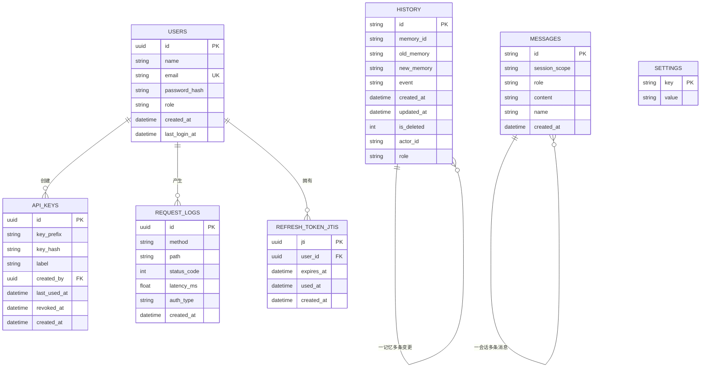
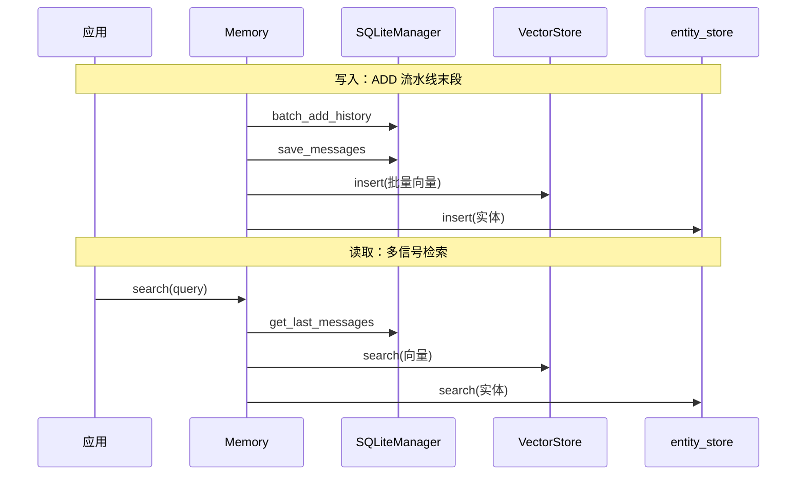

# Mem0 持久化数据模型

> 本解读按 agent ⊗ framework 类规格产出（全新分析）。
> 数据模型主动探测命中：本地 SQLite（`memory/storage.py`）+ Server SQLAlchemy（`server/models.py`）、Alembic 迁移。
> 源码根：`mem0/memory/storage.py`、`server/models.py`、`server/alembic/versions/`。

Mem0 的持久化分两层，职责截然不同：**本地层**（Library 模式的 SQLite）存"记忆变更历史"与"会话消息"——这是 Agent 的记忆**审计与上下文**；**Server 层**（SQLAlchemy + PostgreSQL）存"平台元数据"——用户、API 密钥、请求日志、设置、refresh token。**记忆本体（语义记忆的向量 + 文本）** 属于 VectorStore Provider，不入这两层，而是散落在配置的向量库中。

## 存储选型与理由

Mem0 分层存储的取舍本质是**"记忆本体"与"记忆元数据"分离到什么程度**：

- **记忆本体放 VectorStore，而非关系库**：检索需要向量相似度 + 关键词(部分库支持) + 实体 boost，这些能力是向量库的强项；把向量塞进关系库要靠 pgvector 等扩展，会牺牲 Provider 抽象（那样 VectorStore 抽象就没意义了）。这是**为检索付费**的选择——写入向量库，换取多信号检索的性能。
- **历史/会话放 SQLite**：`history` 表提供"记忆怎么变过来的"审计视图，`messages` 表提供 ADD 阶段 Phase 0 的上下文（最近 10 条会话）。这类高写低读、与记忆检索无关的追加型数据，用零配置的 SQLite 即可，避免 Library 模式强制依赖外部服务——这是**"Library 模式零配置运行"承诺的落点**（[mem0/configs/base.py:42-42]() 默认 `history_db_path=~/.mem0/history.db`）。
- **Server 元数据放 SQLAlchemy + PostgreSQL**：用户、密钥、日志需要关系约束（外键、唯一索引、级联删除）、并发写、与 Dashboard 共享——Server 是"运维级"形态，配 DB 正当。Alembic 负责演进。

## 核心表设计（本地层）

### `history` — 记忆变更审计（[mem0/memory/storage.py:108-108]()）

| 字段 | 类型 | 约束 | 说明 |
|------|------|------|------|
| id | TEXT | PK | 变更记录主键 |
| memory_id | TEXT | 索引语义（检索按记忆） | 关联的记忆 id |
| old_memory | TEXT | 可空 | 变更前内容（ADD 为 null） |
| new_memory | TEXT | - | 变更后内容 |
| event | TEXT | - | ADD/UPDATE/DELETE 等 |
| is_deleted | INTEGER | 默认 0 | 软删除标记 |
| actor_id | TEXT | 可空 | 触发方（agent 名等） |
| role | TEXT | 可空 | 消息角色 |
| created_at / updated_at | DATETIME | - | 审计时间线 |

它的存在让"记忆历史" `Memory.history(memory_id)` 可查（[mem0/memory/storage.py:227-227]()），也支撑 DELETE 的软删除语义——删除并非物理抹除记录，而是写入一条 DELETE 事件 + 标记，保留了审计轨迹。

### `messages` — 会话上下文（[mem0/memory/storage.py:134-134]()）

| 字段 | 类型 | 约束 | 说明 |
|------|------|------|------|
| id | TEXT | PK | 消息主键 |
| session_scope | TEXT | - | 作用域键（user/agent/run 序列化） |
| role | TEXT | - | user/assistant/system |
| content | TEXT | - | 消息正文 |
| created_at | DATETIME | - | 写入时间 |

`session_scope` 是 ADD Phase 0 里 `_build_session_scope(filters)` 的产物——把"哪一租户的会话"编码成一行，使 `get_last_messages(scope, limit=10)` 能按作用域取最近上下文（[mem0/memory/storage.py:298-298]()）。

## 核心表设计（Server 层）

### `users` — 平台用户（[server/models.py:18-18]()）

| 字段 | 类型 | 约束 | 说明 |
|------|------|------|------|
| id | uuid | PK, default uuid4 | 用户 id |
| email | String(255) | unique, index | 登录名 |
| password_hash | Text | - | bcrypt 哈希（[server/auth.py:22-22]()） |
| role | String(20) | default "admin" | 角色（RBAC 依据） |
| last_login_at | DateTime | 可空 | 安全审计 |

### `api_keys` — API 密钥（[server/models.py:30-30]()）

| 字段 | 类型 | 约束 | 说明 |
|------|------|------|------|
| id | uuid | PK | 密钥记录 id |
| key_prefix | String(12) | - | 密钥可见前缀（`m0sk_` 前 12 位） |
| key_hash | Text | - | 全密钥 bcrypt 哈希（不存明文） |
| created_by | uuid | FK users.id ON DELETE CASCADE | 签发者 |
| revoked_at | DateTime | 可空 | 吊销时间 |

认证核心是**只存哈希不存明文**：[server/auth.py:38-38]() `generate_api_key` 返回 `(full_key, prefix, key_hash)`，明文只在生成时出现一次，`verify_api_key_hash` 做 bcrypt 校验——对称加密于关系 RAG 对手的口径一致：密钥泄露面最小化。

### `request_logs` / `settings` / `refresh_token_jtis`

- `request_logs`（[server/models.py:43-43]()）记录每次 API 调用的 method/path/status/latency/auth_type，供 Dashboard 用量审计与限流分析。
- `settings`（[server/models.py:65-65]()）是 key/value 配置表。
- `refresh_token_jtis`（[server/models.py:55-55]()）用 **jti + used_at 实现 refresh token 的一次性消费**——`consume_refresh_jti`（[server/auth.py:72-72]()）用条件 UPDATE（`rowcount=0` 即判重放）原子关闭读取-检查-写入竞态，防刷新令牌重放。

## 演进策略

- **本地层用"自迁移"而非 Alembic**：SQLite 迁移逻辑写在 [mem0/memory/storage.py:20-20]() 的 `_migrate_history_table`——检测旧表列集，若与期望不符则 `ALTER TABLE history RENAME TO history_old`、建新表、复制交集列、drop 旧表，全程在一个事务里。这是"无迁移框架的轻量演进"的典型方案，代价是需要手写列差异检测。
- **Server 层用 Alembic**：`server/alembic/versions/`（`001_create_users_and_api_keys` 至 `006_request_logs_brin`）管理 6 个幂等迁移，从建用户/密钥表到给日志加 BRIN 索引（时间序列大表的检索优化）。规则型 Schema 演进 + 显式版本控制是 Server 形态的正规做法。

## 读写路径

关键观察：**向量库存"本体"，SQLite 存"轨迹"**。ADD 时先向量库插入本体、再 SQLite 记历史与消息（[mem0/memory/main.py:1054-1054]() / `:1183`）；读取时语义从向量库取、实体从 entity_store 取、上下文从 SQLite 取——三条读路径在 `score_and_rank` 汇合，完成多信号融合。

## 全局关联

这套分层存储是"记忆产品"三要素在落库侧的体现：**本体（可检索）→ 向量库，轨迹（可审计）→ SQLite，身份（可运维）→ Server 关系库**。它响应了`memory-core.md` 提到的"记忆生命周期管理"——没有 `history` 表就没有记忆历史，没有 `messages` 表就没有 ADD 阶段的会话上下文；没有 Server 元数据表就无法在多租户 Server 形态下做认证与用量审计。存储不是孤立清单，而是每条写路径都服务一条具体能力。

> 与 Provider 抽象的关系见 [`provider-system.md`](provider-system.md)；Server 如何暴露这些数据见 [`server.md`](server.md)。
