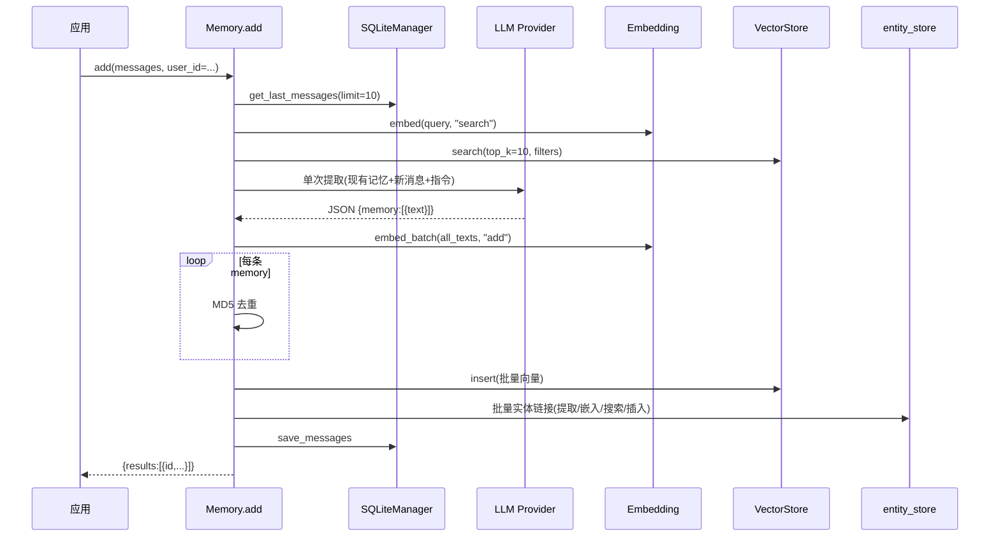
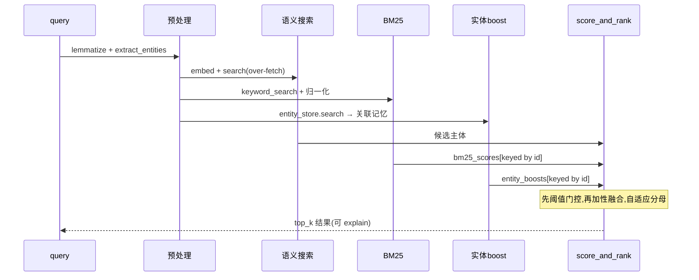

# Mem0 记忆编排核心：ADD 流水线与多信号检索

> 本解读按 agent ⊗ framework 类规格产出（全新分析）。
> 源码根：`mem0/memory/main.py`（3840 行，单文件承载编排核心）。

记忆编排是 Mem0 最"深"的一份代码：`Memory`（同步）与 `AsyncMemory`（异步）两个主类各承载一套几乎平行的实现，核心是两条管线——**ADD 写入**与 **Search 检索**。这两条管线是理解"为什么不退化成普通向量库"的钥匙。

## 数据入口：作用域即租户边界

`Memory.add()` 是所有写入的入口（[mem0/memory/main.py:755-755]()）。签名里 `user_id`/`agent_id`/`run_id` 三轴参数是**记忆空间隔离**的产品化表达。作用域会被打进 payload 与过滤条件，贯穿 ADD 的实体链接与检索的候选过滤。

<!-- snippet: def add( -->

值得注意的两个设计约束：

- **时间参数被显式拒绝**：`timestamp`（`add`）与 `reference_date`（`search`，[mem0/memory/main.py:1422-1422]()）在 OSS 版直接 `raise ValueError`。这意味着时间推理是**平台付费能力**，OSS 主动在 SDK 层挡掉，而不是留一个会静静返回错误结果的坑——这是"让能力边界可见"的工程取舍。
- **`infer=False` 直接写入**：绕过 LLM 提取，把消息原样作为记忆（[mem0/memory/main.py:870-870]()）。这是低成本、确定性的退化路径，供无需事实抽取的场景（如批量导入）。

一个反直觉但关键的细节：即使 `add()` 文档写着"decide whether to add, update, or delete"，**V3 实际是 ADD-only**——单次 LLM 调用只提取"新增事实"。更新/删除是 `Memory.update()`/`delete()` 的显式 API 职责，不再混入提取阶段。

## V3 ADD 流水线：8 阶段批处理

`_add_to_vector_store()`（[mem0/memory/main.py:869-869]()）在 `infer=True` 时执行批处理管线。核心思路从 V2 的"逐条处理"重构为"**单次 LLM 提取一切，之后全批量**"：

```
Phase 0  上下文收集      get_last_messages(limit=10)   ← 最近 10 条会话消息
Phase 1  现有记忆检索    vector_store.search(top_k=10) ← 检索已存在记忆，防止重复
Phase 2  LLM 单次提取    一次调用, 输出 JSON: {memory:[{text,attributed_to}]}
Phase 3  批量嵌入        embedding_model.embed_batch     ← 全记忆一次向量化
Phase 4+5 哈希去重        MD5(text) 对照 existing/seen hash，只收新事实
Phase 6  批量持久化       vector_store.insert(批量)      ← 一次写入全部向量
Phase 7  批量实体链接     提取实体→批量嵌入→批量搜索→插入/更新 entity_store
Phase 8  保存消息        save_messages
```

### 阶段间值得深挖的三个权衡

**Phase 1 的 UUID→整数映射（抗幻觉）**。现有记忆在喂给 LLM 前被映射成序号（[mem0/memory/main.py:923-928]()）：向量结果 UUID 对应 `"0"`/`"1"`…，文本存 `existing_memories`。原因是 LLM 倾向于把检索回来的长 UUID 当"新内容/记忆内容"编造进输出，整数短 id 抑制了这种幻觉，同时保持"既有记忆清单"对 LLM 可见。

**Phase 2 的 agent 作用域指令拼接**。`is_agent_scoped = agent_id 存在且 no user_id`（[mem0/memory/main.py:931-931]()），此时在 ADDITIVE_EXTRACTION_PROMPT 后追加 `AGENT_CONTEXT_SUFFIX`——因为 agent 作用域下更倾向提取"agent 自身的行为方式/技能"，而非用户偏好。这是对"三轴作用域"语义差异的提取策略微调。

**Phase 7 的实体链接是另一条迷你流水线**（[mem0/memory/main.py:1076-1180]()）：
- 7a 跨记忆全局去重：以 `_normalize_entity_text()` 归一化 key 聚合实体 → `global_entities`
- 7b 单次批量嵌入全部实体
- 7c `entity_store.search_batch` 查存量实体（含精确文本命中兜底）
- 7d 分派：命中则更新 `linked_memory_ids` 列表，未命中则收集待插入
- 7e 单次批量插入新实体

设计目的是让"同一个实体"的记忆在检索时能互相boost——V3 把实体关系网络作为检索信号的第三条腿。这里的权衡是实体嵌入失败允许降级（`None` 填充并跳过，[mem0/memory/main.py:1109-1120]()），实体链接是**尽力而为**的增强，不阻塞主记忆写入。

### ADD 时序



## 多信号检索：语义 + BM25 + 实体

`search()`（[mem0/memory/main.py:1369-1369]()）外层做参数校验、作用域过滤、增强过滤算子预处理与可选的 rerank 后，委托给 `_search_vector_store()`（[mem0/memory/main.py:1618-1618]()）执行真正的多信号评分。

检索管线分九个阶段：

```
Step 1  预处理         lemmatize_for_bm25(query) + extract_entities(query)
Step 2  嵌入查询       embed(query, "search")
Step 3  语义 over-fetch vector_store.search(top_k = max(limit*4, 60))   ← 放大候选池
Step 4  关键词搜索      vector_store.keyword_search(top_k=同池)
Step 5  BM25 归一化     get_bm25_params + normalize_bm25 → [0,1]
Step 6  实体 boost     _compute_entity_boosts(query_entities)
Step 7  候选集构建      过滤过期记忆
Step 8  融合评分       score_and_rank
Step 9  格式化结果      提升核心 payload 键 + 剥离冗余 metadata
```

### 三个关键设计判断

**over-fetch 放大候选池**：语义搜索取 `max(limit*4, 60)` 而非刚好 `top_k`（[mem0/memory/main.py:1631-1631]()）。因为 BM25 与实体信号可能把"语义排名第 5"的记忆抬到前 3，候选池必须先放大，融合才有重新排序的空间。这是多信号融合成立的前提——若只取 top_k，BM25/实体 boost 形同虚设。

**BM25 长度自适应归一化**。BM25 原始分无上界（长查询天然高分），直接加性融合会让语义分数被淹没。[mem0/utils/scoring.py:16-16]() 的 `get_bm25_params` 按查询词数选定 sigmoid 的 midpoint/steepness，再经 logistic 归一到 [0,1]（[mem0/utils/scoring.py:43-43]()）——把无界分数压进可控量纲，不同长度查询的分数才能跨查询比较。

<!-- snippet: def get_bm25_params -->
<!-- snippet: def normalize_bm25 -->

**加性评分 + 自适应分母**（[mem0/utils/scoring.py:60-60]() `score_and_rank`）：

```python
has_bm25   = bool(bm25_scores)
has_entity = bool(entity_boosts)
max_possible = 1.0 + (1.0 if has_bm25 else 0) + (0.5 if has_entity else 0)
combined = min((semantic + bm25 + entity*ENTITY_BOOST_WEIGHT) / max_possible, 1.0)
```

[mem0/utils/scoring.py:57-57]() 定义 `ENTITY_BOOST_WEIGHT = 0.5`。关键点是**阈值门控发生在融合之前**（[mem0/utils/scoring.py:111-111]() `semantic_score < threshold: continue`）——语义分低于阈值即使 BM25/实体很高也被排除，防止"噪声记忆被小众渠道抬升"。

<!-- snippet: ENTITY_BOOST_WEIGHT = 0.5 -->
<!-- snippet: semantic_score < threshold -->

分母随激活信号自适应（语义+BM25→2.0；+实体→2.5），保证融合分保持在 [0,1]，语义与辅助信号权重比例稳定。

### 检索时序



## 实体提取：规则与 NLP 混合

`utils/entity_extraction.py` 不用端到端模型，而是 **spaCy NER + 规则启发式**的组合，产出四类实体（含置信度与优先级）。候选人先按优先级去重、消除重叠跨度（`PROPER` 优先覆盖 `TOPIC`），再以归一化 key 全局去重得到最终实体集。

关键是它定义了 **`_GENERIC_HEADS` 黑名单**（[mem0/utils/entity_extraction.py:35-96]()）——"thing/stuff/way/time/experience…"这类过于通用的词被排除在实体头外。这是规则型提取的关键降噪：若允许它们当实体头，链接网络会被 "time"/"way" 这样的伪实体污染，实体 boost 也就失去区分度。

## 与"到底值得学什么"的全局关联

这份核心代码回答了 Agent 记忆产品的一个根本问题：**记忆不是存进去就完了，难的是在检索时拿出来刚好对不对**。V3 的整套设计——ADD-only 防膨胀、多信号融合补语义盲区、实体链接显式化关系——都是围绕"召回质量"这个最终目标在编排侧下功夫，而不是把质量压力全推给 LLM 上下文窗口或向量相似度。这解释了为什么 Mem0 看起来"只是封装了向量库"，却要专门写一套 BM25 实现、一套实体提取器——检索的一体化才是记忆产品的护城河。

> 相关边界的 Provider 抽象如何让这套编排可插拔，见 [`provider-system.md`](provider-system.md)；记忆的落库形态见 [`data-model.md`](data-model.md)；Server 如何暴露这些能力见 [`server.md`](server.md)。
