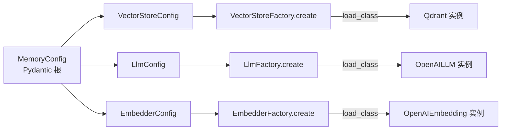

# Mem0 Provider 插件体系：抽象基类 + 反射工厂

> 本解读按 agent ⊗ framework 类规格产出（全新分析）。
> 源码：`mem0/utils/factory.py`、`mem0/llms/`、`mem0/embeddings/`、`mem0/vector_stores/`、`mem0/reranker/`、`mem0/configs/`。

Mem0 能在不绑架用户技术栈的前提下提供记忆层，靠的是这套 **Provider 抽象体系**：LLM、Embedding、VectorStore、Reranker 四类 Provider，各自遵循"抽象基类统一接口 + 反射工厂实例化 + Pydantic 配置驱动"的三段式。这让记忆编排代码与任何具体厂商解耦。

## 四类 Provider 的当前规模（factory 注册为权威）

| 类别 | factory 注册 | 抽象基类 | 配置基类 |
|------|------------|---------|---------|
| LLM | 18 个 | `LLMBase` | `BaseLlmConfig` |
| Embedding | 13 个（+ 特殊 mock 分支） | `EmbeddingBase` | `BaseEmbedderConfig` |
| VectorStore | 25 个 | `VectorStoreBase` | `VectorStoreConfig` |
| Reranker | 5 个 | `BaseReranker` | `BaseRerankerConfig` |

> 以 `utils/factory.py` 各 Factory 的 `provider_to_class` 注册表为准（[mem0/utils/factory.py:42-42]()、[mem0/utils/factory.py:153-153]()、[mem0/utils/factory.py:181-181]()、[mem0/utils/factory.py:233-233]()）。注册表即"运行时能配置的 Provider"集合，是可文档化的权威边界。

## 三段式模式：为什么这么设计

#### 抽象基类定义契约，而非实现

每类 Provider 一个抽象基类，用 `@abstractmethod` 声明必须实现的操作。以 `MemoryBase` 为例（[mem0/memory/base.py:4-4]()），它只是 get/get_all/update/delete/history 的接口契约，不承载任何逻辑。LLM 基类（`llms/base.py`）则声明 `generate_response` 这类厂商无关的操作。

**权衡**：接口抽象让编排侧只依赖基类，新增厂商=新增一个继承自基类的类，不触碰编排代码。代价是"够用"的接口反而约束了厂商特性（如某 LLM 独有的参数）——Mem0 用 Provider 专属 Config 字段 + `**kwargs` 兜底来缓解，而非给基类堆满可选参数。

#### `load_class` 反射加载：零注册的路径

[mem0/utils/factory.py:29-29]() 的核心：

```python
def load_class(class_type):
    module_path, class_name = class_type.rsplit(".", 1)
    module = importlib.import_module(module_path)
    return getattr(module, class_name)
```

Factory 的 `provider_to_class` 地图把"provider 名"映射到 **"模块路径.类名"字符串**，运行时经 `import_module` + `getattr` 反射加载。

**权衡**：相比"在基类里维护一个注册器类变量（需每个 Provider 显式 `@register`）"，反射加载用**显式地图**集中管理，只需 import 路径正确即生效，无需 Provider 自己写注册代码。代价是字符串路径拼错只在运行时暴露、无静态检查。

#### Config 驱动实例化：配置即选择

Factory 的 `create` 同时负责**把配置解析成正确的 Config 对象**再传给类构造。`LlmFactory.create`（[mem0/utils/factory.py:63-63]()）是最复杂的——它处理三种输入：

- `config=None`：用 kwargs 构造默认 Config
- `config` 是 dict：合并 kwargs 后构造 Config
- `config` 是 `BaseLlmConfig`：升级到 Provider 专属 Config，且**只转发该 Config 显式支持的字段**（[mem0/utils/factory.py:110-117]() 用 `inspect.signature` + `VAR_KEYWORD` 检查，redundance 字段如 `reasoning_effort` 只在目标 Config 接受时才透传，否则会因意外 kwargs 抛错——这是"配置兼容性防御"）

`EmbedderFactory` 还有一个特殊分支：`upstash_vector` + `enable_embeddings` 时返回 `MockEmbeddings()`（[mem0/utils/factory.py:169-169]()）——当向量库自带嵌入能力时，内存 mock 顶替外部嵌入器，避免重复向量化。

## Pydantic 配置组合：`MemoryConfig` 是根

配置体系的关键是 [mem0/configs/base.py:29-29]() 的 `MemoryConfig`——一个 Pydantic v2 根模型，聚合各子配置：

```python
class MemoryConfig(BaseModel):
    vector_store: VectorStoreConfig = Field(default_factory=VectorStoreConfig)
    llm: LlmConfig            = Field(default_factory=LlmConfig)
    embedder: EmbedderConfig  = Field(default_factory=EmbedderConfig)
    reranker: Optional[RerankerConfig] = None
    history_db_path: str = ".../.mem0/history.db"
    custom_instructions: Optional[str] = None
    version: str = "v1.1"
```

**为什么用 Pydantic 而非 dict 或 dataclass**：Config 既要能 `MemoryConfig()` 全默认开箱即用，又要能从 dict（Server 场景从用户提交的 JSON）构建，还要在运行时被`model_dump()`/merge。Pydantic 的 `default_factory`、字段校验、dict 互转、嵌套模型正好全覆盖。`vector_store`/`llm`/`embedder` 的 `default_factory=XxxConfig` 使零配置可用（默认各用 OpenAI + Qdrant）。

## 组合链路：从配置到实例



`Memory.__init__` 读取各子 config 的 `provider` 名，调用对应 Factory 的 `create`，得到具体 Provider 实例挂在 `self.vector_store`/`self.llm`/`self.embedding_model` 上，编排代码此后只面向基类接口。

## 扩展机制：加一个新 Provider

1. 在 `mem0/vector_stores/mysql.py` 新建类 `MySQLDB` 继承 `VectorStoreBase`，实现 abstractmethod
2. 将其加入 `VectorStoreFactory.provider_to_class["mysql"] = "mem0.vector_stores.mysql.MySQLDB"`
3. 若需专属字段，建 Config 子类并关联（LLM/Reranker 类会读 `config_class`）

无需改动任何编排核心代码。这是 framework 型项目的典型可扩展点——**新增能力 = 新增一个文件 + 一行注册**。

## 全局关联

这套 Provider 体系不是孤立的设计点，它是"记忆编排核心"得以不绑定厂商的前提。`memory-core.md` 里的 ADD 流水线、多信号检索都只调用 `self.vector_store.search()`/`self.llm.generate_response()` 这类基类方法；换任何 Provider，编排逻辑一行不动。整体架构哲学是一致的：**把确定的编排逻辑写死，把厂商差异隔离在 Provider 边界后**。

> 编排核心如何消费这些接口见 [`memory-core.md`](memory-core.md)；抽象层之下的实际落库形态见 [`data-model.md`](data-model.md)。
