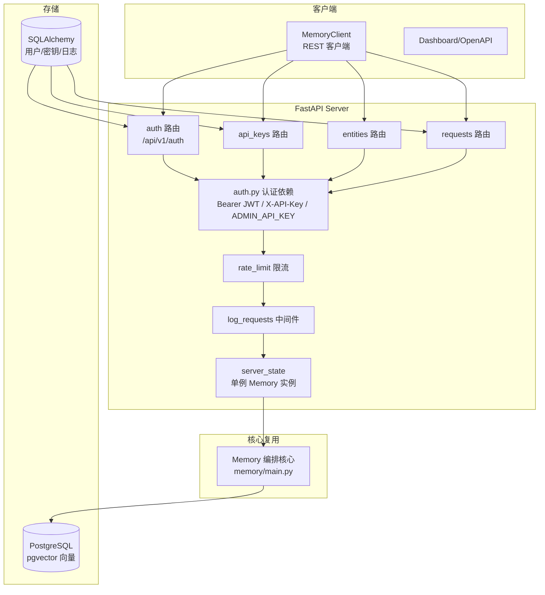

# Mem0 自托管 Server 与平台 Client

> 本解读按 agent ⊗ framework 类规格产出（全新分析）。
> 源码：`server/main.py`、`server/auth.py`、`server/routers/`、`server/rate_limit.py`、`server/server_state.py`、`mem0/client/`。

Mem0 除了 Library 嵌入，还提供两种远程形态：**Self-Hosted Server**（自托管 FastAPI，用户自己的基础设施）与 **Cloud Platform**（托管）。两者都通过 REST API 由 SDK 的 `MemoryClient`/`AsyncMemoryClient` 访问。Server 是一个"薄壳"——它复用 Library 编排核心，自己只做认证、限流、路由编排与元数据持久化。

## 架构：薄 Server 壳调用核心



核心判断：Server 不重新实现记忆逻辑，而是 [server/server_state.py:103-103]() `get_memory_instance()` 持有一个由 `update_config()` 动态重建的 `Memory` 单例；REST 端点只是把 HTTP 参数透传给这个实例的 `add`/`search`/`get`/`delete`/`update`（[server/main.py:367-367]() `/memories` 即调用 `get_memory_instance().add(...)`）。这验证了"编排核心 + Provider 抽象"复用性——Server 只是它的另一个前门。

## 认证与鉴权

认证系统承担"谁能用这座记忆服务"的边界职责，支持三类凭据（`server/auth.py`）：

- **Bearer JWT**：`create_access_token`/`create_refresh_token` 签发（HS256），access 30 分钟、refresh 30 天（[server/auth.py:17-18]()）。
- **X-API-Key**：每用户密钥，只存哈希（[server/auth.py:38-38]()），前缀 `m0sk_` 前 12 位可见、全密钥经 `verify_api_key_hash` 校验。
- **顶层 `ADMIN_API_KEY` 环境变量**：遗留的整服级管理员密钥。

三层关键设计：

**refresh token 一次性消费防重放**。`RefreshTokenJti` 用 jti + used_at 记录（[server/auth.py:63-63]()），`consume_refresh_jti` 用**条件 UPDATE** 而非"先 SELECT 再 UPDATE"（[server/auth.py:72-72]()）——并发重放同一 token 时只一个请求能 `rowcount=1`，其余判 401。这是消除 refresh 令牌重放竞态的正确解法，比查库去重更原子。

**登录时序恒定**。`dummy_verify_password()`（[server/auth.py:33-33]()）在邮箱不存在时也烧同样的 bcrypt 计算量——`pwd_context.dummy_verify()`，防登录接口作为"邮箱枚举"的时序侧信道。

**"无管理员即警告"**。[server/main.py:66-66]() `_warn_if_unconfigured` 在启动时若 `users` 表为空且无 `ADMIN_API_KEY`，打印升级指引（设 `ADMIN_API_KEY` / 访问 `/setup` 注册 / 或 `AUTH_DISABLED=true` 仅限本地）。同时 [server/main.py:90-90]() 强制 `JWT_SECRET` 存在，否则启动抛错——**默认安全（secure-by-default）**：旧版无认证，新版默认启用，缺配置宁可拒绝启动也不裸奔。

## 限流与可观测

- **限流**：`rate_limit.py` 用 slowapi 的 `limiter`（[server/main.py:157-157]() `app.state.limiter = limiter`），配合 `_rate_limit_exceeded_handler` 统一返回 429。是 Server 形态防止误用/滥用冲击记忆服务的护栏。
- **请求日志中间件**：`log_requests`（[server/main.py:292-292]()）为每个请求注入 `X-Request-ID`，异步 `_persist_request_log` 落库到 `request_logs`（含 auth_type、latency），供 Dashboard 用量审计。日志写入走 `run_in_executor`，不阻塞主响应路径。

## Server 路由（REST 面）

| 端点 | 职责 | 鉴权 |
|------|------|------|
| `POST /memories` | 新建记忆（透传 `add`） | verify_auth |
| `GET /memories` | 列出记忆；无 id 时仅 admin 可列全量 | verify_auth + 角色校验 |
| `GET /memories/{id}` / 历史 | 单条查/变更历史 | verify_auth |
| `POST /search` | 检索（透传 `search`） | verify_auth |
| `PUT /memories/{id}` | 更新 | verify_auth |
| `DELETE /memories/{id}` / 全量 / `reset` | 删除 | 删除/重置 require_admin |
| `POST /configure` | 动态改配置，重建实例 | require_admin |
| `GET /configure` | 查看配置（敏感键脱敏） | verify_auth |

亮点：`_redact_config`（[server/main.py:222-222]()）把 `api_key`/`password`/`token` 等 `SENSITIVE_CONFIG_KEYS` 脱敏为 `[redacted]`，避免 GET /configure 泄露密钥。`_client_error`（[server/main.py:214-214]()）把 "not found" 映射为 404、其余校验错误 400，让客户端能区分"请求写错"与"上游故障"。

## 平台 Client：`MemoryClient`

`mem0/client/main.py` 的 `MemoryClient`/`AsyncMemoryClient` 供 Cloud Platform（或任何符合 REST 契约的服务）访问，与 Library 的 `Memory` 是两套实现：

- `add`（[mem0/client/main.py:184-184]()）走 REST `POST /memories`
- `search`（[mem0/client/main.py:300-300]()）走 REST `POST /search`
- `ENTITY_PARAMS = {user_id, agent_id, app_id, run_id}`（[mem0/client/main.py:40-40]()）包边作用域参数

平台版多了 Library OSS 没有的维度：`app_id` 四级作用域、agent 自定义指令、事务性删除（[mem0/client/main.py:509-509]() `{"type":"agent","name":...}`）。

### 新增关注面：`agent_custom_instructions`

[mem0/client/main.py:737-737]() 的 `agent_custom_instructions` 是 agent 作用域下的**自定义提取指令覆盖**——调用方可在 `add` 时为某个 agent 指定专属的事实提取偏好。平台端允许覆盖：

```python
agent_custom_instructions: Optional[str] = None,   # client/main.py:737
# 拼进请求体被 Server 端 add 消费
```

设计意图：`custom_instructions`（全局，[mem0/configs/base.py:54-54]()）只能全局设一套默认；而 agent 作用域记忆往往需要"针对这个 agent 该记什么"的差异策略。这正对应 OSS Library 里 `_should_use_agent_memory_extraction` + `AGENT_CONTEXT_SUFFIX`（[mem0/memory/main.py:734-734]()）的 agent 上下文强化——平台把"agent 差异化提取"做成了一等 API。

## 全局关联

Server 的价值不在于新增能力，而在于**把 Library 编排核心安全地远程化**：认证、限流、日志、角色鉴权都是"多租户远程访问记忆"才需要的护栏。它同时印证了框架设计的复用性——同一个 `Memory` 编排核心，Library 是进程内嵌入，Server 是跨网络暴露，Client 是远程调用，三者共享同一套算法与 Provider 层。`agent_custom_instructions` 则是"三轴作用域"在产品端的延伸：谁的记忆、按什么策略记，都被提升为可配置的 API。

> 编排核心算法见 [`memory-core.md`](memory-core.md)；Provider 抽象见 [`provider-system.md`](provider-system.md)；Server 元数据表结构见 [`data-model.md`](data-model.md)。
