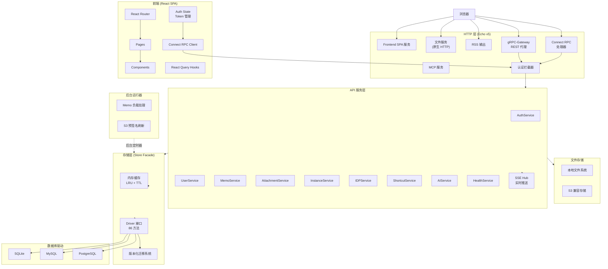
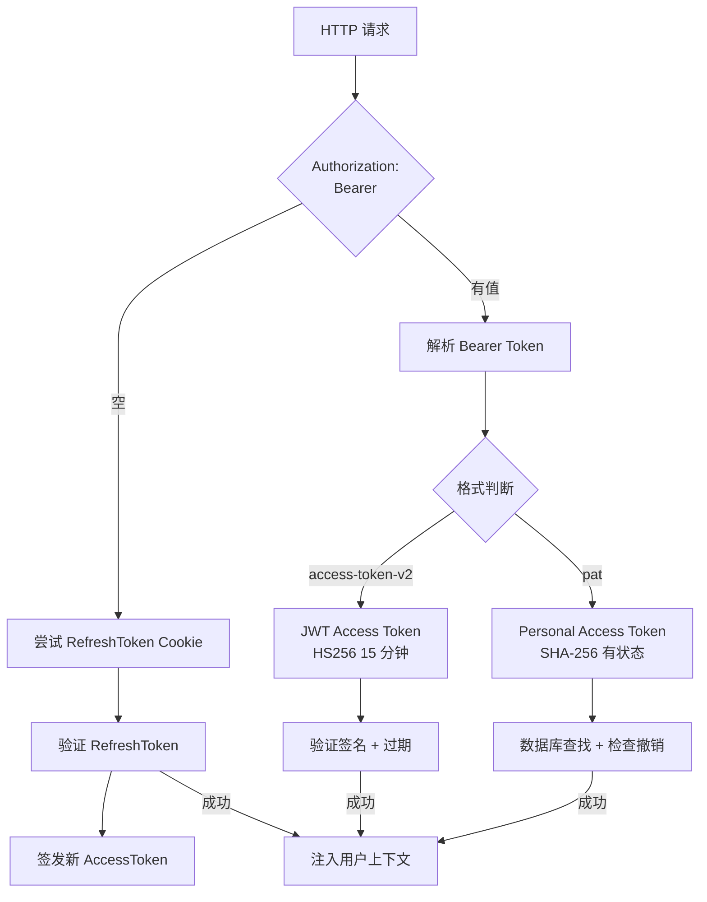

# Memos — 自托管笔记应用的 Go+React 工程实践深度分析

> **仓库:** https://github.com/usememos/memos
>
> **版本:** v0.25.0 | **协议:** MIT | **语言:** Go + TypeScript | **Star:** 35k+

## 第一部分：快速概览

### 这是什么

Memos 是一个**开源、自托管的笔记应用**，以 Twitter/微博式时间线为核心交互界面，支持 Markdown 语法、标签分类、资源附件、公开分享和实时协作。它的 slogan 是"带有社交元素的笔记"——每条 Memo 像一条推文，可以公开、私密或受保护，形成一个轻量级的个人知识流。

与 Notion、Obsidian 等 heavyweight 笔记工具不同，Memos 的定位是**极简、快速、可自托管**——一条 Memo 就是一句话或一段 Markdown，不需要复杂的页面层级和数据库结构。

### 解决的痛点

- **笔记太沉重** — Notion 启动慢、页面层级深；Obsidian 需要客户端和 Vault 同步。Memos 打开浏览器就能写
- **没有轻量自托管方案** — 既想要控制数据，又不想部署一套复杂系统。Memos 单二进制文件运行
- **社交化笔记需求** — 很多开发者在 Twitter/微博上记录想法，但这些平台不是你控制的数据
- **快速记录缺乏工具** — 写一条"今天学到 xxx"不需要开一个完整页面，一条时间线消息就够了

### 适用场景

- 个人知识碎片记录和技术笔记
- 团队内部的轻量周报/日报/技术分享
- 自托管的类 Twitter 微博客
- 作为 AI Agent 的记忆存储后端
- 开发者学习 Go+React 全栈架构的参考项目

### 核心能力清单

| 能力 | 说明 |
|------|------|
| **时间线笔记** | 微博式时间线，支持 Markdown 渲染、标签、引用、代码块 |
| **资源附件** | 图片、文件附件，支持原生 HTTP 文件服务（range 请求）和 S3 存储 |
| **公开分享** | Memo 支持 Public/Protected/Private 三级可见性，公开页面无需登录 |
| **标签系统** | 通过 `#标签` 分类和组织 Memo |
| **备忘录关系** | Memo 之间的父子引用关系（评论/关联） |
| **收藏/反应** | 用户可收藏 Memo、添加表情反应 |
| **短链接** | 为 Memo 生成短链接方便分享 |
| **SSO 登录** | 支持 OAuth2/OIDC 身份提供商集成 |
| **RSS 订阅** | 公开 Memo 的 RSS 输出 |
| **实时推送** | Server-Sent Events (SSE) 实时通知 |
| **多数据库** | 支持 SQLite / MySQL / PostgreSQL |
| **AI 集成** | 内置语音转文字功能 |
| **Docker 部署** | 单 Docker 镜像，一键部署 |
| **MCP 协议** | 支持 MCP（Model Context Protocol），可作为 AI Agent 的工具 |

### 技术栈一览

| 层面 | 技术 |
|------|------|
| **后端语言** | Go 1.26.2 |
| **HTTP 框架** | Echo v5 |
| **RPC 框架** | Connect RPC |
| **REST 网关** | gRPC-Gateway |
| **认证** | JWT (golang-jwt/jwt/v5) |
| **数据库** | 纯 SQL（无 ORM），支持 SQLite / MySQL / PostgreSQL |
| **配置管理** | Cobra + Viper |
| **缓存** | 自定义内存缓存（LRU + TTL） |
| **前端框架** | React 19 + TypeScript 7 |
| **构建工具** | Vite 8 |
| **状态管理** | React Query v5 (TanStack) |
| **样式** | Tailwind CSS v4 |
| **UI 组件** | @base-ui/react |
| **API 定义** | Protocol Buffers + Buf |
| **实时通信** | SSE (Server-Sent Events) |
| **Proto 生成** | Go / TypeScript / OpenAPI 三端生成 |

---

## 第二部分：架构深读

### 架构总览



### 核心请求链路

Memos 支持两种 API 协议，共享同一套服务逻辑和认证机制：

```mermaid
sequenceDiagram
    participant Browser as 浏览器
    participant Echo as Echo 路由
    participant Auth as 认证拦截器
    participant Svc as 服务层
    participant Store as Store Facade
    participant DB as 数据库

    Note over Browser,DB: 方式一: Connect RPC (前端主通道)
    Browser->>Echo: POST /memos.api.v1.MemoService/CreateMemo
    Echo->>Auth: 认证检查
    Auth->>Auth: 验证 JWT / PAT / RefreshToken
    Auth-->>Echo: 通过/拒绝
    Echo->>Svc: 调用 CreateMemo 方法
    Svc->>Store: s.CreateMemo(ctx, memo)
    Store->>DB: driver.CreateMemo(ctx, memo)
    DB-->>Store: 返回 Memo 记录
    Store-->>Svc: 返回 *Memo
    Svc-->>Echo: 返回 Connect 响应
    Echo-->>Browser: HTTP 200 (Connect 协议)

    Note over Browser,DB: 方式二: gRPC-Gateway REST (第三方客户端)
    Browser->>Echo: POST /api/v1/memos (JSON)
    Echo->>Auth: 认证检查
    Auth->>Auth: 验证 JWT / PAT / RefreshToken
    Auth-->>Echo: 通过/拒绝
    Echo->>GW: gRPC-Gateway 代理
    GW->>Svc: 调用 CreateMemo 方法
    Svc->>Store: s.CreateMemo(ctx, memo)
    Store->>DB: driver.CreateMemo(ctx, memo)
    DB-->>Store: 返回 Memo 记录
    Store--->>Svc: 返回 *Memo
    Svc-->>GW: gRPC 响应
    GW-->>Echo: JSON 序列化
    Echo-->>Browser: HTTP 200 (REST JSON)
```

### 模块职责划分

| 模块 | 入口 | 职责 |
|------|------|------|
| **Server** | `server/server.go:44` | HTTP 服务生命周期管理，中间件注册，后台运行器启动/关闭 |
| **Auth** | `server/auth/` | JWT 签发/验证、PAT 验证、Refresh Token 管理、请求凭证提取 |
| **API v1 服务** | `server/router/api/v1/` | 所有业务逻辑的 RPC 方法实现（20 个服务文件） |
| **Authorizer** | `server/router/api/v1/authz.go` | 方法级访问控制，基于 ACL 配置的细粒度认证策略 |
| **SSE Hub** | `server/router/api/v1/sse_hub.go` | 发布-订阅模式的实时事件推送 |
| **Store** | `store/store.go` | 数据访问门面，封装缓存和数据库驱动 |
| **Driver** | `store/driver.go` | 数据库操作接口抽象（86 个方法） |
| **Migrator** | `store/migrator.go` | 版本化数据库迁移系统 |
| **FileServer** | `server/router/fileserver/` | 原生 HTTP 文件服务，支持 range 请求和缩略图 |
| **Runner** | `server/runner/` | 后台定时任务（S3 预签名刷新、Memo 负载处理） |
| **内部包** | `internal/` | 应用私有包：AI/Email/Filter/Markdown/Scheduler/Storage/Webhook |
| **前端 SPA** | `web/src/` | React 单页应用，Connect RPC 客户端 |

### 启动流程

```ascii
main.go (Cobra CLI)
  │
  ├─ 1. 初始化 Profile (配置/数据库驱动/DSN/模式)
  │
  ├─ 2. 创建数据库驱动
  │     ├─ sqlite.NewDB(profile)
  │     ├─ mysql.NewDB(profile)
  │     └─ postgres.NewDB(profile)
  │
  ├─ 3. 创建 Store (Store Facade)
  │     ├─ 初始化 3 个内存缓存
  │     └─ 预加载用户/实例设置到缓存
  │
  ├─ 4. 创建 Server
  │     ├─ 创建 Echo 实例
  │     ├─ 注册 CORS 中间件
  │     ├─ 注册文件服务路由
  │     ├─ 注册前端 SPA 静态文件服务
  │     ├─ 注册 RSS 路由
  │     ├─ 注册 MCP 服务
  │     └─ 创建 API v1 服务组
  │          ├─ 注册 Connect RPC 处理器
  │          ├─ 注册 gRPC-Gateway (Gateway + Health 端点)
  │          └─ 注册 HTTP 扩展端点 (SSE/OIDC/机器人)
  │
  ├─ 5. 启动后台运行器
  │     ├─ S3 预签名刷新 (定时器)
  │     └─ Memo 负载处理 (定时器)
  │
  └─ 6. Echo Server 启动 (监听端口)
```

---

## 第三部分：设计模式与工程实践

### 3.1 Store Facade 模式

Memos 的数据访问层采用经典的 Facade 模式。`Store` 结构体作为数据库操作的总入口，封装了三个内存缓存和底层的 `Driver` 接口。

`store/store.go:13-30`:

```go
type Store struct {
    profile *profile.Profile
    driver  Driver

    // 三个独立的内存缓存
    instanceSettingCache *cache.Cache
    userSettingCache     *cache.Cache
    userCache            *cache.Cache
}
```

每个 Store 方法遵循一致的委托模式：在 Store 层做参数验证和关联清理，实际数据库操作委托给 Driver。

`store/memo.go:109-113`:

```go
func (s *Store) CreateMemo(ctx context.Context, create *Memo) (*Memo, error) {
    if !base.UIDMatcher.MatchString(create.UID) {
        return nil, errors.New("invalid uid")
    }
    return s.driver.CreateMemo(ctx, create)
}
```

这种模式的好处：
- **缓存透传**：Store 层对部分读操作做缓存加速，对写操作做缓存失效
- **写时验证**：在 Store 层统一做参数校验和关联约束检查，驱动层只关注 SQL
- **接口隔离**：Driver 接口（86 个方法）是所有数据库实现的契约，切换数据库不需要改业务代码

### 3.2 多数据库驱动模式

`store/db/db.go:14-32` — 工厂函数根据配置选择驱动：

```go
func NewDBDriver(profile *profile.Profile) (store.Driver, error) {
    switch profile.Driver {
    case "sqlite":
        driver, err = sqlite.NewDB(profile)
    case "mysql":
        driver, err = mysql.NewDB(profile)
    case "postgres":
        driver, err = postgres.NewDB(profile)
    }
    return driver, nil
}
```

三个数据库各 17 个实现文件，严格保持接口一致性。SQLite 是最常用驱动（开发和小规模部署），MySQL/PostgreSQL 面向生产环境。每个数据库驱动的实现文件结构完全对称：

```
store/db/{sqlite,mysql,postgres}/
├── db.go          # 数据库初始化 + 驱动工厂
├── migration.go   # 迁移文件注册 (RegisterMigration)
├── memo.go        # Memo CRUD
├── user.go        # 用户 CRUD
├── user_setting.go
├── instance_setting.go
├── attachment.go
├── idp.go
├── ...
```

### 3.3 版本化迁移系统

`store/migrator.go` — 支持两种初始化路径：

**新安装路径** (`preMigrate`): 应用 `LATEST.sql` 文件，直接创建最新版本的完整 schema，跳过所有增量迁移

**升级路径** (`applyMigrations`): 按版本号顺序执行增量迁移文件

```go
// store/migrator.go:140-208
func (mig *Migrator) applyMigrations(ctx context.Context, currentVersion string) error {
    versions := mig.collectVersions()
    for _, version := range versions {
        if !shouldApplyMigration(currentVersion, version) {
            continue
        }
        // 收集该版本的所有迁移文件（按文件名排序）
        stmts := mig.collectStatements(version)
        // 在事务中执行所有迁移语句
        if err := mig.executeInTransaction(ctx, stmts); err != nil {
            return errors.Wrap(err, "execute migration")
        }
    }
}
```

迁移文件的命名约定：`{版本号}/{序号}__{描述}.sql`，例如 `store/migration/sqlite/0.30/01__memo_relation.sql`。版本号基于语义化版本，每个版本的迁移文件在一个事务中执行。

**一致性保证**：LATEST.sql 和增量迁移的集合必须始终等价。这是通过手动维护来保证的——每次新增迁移后，更新所有三个数据库驱动的 LATEST.sql 文件。

### 3.4 ACL 配置模式（单一真相源）

`server/router/api/v1/acl_config.go` — 所有公开端点的唯一配置源：

```go
var PublicMethods = map[string]struct{}{
    "/memos.api.v1.AuthService/GetAuthStatus":          {},
    "/memos.api.v1.AuthService/SignIn":                 {},
    "/memos.api.v1.AuthService/SignUp":                 {},
    "/memos.api.v1.MemoService/ListMemos":              {},  // 公开实例使用
    "/memos.api.v1.MemoService/GetMemo":                {},
    // ... 更多公开端点
}

var AuthBootstrapMethods = map[string]struct{}{
    "/memos.api.v1.AuthService/GetAuthStatus":          {},
    "/memos.api.v1.InstanceService/GetInstance":        {},
    "/memos.api.v1.InstanceService/GetInstanceStats":   {},
}
```

`AuthBootstrapMethods` 是 `PublicMethods` 的子集，表示"即使实例是私有的，这些端点也可匿名访问"——用于引导认证流程。

`Authorizer`（`authz.go:26-73`）在每次请求时检查：

```go
func (a *Authorizer) GetAuthStatus(ctx context.Context, method string) (AuthStatus, error) {
    // 1. 检查方法是否在 AuthBootstrapMethods 中 → AuthBootstrap 级别
    // 2. 检查方法是否在 PublicMethods 中 → AuthPublic 级别
    // 3. 其他方法 → AuthRequired 级别
}
```

这种集中式配置带来两个好处：
- **一致性**：Connect RPC 和 gRPC-Gateway 两个协议共享同一个 Authorizer 实例
- **可审计**：一眼就能看出哪些端点对外暴露，不需要遍历整个路由注册代码

### 3.5 SSE Hub 实时推送

`server/router/api/v1/sse_hub.go` — 原生实现的发布-订阅模式：

```go
type SSEEvent struct {
    Type string
    Payload any
    CreatorID int32
    Visibility store.Visibility
}

type Hub struct {
    mu sync.RWMutex
    clients map[any]chan *SSEEvent
}
```

关键设计决策：
- **按可见性过滤事件**：只有对用户可见的事件才会通过其 channel 推送（Private 事件仅推送给创建者，Public 事件推送给所有订阅者，Protected 事件推送给登录用户）
- **慢客户端保护**：非阻塞发送 + 默认 8 容量的 buffered channel
- **无注册事件的持久化**：SSE 作为一次性通知通道，纯内存无持久化，适合实时状态变化通知（Memo 创建/更新、通知等）

### 3.6 认证链设计

`server/auth/authenticator.go` — 三层凭证的灵活支持：



凭证格式约定：
- Access Token V2: `memos-{userId}-{签名}` 前缀格式
- PAT: `memos-pat-{hash}` 格式
- 这种格式前缀设计使得代码可以在不解析完整 Token 的情况下判断凭证类型

---

## 第四部分：API 设计与协议

### 4.1 Proto 驱动 API

所有 API 契约由 `.proto` 文件定义（`proto/api/v1/`），通过 Buf 工具链生成三种输出：
- **Go 代码**：服务接口 + 消息类型
- **TypeScript 类型**：前端类型定义（`web/src/types/proto/`）
- **OpenAPI 规范**：REST API 文档

```
proto/
├── buf.yaml              # Buf 配置 (依赖 googleapis)
├── buf.gen.yaml          # 生成配置 (Go + TS + OpenAPI)
└── api/v1/
    ├── common.proto       # State, Direction, PageToken
    ├── auth_service.proto # 认证服务
    ├── user_service.proto # 用户管理 (PAT, Webhook, 设置)
    ├── memo_service.proto # Memo CRUD (657 行, 最复杂)
    ├── instance_service.proto
    ├── attachment_service.proto
    ├── idp_service.proto
    ├── ai_service.proto
    └── shortcut_service.proto
```

### 4.2 双重协议：Connect RPC + gRPC-Gateway

`server/router/api/v1/v1.go:65-90` — 两种协议的注册：

```go
func (s *APIV1Service) RegisterGateway(ctx context.Context, echoCtx *echo.Echo) error {
    // 方案 A: Connect RPC 原生处理器（前端使用）
    path, handler := connectrpc.NewServiceHandler(connectSvc, connectOpts)
    echoCtx.Add(path, echo.WrapHandler(handler))

    // 方案 B: gRPC-Gateway（第三方/CLI 客户端使用）
    mux := runtime.NewServeMux()
    connectv1.RegisterAuthServiceHandlerFromEndpoint(ctx, mux, endpoint, opts)
    connectv1.RegisterMemoServiceHandlerFromEndpoint(ctx, mux, endpoint, opts)
    echoCtx.Group("/api").Any("/*", echo.WrapHandler(mux))

    // 方案 C: 健康检查端点
    connectv1.RegisterHealthServiceHandlerFromEndpoint(ctx, mux, endpoint, opts)
}
```

**为什么两种协议？**
- **Connect RPC**：前端 SPA 使用，通过 `@connectrpc/connect-web` 调用，享受 gRPC 的强类型和流式能力
- **gRPC-Gateway**：提供标准的 RESTful JSON API，方便 curl、Postman、第三方集成

这实际上是"一次定义，多协议暴露"的典型实践。两种协议共享同一套 `Authorizer` 进行访问控制。

### 4.3 API 路由全景

| 协议 | 路由前缀 | 示例端点 | 认证要求 |
|------|---------|---------|---------|
| Connect RPC | `/memos.api.v1.{Service}/{Method}` | `POST /memos.api.v1.MemoService/CreateMemo` | 多数需认证 |
| gRPC-Gateway | `/api/v1/{resource}` | `GET /api/v1/memos` | 多数需认证 |
| SSE | `/api/v1/status` | `GET /api/v1/status?user={id}` | 需认证 |
| OIDC | `/api/v1/auth/signin` | OAuth2 回调端点 | 公开 |
| RSS | `/explore/rss.xml` | 公开 Memo RSS | 公开 |
| MCP | `/mcp` | MCP 协议服务 | 需认证 |
| 文件服务 | `/file/{uid}/{filename}` | 资源文件下载 | 公开/需认证 |
| 前端 SPA | `/` | 单页应用入口 | 根据实例配置 |

---

## 第五部分：数据层解析

### 5.1 数据库设计

Memos 不对标复杂的关系模型。核心表只有几张：

| 表 | 职责 | 核心字段 |
|----|------|---------|
| `memo` | 笔记主表 | id, uid, creator_id, content, visibility, tags, payload (JSON), parent_id |
| `memo_relation` | Memo 关联关系 | memo_id, related_memo_id, type (reference/comment) |
| `memo_share` | 分享配置 | memo_id, share_type (public/protected) |
| `user` | 用户表 | id, uid, username, email, password_hash, display_name, avatar_url |
| `user_setting` | 用户设置 | user_id, key, value（KV 存储模式） |
| `instance_setting` | 实例配置 | key, value（KV 存储模式） |
| `attachment` | 资源附件 | id, uid, creator_id, filename, size, type, storage_type (local/s3) |
| `reaction` | 表情反应 | creator_id, content_id, reaction_type |
| `webhook` | Webhook 配置 | url, type, scope, secret |
| `idp` | 身份提供商 | type (oauth2/oidc), client_id, client_secret, discovery_url |

设计特点：
- **KV 存储模式**：`user_setting` 和 `instance_setting` 采用 KV 模式，避免频繁的 schema 变更
- **UID 设计**：每个资源实体（memo/user/attachment）都有可读的 UID，用于公开 URL 和 API 引用
- **Payload 字段**：`memo.payload` 使用 JSON 字段存储动态属性，避免频繁加列

### 5.2 缓存策略

`store/cache/` — 自定义内存缓存实现（非 Redis），保持部署简单：

```go
type Cache struct {
    store map[string]*item
    ttl   time.Duration
    mu    sync.RWMutex
}

type item struct {
    value      any
    expireTime time.Time
}
```

三个缓存实例：
- **instanceSettingCache** (TTL: 10min) — 实例级别设置
- **userSettingCache** (TTL: 10min) — 用户级别设置
- **userCache** (TTL: 10min) — 用户基本信息

缓存的失效策略是**写穿透 + TTL**：写入操作在 Store 层删除对应缓存项，读操作先查缓存后查数据库。

**为什么不用 Redis？** Memos 定位单机部署为主，引入 Redis 增加了运维复杂度但收益有限。对于 SQLite 用户来说，数据已经在本机，缓存只用来减少热点读的 SQL 执行次数。

### 5.3 文件存储

支持两种存储后端（`internal/storage/`）：

| 存储后端 | 适用场景 | 关键特性 |
|---------|---------|---------|
| **本地文件系统** | 单机部署、开发环境 | 零配置，文件存储于 `--data` 目录 |
| **S3 兼容存储** | 生产环境、多实例部署 | 支持 AWS S3 / MinIO 等，预签名 URL 刷新 |

S3 预签名 URL 由后台 `Runner` 定时刷新（`server/runner/s3presign/`），确保持续可用。

文件服务层（`server/router/fileserver/`）实现：
- **Range 请求**：支持视频/音频的渐进式播放
- **缩略图生成**：图片资源自动生成缩略图
- **内容协商**：根据 Accept 头返回不同格式

---

## 第六部分：前端架构

### 6.1 认证流程

前端的认证流程比一般的 SPA 更复杂，因为它需要处理两种状态：

`web/src/contexts/AuthContext.tsx` 的两步初始化：

```typescript
// 第一步: 调用 GetAuthStatus 获取用户身份（允许路由守卫工作）
// 第二步: 异步加载用户设置（到达 isInitialized 完整就绪状态）

// auth-state.ts 提供 Token 存储 + BroadcastChannel 跨标签页同步
// connect.ts 提供 Auth Interceptor + Token 自动刷新
```

跨标签页同步通过 `BroadcastChannel` 实现（`web/src/auth-state.ts`），当在一个标签页登出时，其他标签页也能收到通知。

### 6.2 React Query 模式

每个数据域遵循一致的工厂模式（`web/src/hooks/`）：

```typescript
// web/src/hooks/useMemoQueries.ts:19-27
export const memoKeys = {
    all: ["memos"] as const,
    lists: () => [...memoKeys.all, "list"] as const,
    details: () => [...memoKeys.all, "detail"] as const,
    detail: (name: string) => [...memoKeys.details(), name] as const,
};
```

每个 Hook 文件包含：
- **Query Key 工厂**：`{domain}Keys`，确保 key 一致性
- **queryOptions 函数**：定义 `staleTime`、`queryFn` 等配置
- **use{Resource}** Hook：包装 `useQuery`
- **use{Resource}Mutation** Hook：包装 `useMutation` + 自动 invalidate

这种模式确保了所有数据获取的缓存一致性——创建/更新 Memo 后自动使 memo list 缓存失效。

### 6.3 Connect RPC 客户端

`web/src/connect.ts` — 前端 API 通信的核心：

```typescript
// 创建认证拦截器: 自动注入 Authorization header
// 实现 Token 自动刷新: 401 时尝试刷新 AccessToken
// BroadcastChannel 通知: Token 变更后通知其他标签页
const transport = createConnectTransport({
    baseUrl: `${window.location.origin}`,
    interceptors: [authInterceptor],
});
```

前端不直接发 REST 请求，而是通过 Connect Web 客户端调用 gRPC 服务。这提供了：
- **强类型调用**：TypeScript 类型直接从 Proto 生成
- **自动序列化**：Protobuf 二进制或 JSON 格式
- **统一的错误处理**：所有的 gRPC 错误码在前端统一处理

### 6.4 组件结构

```
web/src/components/
├── MemoEditor/        # Memo 编辑器 (CodeMirror + Markdown)
├── MemoContent/        # Memo 渲染 (react-markdown + 自定义渲染器)
├── MemoView/           # Memo 视图 (时间线/列表/网格)
├── MemoExplorer/       # Memo 浏览 (过滤/搜索/分页)
├── MemoFilters.tsx     # 过滤控件 (可见性/标签/创建者)
├── Settings/           # 设置页面 (个人/实例/系统)
├── ui/                 # 基础 UI 组件库 (Button/Input/Dialog/Select 等)
└── kit/                # 工具性组件 (Loading/Skeleton/Empty)
```

组件划分基于功能模块，而非 UI 层级。`ui/` 为基础组件库（Radix 原语的封装），`kit/` 为业务无关的工具组件，其余为业务组件。

---

## 第七部分：部署与运维

### 7.1 部署方式

| 方式 | 命令/配置 | 说明 |
|------|----------|------|
| Docker | `docker run -d --name memos -p 5230:5230 ghcr.io/usememos/memos` | 推荐方式，Alpine 3.21 基础镜像 |
| 二进制 | `./memos --port 8081 --data ~/.memos/` | 单文件部署 |
| Docker Compose | `docker compose up -d` | 含自动 HTTPS 的完整配置 |

Docker 镜像特点（`scripts/Dockerfile`）：
- Alpine 3.21 运行时，非 root 用户
- 多架构支持：amd64 / arm64 / arm/v7
- 默认端口 5230
- 前端 SPA 构建产物嵌入 Go 二进制

### 7.2 配置参数

所有配置通过命令行参数或环境变量设置（Cobra + Viper）：

| 参数 | 环境变量 | 默认值 | 说明 |
|------|---------|--------|------|
| `--port` | `MEMOS_PORT` | `8081` | 监听端口 |
| `--mode` | `MEMOS_MODE` | `prod` | 运行模式 (dev/prod/demo) |
| `--data` | `MEMOS_DATA` | `./data` | 数据目录 |
| `--driver` | `MEMOS_DRIVER` | `sqlite` | 数据库驱动 |
| `--dsn` | `MEMOS_DSN` | `` | 数据库 DSN |
| `--disable-frontend` | `--` | `false` | 禁用前端 SPA |

### 7.3 可观测性

Memos 的可观测性较为基础：
- **日志**：Echo 框架的标准日志输出
- **健康检查**：`/api/v1/health` 端点（gRPC-Gateway Health Service）
- **实例统计**：`/api/v1/instance/stats` 返回用户数/Memo 数等基础指标

没有集成 Prometheus metrics、OpenTelemetry 或结构化日志——这与 Memos 的"轻量自托管"定位一致。

---

## 总结与评价

### 最值得学习的设计决策

1. **Proto 驱动的双重协议** — 一次 API 定义同时生成 Connect RPC（前端）和 gRPC-Gateway（REST），共享同一个 Authorizer。这是一个"写一次，多种消费方式"的典范实践

2. **Store Facade + Driver 接口** — 用纯 SQL + 接口抽象替代 ORM，在保持数据库切换能力的同时避免了 ORM 的复杂性和性能损耗。对于 Go 项目来说，这是一个比 GORM 更值得学习的数据层设计

3. **ACL 单一真相源** — `acl_config.go` 集中管理所有端点的认证策略，比散布在各个服务方法中的访问控制检查更可维护

4. **两步前端初始化** — "先获取用户身份，再加载设置"的两步模式，在保证路由守卫工作正常的同时不会阻塞 UI 渲染

5. **无 Redis 的架构** — 对单机部署场景来说，自建内存缓存（LRU + TTL）比引入 Redis 更轻量、更容易运维。这是一个"按场景做对的事"而非"用最新技术"的设计判断

### 对 AI Agent 项目开发者的参考价值

| 值得学习的实践 | 适用场景 |
|---------------|---------|
| 纯 SQL + Driver 接口的数据层设计 | Agent 需要支持多种数据库（SQLite 本地 + PG 生产） |
| Proto 驱动的双重协议 API | Agent 需要同时暴露 gRPC（Agent 通信）和 REST（Web 前端） |
| SSE Hub 实时推送 | Agent 需要实时状态更新/事件流传递给前端 |
| 两步认证初始化 | Agent 控制台需要在"未登录但可访问"和"完全就绪"之间过渡 |
| ACL 配置单一真相源 | Agent 系统的权限模型需要清晰的审计点 |
| 自定义内存缓存 | Agent 单机部署时避免 Redis 依赖 |
| 后台 Runner 定时任务 | Agent 需要定时刷新凭证/清理过期会话 |

### 潜在改进空间

- **测试覆盖**：Store 层的集成测试用 TestContainers 覆盖三个数据库，但前端的测试覆盖较薄
- **可观测性**：缺少 Structured Logging 和 Metrics 集成，排查问题主要依赖 Echo 日志
- **全文搜索**：SQLite FTS5 / PostgreSQL 全文索引有潜力但尚未充分利用
- **前端状态管理**：AuthContext 和 InstanceContext 随功能增长趋于复杂，可考虑拆分

> **仓库：** https://github.com/usememos/memos
