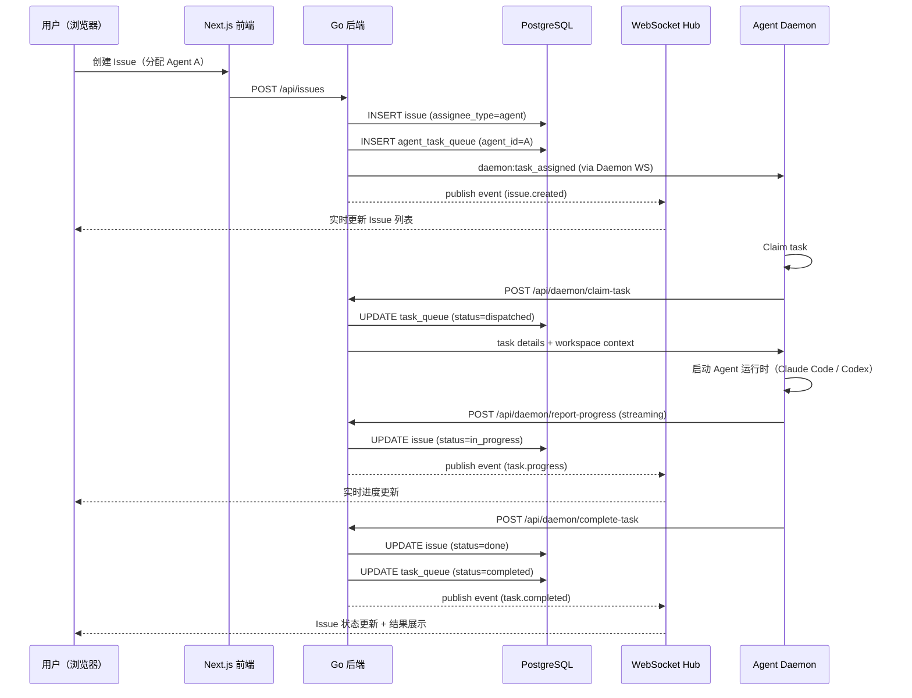
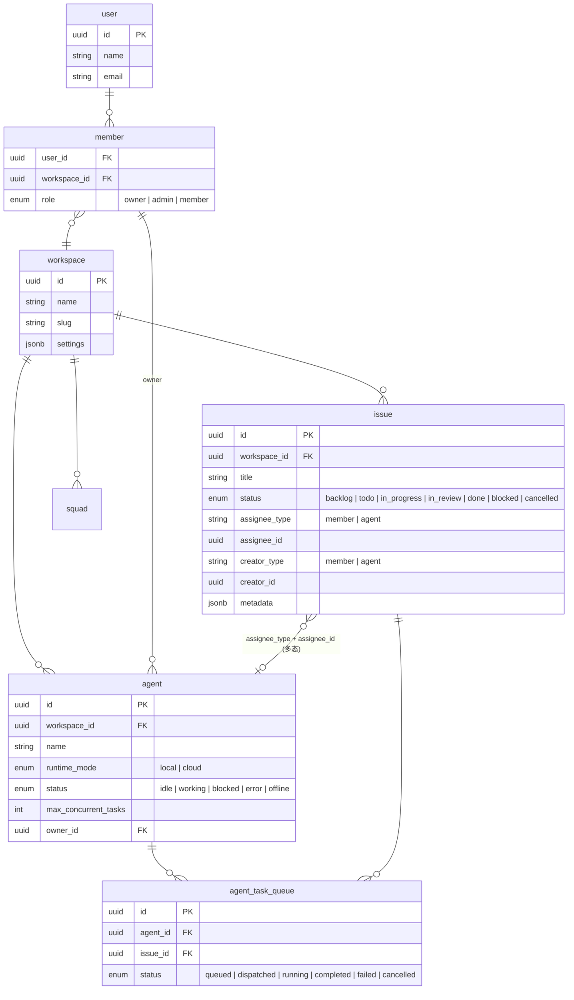

# Multica — 托管式 AI Agent 协作平台解读

> **GitHub:** [https://github.com/multica/multica](https://github.com/multica/multica)
>
> **文档维护说明**：本文档 2026-08-03 全面更新。配套文档：
> - [`18-runtimes-compare.md`](18-runtimes-compare.md) — 18 种 Agent 运行时深度对比
> - [`memory.md`](memory.md) — 多 Provider 隔离与记忆架构

## 第一部分：快速概览

### 这是什么

Multica（**Mul**tiplexed **I**nformation and **C**omputing **A**gent）是一个开源托管式 AI Agent 协作平台。它的核心理念是：**让 AI 编码 Agent 成为团队中的第一公民队友**——像给同事分配 Issue 一样，把任务指派给 Agent，Agent 自主执行、汇报进展、提交代码。

项目名称致敬 Multics（1960 年代的分时操作系统）——Multics 让多用户共享一台机器，Multica 让多个 Agent 和人类在同一个任务面板上协同工作。标语："你的下一个 10 个员工不会是人类。"

### 解决的痛点

当前使用 AI 编码助手（Claude Code、Codex、Copilot CLI 等）的典型问题：

- **手动搬运**：在终端和编辑器之间复制粘贴 prompt，丢失上下文
- **无持久化**：每次对话都是孤立的，没有任务历史、没有进度追踪
- **无团队协作**：Agent 的工作结果只有自己知道，队友无法查看状态或接力
- **无调度机制**：无法定时触发任务、无法通过外部事件（GitHub Issue、Webhook）自动启动工作
- **无能力沉淀**：每次解决问题的方法无法复用，团队经验无法累积

### 适用场景

- 2-10 人的 AI 原生工程团队
- 需要将重复性编码任务（bug 修复、小功能开发、代码审查）自动化
- 希望建立"AI 同事"协作流程的团队

### 核心能力清单

| 能力 | 说明 |
|------|------|
| **Issue 系统** | 完整的 Issue 管理（状态、优先级、标签、依赖、评论），Agent 可作为 assignee |
| **Agent 管理** | 注册 Agent、配置运行时、分配并发任务数、监控运行状态 |
| **Agent 模板** | 预配置模板，从模板创建 Agent 时自动导入技能和指令 |
| **Squad 团队** | 将多个 Agent（和人类）组成团队，由领导 Agent 路由任务 |
| **Autopilot 自动飞行** | 定时（Cron）、Webhook 或手动触发自动化工作流 |
| **Skill 技能库** | 可复用的 workflow，每次解决问题的方案可以沉淀为 Skill |
| **实时 WebSocket** | 任务进展、Agent 状态、聊天消息的实时推送 |
| **多运行时（18 种）** | Claude Code、Codex、Copilot、OpenCode、Grok、Qwen 等 18 个 CLI，经统一 `pkg/agent.Backend` 抽象执行 |
| **multica CLI** | Cobra 构建的全功能命令行工具（issue/agent/autopilot/daemon/runtime 管理），GoReleaser 发布 |
| **自托管** | Docker Compose / Helm / `multica setup self-host` 一键部署 |
| **多平台前端** | Web（Next.js）、Desktop（Electron）、Mobile（React Native） |
| **多语言界面** | 英文、简体中文、韩文、日文 |
| **GitHub 集成** | GitHub App Webhook 接收 Issue/PR 事件 |
| **飞书集成** | Lark Open Platform 集成，IM 消息收发、Bot Agent 路由 |
| **VCS / Slack / Composio** | 自托管 VCS（Forgejo/GitLab）、Slack、Composio、GHSnapshot 集成 |

### 技术栈一览

| 层面 | 技术 |
|------|------|
| **后端语言** | Go 1.26+ |
| **HTTP 框架** | Chi |
| **WebSocket** | gorilla/websocket |
| **数据库** | PostgreSQL 17 + pgvector |
| **缓存 / 实时中继** | Redis（可选，多节点部署） |
| **数据层生成** | sqlc |
| **CLI 框架** | Cobra + GoReleaser（发布 `multica` 二进制，支持 Homebrew/Scoop/安装脚本） |
| **前端框架** | Next.js 16 (App Router) + React 19 |
| **桌面端** | Electron + electron-vite + react-router-dom |
| **移动端** | Expo / React Native |
| **组件库** | shadcn/ui on Base UI (Tailwind CSS v4) |
| **Monorepo** | Turborepo + pnpm workspaces |
| **服务端状态** | TanStack React Query |
| **客户端状态** | Zustand |
| **类型验证** | zod |
| **端到端测试** | Playwright |

---

## 第二部分：架构深读

### 架构总览

```
┌──────────────────────────────────────────────────────────────────────┐
│                       Presentation Layer                             │
│  ┌─────────────────┐  ┌──────────────────┐  ┌───────────────────┐   │
│  │ Next.js Web App │  │ Electron Desktop │  │ React Native      │   │
│  │ (App Router)    │  │ (Memory Router)  │  │ (Expo / RN)       │   │
│  └────────┬────────┘  └────────┬─────────┘  └─────────┬─────────┘   │
└───────────┼────────────────────┼──────────────────────┼──────────────┘
            │                    │                      │
            └─────────┬──────────┴──────────┬───────────┘
                      │                     │
             ┌────────▼─────────────────────▼──────────────────────────┐
             │                  Shared Logic Layer                     │
             │  ┌──────────────────┐  ┌────────────────────────────┐   │
             │  │ packages/core    │  │ packages/views             │   │
             │  │ (Zustand Stores, │  │ (Shared Business Pages)    │   │
             │  │  React Query,    │  │  - navigation adapter      │   │
             │  │  API Client)     │  │  - i18n / locales)         │   │
             │  └──────────────────┘  └────────────────────────────┘   │
             │  ┌──────────────────────────────────────────────────┐   │
             │  │ packages/ui (shadcn/Base UI, zero core imports)  │   │
             │  └──────────────────────────────────────────────────┘   │
             └──────────────────────┬──────────────────────────────────┘
                                    │ HTTP / WebSocket
             ┌──────────────────────▼──────────────────────────────────┐
             │                     Backend (Go)                        │
             │                                                        │
             │  Chi Router → Middleware → Handler → Service           │
             │                                                        │
             │  ┌────────────────┐  ┌────────────────┐               │
             │  │ Realtime       │  │ Daemon         │               │
             │  │ WebSocket Hub  │  │ WebSocket Hub  │               │
             │  └───────┬────────┘  └───────┬────────┘               │
             │          │                   │                         │
             │  ┌───────┴───────────────────┴──────────────────────┐  │
             │  │          Event Bus (in-process pub/sub)          │  │
             │  │   WS Broadcast / Activity Log / Notifications    │  │
             │  └───────────────────────┬──────────────────────────┘  │
             │                          │                             │
             │  ┌───────────────────────▼──────────────────────────┐  │
             │  │  Scheduler + Integrations                        │  │
             │  │  (DB-backed Cron / GitHub / Lark / Stripe)       │  │
             │  └──────────────────────────────────────────────────┘  │
             └──────────────────────────┬─────────────────────────────┘
                                        │
             ┌──────────────────────────▼─────────────────────────────┐
             │                     Data Layer                         │
             │  ┌─────────────────────────┐   ┌───────────────────┐   │
             │  │ PostgreSQL 17 + pgvector │   │ Redis (optional)  │   │
             │  │   - 主数据库             │   │   - 实时中继      │   │
             │  │   - 矢量存储             │   │   - 缓存 / 限流   │   │
             │  └─────────────────────────┘   └───────────────────┘   │
             └────────────────────────────────────────────────────────┘
                                         │ WebSocket
             ┌──────────────────────────▼─────────────────────────────┐
             │                 Agent Execution Layer                  │
             │                                                        │
             │   multica Daemon (single binary, re-exec child)        │
             │   └── pkg/agent.Backend 统一抽象（18 个 provider）      │
             │       ├── Claude Code │ Codex │ Copilot │ OpenCode     │
             │       ├── Kimi │ Kiro │ Qoder │ Trae │ Grok │ Qwen     │
             │       └── daemon/execenv 负责每 provider 隔离          │
             └────────────────────────────────────────────────────────┘
```

### 项目结构总览

```
multica/
├── server/                      # Go 后端
│   ├── cmd/
│   │   ├── server/              # API Server 入口（main.go + router.go）
│   │   ├── multica/             # multica CLI（Cobra，~58 文件）
│   │   ├── migrate/             # 数据库迁移运行器
│   │   └── backfill_*/          # 用量回溯工具
│   ├── internal/
│   │   ├── handler/             # HTTP 处理器（~310 个路由）
│   │   ├── service/             # 业务逻辑服务
│   │   ├── daemon/              # Agent 运行时 + execenv 隔离（最大模块）
│   │   │   └── execenv/         # 运行时上下文注入 + 多 provider 隔离（57 文件）
│   │   ├── realtime/            # 浏览器 WebSocket Hub
│   │   ├── daemonws/            # Daemon WebSocket Hub
│   │   ├── events/              # 进程内事件总线
│   │   ├── middleware/          # 中间件链
│   │   ├── auth/                # 认证（JWT/PAT/DaemonToken）
│   │   ├── scheduler/           # 调度器
│   │   ├── cli/                 # CLI HTTP 客户端 + 错误翻译
│   │   ├── integrations/        # Lark / GitHub / Slack / VCS / Composio
│   │   ├── selfexec/            # 单二进制 re-exec（守护进程复用）
│   │   ├── dispatch/            # 任务分发
│   │   ├── featureflags/        # 特性开关
│   │   ├── analytics/ metrics/ storage/ logger/
│   │   ├── issueguard/ issueposition/ attribution/ ...
│   │   └── ...
│   ├── pkg/
│   │   ├── agent/               # 18 种 Agent 运行时后端（统一 Backend 抽象）
│   │   ├── llm/                 # LLM 层（快捷动作服务端生成）
│   │   ├── protocol/ redact/ skillbundle/ taskfailure/ ...
│   │   └── db/                  # sqlc 生成代码
│   └── migrations/              # ~291 个 SQL 迁移
├── apps/
│   ├── web/                     # Next.js 前端
│   ├── desktop/                 # Electron 桌面端
│   ├── mobile/                  # React Native 移动端
│   └── docs/                    # Next.js 文档站点
├── packages/
│   ├── core/                    # 无头业务逻辑（Zustand/ReactQuery/API）
│   ├── views/                   # 共享业务组件
│   ├── ui/                      # 原子 UI 组件
│   ├── eslint-config/           # 共享 ESLint 配置
│   └── tsconfig/                # TypeScript 共享配置
├── e2e/                         # Playwright 端到端测试
├── deploy/helm/                 # Kubernetes Helm chart
├── docker/                      # 自托管 Docker 打包
└── docs/                        # 内部文档（feature-flags、design 等）
```

### 启动流程

```
Server 启动（server/cmd/server/main.go）
  │
  ├── 1. 初始化 Logger，检查关键配置（JWT_SECRET、邮件后端）
  │
  ├── 2. 连接 PostgreSQL（pgxpool）
  │
  ├── 3. 创建进程内事件总线（events.Bus）
  │
  ├── 4. 创建 WebSocket Hub 和 Daemon WebSocket Hub
  │      ├── Realtime Hub — 用于浏览器客户端
  │      └── Daemon WebSocket Hub — 用于 Daemon Agent
  │
  ├── 5. 可选：初始化 Redis 中继（sharded / dual / legacy 模式）
  │
  ├── 6. 创建服务层（TaskService / IssueService / AutopilotService / EmailService）
  │
  ├── 7. 构建 Chi 路由（~310 个 route verbs，92 个 handler 文件）
  │      ├── 公共路由：/health /ws /auth/*
  │      ├── Daemon API：/api/daemon/*
  │      ├── 用户路由：/api/me /api/workspaces /api/invitations
  │      └── 工作空间路由：/api/issues /api/agents /api/squads ...
  │
  ├── 8. 启动后台 goroutine 集群
  │      ├── Runtime Sweeper — 标记过期运行时为 offline
  │      ├── Heartbeat Scheduler — Agent 心跳管理
  │      ├── Autopilot Scheduler — 定时触发 Autopilot
  │      ├── Autopilot Failure Monitor — 检测失败运行
  │      ├── DB Stats Logger — 连接池指标日志
  │      └── Lark Inbound Supervisor — 飞书消息监听
  │
  └── 9. 启动 HTTP Server，等待 SIGINT/SIGTERM
```

### Daemon 启动单二进制架构（新增）

Daemon **不是一个独立编译的二进制**——它是同一个 `multica` 二进制以 `daemon start --foreground` 参数重新执行（re-exec）为子进程：

```
multica daemon start（后台模式）
  │
  ├── 1. 检查健康端口（per-profile，默认 19514）确认未在运行
  ├── 2. requireDaemonAuth — 校验已 `multica login`
  ├── 3. selfexec.Resolve 解析当前二进制路径
  ├── 4. 构造子进程参数：daemon start --foreground [+ 转发的 flag/env]
  ├── 5. 后台 spawn 子进程（Windows 走 Job Object breakaway，防父 shell 退出连带）
  ├── 6. 写 daemon.pid，轮询健康端口直到 status=running（45s 窗口）
  │
  └── daemon start --foreground（子进程）
        ├── 日志：stderr 是终端 → 彩色终端；否则 → 旋转式 daemon.log（lumberjack）
        ├── daemon.LoadConfig（flag > env > config.json > 默认 四级优先级）
        ├── daemon.New(cfg) → d.Run(ctx)
        └── 自更新后 spawn 继任者（更新后的二进制再次 re-exec 交接）
```

关键点：
- `selfexec.Resolve`（`server/internal/selfexec/`）解析要 spawn 的二进制；测试通过覆盖该变量避免 fork 测试进程（`cmd_daemon.go:280`）
- Windows 用**健康端口 HTTP `/shutdown`**而非 OS 信号做优雅关闭（DETACHED_PROCESS 无共享 console，`cmd_daemon.go:1005-1016`）
- 多 profile 隔离在 `~/.multica/profiles/<name>/`，每个有独立健康端口

### 核心请求链路

我们追踪一个典型场景：**人在 Web 端创建一个 Issue 并分配给 Agent，Agent 在本地 Daemon 上接收并执行，执行结果实时回传**。



### 模块职责划分

| 模块 | 路径（server/internal/） | 职责 |
|------|-------------------------|------|
| **Handler** | `handler/` | HTTP 请求处理，参数校验、响应组装 |
| **Service** | `service/` | 业务逻辑编排，事务协调 |
| **Realtime Hub** | `realtime/hub.go` | 浏览器 WebSocket 连接管理、订阅分发 |
| **Daemon Hub** | `daemonws/hub.go` | Daemon Agent 连接管理、心跳、任务分发 |
| **Event Bus** | `events/bus.go` | 进程内发布/订阅，驱动 WS 广播和后台处理 |
| **Middleware** | `middleware/` | 鉴权、工作空间解析、限流 |
| **Auth** | `auth/` | 多模式认证（JWT / PAT / Daemon Token） |
| **Scheduler** | `scheduler/` | DB 租赁式定时任务调度 |
| **Agent Backend** | `pkg/agent/` | 18 种 CLI 的统一执行抽象（Backend/Session/Message） |
| **Daemon / 隔离** | `daemon/` + `daemon/execenv/` | 任务执行、工作目录、多 provider 隔离（sandbox/home/记忆） |
| **CLI 客户端** | `cli/` | CLI 的 HTTP 客户端、错误翻译、profile 管理 |
| **Integrations** | `integrations/` | Lark / GitHub / Slack / VCS / Composio |
| **Self-exec** | `selfexec/` | 单二进制 re-exec（守护进程复用） |
| **Dispatch / FF** | `dispatch/` `featureflags/` | 任务分发、特性开关 |

---

## 第三部分：核心实现深度解析

### 数据模型设计

Multica 的数据模型围绕 **工作空间（Workspace）多租户** 和 **多态分配（Polymorphic Assignment）** 设计：



**核心表设计要点：**

```sql
-- 多态分配：Issue 的 assignee 可以是 member 或 agent
-- server/migrations/xxx_init.up.sql
CREATE TABLE issue (
    id            UUID PRIMARY KEY,
    workspace_id  UUID NOT NULL REFERENCES workspace(id),
    title         TEXT NOT NULL,
    status        TEXT NOT NULL DEFAULT 'backlog',
        -- backlog | todo | in_progress | in_review | done | blocked | cancelled
    assignee_type TEXT,  -- 'member' | 'agent'
    assignee_id   UUID,
    creator_type  TEXT NOT NULL,  -- 'member' | 'agent'
    creator_id    UUID NOT NULL,
    ...
);

CREATE TABLE agent (
    id                  UUID PRIMARY KEY,
    workspace_id        UUID NOT NULL REFERENCES workspace(id),
    name                TEXT NOT NULL,
    runtime_mode        TEXT NOT NULL DEFAULT 'local',
        -- 'local' | 'cloud'
    status              TEXT NOT NULL DEFAULT 'idle',
        -- idle | working | blocked | error | offline
    max_concurrent_tasks INT DEFAULT 1,
    owner_id            UUID REFERENCES member(id),
    ...
);

CREATE TABLE agent_task_queue (
    id         UUID PRIMARY KEY,
    agent_id   UUID NOT NULL REFERENCES agent(id),
    issue_id   UUID NOT NULL REFERENCES issue(id),
    status     TEXT NOT NULL DEFAULT 'queued',
        -- queued | dispatched | running | completed | failed | cancelled
    ...
);

CREATE TABLE comment (
    id          UUID PRIMARY KEY,
    issue_id    UUID NOT NULL REFERENCES issue(id),
    author_type TEXT NOT NULL,  -- 'member' | 'agent'
    author_id   UUID NOT NULL,
    type        TEXT NOT NULL DEFAULT 'comment',
        -- comment | status_change | progress_update | system
    content     TEXT NOT NULL,
    ...
);
```

关键设计决策：

- **多态分配**：`issue.assignee_type + assignee_id` 的组合让 Agent 和人类成员可以出现在同一个字段中，前端根据类型渲染不同样式（Agent 用紫色背景 + 机器人图标）
- **任务队列**：`agent_task_queue` 作为 Issue 和 Agent 之间的调度层，支持排队、分发、运行、完成的全生命周期管理
- **审计日志**：`activity_log` 记录所有操作，支持按工作空间和 Issue 追溯
- **JSONB 元数据**：`issue.metadata`、`workspace.settings` 等字段使用 JSONB 存储，保持核心表稳定同时支持扩展

**自定义运行时（runtime_profile，migration 120 新增）：**

为了支持多 provider（18 种 CLI）带来的运行时管理需求，新增了 `runtime_profile` 表（`server/migrations/120_runtime_profile.up.sql`）：

```sql
CREATE TABLE runtime_profile (
    id UUID PRIMARY KEY DEFAULT gen_random_uuid(),
    workspace_id UUID NOT NULL,
    display_name TEXT NOT NULL,
    -- protocol_family 与 server/pkg/agent/agent.go 的 Backend switch 保持 lockstep
    protocol_family TEXT NOT NULL CHECK (protocol_family IN (
        'claude','codebuddy','codex','copilot','opencode','openclaw',
        'hermes','gemini','pi','cursor','kimi','kiro','antigravity'
    )),
    command_name TEXT NOT NULL,
    -- fixed_args：该运行时下所有 agent 必须继承的固定参数
    fixed_args JSONB NOT NULL DEFAULT '[]',
    ...
    UNIQUE (workspace_id, display_name)
);
```

关键点：

- **编译期白名单 + 数据库 CHECK 双保险**：`protocol_family` 必须与 `pkg/agent.New()` 支持的运行时一致——新增运行时 = 加 backend + 白名单 + migration 扩展 CHECK
- **`fixed_args` 与 `agent.custom_args` 分离**：profile 固定参数（进入兼容模式必需）与单个 agent 特有参数（`custom_args`）分开管理（`120_runtime_profile.up.sql:27-29`）
- **不加外键**：遵循仓库铁律，`runtime_profile` 与 `agent_runtime` 的关联（`profile_id` 列）在主表层级显式维护

> 注意：CHECK 约束里包含 `gemini`，但 `pkg/agent` 的 18 个 `SupportedTypes` 中暂无 `gemini` 后端——`gemini` 是数据库约束中预留但尚未正式实现的运行时。

### 双 WebSocket 架构

Multica 维护两套独立的 WebSocket 系统，分别服务不同的客户端：

**Realtime Hub（`server/internal/realtime/hub.go`）：**

- 服务于浏览器客户端（Web 前端、Electron 渲染进程）
- 按工作空间（workspace-scoped）、任务（task-scoped）、聊天会话（chat-scoped）进行订阅隔离
- 认证方式：JWT / PAT / Cookie
- 支持 Redis 中继模式实现多节点广播

**Daemon WebSocket Hub（`server/internal/daemonws/hub.go`）：**

- 服务于 Daemon Agent（运行在用户机器上的守护进程）
- 独立协议：`daemon:heartbeat`、`daemon:task_assigned`、`daemon:task_claimed` 等
- 每个 Daemon 连接携带 `ClientIdentity`（daemon_id、user_id、workspace_id、runtime_ids）
- 事件去重：避免冗余唤醒
- 批量心跳处理：减少连接开销

```go
// server/internal/daemonws/hub.go: 身份结构
type ClientIdentity struct {
    DaemonID    string   `json:"daemon_id"`
    UserID      string   `json:"user_id"`
    WorkspaceID string   `json:"workspace_id"`
    RuntimeIDs  []string `json:"runtime_ids"`
}
```

两种 Hub 在事件总线上注册监听器，当业务层发布事件时，自动广播到相关的 WebSocket 客户端。

### 事件驱动总线

`server/internal/events/bus.go` 实现了一个进程内发布/订阅系统：

```go
// server/internal/events/bus.go: 事件定义
type Event struct {
    Type           EventType
    WorkspaceID    string
    Actor          Actor
    TaskID         *string
    ChatSessionID  *string
    Data           any
}

type Bus struct {
    mu      sync.RWMutex
    subs    map[EventType][]Handler
    ...
}

func (b *Bus) Publish(ctx context.Context, event Event) {
    b.mu.RLock()
    defer b.mu.RUnlock()

    for _, handler := range b.subs[event.Type] {
        handler(ctx, event)  // 同步调用
    }
}
```

事件总线是整个系统的**协调中枢**，它的角色包括：

- **WS 广播**：Realtime Hub 和 Daemon Hub 分别订阅事件，推送到对应客户端
- **活动日志**：`activity_log` 订阅者记录所有域操作
- **通知触发**：Inbox 订阅者创建通知项
- **Autopilot 触发**：某些事件可以作为 Autopilot 的触发器

事件总线是同步调用的（同一 goroutine 内），避免了异步消息队列的复杂性，但代价是事件处理不能阻塞（Handler 应尽快返回，耗时操作应启动新 goroutine）。

### 调度系统

`server/internal/scheduler/` 实现了一个基于数据库租赁（lease-based）的周期性任务调度器：

```sql
-- sys_cron_executions 表跟踪调度执行
CREATE TABLE sys_cron_executions (
    id          UUID PRIMARY KEY,
    job_type    TEXT NOT NULL,
    status      TEXT NOT NULL DEFAULT 'pending',
    lease_until TIMESTAMPTZ,
    last_run_at TIMESTAMPTZ,
    ...
);
```

当前调度任务：

| Job | 间隔 | 说明 |
|-----|------|------|
| `rollup_task_usage_hourly` | 每小时 | 聚合任务用量数据 |

分布式安全性：多个 Server 实例通过数据库行级锁竞争租赁（`UPDATE ... WHERE lease_until < NOW()`），确保同一时刻只有一个实例执行。

### 状态管理架构

前端采用严谨的**服务端状态 vs 客户端状态分离**策略：

```
TanStack React Query（服务端状态）
  ├── Issues / Users / Workspaces / Inbox Items
  ├── Agents / Runtimes / Skills / Projects
  ├── Labels / Chat Sessions / Autopilots
  └── 所有 query 以 wsId 为 key → 工作空间切换自动刷新

Zustand Stores（客户端状态）— packages/core/
  ├── auth/store.ts         — 认证状态
  ├── chat/store.ts         — 聊天会话状态
  └── */stores/
      ├── view-store.ts     — 视图模式、过滤器
      ├── selection-store.ts— 选中项
      ├── draft-store.ts    — 草稿
      └── ...
```

关键约定：

- **WebSocket 事件只触发 React Query 失效**，从不直接写入 Zustand Store
- **Zustand 只管理 UI 瞬态**（展开/折叠、过滤器值、滚动位置）
- **状态变更是单向的**：WS 收到事件 → 失效 Query → 自动重新获取 → UI 更新

### 导航适配器模式

为了解决共享组件在不同平台（Next.js File Router vs Electron Memory Router）中的导航问题，Multica 引入 `NavigationAdapter` 接口：

```typescript
// packages/views/navigation/adapter.ts
export interface NavigationAdapter {
    push: (path: string) => void;
    replace: (path: string) => void;
    back: () => void;
    pathname: string;
    searchParams: URLSearchParams;
}

// Web 实现：包装 next/navigation
// apps/web/components/web-providers.tsx
function WebNavigationProvider({ children }) {
    const router = useRouter();
    const pathname = usePathname();
    // 桥接到 NavigationAdapter 接口
}

// Desktop 实现：包装 react-router-dom
// apps/desktop/src/renderer/src/platform/navigation.tsx
function DesktopNavigationProvider({ children }) {
    const navigate = useNavigate();
    const location = useLocation();
    // 桥接到 NavigationAdapter 接口
}
```

**共享组件**（`packages/views/`）调用 `useNavigation().push()` 或 `<AppLink>`，不直接依赖任何路由库。每个平台提供自己的适配器实现。

### API 前向兼容策略

Electron 桌面应用作为二进制分发，可能比后端版本更旧或更新。前向兼容通过以下手段保证：

```typescript
// packages/core/api/client.ts: 安全解析
function parseWithFallback<T>(schema: z.ZodSchema<T>, data: unknown, fallback: T): T {
    const result = schema.safeParse(data);
    if (result.success) return result.data;

    // 记录解析失败但不崩溃
    console.warn('API response parse failed', result.error);
    return fallback;
}

// 使用示例
const issue = parseWithFallback(issueSchema, response.data, defaultIssue);
```

原则：
- **每个 API 响应都经过 zod 验证**，没有裸 `as` 类型断言
- **可选链操作**贯穿整个代码
- **枚举值降级**：遇到未知枚举值走 `default` 分支
- **API 字段增删**不会导致前端崩溃，只丢失对应功能

### 统一 Agent Backend 抽象（18 种运行时）

Multica 通过 `server/pkg/agent/` 的统一接口抽象所有 Agent CLI。这是从「仅供 Claude Code + Codex」到「18 种运行时」最核心的架构演进：

```go
// server/pkg/agent/agent.go: 统一执行接口
type Backend interface {
    Execute(ctx context.Context, prompt string, opts ExecOptions) (*Session, error)
}
```

- **`Session`**：`Messages` 通道流式输出，`Result` 通道返回最终结果，归一化所有 CLI 的事件
- **`ExecOptions`**：跨运行时通用参数（超时、看门狗、resume、MCP 配置、thinking level、service tier）
- **`New()` 工厂**（`agent.go:297`）：18 分支 switch，每个 provider 独立实现
- **`SupportedTypes` 白名单**（`agent.go:237`）：与 migration 120 的 `protocol_family` CHECK 约束 lockstep

三种启动协议：**ACP**（kimi/kiro/hermes/qoder/copilot/traecli/grok/openclaw）、**Stream-JSON**（claude/codebuddy/cursor/opencode/qwen/pi）、**原生专用**（codex app-server/antigravity/deveco)。

> 完整的 18 种 provider 协议分类、resume-rejection 白名单、隔离策略对比，见 **[`18-runtimes-compare.md`](18-runtimes-compare.md)**。

### 多模态与附件处理

一个关键事实：**Multica 没有自有的视觉/多模态管线**（无 OCR、无 image caption、无 vision model）。它的"多模态支持"是**附件驱动的、由具体编码 CLI 自行消费**的方式——Multica 负责"传递文件"，真正的看图能力取决于 agent 配置了哪一个 CLI（Claude Code / Codex / Kimi 等是否原生支持读取图片）。

**输入侧（把图给 agent 看）：**

```
用户在 Issue / 评论 / 聊天里贴图（attachment）
   → agent 任务携带 attachment IDs
   → 提示词引导 agent 执行 `multica attachment download <id>`
   → 文件落到该次运行的私有 workdir
   → 编码 CLI 原生读取本地图片文件，用自己的多模态能力看图
```

关键设计（`daemon/prompt.go:469-485`）：**故意不内联附件 URL**——URL 可能过期，且该文件只存在于运行 agent 的机器上。改为列出附件 ID + 文件名，让 agent 经 `multica attachment download <id>` 按需拉取（可重新签名）。

**输出侧（agent 回传图/文件）：**

`daemon/prompt.go:495`：agent 想交付一张图或文件时执行 `multica attachment upload <local-path>`，绑定到回复里，前端渲染为附件卡片（文件）或内联图（图片）。

**附件下载的鉴权设计：**

`handler/attachment_capability.go`（MUL-5292）：浏览器/Electron 原生下载不携带 Authorization header，故 `GetAttachmentByID` 铸一枚**短时签名能力**（单附件绑定 + 60s TTL + 与 JWT secret 域分离的 HMAC），供公开下载路由一次性兑换——成员校验在铸签时完成、兑签时不再校验（签名即凭证）。

**附件进入 workdir 的私有语义：**

`runtime_config_sections.go:601-607`（MUL-4899）：下载到 workdir 的附件是「私有工作副本」——agent 被明确告知不能把它当链接回传进交付物，因为读者机器上没有这个路径。

**唯一的"原生多模态相关"代码是健壮性处理：**

`pkg/agent/kiro.go:513-539`：恢复的会话历史里若含超大图片（`image.source.base64.data` 维度超 8000px），provider 会拒绝整个会话——Multica 据此把这次 resume 判定为拒绝，用全新会话重试。这是"历史图片导致 resume 失败"的处理，而非图片内容理解。

---

## 第四部分：部署与配置

### 依赖项

| 依赖 | 版本 | 说明 |
|------|------|------|
| PostgreSQL | 17+ | 主数据库，需安装 pgvector 扩展 |
| Redis | 可选 | 实时中继、缓存、限流（单节点部署无需） |
| Go | 1.26+ | 后端编译 |
| Node.js | 20+ | 前端构建 |
| pnpm | 最新 | 包管理 |
| Docker | 最新 | 自托管部署（含 Compose） |

### 快速启动

```bash
# 安装依赖
make dev

# 启动后端（Go Server + 数据库迁移）
cd server && go run ./cmd/server

# 启动前端（开发模式）
cd apps/web && pnpm dev
```

### 关键配置项

| 配置 | 说明 |
|------|------|
| `JWT_SECRET` | JWT 签名密钥（生产环境必需） |
| `DATABASE_URL` | PostgreSQL 连接串 |
| `REDIS_URL` | Redis 连接串（可选） |
| `EMAIL_BACKEND` | 邮件发送后端 |
| `STORAGE_BACKEND` | 文件存储后端（S3 / 本地） |
| `GITHUB_APP_ID` | GitHub App 集成配置 |
| `LARK_APP_ID` | 飞书集成配置 |
| `RESEND_API_KEY` | 自托管登录的邮箱验证码后端（可选，不设则读后端日志中的验证码） |

### 自托管部署（新增）

Multica 从 8 月开始提供完整的自托管能力，两种路径：

**方案 A：一键脚本（推荐）**

```bash
# 1. 安装 CLI + 拉取自托管资产 + GHCR 镜像，配置 localhost
curl -fsSL https://raw.githubusercontent.com/multica-ai/multica/main/scripts/install.sh | bash -s -- --with-server

# 2. 配置 CLI、认证、启动 daemon
multica setup self-host
```

**方案 B：Docker Compose / Helm**

```bash
git clone https://github.com/multica-ai/multica.git && cd multica
make selfhost        # 自动生成 .env + JWT_SECRET，Compose 拉起全部服务
# 或 make selfhost-build  # 用本地 checkout 构建镜像
```

组件：Go 后端（单二进制）+ Next.js 前端 + PostgreSQL 17 + pgvector，各用户在自己机器上装 `multica` CLI 跑 agent daemon（`SELF_HOSTING.md`）。

- **Helm 部署**：`deploy/helm/multica/`（Kubernetes）
- **登录方式**：配置 `RESEND_API_KEY` 走邮箱验证码；否则验证码打印在后端日志
- **`multica setup self-host`**：默认连 `localhost:8080`（后端）/ `localhost:3000`（前端），可用 `--server-url` / `--app-url` 指定 on-premise 部署

---

## 第五部分：同类项目对比

### 定位对比

| 维度 | Multica | Leros | Dify | CrewAI |
|------|---------|-------|------|--------|
| **定位** | Agent 协作任务平台 | 企业级 AI 工作平台 | LLM 应用开发平台 | Agent 编排框架 |
| **核心抽象** | Issue + Agent + Squad | Project + Session + Worker | 工作流 + 知识库 | Agent + Task + Crew |
| **交付形态** | 自托管 SaaS + multica CLI | 自托管（Server + Worker） | 自托管 SaaS | Python 库 |
| **Agent 类型** | 18 种 CLI（Claude/Codex/Kimi/Qwen...） | Eino / Claude / Codex | 自定义 Agent | 自定义 Agent |
| **任务管理** | 完整 Issue 系统（看板 + 状态 + 优先级） | Session + Task | 对话 / 工作流 | 无 |
| **团队协作** | ✅ 多成员 + Agent 协同 | ✅ 多成员 + Agent 协同 | ✅ 多成员 | ❌ 单用户 |
| **实时推送** | WebSocket（双 Hub 架构） | WebSocket（基于 NATS） | WebSocket | ❌ 无 |
| **定时任务** | Autopilot（Cron / Webhook / 手动） | 无 | 工作流触发 | 无 |
| **技能沉淀** | Skill 系统 | Skill 系统 | 插件 / 工具 | 工具 |
| **前端** | Next.js + Electron + RN + Docs | Next.js + Electron | React | 无 |
| **消息队列** | 进程内事件总线 | NATS JetStream | Redis / Celery | 无 |
| **Go 后端** | Chi + sqlc + pgx | Gin + GORM | Python（Flask） | Python |
| **认证方式** | 邮箱验证码 / Google OAuth | GitHub OAuth / JWT | 邮箱 / OAuth | 无 |

### 架构对比

| 维度 | Multica | Leros |
|------|---------|-------|
| **Server-Worker 分离** | 否（单进程 + 单二进制 daemon re-exec） | 是（Server / Worker 独立进程，NATS 通信） |
| **Daemon 协议** | WebSocket（独立 Hub） | WebSocket（Worker 注册） |
| **Agent 执行** | 18 种外部 CLI（统一 `pkg/agent.Backend` 抽象 + `execenv` 隔离） | 内置 Eino + 外部 CLI |
| **实时中继** | Redis（可选） | NATS（必需） |
| **数据库** | PostgreSQL + pgvector | SQLite / PG / MySQL / ClickHouse |
| **多节点** | Redis 中继（sharded streams） | NATS 原生支持 |
| **前端框架** | Next.js 16 App Router | Next.js |
| **包管理** | pnpm + Turborepo | 未公开 |
| **代码生成** | sqlc（数据库 -> Go 类型） | GORM（Go 结构体 -> 数据库） |
| **状态管理** | React Query + Zustand | 未公开 |

### 关键差异

1. **任务模型差异**：Multica 以 Issue 为核心，Agent 是 Issue 的 assignee——这是"Agent 作为第一公民"的具体体现。Leros 以 Session 为核心，消息是基本工作单元。两种模型反映了不同的使用场景：Issue 模型适合工程团队的任务跟踪，Session 模型适合持续对话的 AI 工作空间。

2. **架构复杂度**：Leros 采用四平面架构 + NATS 消息队列，Server 和 Worker 分离，天然支持分布式部署。Multica 采用单进程后端 + 单二进制 daemon（`selfexec` re-exec），架构简洁，但多节点扩容需要 Redis 中继。

3. **Agent 运行时**：Leros 内置了基于 CloudWeGo Eino 的原生 Agent 运行时（不依赖外部 CLI），Multica 支持 18 种外部 CLI（Claude Code、Codex、Kimi、Qwen 等），经统一的 `pkg/agent.Backend` 抽象。这反映了不同的设计哲学：Leros 追求"一站式"，Multica 追求"与现有工具链最大化兼容"。

4. **Skill 系统**：两者的 Skill 系统都支持将解决方案沉淀为可复用组件，但 Multica 的 Skill 以文件 + frontmatter 形式管理，支持从本地源导入；Leros 的 Skill 与 MCP 协议集成更深。

---

## 第六部分：总结与评价

### 最值得学习的设计决策

1. **严格的包边界分离**：`packages/core/`（零 react-dom、零 localStorage、零 process.env）、`packages/ui/`（零 core 引用）、`packages/views/`（零 next 引用）——这种边界约束在 monorepo 中强制了架构整洁度，每个包的可测试性和可替换性都得到保证。

2. **状态管理分离哲学**：React Query 管理服务端状态，Zustand 管理客户端瞬态，WebSocket 事件只触发 Query 失效从不直接写 Store。这个约定简单但有效，避免了前端状态管理中常见的"状态在不同地方不同步"问题。

3. **双 WebSocket 系统**：将浏览器客户端和 Daemon Agent 的 WebSocket 连接分开设计，各自的协议、认证方式、生命周期管理独立演化。浏览器使用 Realtime Hub 按工作空间订阅，Daemon 使用 Daemon Hub 按运行时绑定——职责清晰。

4. **导航适配器模式**：为 Next.js File Router、Electron Memory Router 等不同路由系统提供统一接口，让 `packages/views/` 中的业务组件完全与平台解耦。这是一个被低估但非常实用的抽象。

5. **API 前向兼容策略**：Electron 二进制分发带来的版本漂移问题，通过 `parseWithFallback()`、zod 验证、可选链、枚举降级等一整套防御性编程手段解决。对这些细节的重视是生产级软件的标志。

6. **事件总线作为协调中枢**：使用进程内发布/订阅替代消息队列，在单节点部署场景下减少了运维复杂度，同时保持了模块间的解耦。事件类型系统（携带 `WorkspaceID`、`Actor`、`TaskID`）让 Handler 可以精确过滤感兴趣的事件。

7. **统一 Agent Backend 抽象**：用 `Backend` 接口 + `SupportedTypes` 白名单 + 编译期锁步 CHECK 约束，把「从 2 个到 18 个运行时」的扩展变成了可枚举、可测试、增量迁移的规范化流程——每个新 provider = backend 文件 + 白名单 + migration 扩展，是「为未来增长而设计」的优秀范例。

8. **多 Provider 隔离框架**：把「隔离」从单一 Codex 专用策略推广为逐 provider 适配的通用框架（context 文件目标、技能目录、home 隔离、sandbox 粒度各自独立），在最大化工具链兼容（18 个 CLI）的同时保证运行时保真。见 [`memory.md`](memory.md)。

### 潜在改进空间

- **Server-Worker 分离**：当前架构中后端和 Agent Daemon 通过 WebSocket 直连（语义上仍绑定），如果未来需要支持云端 Agent 运行时，可能需要类似 Leros 的 Server/Worker 分离方案（`cloudruntime/` 包已出现，说明该方向在探索中）
- **运行时多样化带来的维护面**：18 个 provider 每个都需要独立的 backend + 隔离策略 + migration，新增/升级 CLI 的适配成本较高；`resume-rejection undetectable` 白名单也依赖人工维护

### 测试与质量

Multica 当前的测试覆盖已相当完善（这是相对早期分析的重要更新）：

- **Go 后端**：544 个 `*_test.go`，约 216K 行测试代码
- 默认测试**绝不解析或执行用户安装的 Agent CLI**——子进程代码必须传 fake/missing 可执行路径；真实 agent 冒烟测试走 `agentintegration` build tag + `MULTICA_RUN_REAL_AGENT_SMOKE=1` 门控
- **端到端测试**：Playwright（`e2e/*.spec.ts`），chromium 无头、单 worker、要求先运行 servers、用 `TestApiClient` 做 setup/teardown
- **前端单测**：Vitest（`packages/*.test.ts(x)`）

### 项目信息

> **仓库:** [https://github.com/multica/multica](https://github.com/multica/multica)
