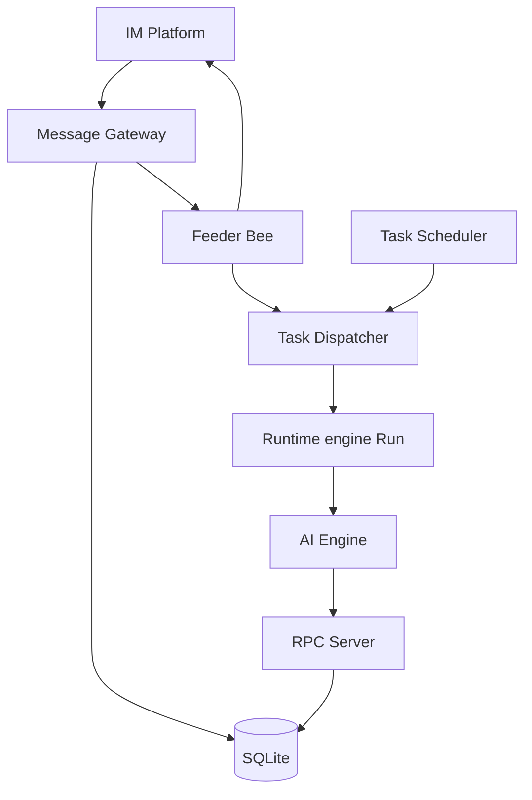
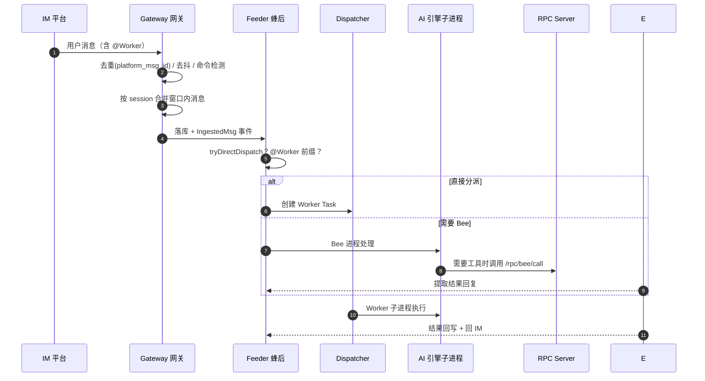

# OpenBee — 24/7 数字员工管理平台

> **本解读按 agent 类规格产出**（配套多关注面子文档）。
> **仓库：** https://github.com/theopenbee/openbee ｜ **协议：** MIT ｜ **公司：** 杭州万训科技 ｜ **npm：** `@theopenbee/cli`
> **分析基线：** 上游 v0.0.42（多用户 RBAC），本解读依据代码快照比对。

## 子文档索引

- [`data-model.md`](data-model.md) — SQLite 数据模型：49 迁移、存储选型、Schema 演进
- [`rbac.md`](rbac.md) — 多用户 RBAC：首装引导、鉴权链路、权限解析与缓存、系统角色保护
- [`runtime.md`](runtime.md) — Agent 运行时：动态引擎路由、engine args 合并、Go 并发惯用法
- [`deployment.md`](deployment.md) — 分发与部署：npm 平台子包、GoReleaser、系统服务自启、自升级

## 概览

### 根因：把 AI 当"数字员工"来管理

OpenBee 解决的核心问题是：**AI Agent 用完即走、各自为战，缺一个持续的"数字员工"层**。它的产品主张是——每个 Worker 是一个有名字、有身份、有部门、有工作状态和历史记录的数字员工，管理员像管人一样管理它们。这是与"Agent 协作平台（Issue/Project 驱动）"完全不同的切入角度：**对话即调度，AI 不是临时工具而是常驻同事**。

与此配套，OpenBee 把"蜂后（Bee）+ 工蜂（Worker）"的组织隐喻做进了架构：Bee 是消息的第一接收者和中央协调者，Worker 是被分派干活的分工单元。

### 解决的痛点

- **AI 不"在线"**——终端里用完就没了，没有持续的工作身份。
- **入口碎片化**——飞书/钉钉/微信/命令行各自为战，无统一指挥中心。
- **没有调度**——"每晚 8 点跑一次代码审查"这类定时需求无处安放。
- **无法协作与交接**——一个 Worker 做一半的活，其他人看不到、接不了手。

### 核心能力清单

| 能力 | 说明 |
|------|------|
| 蜂后对话 | Bee 作为中央 AI 协调者，接收 IM 消息，自主执行或 `@Worker` 分派 |
| 数字员工身份 | Worker 有名字/状态/描述/约束/部门/权限范围，像员工一样可见 |
| 任务调度 | 立即 / 倒计时 / cron 三类任务，Worker 级串行队列 |
| 部门组织 | 树形部门，Worker 可挂多部门、递归查询 |
| 多 IM 集成 | 飞书 / 钉钉 / 企微 / 微信 / Telegram / Linear / 本地 Web Chat |
| 多 AI 引擎 | Claude / Codex / Pi，Bee 与 Worker 可**运行时**独立切换（动态引擎） |
| RPC 工具系统 | Worker 进程经 HTTP/JWT 调用 20+ 工具（发消息/查状态/管 Worker/任务/部门） |
| 约束系统 | 给 Worker 设 Scope 级 Key-Value 约束（v0.0.30 起与 Agent 内置记忆脱钩） |
| 环境变量 | 加密存储，运行时注入 Worker 进程；全局/Worker/部门/调度器多级 |
| Token 统计 | 后台同步器聚合 Token 用量，仪表盘趋势图 |
| 多用户 RBAC | v0.0.42 起多账号 + 角色权限 + 首装 super-admin 引导 |

### 技术栈一览

| 层面 | 技术 |
|------|------|
| 后端 | Go（~4.8 万行，含测试） |
| Web 框架 | Gin |
| 数据库 | SQLite（modernc.org/sqlite 纯 Go，WAL + 单连接） |
| CLI | Cobra |
| AI 引擎 | Claude Code / Codex / Pi（插件式 EngineAdapter） |
| IM SDK | 飞书 / 钉钉 Stream / Telegram / 基于 websocket 的企微 |
| 调度 | robfig/cron/v3 |
| 前端 | React 19 + TypeScript + Vite + Tailwind（v0.0.40 起 design system 重设计） |
| 分发 | npm `@theopenbee/cli` + Homebrew + Scoop + deb/rpm + GoReleaser |

## 架构总览

OpenBee 是**单体 Go 进程**：一条命令 `openbee server` 启动 API、消息网关、Bee 协调器、调度器、Dispatcher 全套，Worker 作为子进程由调度器拉起。

> 数据流方向与职责：`PL → GW`（IM 消息入口）；`GW → FD`（去重/去抖后入 Bee 协调）；`FD → DISP`（@Worker 直派，绕过 Bee）；`SCH → DISP`（cron/倒计时投放）；`DISP → RUNT → ENG`（拉 Worker 子进程跑引擎）；`ENG → RPC`（引擎经 RPC 调 20+ 工具）；`FD → PL`（回复回 IM）。节点对应：Message Gateway=去重/去抖/命令检测，Task Dispatcher=按 Worker 串行队列，engine Run=子进程执行。

- 架构决策详解见 [runtime.md](runtime.md)；数据层见 [data-model.md](data-model.md)。

## 核心执行链路

### 对话 → Bee → Worker → 回复

用户在某 IM 平台发消息，链路为（[internal/domain/msgingest/gateway.go:57-57]() 的 seen 去重、[internal/domain/bee/feeder.go:167-167]() 的 processBeeGroup 先 `tryDirectDispatch`）：

<!-- snippet: 	seen           map[string]struct{} // in-memory dedup set keyed by platform_msg_id -->
<!-- snippet: func (f *Feeder) processBeeGroup(ctx context.Context, sessionKey string, msgs []store.ClaimedMessage) { -->

这一层的关键设计：**@Worker 直派绕过 Bee 的 AI 推理**，响应快、成本低；Bee/Worker 的会话都由引擎键控的 session_contexts 持久化，支持跨消息 resume（`session_key+agent+engine` 主键，见 [data-model.md](data-model.md)）。

### 调度与分发

- 调度器按 cron/倒计时计算 `next_run_at`，Dispatcher 以**单事件循环 + 按 worker 串行队列**保证"同一 Worker 同一时刻只跑一个任务"（[internal/domain/task/dispatcher.go:141-141]()）。

<!-- snippet: func (d *TaskDispatcher) Run(ctx context.Context) { -->

- Feeder 与 Scheduler 的轮询间隔为 **500ms**（自 v0.0.13 起的并发会话 + 信号量限流，见 [internal/domain/bee/constants.go:7-7]()）。

<!-- snippet: 	PollInterval = 500 * time.Millisecond -->

## 核心模块导读

| 模块 | 说明 | 深读 |
|------|------|------|
| AI 引擎层 | `EngineAdapter` 插件契约 + DynamicAdapter 运行时切换 | [`runtime.md`](runtime.md) |
| 引擎配置 | enginecfg 并发安全默认引擎 + engine args 三层合并 | [`runtime.md`](runtime.md) |
| 并发执行 | Feeder 信号量 / Dispatcher 事件循环 / context 取消传播 | [`runtime.md`](runtime.md) |
| SQLite 数据层 | 49 条内联迁移、单连接、WAL、幂等演进 | [`data-model.md`](data-model.md) |
| 核心表 | worker / task / execution / session_contexts / token_stats | [`data-model.md`](data-model.md) |
| 多用户 RBAC | 四表、首装引导、鉴权双闸门、权限缓存 | [`rbac.md`](rbac.md) |
| 分发部署 | npm 平台子包 / GoReleaser / launchd/systemd / 原子自升级 | [`deployment.md`](deployment.md) |

## 同类项目对比

| 维度 | OpenBee | Leros | Multica |
|------|---------|-------|---------|
| 定位 | 数字员工管理（对话驱动） | 企业 AI 工作平台（Session 驱动） | 托管 Agent 协作（Issue 驱动） |
| 核心隐喻 | 蜂后 + 工蜂 | 四平面架构 | Agent 作为 Issue Assignee |
| 交付 | 单进程自托管 | Server + Worker（NATS） | 单进程 + Daemon |
| 引擎 | Claude/Codex/Pi（外部 CLI，可运行时切换） | Eino + 多 CLI | Claude Code/Codex |
| 数据库 | SQLite（单机） | SQLite/PG/MySQL/ClickHouse | PostgreSQL |
| 分布式 | ❌ 单体 | ✅ NATS | ⚠️ Redis 中继 |
| 定时调度 | ✅ cron/倒计时 | ✅ | ✅ Autopilot |
| 多 IM | 飞书/钉钉/企微/微信/Telegram/Linear | 飞书 + GitHub | 飞书 |
| 多租户/多用户 | ✅ v0.0.42 RBAC | ✅ Org | ✅ Workspace |
| 部门组织 | ✅ 树形部门 | ✅ | ✅ Squad |
| Skill 系统 | ❌（引擎自带） | ✅ Skill Catalog | ✅ Skill 市场 |

> 对比视角：OpenBee 是三个里唯一把"数字员工身份 + 单体零依赖 + 多引擎运行时切换"做进核心设计的。

## 设计亮点

1. **@Worker 直派**：消息带 `@WorkerName` 直接分派给 Worker，绕过 Bee 推理，响应更快速、成本更低（[internal/domain/bee/feeder.go:381-381]()）。

<!-- snippet: func (f *Feeder) tryDirectDispatch(ctx context.Context, msgs []store.ClaimedMessage) bool { -->
2. **运行时换引擎**：`DynamicAdapter` + `enginecfg` 让 Bee/Worker 可在运行中切换后端模型订阅，且 `RunResult.ExtractResult` 关闭在 run 时刻，切换不影响在途结果（[runtime.md](runtime.md)）。
3. **单连接换简单性**：SQLite `SetMaxOpenConns(1)` 串行化写路径、规避锁竞争，store 层以"先排空再查关联"规避死锁（[data-model.md](data-model.md)）。
4. **自写 CLI tokenizer 防注入**：engine args 逐字符解析引号/转义，作为 argv 而非 shell 文本传入（[internal/ai/engine_args.go:27-27]()）。

<!-- snippet: func splitCLIArgs(s string) ([]string, error) { -->
5. **改密强制全员重新登录**：`floorToSecond` 让 `password_changed_at` 与 JWT `iat` 对齐，改密瞬间旧 token 失效（[rbac.md](rbac.md)）。

## 不足与风险

- **单体上限**：单进程 + SQLite 限制横向扩展，Worker 数量增大时单机资源成瓶颈；分布式的 Leros/NATS 以更高运维换更大规模。
- **无内置运行时**：依赖外部 CLI（Claude/Codex/Pi），每个 Worker 须装了对应命令行，缺 Leros 内嵌运行时；工作目录直接映射 CLI 工作空间是设计取舍。
- **多用户刚起步**：RBAC 覆盖了用户/角色/权限的管理 API，但"A 用户能否看到 B 用户的 Worker/Task"这类数据级可见性尚未细化（权限集中在 resource:action 的操作级）。

## 可借鉴的设计

- **插拔式引擎 + 运行时可切换**：用统一 `EngineAdapter` 接口收敛异构外部 CLI，配一个并发安全的默认引擎选择器，是"给产品留换模型余地"的可迁移范式（[runtime.md](runtime.md)）。
- **单连接 + WAL 的单机数据层**：单体自托管产品用 SQLite 单连接 + 显式事务，省掉分布式存储的复杂度，换取极低部署门槛（[data-model.md](data-model.md)）。
- **校验式自升级**：下载 → SHA256 边下边校验 → 临时文件 → `os.Rename` 原子替换，避免升级中断留下坏二进制（[deployment.md](deployment.md)）。
- **多级环境变量 + 加密注入**：全局/Worker/部门/调度器四级配置，加密存储、运行时解密注入 Worker 进程（部署核心能力）。

## 总结

OpenBee 用"数字员工"这个隐喻把 AI Agent 从"临时工具"重定位成"常驻同事"，并以单体 + SQLite + 多引擎的设计，把一个自托管、零依赖、对话即调度的 AI 工作平台做到了极低部署成本。它的根因锚点始终是：**让人像管人一样管 AI，而不用学一套新系统的复杂心智**。若你希望 AI 协作平台"开箱即用、本地私有化、IM 里@一下就能派活"，OpenBee 是对话驱动这条路上很完整的参考。
