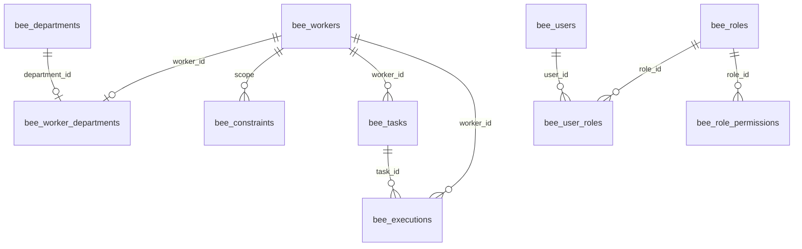
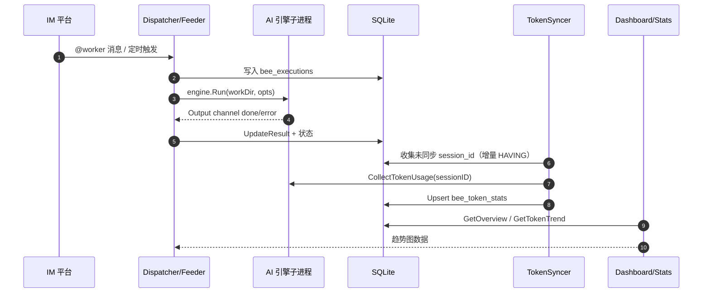

# OpenBee 数据模型

> 本解读按 agent 类规格产出，配套 [README.md](README.md)。本文聚焦 SQLite 数据层的存储选型、实体关系、Schema 演进与读写路径。

## 存储选型与理由

OpenBee 是自托管单机产品，选择 **SQLite（modernc.org/sqlite 纯 Go 驱动）** 而非 PostgreSQL/MySQL，理由与单体架构哲学一致：一条命令启动整个系统，数据文件就在本地，无外部依赖即可跑起来。连接串显式打开 WAL、外键与忙超时（[internal/infra/store/db.go:528-528]()）。

<!-- snippet: 	db, err := sql.Open("sqlite", dbPath+"?_journal_mode=WAL&_foreign_keys=on&_busy_timeout=5000") -->

真正值得注意的设计是**连接池被压到单连接**：`db.SetMaxOpenConns(1)` + `db.SetMaxIdleConns(1)`（[internal/infra/store/db.go:533-533]()）。配合 WAL 的读写并发，单连接既满足"单机单人"的吞吐预期，又极大简化了并发正确性——所有写路径靠显式事务串行化，无需担心 SQLite 的锁竞争。

<!-- snippet: 	db.SetMaxOpenConns(1) -->

代价是**任何持有连接迭代游标的同时再发嵌套查询都会死锁**，store 层为此专门在列表查询里先排空结果集再查关联（[internal/infra/store/user_store.go:92-92]()）。这是一个"用单连接换简单性、但要求上层遵守纪律"的权衡。

<!-- snippet: 	// Drain the result set before issuing nested queries: the DB pool is capped -->

存储选型信号汇总：

| 决策 | 取值 | Why |
|------|------|-----|
| 数据库 | SQLite（modernc.org/sqlite） | 单机自托管，零外部依赖，纯 Go 无 CGo |
| 连接 | `_journal_mode=WAL` | 读写不互斥，后台同步器与 API 读取可并行 |
| 外键 | `_foreign_keys=on` | RBAC 关联表靠 ON DELETE CASCADE 保证引用完整性 |
| 并发 | `SetMaxOpenConns(1)` | 单连接串行化写路径，配合显式事务，省略锁竞争分析 |

## 实体关系总览

所有表以 `bee_` 前缀命名。核心业务实体关系如下（省略消息/会话等次要关联，聚焦 Worker-任务-执行-RBAC 主链）：

- worker 表建表（[internal/infra/store/db.go:24-24]()）、execution 表（[internal/infra/store/db.go:38-38]()）、task 表（[internal/infra/store/db.go:72-72]()）分别建在这三处。

<!-- snippet: 		sql: `CREATE TABLE IF NOT EXISTS bee_workers ( -->
<!-- snippet: 	name:    "create_table_bee_executions", -->
<!-- snippet: 		name:    "create_table_bee_tasks", -->

## 核心表设计

### bee_workers

Worker 即"数字员工"实体，元核心业务对象。建表后经 v30/36/44 三次加列（permission_scopes / engine / engine_args）。核心字段如下：

| 字段 | 类型 | 约束 | 说明 |
|------|------|------|------|
| `id` | TEXT | 主键 | UUID |
| `name` | TEXT | NOT NULL | Worker 名，全局唯一 |
| `work_dir` | TEXT | NOT NULL | 工作目录（默认 `~/.openbee/worker/{id}`） |
| `status` | TEXT | 默认 `idle` | 空闲/工作中/错误，驱动仪表盘状态 |
| `description` | TEXT | 默认 '' | 行为描述 |
| `constraints` | TEXT | 默认 '' | 原 `memory` 列改名（v39） |
| `permission_scopes` | TEXT | 默认 '' | v30 加列，RPC 工具权限范围 |
| `engine` | TEXT | 默认 '' | v36 加列，AI 引擎名，空则用全局默认 |
| `engine_args` | TEXT | 默认 `{}` | v44 加列，JSON：引擎→CLI 参数 |

最终列集合见运行期常量（[internal/infra/store/worker_store.go:45-45]()）；`engine_args` 加列见 [internal/infra/store/db.go:405-405]()。

<!-- snippet: 	workerColumns        = `id, name, description, constraints, work_dir, engine, engine_args, status, permission_scopes, created_at, updated_at` -->
<!-- snippet: 		version: 44, -->

### bee_tasks

任务实体，支持即时/倒计时/cron 三类。关键设计是**外键引用消息与 worker**，把"IM 对话 → 任务"直接建模进来（[internal/infra/store/db.go:71-71]()）。

<!-- snippet: 		name:    "create_table_bee_tasks", -->

v46 删除 `execution_id` 列、v45 给 execution 增加 `task_id` 并回填，把"execution 从属于 task"的关系反过来建模（[internal/infra/store/db.go:419-419]()）。

<!-- snippet: 		version: 46, -->

| 字段 | 类型 | 约束 | 说明 |
|------|------|------|------|
| `id` | TEXT | 主键 | UUID |
| `message_id` | TEXT | 外键→bee_platform_messages | 触发该任务的 IM 消息 |
| `worker_id` | TEXT | 外键→bee_workers | 任务归属 Worker |
| `instruction` | TEXT | NOT NULL | 待执行的指令 |
| `type` | TEXT | CHECK | `immediate`/`countdown`/`scheduled` |
| `status` | TEXT | CHECK | pending/running/completed/failed/cancelled |
| `scheduled_at` | INTEGER | 可空 | 倒计时/定时时间戳 |
| `cron_expr` | TEXT | 默认 '' | cron 表达式 |
| `next_run_at` | INTEGER | 可空 | 调度器算出的下次运行时间 |

### bee_executions

一次执行的运行记录，由 worker 路径和 bee 自身路径两个写入者产生（[internal/domain/worker/execution.go:29-29]()）。`task_id` v45 加列并回填，把执行关联回任务；日志不存货进库，改存文件系统 `~/.openbee/logs/`。建表见 [internal/infra/store/db.go:38-38]()。

<!-- snippet: func (m *Manager) ExecuteWorker(ctx context.Context, req ExecuteRequest) (model.WorkerExecution, error) { -->

| 字段 | 类型 | 约束 | 说明 |
|------|------|------|------|
| `id` | TEXT | 主键 | UUID |
| `worker_id` | TEXT | 可空 | Worker，bee 自身执行时为空 |
| `session_id` | TEXT | NOT NULL | 会话；resume 时传给引擎续上下文 |
| `status` | TEXT | 默认 `pending` | 生命状态 |
| `ai_process_pid` | INTEGER | 默认 0 | 引擎子进程 PID |
| `trigger_input` | TEXT | 默认 '' | 完整 prompt（含合并的消息内容） |
| `result` | TEXT | 默认 '' | 提取的最终结果 |
| `engine` | TEXT | 默认 '' | v42 加列，记录用了哪个引擎 |
| `task_id` | TEXT | 默认 '' | v45 加列并回填 |

### bee_session_contexts

**跨消息上下文持久化的关键表**。v29 重构为 engine 键控的 `(session_key, agent_id, engine)` 三列主键（[internal/infra/store/db.go:265-265]()）——因为同一会话用不同引擎时 session_id 存储独立，恢复上下文必须落在正确的引擎上。

<!-- snippet: 		version: 29, -->

| 字段 | 类型 | 约束 | 说明 |
|------|------|------|------|
| `session_key` | TEXT | 复合主键 | IM 平台会话键 |
| `agent_id` | TEXT | 复合主键 | bee 或 worker 的 id |
| `engine` | TEXT | 复合主键 | 引擎名，v29 引入 |
| `session_id` | TEXT | NOT NULL | 引擎的 session id |
| `updated_at` | INTEGER | NOT NULL | 上次更新 |

### bee_token_stats

Token 用量聚合表，由后台同步器写入，带 `(session_id, model)` 唯一索引，dashboard 据此做趋势图。建表见 [internal/infra/store/db.go:376-376]()。

<!-- snippet:         CREATE TABLE IF NOT EXISTS bee_token_stats ( -->

| 字段 | 类型 | 约束 | 说明 |
|------|------|------|------|
| `id` | TEXT | 主键 | UUID |
| `session_id` | TEXT | NOT NULL | 关联执行会话 |
| `model` | TEXT | NOT NULL | 模型名 |
| `input/output_tokens` | INTEGER | 默认 0 | 各方向 token |
| `cache_creation/read_tokens` | INTEGER | 默认 0 | 缓存 token |
| `synced_at` | INTEGER | NOT NULL | 同步时间，驱动增量 |

### RBAC 四表

v47 引入（详见 [rbac.md](rbac.md)）：`bee_users`（含 v49 加的 `password_changed_at`）、`bee_roles`（`is_system` 锁系统角色）、`bee_role_permissions`、`bee_user_roles`，复合主键 + ON DELETE CASCADE，种子写入 `sysrole_superadmin` + `'*'` 通配权限。建表见 [internal/infra/store/db.go:426-427]()。

<!-- snippet: 		sql: `
CREATE TABLE IF NOT EXISTS bee_users ( -->

## Schema 演进策略

迁移采用**内联 Go 数组** + version 水位线，49 条全定义在 `internal/infra/store/db.go`。`applyMigrations` 以 `bee_migrations.version` 为门控，已应用则跳过、未应用则开事务执行并记录，天然幂等（[internal/infra/store/db.go:555-555]()）。

<!-- snippet: func applyMigrations(db *sql.DB, migrations []migration) error { -->

演进模式取舍：

- **ADD 式为主**：绝大多数是 `CREATE TABLE IF NOT EXISTS` / `CREATE INDEX IF NOT EXISTS` / `ALTER TABLE ADD COLUMN`，向前兼容、可重入。
- **破坏性重建用"建新→搬数据→DROP→RENAME"三明治**：v29 重构 session（[internal/infra/store/db.go:265-265]()）

<!-- snippet: 		version: 29, -->

与 v40 重命名 memories→constraints（[internal/infra/store/db.go:355-355]()）。

<!-- snippet: 		version: 40, -->

- **数据回填嵌入迁移 SQL**：v45 回填 `task_id`（[internal/infra/store/db.go:410-410]()）

<!-- snippet: 		version: 45, -->

、v21 复制 local_replies→outbound（[internal/infra/store/db.go:208-208]()）。

<!-- snippet: 		version: 21, -->

- **废弃不删表，只留注释 + `SELECT 1`**：v27 对 `bee_local_sessions`（[internal/infra/store/db.go:252-252]()）。

<!-- snippet: 		version: 27, -->

测试侧用幂等断言（[internal/infra/store/db_test.go:45-45]()）与旧库手工升级测试（[internal/infra/store/db_migration_v47_test.go:5-5]()）护住演进安全。

<!-- snippet: func TestMigrations_Idempotent(t *testing.T) { -->
<!-- snippet: func TestMigrationV47_TablesAndSeedRoles(t *testing.T) { -->

## 读写路径

数据流核心是两个执行写入者（Worker vs Bee）如何生产 execution，以及后台同步器如何把 token 汇总成统计。

- execution 写入者：Worker 路径 [internal/domain/worker/execution.go:29-29]()，Bee 路径在 `internal/domain/bee/feeder.go`。
- 同步器增量采集用 `HAVING MAX(e.completed_at) > COALESCE(MAX(ts.synced_at), 0)`（[internal/tokenstat/syncer.go:42-42]()），扫描有 `LIMIT 500` 上限。
- 无数据时写 tombstone（model=`unknown`）防重复扫描（[internal/tokenstat/syncer.go:184-184]()）。
- token upsert 用 `ON CONFLICT(session_id, model) DO UPDATE`（[internal/infra/store/token_stats_store.go:54-54]()），dashboard 经协议汇总读取。

## 全局关联

数据层与整个单体架构互为因果：单连接 + WAL + 内联迁移，全部在服务单机自托管的定位下"去依赖"；RBAC 四表则是 v0.0.42 多用户能力的地基，支撑 [rbac.md](rbac.md) 描述的权限模型。而 session_contexts 与 token_stats 两块，分别服务对话连续性（[runtime.md](runtime.md)）与可观测（仪表盘），共同构成"数字员工有身份、有历史"的产品叙事。
