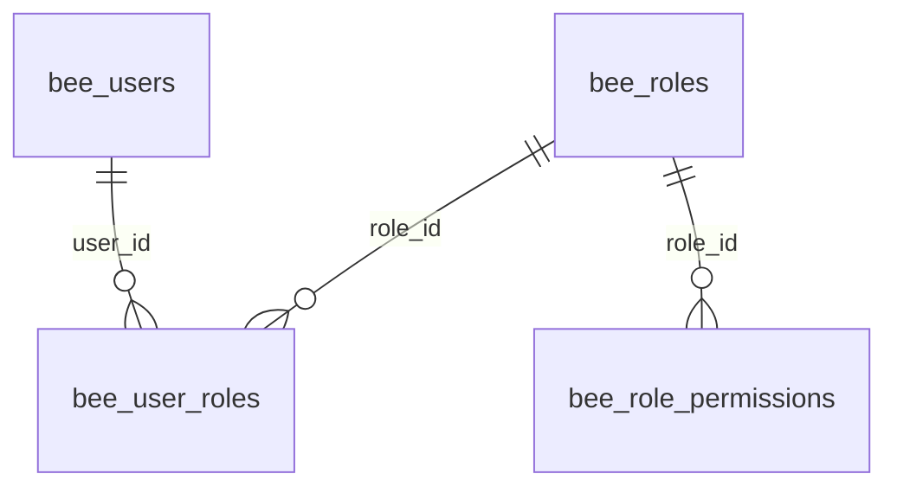
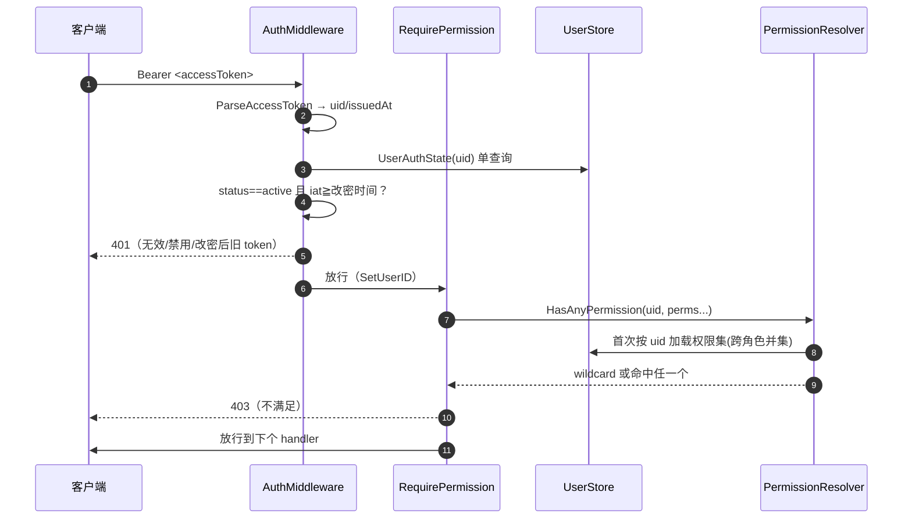

# OpenBee 多用户 RBAC

> 本解读按 agent 类规格产出，配套 [README.md](README.md)。本文深挖 v0.0.42 引入的多用户账号与角色权限（RBAC）模型：首装引导、鉴权链路、权限解析与缓存、系统角色保护。

## 为什么从"单用户"走向 RBAC

OpenBee 早期是单用户单机工具（[README.md](README.md) 早期版本"无多租户"）。但产品定位是"数字员工管理平台"——一个团队多人会同时操作控制台指挥 AI Worker，单用户无法区分"谁在下达任务、谁的权限范围到哪"。v0.0.42 引入多用户账号，本质是补上**作业审计**和**越权防护**两环：谁改了什么、谁能管哪些资源。

设计上它是**基于角色**而非直接给用户挂权限：用户 → 角色 → 权限，四张表（`bee_users` / `bee_roles` / `bee_role_permissions` / `bee_user_roles`）。相比直接 user-permission，RBAC 让"多个用户共享同一职责集"时不必重复维护权限，也便于预置系统角色。

## 首次设置（First-run Setup）

没有用户的系统是"未初始化"的。Web 控制台会先弹 setup 引导，创建**首个 super-admin**。核心约束是**只能在没有用户时执行一次**：

```go
func (h *SetupHandler) Create(c *gin.Context) {
	n, err := h.users.Count()
	if err != nil {
		respondError(c, http.StatusInternalServerError, err)
		return
	}
	if n > 0 {
		c.JSON(http.StatusConflict, gin.H{"error": "system already initialized"})
		return
	}
	user, err := h.users.Create(req.Username, req.Password, req.DisplayName, "", []string{model.RoleIDSuperAdmin})
```

`Status` 端点返回 `{"initialized": n > 0}` 供前端决定是否进入 setup 页（[internal/api/setup_handler.go:22-22]()）。首装创建的 user 带上 `sysrole_superadmin` 角色，并直接返回 JWT 对。

<!-- snippet: func (h *SetupHandler) Status(c *gin.Context) { -->

这是典型的 **"引导注册 + 幂等门闩"** 模式：初始化本身不是特权接口（无 token 也能调），但用"用户数 > 0 即拒绝"锁死，防止被二次利用覆盖已有管理员。

## 数据模型与种子

四表结构见 [data-model.md](data-model.md) 的 RBAC 段，布局为标准的 RBAC 中间表：



关键在设计信号：

- **权限是自由字符串而非外键**：`bee_role_permissions` 只有 `（role_id, permission TEXT）`，permission 是 `"resource:action"` 语义串（如 `tasks:manage`）。好处是权限变更不走 DDL，坏处是需要程序侧白名单约束可赋值性（见下）。
- **复合主键 + ON DELETE CASCADE**：`bee_user_roles`/`bee_role_permissions` 删除父实体即级联清理，避免残留引用。
- **种子 super-admin 拥有通配权限 `*`**：迁移 v47 用 `INSERT OR IGNORE` 写入 `sysrole_superadmin`，并只给它一条 `'*'` 权限（[internal/infra/store/db.go:427-427]()）。

<!-- snippet: CREATE TABLE IF NOT EXISTS bee_users ( -->

## 权限目录与可赋值性校验

权限 key 由**单一事实源**定义，并把可赋值的集合固定下来：

```go
const PermWildcard = "*"
const (
	PermContactsRead = "contacts:read"
	// ... resource:action 常量
	PermRolesManage  = "roles:manage"
)
```

`PermissionCatalog()` 按资源分组返回给 UI 下拉（contacts/chat/tasks/sessions/dashboard/env/system_config/administration 八组），同时 `assignablePermissions` 在包初始化时构建"已知可赋值权限集合"（不含通配符），`IsAssignablePermission` 据此校验用户创建角色时传的权限是否合法（[internal/infra/auth/permissions.go:6-6]()）。

<!-- snippet: const PermWildcard = "*" -->

这样**通配符 `*` 只能由系统种子拥有**，普通管理员在 UI 上、甚至通过 API 都无法把"上帝权限"赋给自定义角色——`validatePermissions` 拒绝非白名单 key（[internal/api/role_handler.go:94-94]()）。

<!-- snippet: func validatePermissions(perms []string) error { -->

## 鉴权链路：从 token 到权限放行

一次受保护 API 请求经过两道闸门：



两道闸门分工明确：

- **AuthMiddleware 认证**：验证 token 有效、用户存在且 `status==active`，还做**改密强制下线**——token 签发时间早于 `password_changed_at` 即拒绝（[internal/infra/auth/middleware.go:20-20]()）。

<!-- snippet: func AuthMiddleware(jwtSvc *JWTService, users UserAuthStateLoader) gin.HandlerFunc { -->

- **RequirePermission 授权**：基于已认证的 uid 查权限，多个权限参数按**或**语义（any-of），命中任一即放行；通配符 `*` 直接放行（[internal/infra/auth/middleware.go:48-48]()）。

<!-- snippet: func RequirePermission(resolver *PermissionResolver, perms ...string) gin.HandlerFunc { -->

密码策略细节：`floorToSecond` 把 `password_changed_at` 截到秒，与 JWT `iat`（秒精度）对齐，保证"改密那一刻及之前签发的 token 立即失效"——这是让每次改密码都强制全员重新登录的巧妙实现（[internal/infra/store/user_store.go:33-33]()）。

<!-- snippet: func floorToSecond(ms int64) int64 { return ms / 1000 * 1000 } -->

## 权限解析：跨角色并集 + 按用户缓存

`PermissionResolver` 把"用户有多少权限"变成可回答的高频查询，关键在**两处缓存**：

- **按用户缓存权限集**：`permSet` 首次按 uid 从 loader 加载所有角色的权限并集，结果存进 `cache[userID]`；同一 uid 的重复鉴权走内存命中（[internal/infra/auth/permissions.go:85-85]()）。

<!-- snippet: func (r *PermissionResolver) permSet(userID string) (map[string]struct{}, error) { -->
- **变更时使缓存失效（两级）**：改某个用户的角色 → `Invalidate(userID)` 只清该用户；改某个角色的权限 → `InvalidateAll()` 清整个缓存，因为影响所有成员（[internal/api/role_handler.go:63-63]()）。

<!-- snippet: func (h *RoleHandler) Update(c *gin.Context) { -->

通配符判断在 `HasPermission` 里优先返回 true，避免遍历（[internal/infra/auth/permissions.go:108-108]()）。

<!-- snippet: func (r *PermissionResolver) HasPermission(userID, perm string) (bool, error) { -->

`sync.RWMutex` 保护缓存，适配高并发读。

权限 set 用 `map[string]struct{}` 而非 slice，充分利用 Go map 的 O(1) 成员判断——这是 Go 里"权限集合"的惯用表示。

## 系统角色锁定与最后的 super-admin 保护

RBAC 最怕"权限自毁"——管理员删光所有 super-admin 导致系统失去管理入口。OpenBee 用两层防线：

- **系统角色不可改不可删**：`RoleStore.Update` 先查 `is_system`，系统角色直接返回 nil 忽略变更（权限/名称/描述全不可变）（[internal/infra/store/role_store.go:100-100]()）。

<!-- snippet: func (s *RoleStore) Update(r model.Role, permissions []string) error { -->

`Delete` 对系统角色报 `system_role_undeletable`（[internal/infra/store/role_store.go:132-132]()）。

<!-- snippet: func (s *RoleStore) Delete(id string) error { -->
- **最后一个 super-admin 不可移除/禁用**：`user_handler` 定义 `errLastSuperAdmin`，删除或禁用会破坏"至少保留一个活跃 super-admin"【业务不变量】（[internal/api/user_handler.go:15-15]()）。

<!-- snippet: var errLastSuperAdmin = apperr.New("last_super_admin", "cannot remove or disable the last active super-admin") -->

两层都是"靠程序不变量兜底"而非靠操作者自觉——即便有 `users:manage` + `roles:manage` 的人乱操作，也破坏不了这两条。

## 全局关联

RBAC 是 v0.0.42 多用户化的地基，与 [data-model.md](data-model.md) 的四表直接对应，也与 [runtime.md](runtime.md) 里的 engine 编排解耦——auth 层只管"谁、能否、做什么"，不关心引擎怎么跑。它与 RPC 工具的 `permission_scopes` 是**两个正交的权限维度**：前者管 Web 管理端 API，后者管 Worker 进程调用工具的权限，共同构成"人管控制台 + Agent 管任务"的双边界。
