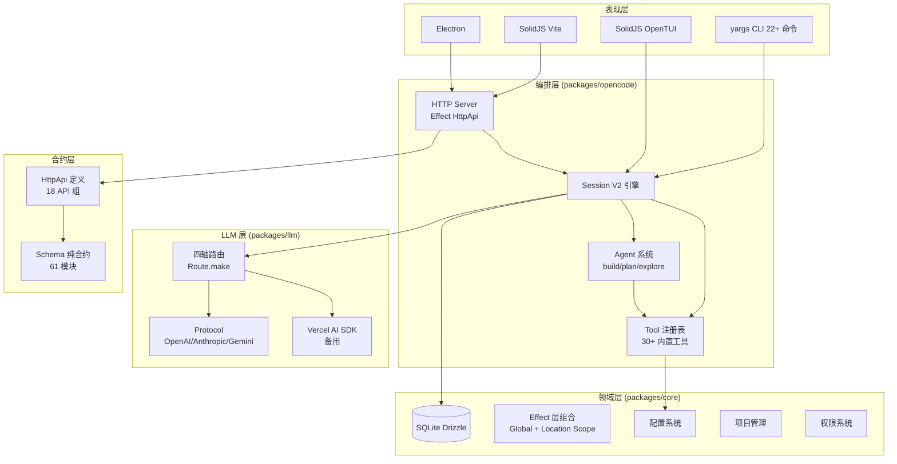

# OpenCode — 开源 AI 编码 Agent 深度解读

> **GitHub:** [github.com/anomalyco/opencode](https://github.com/anomalyco/opencode)
>
> **关联文档:** [系统架构深读](./architecture.md) · [LLM 四轴路由系统](./llm-route-system.md) · [Session V2 持久化编排](./session-system.md)

---

## 一、项目概览

### 这是什么

OpenCode 是一个全栈开源的 AI 编码 Agent，定位为终端 + Web + 桌面三端覆盖的 AI 辅助编程工具。与 Claude Code、Codex CLI 等同类工具的"单入口"设计不同，OpenCode 采用**服务化架构**——它既是终端 CLI/TUI 工具，也是 HTTP API Server，还可嵌入 Electron 桌面应用，三者共享同一套核心编排引擎。

### 解决的痛点

现有 AI 编码工具多采用简化心智模型的设计：输入指令 → 等待结果 → 接受或拒绝。这种设计对用户友好但牺牲了可控性。OpenCode 要解决的根本问题是**让 AI Agent 的执行变得可观察、可编排、可扩展**——通过 Session 持久化（崩溃恢复与历史重放）、结构化 Tool 系统（30+ 内置工具）、可组合 LLM 路由（20+ Provider 统一抽象）、以及 Effect-TS 的函数式编排，使 Agent 的推理与执行过程对用户完全透明。

### 核心能力清单

| 能力 | 说明 |
|------|------|
| **多模态交互** | CLI / TUI / Web / Desktop / Headless API 五种界面 |
| **多 LLM 提供者** | 20+ 提供者（OpenAI / Anthropic / Google / Bedrock / Azure / DeepSeek 等），统一路由层 |
| **持久化 Session** | SQLite 事件溯源，崩溃恢复，重放，Context Epoch 快照 |
| **30+ 内置工具** | 读/写/搜索/编辑/Shell/MCP/LSP/WebSearch/子Agent |
| **插件系统** | V1/V2 双版本 API，支持 Effect 和 Promise 两种编程模型 |
| **MCP 协议** | Model Context Protocol 完整实现（Server/Client/Browser/Auth） |
| **多 LLM 协议** | OpenAI Chat/Responses、Anthropic Messages、Gemini、Bedrock Converse |
| **自托管** | 单二进制（Bun），SQLite 存储，Docker 部署 |
| **代码生成 SDK** | Effect HttpApi 定义自动生成 JS/SDK 客户端 |

### 技术栈一览

| 层面 | 技术 |
|------|------|
| 运行时 | Bun 1.3+ (主), Node.js (备) |
| 语言 | TypeScript 5.x, ESM |
| 函数式框架 | Effect-TS v4 (beta, `4.0.0-beta.83`) |
| 数据库 | SQLite (bun:sqlite / node:sqlite), Drizzle ORM |
| HTTP 服务 | Hono + Effect HttpApi |
| LLM 抽象 | Vercel AI SDK + 自定义 Route Runtime (四轴路由) |
| 前端 (Web) | SolidJS + Vite + TailwindCSS |
| 前端 (TUI) | SolidJS + OpenTUI |
| 桌面 | Electron + electron-builder |
| 基础设施 | Turborepo monorepo, Bun workspaces |
| 测试 | Bun test, Playwright, happy-dom |
| 代码生成 | Effect HttpApi → Schema → Client SDK |

---

## 二、同类定位

| 项目 | 协议 | 多界面 | 多 Provider | Session 持久化 | 插件系统 | 架构层级 |
|------|------|--------|------------|---------------|---------|---------|
| **OpenCode** | MIT | ✅ CLI/TUI/Web/Desktop | ✅ 20+ | ✅ 事件溯源 | ✅ V1/V2 | 服务化(Server+SDK) |
| **Claude Code** | 专有 | ✅ CLI | ❌ Claude 独占 | ✅ | ❌ | 单体 |
| **Codex CLI** | 专有 | ✅ CLI | ❌ 有限 | ❌ | ❌ | 单体 |
| **Continue** | Apache-2.0 | ✅ IDE 插件 | ✅ | ❌ | ✅ | IDE 增强 |
| **Aider** | Apache-2.0 | ✅ CLI | ✅ 主流 | ❌ | ❌ | 单体 |
| **Cline** | Apache-2.0 | ✅ VS Code | ✅ | ❌ | ✅ MCP | IDE 增强 |

OpenCode 是目前唯一**既是独立工具又有服务端能力**的 AI 编码 Agent。它提供的不是 IDE 插件，而是一个运行时编排引擎——你可以用它的 CLI 交互、用 Web 远程操控、或用 SDK 集成到自己的应用中。

---

## 三、项目规模

| 类别 | 数量 |
|------|------|
| 包数 | ~32 (monorepo) |
| 核心包 | `@opencode-ai/opencode`, `@opencode-ai/core`, `@opencode-ai/llm` |
| GitHub Stars | ~10,000+ |
| 开发语言 | TypeScript 100% |
| 许可证 | MIT |

---

## 四、架构总览

OpenCode 采用**分层 + 服务化**的架构，核心依赖链路为：

```
Schema (纯合约) → Protocol (API 定义) → Server (HTTP)
    ↓
Core (领域模型 + Effect 服务) → OpenCode (CLI/TUI/Server 入口)
    ↓
LLM (路由抽象)
```



### 包间依赖

```
@opencode-ai/schema          ← 浏览器安全，纯合约
    ├─ @opencode-ai/protocol ← HttpApi 定义
    │    ├─ @opencode-ai/server      (共享 HTTP 工具)
    │    └─ @opencode-ai/client      (代码生成 SDK)
    └─ @opencode-ai/core      ← 领域模型 + 数据库
         └─ @opencode-ai/opencode ← 主入口
              └─ @opencode-ai/llm   ← LLM 抽象层
```

---

## 五、核心模块导读

### [LLM 四轴路由系统](./llm-route-system.md)

将 LLM Provider 的 API 调用分解为四个正交可组合的维度：

| 轴 | 职责 | 可复用性 |
|----|------|---------|
| **Protocol** | 语义 API 合约（body schema + stream parser） | DeepSeek / TogetherAI / Cerebras 直接复用 OpenAI Chat |
| **Endpoint** | URL 构造（静态路径 / 动态函数） | Bedrock 用函数路径嵌入 modelId |
| **Auth** | 鉴权方案（Bearer / Header / SigV4） | SigV4 仅 Bedrock 独有 |
| **Transport** | 传输层（HTTP SSE / WebSocket） + Framing (SSE / binary) | 仅 Bedrock 使用 binary event-stream |

**亮点：** 新增一个 OpenAI 兼容 Provider 只需 5 行路由 + 1 行 profile 注册。

### [Session V2 持久化编排](./session-system.md)

基于事件溯源的持久化会话系统，核心设计：

```
Prompt Admission (durable inbox) → Wake (异步调度) → Drain (串行执行)
```

| 机制 | 说明 |
|------|------|
| **Admit / Promote 分离** | 输入先持久化（admit），在安全边界才提升为可见消息（promote） |
| **Steer / Queue 语义** | Steer 立即在下一 turn 边界投递，Queue 仅当 Session 将空闲时 |
| **Wake 合并** | 同一 Session 的多次 wake 调用折叠为一次执行 |
| **Context Epoch** | 系统上下文（环境、工具列表、Project 信息）的快照与增量更新 |
| **Compaction** | 自动触发的 LLM 摘要压缩，超出上下文窗口时启动 |

### [系统架构深读](./architecture.md)

涵盖：
- CLI 命令体系与启动流程
- Effect 层组合（LayerNode + Global/Location 两阶段部署）
- Tool 系统（三层注册 + 权限过滤）
- Server 端 HttpApi 组织模式
- 完整请求链路追踪

---

## 六、设计亮点

### 1. Effect-TS 贯穿全局

所有核心服务以 Effect `Service` 类实现，使用 `Context.Tag` + `Layer` 组合模式。项目在 `packages/core/src/effect/` 中封装了自定义的 **LayerNode** 系统，为 Effect Layer 添加了类型安全的依赖树、Tag 分组、和分层编译能力。

**两阶段部署模型：**
- **Global** — 进程级单例（数据库、文件系统、配置）
- **Location** — 每目录实例化（Session、Tool、权限），60 分钟不活跃自动回收

### 2. 四轴可组合 LLM 路由

这是本项目**最具设计价值的模块**。通过将 Provider 适配分解为 Protocol / Endpoint / Auth / Transport 四个独立维度，实现了：

- 7+ 兼容 Provider 共享同一个 Protocol 定义
- 每个 Provider 只需 15-60 行 route 描述
- 新增 Provider 模式：从 profile 中选取或自定义

### 3. 面向会话而非面向请求的 Agent 编排

大部分 AI 编码工具在每次用户输入时新建一个请求。OpenCode 将一切视为**持久化会话中的事件**，每个输入先入库再执行，支持：
- 在执行过程中新增输入（steer/queue 两种投递方式）
- 崩溃恢复（重放事件流重建状态）
- 上下文精细控制（Context Epoch 快照与增量替换）

### 4. 代码生成管线

从 `@opencode-ai/protocol` 的 HttpApi 定义出发，自动生成：
- Promise 风格 JS SDK
- Effect 风格 JS SDK
- OpenAPI 规范文档

---

## 七、总结与评价

### 亮点

- **架构完整性**：从 CLI 到 Server 到 SDK，覆盖了 AI 编码 Agent 的所有使用场景
- **LLM 路由设计**：四轴可组合是解决多 Provider 适配问题的优雅方案，体现了接口隔离与组合优于继承
- **Session V2 事件溯源**：admit / promote 两阶段、steer / queue 双投递语义，设计精细且语义明确
- **Effect-TS 实践**：全量使用函数式编排，为 TypeScript 项目的函数式架构提供了工程范本

### 不足

- **入口复杂度**：22+ CLI 命令 + 多种运行模式，新用户上手有一定门槛
- **Bun 强依赖**：核心运行时依赖 Bun，对 Node.js 生态的部分工具有兼容问题
- **文档分散**：优秀的架构设计缺乏体系化的技术文档（这也是本解读的初衷）
- **仍在快速迭代**：Session V2 和 LLM Route 系统处于活跃开发中，部分 API 可能变化

### 可借鉴的设计

1. **四轴路由分解**：任何需要对接多个外部 API 的系统都可以借鉴此模式
2. **Effect LayerNode**：类型安全的依赖注入组合，适用于中大型 TypeScript 项目
3. **Location-scoped 服务**：基于目录粒度的服务生命周期管理，对多项目/多工作区场景有参考价值
4. **事件溯源 Session**：admit/promote 分离 + 双投递语义的设计适用于需要精确控制的持久化对话系统

---

> **关联文档:** [系统架构深读](./architecture.md) · [LLM 四轴路由系统](./llm-route-system.md) · [Session V2 持久化编排](./session-system.md)
