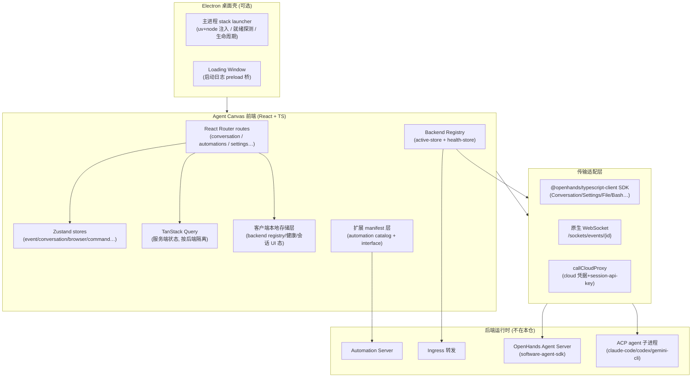

# OpenHands Agent Canvas

> 本解读按**通用默认规格**产出，叠加 **TypeScript 前端 ⊗ 可部署服务** 语言/产品维度（回落 `_default.md`，无独立 TS 前端类型规格）。基于 `@openhands/agent-canvas` v1.10.0（仓库 checkout：`OpenHands/OpenHands` Agent Canvas，`git` tag 对应 commit `566386939`）。本文档为重写版，纳入 Electron 桌面交付与客户端存储两个此前未覆盖的关注面。

## 根因

OpenHands 曾是单一的全栈 agent 运行时，拆分后变成了"**运行时** 与 **控制台** 解耦"的生态。Agent Canvas 解决的根本问题是——**当你的 coding agent 可以是多个（本地 OpenHands、Claude Code、Codex、Gemini，或云端/远程/ACP），如何用一块前端把所有后端统一成"一个开发控制中心"来启动、切换、监控和自动化它们**。它本身不执行 agent 动作，而是把底层多协议后端翻译成一套一致的用户界面，并把这些控制能力从单机扩展到桌面与云端。

## 概览

Agent Canvas 是一个 **React + TypeScript** 的桌面/Web 前端（`@openhands/agent-canvas`），README 自述为 "self-hosted developer control center for coding agents and automations"。它连接一个或多个 Agent Server 后端（REST + WebSocket），可包成 Electron 桌面应用，并挂接 Automation Server 做定时/事件触发的自动化；前端负责渲染会话/终端/浏览器/文件/设置/自动化 UI、管理前端状态与多后端本地元数据、翻译 UI 动作成 Agent Server API。

**边界**（`docs/architecture.md`）：绝不执行 agent 动作、不提供沙箱隔离、不承载 LLM 凭据执行，也不在无 automation 后端时跑自动化——它只做编排与呈现，执行完全交给外部后端。

| 核心能力 | 说明 |
|---|---|
| 多后端连接与切换 | 一个 UI 注册/切换多个 local/cloud 后端，`?backend=` 直达指定后端 |
| 第三方 agent 抽象 | 统一 OpenHands 与 ACP agent（Claude Code / Codex / Gemini） |
| 实时会话流 | 原生 WebSocket 拉取动作/观察事件，增量续接避免重放 |
| 自动化工坊 | 定时 (cron) / 事件 (webhook) 触发 agent 运行的自动化编排 |
| 运行时服务注入 | 把后端可达的 runtime services 塞进新会话 system_message_suffix |
| 桌面打包交付 | Electron 内置本地后端栈（uv/node），免 Docker 分发 |
| 客户端状态持久化 | 后端注册表/健康/会话 UI 状态的本地分层存储 |
| 多形态交付 | 独立 app / npm 库 entrypoint / Electron 桌面 / Docker |

**技术栈一览**：React 18 + React Router 7（file-based routing）、Zustand（本地状态，含 persist 中间件）、TanStack Query v5（服务端状态）、`@openhands/typescript-client`（Agent Server SDK）、原生 WebSocket、Monaco/xterm、Tailwind CSS v4 + HeroUI、i18next、Electron + electron-builder（桌面）、MSW（mock 模式）、Vitest + Playwright（测试）。

## 架构总览



**模块职责映射**（关键目录）：

```
src/
├── api/                    服务适配层（agent-server / automation / cloud / acp / profiles）
│   ├── backend-registry/   多后端注册表：active-store + storage + health-store
│   ├── agent-server-adapter.ts   请求载荷构建 + runtime-services 注入
│   ├── automation-service/ Automation Server 通信
│   └── cloud/              OpenHands Cloud 代理调用
├── stores/                 Zustand 状态（event 枢纽 / conversation / browser / command…）
│                            + persist 中间件的本地持久化（sidebar/home/pinned…）
├── utils/conversation-local-storage.ts   会话 UI 状态的本体 sanitize 持久化
├── components/             路由与功能 UI（会话/浏览器/文件/终端/后端/自动化/设置）
├── hooks/                  React Query hooks（query / mutation）+ 草稿持久化
├── contexts/               全局上下文（active-backend / conversation-websocket…）
├── manifests/              扩展 manifest 准入校验与派生逻辑（automation catalog）
├── constants/acp-providers.ts    ACP provider 注册表 + 凭据解析
├── types/                  action/observation/automation 等类型与类型守卫
├── routes/                 页面级路由组件
└── utils/                  websocket-url、handle-event-for-ui 等纯逻辑
electron/
├── main.mjs                Electron 主进程：栈启动器 + 窗口管理器 + 优雅关闭
├── preload.cjs             仅加载窗的 IPC 白名单桥（contextBridge）
├── loading.html            后端就绪前的原生进度屏（自包含 token + 日志文本插入）
├── electron-builder.config.mjs   打包：asar:false + node_modules 瘦身 + extraResources
docker/  helm/  bin/  scripts/    容器/Helm 部署、CLI launcher、本地栈启动脚本
```

## 子文档索引

- [`backend-control-plane.md`](backend-control-plane.md) — 多后端管理：注册/切换/健康探测与 ACP/OpenHands 抽象
- [`realtime-session.md`](realtime-session.md) — 实时会话流：WebSocket 事件 → Zustand → UI 渲染管线
- [`automations.md`](automations.md) — 自动化编排：Automation Server 契约、manifest/catalog、触发与运行
- [`electron-desktop.md`](electron-desktop.md) — Electron 桌面交付：主进程栈启动、运行时自包含、进程生命周期
- [`client-storage.md`](client-storage.md) — 客户端存储层：本地元数据的分层持久化、校验与演进

## 核心模块导读

| 模块 | 定位 | 深度阅读 |
|------|------|----------|
| **Backend Registry** | 多 local/cloud 后端的注册、持久化、active 选择与健康状态机；本地存储键的读强写弱契约 | [`backend-control-plane.md`](backend-control-plane.md) / [`client-storage.md`](client-storage.md) |
| **Agent Server 适配层** | 把后端请求统一成 Agent Server/ACP 载荷，并注入 runtime services | [`backend-control-plane.md`](backend-control-plane.md) |
| **实时会话传输** | 原生 WebSocket 的 URL 构建、认证、重连与事件分发 | [`realtime-session.md`](realtime-session.md) |
| **事件 → UI 渲染** | action→observation 归一化、流式增量合并、按类型路由到卡片/专用可视化器 | [`realtime-session.md`](realtime-session.md) |
| **Automation Service** | Automation Server REST 契约与 CRUD/dispatch/run/export | [`automations.md`](automations.md) |
| **Automation 触发与运行** | schedule(event) 触发、run 状态轮询、健康度派生 | [`automations.md`](automations.md) |
| **Electron 主进程** | 桌面栈启动编排、uv/node 运行时注入、两阶段就绪、进程树优雅关闭 | [`electron-desktop.md`](electron-desktop.md) |
| **Electron 打包** | asar:false + node_modules 瘦身 + extraResources 运行时打包 | [`electron-desktop.md`](electron-desktop.md) |
| **客户端存储** | 后端/健康/会话 UI 状态的分层持久化、sanitize 校验、明文 key 边界 | [`client-storage.md`](client-storage.md) |

## 设计亮点

- **多后端"只换客户端、不动页面"**：active backend 被编进 React Query 的 query key，后端切换即视为全新 query 自动 refetch，无需全局 invalidate（`src/contexts/active-backend-context.tsx:112-119`）——见 [`backend-control-plane.md`](backend-control-plane.md)。
- **实时流"REST 历史 + WS 增量"组合**：先 REST 拉历史，再用 `resend_mode='since'` 从断点续传，避免重复重放（`[src/contexts/conversation-websocket-context.tsx:862-864]()`，见 [`realtime-session.md`](realtime-session.md)）。
  <!-- snippet:     const queryParams: Record<string, string | boolean> = initialAfterTimestamp
      ? { resend_mode: "since", after_timestamp: initialAfterTimestamp }
      : { resend_mode: "all" }; -->
- **manifest 作为"安全收纳层"**：automation 模板与 interface 由 `@openhands/extensions` 包下发，宿主先准入校验再派生行为，不盲目信任外部数据（`[src/manifests/manifest-sources.ts:9-20]()`，见 [`automations.md`](automations.md)）。
  <!-- snippet:  * The catalog is passed as `unknown[]` on purpose: admission is a trust
  * boundary, so the host validates the published data rather than trusting the
  * types that shipped beside it.
  */

import * as automationsModule from "@openhands/extensions/automations";
import { AUTOMATION_CATALOG } from "@openhands/extensions/automations";
import { createSetupRegistry, type SetupRegistry } from "./manifest-registry";

export const SETUP_REGISTRY: SetupRegistry = createSetupRegistry(
  AUTOMATION_CATALOG as readonly unknown[],
); -->
- **桌面形态"免 Docker + 运行时自包含"**：desktop 不带容器，把 uv(uvx) 与官方 Node 打进包来起后端栈，规避 Finder 启动 .app 时 PATH 极简导致的静默崩溃；并记录"Electron-as-Node 会破坏 stdio MCP 握手"的踩坑史（`electron/main.mjs:132-141`，见 [`electron-desktop.md`](electron-desktop.md)）。
- **读取端永远防御、写入端静默吞错**：localStorage 是 user-writable，后端/健康/会话态全部读强校验 + 空值兜底，防手改 `-1` 推翻失败封顶机制（`src/api/backend-registry/health-storage.ts:27-34`，见 [`client-storage.md`](client-storage.md)）。
- **前端倒逼后端接口演进**：版本探测 + 最低兼容版本断言，前端可预先拦截不兼容的 Agent Server（`src/api/agent-server-compatibility.ts:291`）。

## 不足与风险

- **本仓仅前端**：真正 agent 执行/沙箱/LLM 流程在外部 `software-agent-sdk`，单独解读无法看到 agent 运行环路全貌。
- **多 agent 协议抽象依赖订阅源**：automation 模板来自已发布 npm 包，宿主对 catalog 结构高度耦合，包升级可能破坏承载 UI。
- **本地直跑风险高**：`npm run dev` 让 agent 直连本机文件系统，桌面形态免 Docker 意味着没有容器根文件系统隔离（agent-server 直接操作 `~/.openhands/...`），文档明确提示仅限可信环境；本地后端的 apiKey 明文进 localStorage，是本地单用户模型接受的取舍。

## 可借鉴的设计

- **query key 掺入"资源身份"实现切换即重建**：把 `conversation_url`/`session_api_key` 塞进 query key，天然按后端隔离缓存（可迁移到任何多租户/多实例前端）。
- **读强写弱 + 防篡改校验**：localStorage 读取边界做逐字段校验（防手改推翻 disable），写入端 try/catch 静默——"易损存储靠读取端防御"可复制。
- **声明式扩展 + 本地准入**：外部包给模板，宿主侧做 schema 校验、字段收集、错误映射的 manifest 层，实现"可插拔 UI"而不失控。
- **桌面栈 launcher 复用**：desktop/`npm run dev`/Docker 共用同一套 `scripts/dev-with-automation.mjs`，差异只在入口参数；主进程 `import()` 复用而非另写一遍，单点维护栈逻辑。
- **把工程史沉淀成注释与防御代码**：Electron-as-Node 失败、PATH 陷阱、悬空 symlink 都写在 docstring 里，下次触雷的人能直接读到原因。

## 总结

Agent Canvas 的价值不在于它是某个 agent 的界面，而在于它把"**驱动多个异构 coding agent**"这件事收敛成单一的开发控制台：通过 backend-registry 管连接、WebSocket/Query 管实时态、manifest 管扩展、automation 管触发、客户端存储管本地元数据、Electron 管桌面交付。它清楚地划出前端与后端的边界，也示范了一个"壳类产品"如何靠读强写弱校验、防止幻觉般的静态防御，在易损的浏览器存储与不可信的桌面工具链上保持可控——这也是理解整个 OpenHands 生态的关键切入口。
