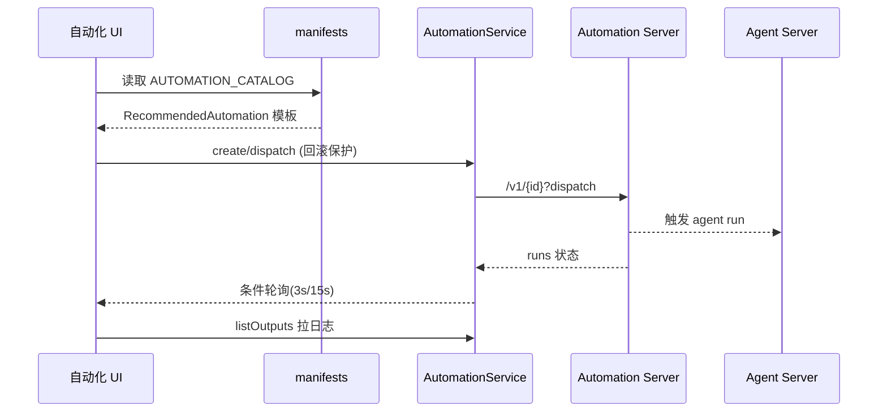

# 自动化编排：Automation Server 契约、manifest 与触发运行

> 本子文档深挖 Agent Canvas 的 automations 关注面。引用以 OpenHands Agent Canvas 仓库根为验证根。

## 定位：把"手动驱动 agent"升级成"自动触发 agent"

README 把 automations 列为头条卖点："Create automations and workflows that integrate with Slack, GitHub, Linear, and more. Run on a schedule or in response to webhook events"。

在边界上，**Agent Canvas 前端不执行自动化**——它通过 `AutomationService`（`src/api/automation-service/automation-service.api.ts`）与独立的 **Automation Server**（外部服务）通信，做的是：模板展示、创建/导入、触发配置、运行状态轮询与日志。契约类型集中在 `src/types/automation.ts`。

## 与 Automation Server 的契约

所有请求 base path `/api/automation`（`automation-service.api.ts:40`），端点经 `automation-interface.ts` 的 `DEFAULT_ENDPOINTS` 解析（`:45-56`）。**双后端模型**：`getActiveBackend()` 区分——cloud 走 `callCloudProxy`，否则走本地 axios；本地实例的拦截器**动态**从 backend registry 取 host 与 `X-Session-API-Key`（`:73-101`）。核心方法：

| 方法 | 端点 | 用途 |
|---|---|---|
| `listAutomations`/`getAutomations` | `GET /v1` | 列表（分页 limit/offset） |
| `getAutomation` | `GET /v1/{id}` | 详情 |
| `createAutomation` | `POST /v1` | 导入用创建（先占位再 PATCH 成真实 trigger） |
| `updateAutomation` | `PATCH /v1/{id}` | 更新 |
| `deleteAutomation` | `DELETE /v1/{id}` | 删除 |
| `dispatchAutomation` | `POST /v1/{id}/dispatch` | 立即运行 |
| `cancelAutomationRun` | `POST /v1/runs/{runId}/cancel` | 取消 |
| `listAutomationRuns` | `GET /v1/{id}/runs` | 运行历史 |
| `downloadTarball` | `GET /v1/{id}/tarball` | 导出 tar（自动化可移植包） |
| `getCapabilities` | `GET /v1/capabilities` | 能力发现 |
| `validateDraft` | `POST /v1/validate` | 草稿校验 |
| `createAutomationDraft` | `POST /v1/preset/prompt` | 直接创建（assisted 模式） |
| `checkHealth` | `GET /health` | 5s 超时健康检查 |

## 触发模型：为什么 `type` 故意用 string

这是最体现沟通成本的一个设计。`AutomationTrigger.type` 注释直白说明了**不用封闭联合**的原因——后端会发多个 schedule 别名（cron/schedule），且可能引入新 kind，如果前端用枚举，后端一发新值就崩：

```ts
  /**
   * Trigger kind. Known values are the schedule aliases "cron" / "schedule"
   * (time-based) and "event" (webhook/event-driven). Kept as `string` rather
   * than a closed union on purpose: the backend emits more than one
   * scheduled-trigger alias and may introduce new kinds, so UI code branches
   * on `type === "event"` and treats every other value as a schedule.
   */
  type: string;
```
`[src/types/automation.ts:3-9]()` — 触发类型故意不用封闭联合，后端可自由加别名，UI 只把 type==="event" 当事件、其余当 schedule
<!-- snippet:    * Trigger kind. Known values are the schedule aliases "cron" / "schedule"
   * (time-based) and "event" (webhook/event-driven). Kept as `string` rather
   * than a closed union on purpose: the backend emits more than one
   * scheduled-trigger alias and may introduce new kinds, so UI code branches
   * on `type === "event"` and treats every other value as a schedule.
   */
  type: string; -->

由此派生出判断逻辑：`automation-insights.ts:166-168` 的 `TRIGGER_PREDICATES.event = (a) => a.trigger.type === "event"`，schedule 即取反。**一条"未来鲁棒"的契约决策，避免了与后端枚举同步的反复崩溃**。

事件触发带两种能力：`on`（event key 模式如 `"pull_request.opened"`/`["push","release.*"]`）与 `filter`（JMESPath 表达式对原始 webhook payload 过滤）。Schedule 触发则含 `schedule`/`schedule_human`/`timezone`。

## 扩展 manifest 作为"安全收纳层"

automation 模板（catalog）与承载 UI（interface manifest）**不在仓库内**，而是由已发布 npm 包 `@openhands/extensions` 下发。宿主的关键设计是 **admission = trust boundary**：把 catalog 当作 `unknown` 传入并校验，而非信任随包声明的类型：

```ts
/**
 * The catalog is passed as `unknown[]` on purpose: admission is a trust
 * boundary, so the host validates the published data rather than trusting the
 * types that shipped beside it.
 */

import * as automationsModule from "@openhands/extensions/automations";
import { AUTOMATION_CATALOG } from "@openhands/extensions/automations";
import { createSetupRegistry, type SetupRegistry } from "./manifest-registry";

export const SETUP_REGISTRY: SetupRegistry = createSetupRegistry(
  AUTOMATION_CATALOG as readonly unknown[],
);
```
`[src/manifests/manifest-sources.ts:9-20]()` — 外部包给模板，宿主以 unknown 接收并自校验，不信任随包类型，作为准入信任边界
<!-- snippet:  * The catalog is passed as `unknown[]` on purpose: admission is a trust
 * boundary, so the host validates the published data rather than trusting the
 * types that shipped beside it.
 */

import * as automationsModule from "@openhands/extensions/automations";
import { AUTOMATION_CATALOG } from "@openhands/extensions/automations";
import { createSetupRegistry, type SetupRegistry } from "./manifest-registry";

export const SETUP_REGISTRY: SetupRegistry = createSetupRegistry(
  AUTOMATION_CATALOG as readonly unknown[],
); -->

`manifest-registry.ts` 扫描 catalog、校验 setup block，遗漏即丢弃（`:19-52`）。整套 `src/manifests/` 做的是"外部声明式数据 → 宿主可执行逻辑"的派生：schema 校验、表单字段收集、错误映射、路由/端点/导入导出 envelope 的唯一来源。这让**可插拔 UI 不失控**——模板来自外部，但行为由宿主掌控。

## 触发方式的前端呈现：schedule vs event

- **详情配置区** `detail/configuration-section.tsx`：非 event 显示 `TRIGGER_SCHEDULE` + `CalendarIcon` 与 `schedule_human`+timezone 文案（`:59-64,95-102`）；event 显示 source、on、可展开的 JMESPath filter（`:104-129`）。
- **编辑弹窗** `edit-automation-modal.tsx`：event 只读展示 source/on/filter（`:386-426`）；schedule 用封装的频次选择器（daily/weekdays/weekly/custom），通过 `parseCronSchedule`/`buildCronSchedule`（`src/utils/automation-schedule.ts:33-107`）在 cron 表达式与可视化控件间双向转换。

## 运行状态：条件轮询 + 健康度派生

运行状态由 `AutomationRunStatus` 枚举驱动（`automation.ts:66-73`：PENDING/RUNNING/COMPLETED/FAILED/CANCELLED/SKIPPED，对齐服务端 OpenAPI）。**轮询是条件触发的**——只在存在非终止 run 时高频轮询，避免永远空转：

- 详情页 `useAutomationRuns`（`use-automation-detail.ts:40-66`）：检查最近页是否有 `PENDING || RUNNING`（`:56-65`），有则每 **3s** 轮询；
- 首页多自动化扇出 `useLatestAutomationRuns`（`:40-93`）：每启用自动化一条查询，每 **15s** 轮询一次；
- 健康度派生 `deriveAutomationHealth`（`automation-insights.ts:108-126`）：disabled → never-run → failing → running → healthy 五档。

run 日志通过 `run.bash_command_id` + `conversation_url/session_api_key` 调 `BashService.listOutputs`（`run-logs-modal.tsx` → `use-bash-command-logs.ts:117-207`）。

## 创建数据流（含经典"新建即失败回滚"）

`createAutomation`（`:310-378`）是导入场景：先 POST 一个**占位 event trigger** 拿到 id，再 PATCH 成真实 trigger + `enabled:false`，任一步失败则 DELETE 回滚。这保证"导入的自动化不会带着错误 trigger 意外启用"。



## 权衡与总结

- **catalog 外部化 vs 版本耦合**：模板由 npm 包发布，宿主做准入而非信任，灵活但高度耦合 `@openhands/extensions` 版本，升级可能破坏承载 UI。
- **string 而非枚举**：优先向后端演进友好，代价是丢失前端类型安全。
- **条件轮询**：用"有活 pending 才高频轮询"平衡实时性与后台开销。

核心哲学：**把自动化的"定义、校验、触发、监控"分层各司其职**——外部包提供描述，宿主提供契约与 UI，后端提供执行，前端不做任何执行逻辑，只做编排和呈现。
