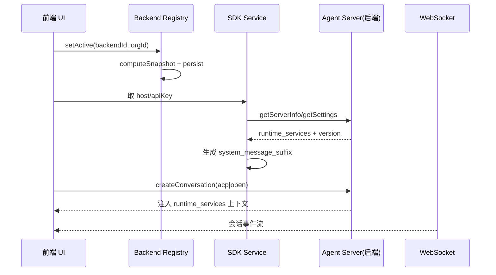

# 多后端控制平面：Backend Registry 与 ACP/OpenHands 抽象

> 本子文档深挖 Agent Canvas 的"多后端"关注面。所有引用以 OpenHands Agent Canvas 仓库根为验证根。

## 为什么需要"控制平面"

Agent Canvas 的核心卖点（README 自述）："Run OpenHands, Claude Code, Codex, Gemini, or any ACP-compatible agent across local, remote, and cloud backends"，并能"switch between local, remote, and cloud agents without losing focus"。要做到这一点，前端必须有**一层独立于 UI 的后端状态机**：它要知道有哪些后端、哪个是 active、各自健康与否、以及当 active 是 cloud 时不能误用某个 local 后端的协议。

这一层被独立成 `src/api/backend-registry/`——**自定义订阅 store**（不是 Zustand），选它是因为它几乎被所有模块读取（service 层也要用），不能依赖 React 组件链。

## 后端模型与状态机

### Backend 类型

`src/api/backend-registry/types.ts:4` 定义 `Backend`（`id/name/host/apiKey/kind/authMode/connectionRevision`），`kind: "local" | "cloud"` 拉开两类后端。`connectionRevision` 用于 host/apiKey 变更时让下游连接层感知需要重建。

### Active 解析与"哨兵"Backend

`getActiveBackend()` 返回解析后的 active backend；`setActiveSelection()` 写入并通知订阅者。引入一个关键设计——**`NO_BACKEND` 哨兵**：当注册表没有任何可用后端时返回它，且注释明确"它永远不会被持久化，调用方必须先 `isNoBackend()` 再解释字段"：

```ts
export const NO_BACKEND: Backend = {
  id: NO_BACKEND_ID,
  name: "No Backend Available",
  host: "",
  apiKey: "",
  kind: "local",
};
```
`[src/api/backend-registry/active-store.ts:29-35]()` — NO_BACKEND 哨兵定义
<!-- snippet: export const NO_BACKEND: Backend = {
  id: NO_BACKEND_ID,
  name: "No Backend Available",
  host: "",
  apiKey: "",
  kind: "local",
}; -->

选择哨兵对象而非 `null`，是为了让承载组件能无脑渲染一个"无后端"占位、且不会误把 `kind/host/apiKey` 当真实值使用。

### 有效本地后端的严格解析

`getEffectiveLocalBackend()` 是一个决定性的约束：**绝大多数 GUI 服务讲的是本地 agent-server 协议**（settings 读写、conversation CRUD、skills/MCP/secrets），它们对 cloud host 会失败。因此只有 active 是 local 时它才返回非空，且"cloud 选择时绝不借用另一个已注册的 local 后端"：

```ts
export function getEffectiveLocalBackend(): Backend | null {
  const active = snapshot.active.backend;
  if (active.kind === "local" && !isNoBackend(active)) return active;
  return null;
}
```
`[src/api/backend-registry/active-store.ts:140-144]()` — local 协议派发总闸
<!-- snippet: export function getEffectiveLocalBackend(): Backend | null {
  const active = snapshot.active.backend;
  if (active.kind === "local" && !isNoBackend(active)) return active;
  return null;
} -->

这是整个前端的"协议派发总闸"——后续所有 REST/WebSocket 客户端都从它拿 host/apiKey，`getAgentServerClientOptions()`（`src/api/agent-server-client-options.ts:52`）无后端时抛 `NoBackendAvailableError`。**防止"明明选了 cloud，却发了本地协议的请求"这类静默错乱**，是把多后端做好最基本也是最重要的一刀。

## 切换即重建：query key 掺后端身份

多后端切换的难点在于：切后端后，所有 server 态（settings、conversation 历史、profiles）都该指向新后端。Agent Canvas 的策略是**不全局 invalidate，而是把后端身份编进 React Query 的 query key**：

- `use-conversation-history.ts:34-41` 的 key 含 `conversation_id + conversation_url + session_api_key`；
- `active-backend-context.tsx:112-119` 明确注释：**长生命周期 query 的 key 包含 active backend 的 id/orgId，后端切换被视为全新 query**。

配合 UI 层：`src/routes/conversation.tsx:46-51` 检测到 `backendChanged` 后**整体 unmount 会话子树返回 null**（`:189-191`），在子组件发起对新后端无效的 fetch 之前先卸载。这样切后端 = 缓存天然隔离 + UI 主动回收，无需手写清理。

## 健康探测与故障封顶

后端绝不是"连上就一直好"。前端维护一个**同步持久化的健康存储**（`src/api/backend-registry/health-store.ts` + `health-storage.ts`）：

- 每 10s 轮询（`src/hooks/query/use-backends-health.ts:31`），每后端一个 query；
- 探测：cloud 查 `/api/keys/current`、`/api/organizations`，401 判 `LOGGED_OUT`；local 用 `SettingsClient.getSettings()` 验 key + `ServerClient.getServerInfo()` 验版本（`:114-123`）；
- **连续失败 5 次后 `MAX_CONSECUTIVE_FAILURES=5` 封顶禁用该后端**（`health-storage.ts:10`），停止轮询，直到用户编辑 host/apiKey 才重置。

这个"失败封顶"机制把网络抖动与真实故障区分开，避免对坏后端无限打请求。

### 启动时的双探针（版本 + 凭据）

`/server_info` 是**无保护**的（不验凭据），因此它只能验版本不能验身份。启动链路（`src/root.tsx:314` → `use-config.ts` → `option-service.api.ts`）只在 local 后端跑，cloud 跳过（`agent-server-compatibility.ts:323-337`）。版本不足则抛 `AgentServerUnsupportedVersionError`（`:291`）；公开模式再 `getSettings()` 抓 401 验证凭据（`:372`），`root.tsx` 据此分别渲染 MissingAgentServer 或 ApiKeyEntry 屏（`:354,369-372`）。

## ACP 与 OpenHands 的统一抽象

"Use with any ACP-compatible agent"是另一大卖点。ACP（Agent Client Protocol）三方 agent 在**后端**以 stdio 子进程加载（前端只发配置），前端在 `src/constants/acp-providers.ts` 维护 provider 注册表并 enrich UI 元数据：

- `ACP_PROVIDERS` 由 `@openhands/typescript-client` 的 ACP registry 拉取并叠加 UI 信息（`:151`），覆盖 `claude-code`/`codex`/`gemini-cli`（`:129-145`）；
- `buildAcpAgentSettingsDiff()` 生成 `{ agent_kind:"acp", acp_server, acp_command, acp_args, acp_model }`，切回 OpenHands 只发 `{ agent_kind:'openhands' }`（`:484-497`）；
- 每个 provider 的凭据环境变量与容器化 cred（`CODEX_AUTH_JSON`、`CLAUDE_CODE_OAUTH_TOKEN`…）集中在 `ACP_RESERVED_CREDENTIALS`（`:218`）。

会话适配层 `src/api/agent-server-adapter.ts` 由 SDK 的 discrimininator `info.agent.kind === "ACPAgent"` 判定会话是 acp 还是 openhands（`:313`），统一映射到 `agent_kind`。这样前端看到的是"一个 conversation"，不管底层是哪个 agent。

## 运行时服务注入（design highlight）

一个很前卫的设计：`/server_info.runtime_services` 记录了"从 agent 沙箱视角"可达的 Agent Server / Ingress / Frontend / Automation 地址。前端 `fetchBackendRuntimeServicesInfo()` 抓取后，`buildRuntimeServicesSystemSuffix()`（`agent-server-adapter.ts:203`）把它渲染成 `<RUNTIME_SERVICES>…</RUNTIME_SERVICES>` markdown 块，再经 `buildAgentContext()`（`:667`）写入 `system_message_suffix`（`:702-704`）塞进新会话——**让 agent 无需猜测端口就知道沙箱内能访问哪些服务**。所有 URL 都从 agent 的视角书写，而非浏览器视角（接口注释 `agent-server-adapter.ts:110-115`）。



## 权衡与总结

- **自研订阅 store 而非 Zustand**：backend 状态被几乎全部 service 层直接读（含非组件代码），独立 store 避免依赖 React 树，是"全局可用 + 可订阅"的最小解。
- **query key 掺身份 vs 全局 invalidate**：前者更精准（只重建受影响 query、保留无关缓存），代价是每个 query 都要显式携带身份，漏带就串数据。
- **双探针**：把"无保护版本探测"与"带凭据探测"分离，兼顾首屏快速失败与安全边界。

整套设计的核心哲学：**前端永远假设后端可能更替、可能故障、可能是异构的**，因此把"连接、身份、健康、协议适配"全部前置到独立控制平面，业务 UI 只对统一的 conversation/backend 抽象编程。
