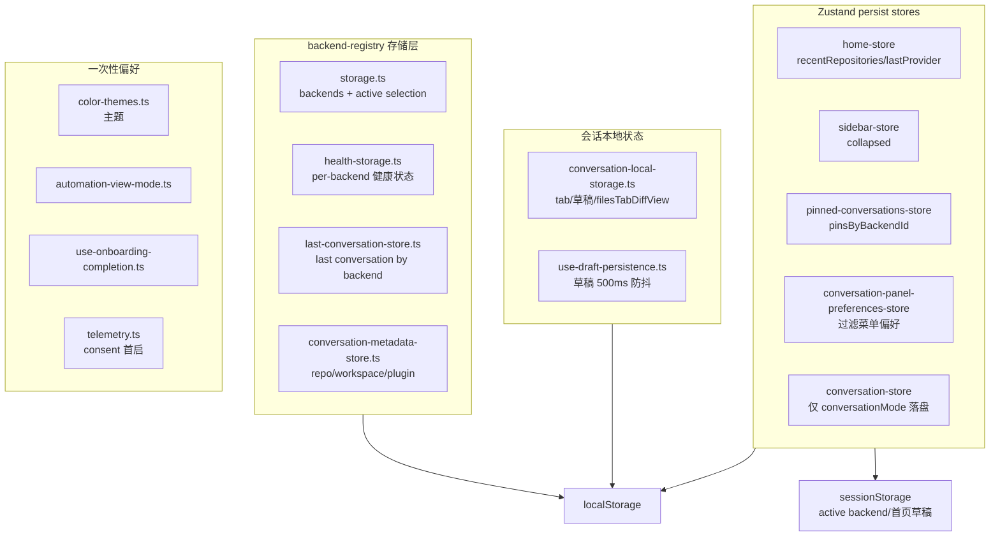

# 客户端存储层：前端本地元数据的持久化设计

> 本子文档深挖 Agent Canvas 的本地持久化/客户端存储关注面。所有引用以源码仓库根为验证根。它对应通用框架里的"数据模型"关注面，但因为载体是浏览器 `localStorage`/`sessionStorage` 而非数据库，实体关系用 `graph TB`（非 `erDiagram`）表达。

## 定位：前端要持久化什么，以及为什么需要"设计"

Agent Canvas 不自己跑数据库——会话与 agent 状态都存在远端 Agent Server。但**前端自己有一批必须跨刷新存活、却又属于本地元数据的键值**：后端注册表（连哪些后端、哪个 active）、每个后端的健康状态、各后端最后打开的会话、会话 UI 状态（tab/草稿/面板偏好）、主题、钉选、首页最近仓库等。

这批数据有一个共同特征：**它们是"壳"的元数据，不是"业务"的真值**。丢了不该崩，读到了不该错。因此其持久化设计围绕三个问题展开：

1. **读取端永远假设 localStorage 可被篡改/损坏**（它是 user-writable）——所以所有读取都做逐字段校验 + try/catch 兜底；
2. **该持久化的、不该持久化的，要分得清**（右抽屉就不该存，task 占位 id 也不该存）；
3. **明文 key 与云凭据的边界**——本地单用户把 apiKey 明文落盘是接受的，但云 cookie 一律不进 localStorage。

这一层没有统一的存储抽象库，而是**多套手写的一致性惯例**。本文将本地存储体系归类为四类，分别剖析其契约、迁移与权衡。

## 存储体系全景



四类存储的设计强度从高到低递降：

| 类别 | 代表 | 校验强度 | 演进方式 |
|------|------|----------|----------|
| 后端注册表 + 健康 | `storage.ts` / `health-storage.ts` | 强（逐字段校验，防篡改绕过 disable） | 一次性迁移 + 重新 seed |
| 会话本地状态 | `conversation-local-storage.ts` | 强（sanitize + denylist） | 运行时 sanitize + 向后兼容读 |
| Zustand persist | `home/sidebar/pinned/panel-preferences` | 中（persist 中间件 + partialize） | `migrate` 一次性迁移 |
| 一次性偏好 | `color-themes` / `onboarding` / `telemetry` | 弱（直写） | 无 |

## 后端注册表：本地存储里"最重"的契约

### 键

后端注册表的存储没有统一封装，但键前缀约定清晰（几乎都 `openhands-` 开头）：

| 键 | 内容 | 文件 |
|----|------|------|
| `openhands-backends` | 后端数组 | `storage.ts:13` |
| `openhands-active-backend` | active selection | `storage.ts:14` |
| `openhands-backend-health` | per-backend 健康 | `health-storage.ts:3` |
| `openhands-last-conversation-by-backend` | 各后端最后会话 | `last-conversation-store.ts:10-11` |
| `openhands-agent-server-conversation-metadata` | 会话元数据 | `conversation-metadata-store.ts:4` |
| `openhands-color-theme` | 主题 | `color-themes.ts:191` |

（注意：Zustand persist 的 `name` 反而不统一，`"openhands-sidebar"` 有前缀，`"home-store"`/`"pinned-conversations"` 无前缀——是历史演进残留，无统一规范。）

### 读取契约：验证、seed、锁定三层

`readStoredBackends()`（`storage.ts:104-149`）是"读取端永远是防御起点"的教科书实现，按优先级三层：

1. **锁定到 Cloud 部署 gate**：若 `makeLockedCloudBackend()` 非空（部署限定了唯一云后端），强制覆盖写 `[lockedCloud]` 并把 active 拨到 `locked-cloud`（`storage.ts:108-115`）；
2. **首次安装 seed**：`raw === null` 时仅当 launcher 提供了 host+apiKey 才 seed 默认本地后端（`storage.ts:122-128`）；
3. **常规读取**：`JSON.parse` → `Array.isArray` → `filter(isValidBackend)` 逐项校验（`storage.ts:130-132`）；校验后空数组重新 seed（`:136-142`）；再对 default-local 兜底同步陈旧 apiKey（`:144`）。

写入侧的 `writeStoredBackends` 用 `typeof window === "undefined"` 守卫 + try/catch 吞掉 quota/serialization 错误（`storage.ts:95-102`）：

```ts
export function writeStoredBackends(backends: Backend[]): void {
  if (typeof window === "undefined") return;
  try {
    window.localStorage.setItem(BACKENDS_STORAGE_KEY, JSON.stringify(backends));
  } catch {
    /* ignore quota / serialization errors */
  }
}
```
`[src/api/backend-registry/storage.ts:95-102]()` — 写入带运行环境守卫 + 静默吞错，读取端才做校验
<!-- snippet: export function writeStoredBackends(backends: Backend[]): void {
  if (typeof window === "undefined") return;
  try {
    window.localStorage.setItem(BACKENDS_STORAGE_KEY, JSON.stringify(backends));
  } catch {
    /* ignore quota / serialization errors */
  }
} -->

**为什么是"读强写弱"？** 因为写入者只有应用自身、可控；读取者天然暴露于用户编辑/devtools 篡改，所以校验必须前置到读取边界，而不是在写入时假设干净的来源。整条链路从 `active-store.ts:116`（模块加载同步读）到 `setRegisteredBackends` → `writeStoredBackends`（`:164-178`），读取一次、写入多处，都走这层防御。

### Active selection 的双存储 / 双写

`readStoredActiveBackend` **优先读 `sessionStorage`，失败回退 `localStorage`**（`storage.ts:205-219`），`writeStoredActiveBackend` **同时镜像写两份**（`storage.ts:221-243`）。设计意图：

- **sessionStorage 是当前 tab 的活选择**（tab 作用域，防多 tab 串台）；
- **localStorage 是"新 tab / 向后兼容"的默认值**（新开 tab 没有 sessionStorage，从 localStorage 继承上次选择）。

这是典型的"活动的放短时作用域、默认的放长时作用域"分层。

### 健康状态：防篡改是物理校验

`health-storage.ts` 的 `MAX_CONsecutive_FAILURES = 5`（`:10`）驱动"连续失败封顶→停止轮询直到用户改 host/apiKey"的机制。校验器 `isValidEntry`（`:24-39`）是它最亮的地方——这是唯一一处**刻意防负值**的校验：

```ts
  // localStorage is user-writable. Reject anything outside the range
  // our own writer produces — a tampered `-1` would never reach the
  // cap and would defeat the whole disable mechanism, and a giant
  // value would clutter the UI for no reason.
  return (
    Number.isInteger(v.consecutiveFailures) &&
    (v.consecutiveFailures as number) >= 0 &&
    (v.consecutiveFailures as number) <= MAX_CONSECUTIVE_FAILURES &&
    ...
  );
```
`[src/api/backend-registry/health-storage.ts:27-34]()` — 逐范围校验 consecutiveFailures，防 -1 推翻 disable 机制
<!-- snippet:   // localStorage is user-writable. Reject anything outside the range
  // our own writer produces — a tampered `-1` would never reach the
  // cap and would defeat the whole disable mechanism, and a giant
  // value would clutter the UI for no reason.
  return (
    Number.isInteger(v.consecutiveFailures) &&
    (v.consecutiveFailures as number) >= 0 &&
    (v.consecutiveFailures as number) <= MAX_CONSECUTIVE_FAILURES && -->

注释点出威胁模型：localStorage user-writable，手改 `-1` 就永远达不到上限，disable 机制报废；同理错误消息截断 `MAX_ERROR_MESSAGE_LENGTH=500`（`:13`）防止把连接错误里的敏感服务器信息无限持久化。健康条目每次全量 map 读、空时用 `removeItem` 而非写空对象（`:61-75`）。

## 会话本地状态：只存 UI 态，不存消息

`conversation-local-storage.ts`（341 行）按会话（动态键 `conversation-state-<id>`）持久化**纯 UI 状态**：`selectedTab`、`unpinnedTabs`、`conversationMode`、`subConversationTaskId`、`draftMessage`（草稿）、`filesTabDiffView`、`filesTabContentViewMode`。

三个关键取舍：

### 1. 右边抽屉有意不持久化

docblock（`conversation-local-storage.ts:22-30`）与 `conversation-store.ts:106-114` 的注释一致：用户期望**每次加载抽屉都是关的**，所以右面板开合状态做成内存态（`isRightPanelShown/hasRightPanelToggled`，`conversation-store.ts:115/128`），不落 localStorage。这是"恢复时状态干净"的刻意选择。

### 2. 草稿双通道

会话内草稿 → localStorage `conversation-state-<id>.draftMessage`，**500ms 防抖**（`use-draft-persistence.ts:18`）；首页草稿 → **sessionStorage** `"oh:home-prompt-draft"`（`:24`）。会话级草稿跨刷新保留，首页草稿仅会话内。发送成功后清空草稿（`conversation-websocket-context.tsx:539/744`）。

### 3. task 占位 id 不持久化

`isTaskConversationId`（`conversation-local-storage.ts:135-137`）+ `shouldSkipPersistence`（`:148-150`）：V1 会话初始化用的临时 `task-{uuid}` 占位 id 若 persist 会污染存储，所以跳过；task→real id 转移时草稿也一并搬（`use-draft-persistence.ts:87-106`）。

### sanitize：向后兼容读而非版本号

`sanitizeStoredState`（`conversation-local-storage.ts:85-129`）是演进策略的核心。它不做 version 字段，而是：

- **删除已退役字段** `rightPanelShown`（`:92`），旧 blob 带它就静默丢弃；
- **denylist 剔除已删除/非法 tab**（`REMOVED_CONVERSATION_TABS`，含 `editor/served/changes/app/vscode`，`:75-81`）——刻意不用 whitelist，因为 `unpinnedTabs` 允许任意 key（子会话 tab id）；
- **丢弃非法枚举** 如 `filesTabContentViewMode` 非 `"rich"/"plain"` 时回退 typed default（`:120-126`），因为 JSON.parse 出来的值运行时是 `unknown`，TypeScript 帮不上忙。

## 数据模型五要素小结

### 存储选型与理由

浏览器原生 `localStorage`/`sessionStorage` + Zustand `persist` 中间件，**不引入 localforage/indexedDB**。理由：这批数据量小（KB 级）、同步读取足够、无需复杂查询——这是"够用就好"的最小解。代价是没有真正的 schema/索引/事务，因此**校验与迁移全部退化为代码层防御**，这反过来要求一条铁律：读取路径的校验强度决定系统健壮性。

### 核心键设计与写入粒度

两种写入粒度并存：**全量快照写**（backends、health map）vs **读-合并-写**（`conversation-metadata-store.ts:72-92` 的 `get/set/removeStoredConversationMetadata` 每次全读合并再全写）。前者简单，后者避免并发覆盖但读放大。

### 演进策略

无统一 version+migrate，靠三层：① 读取端运行时 sanitize（conversation 状态）；② 读取端强校验 + 空值兜底（backend/health，`JSON.parse` 失败返回 `{}/[]/DEFAULT`）；③ 一次性显式迁移代码（`sidebar-store.ts:40-53`：旧裸字符串键 → 新 persist 格式，仅在新键不存在时 seed，防覆盖用户升级后选择，迁移完删旧键）。语义违反选择"接受并静默忽略旧字段"（`conversation-local-storage.ts:28-29`）。

### 敏感信息边界

- **本地 backend 的 `apiKey` 明文入 localStorage**（`storage.ts:98`），来自 `getAgentServerSessionApiKey()`（`agent-server-config.ts:192-194`）。这是桌面本地单用户模型接受的取舍——key 本地持有是必要认证；
- **云 backend 用 `authMode:"cookie"` + `apiKey:""`**（`default-backend.ts:28-36`），cookie 交给浏览器语义处理，**刻意不写入 localStorage**，避免云会话凭据落盘；
- **插件参数有意不存**：`conversation-metadata-store.ts:38` 注释 "Store plugin coordinates only; parameters may contain secrets"，`toPluginCoordinates`（`:42-46`）只存 `source/ref/repo_path`。

### 读写路径

- 后端注册表：**写** = `ActiveBackendProvider.addBackend/updateBackend/removeBackend`（`active-backend-context.tsx:124-204`）→ `setRegisteredBackends` → `writeStoredBackends`；**读** = `active-store.ts:116` 模块加载同步读 + `subscribeActiveBackend`（`:180-185`），组件用 `useSyncExternalStore` 订阅。
- 健康：**写** = 轮询 hook `use-backends-health.ts` 在探测结果处调用 `recordBackendFailure/Success`（`health-store.ts:46-92`）；**读** = `health-store.ts:12` 加载读，`pickFallbackBackend`（`active-store.ts:52-62`）在无有效 selection 时优先健康 local backend。
- 会话状态：草稿经 `useDraftPersistence` + ws 上下文，其余经 `useConversationLocalStorageState` 的 setter（`conversation-local-storage.ts:263-341`，监听 `storage` 事件 + 自定义事件双向跨 tab 同步）。

## 权衡与总结

- **读强写弱**：写入端 only 应用自身、可静默吞错；读取端暴露于 user-writable 的存储，因此校验前置到读取边界——这是整层最统一的哲学。
- **明文 apiKey vs cookie 隔离**：本地单用户接受明文，云会话凭据刻意不进 localStorage，敏感边界按后端类型而非内容一刀切。
- **不持久化一切**：右抽屉、novice banner、task 占位 id 都刻意不做——"恢复时状态干净"也是一种产品决策，不是偷懒。
- **无版本号靠 sanitize**：用向后兼容读 + denylist + 一次性迁移替代 version 字段，平衡简单与健壮；代价是 schema 演进靠代码而不是声明式 migrations 文档化。

核心哲学：**把"壳的元数据"与"业务的真值"分开**——业务真值在远端 Agent Server，本地只放"丢了能重建、坏了能兜底"的壳状态。正因数据可重建，设计者敢把校验做成静态防御、把不重要的状态拒之门外，这比统一封装一个 storage 库更能体现对"迁就易损存储"的正确心态。
