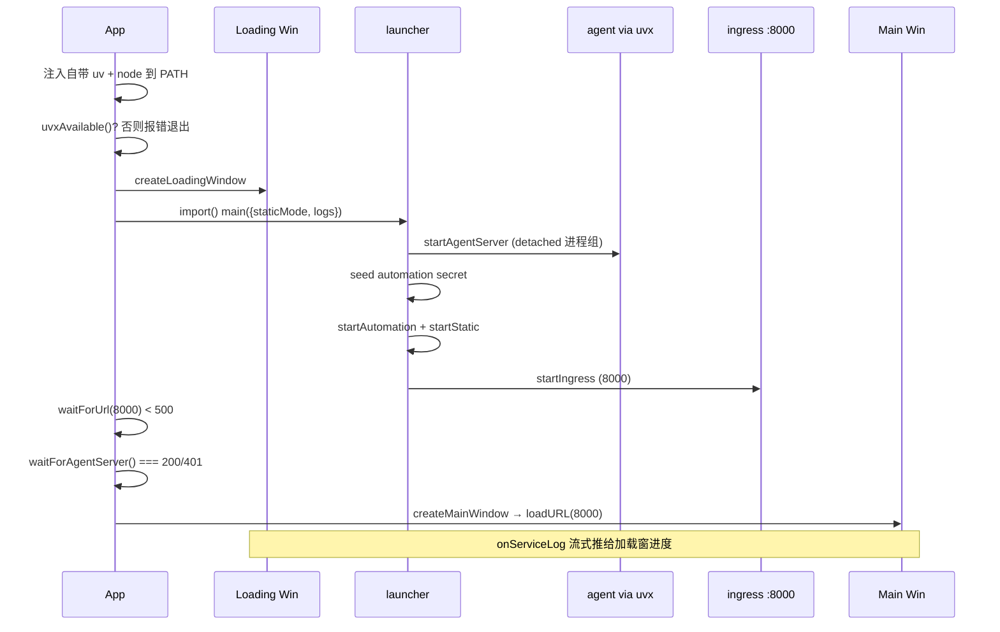

# Electron 桌面交付：把"本地后端栈"装进一个桌面 App

> 本子文档深挖 Agent Canvas 的桌面交付关注面。所有引用以源码仓库根为验证根（`/Users/morehao/Documents/study/ai/agent-product/OpenHands`）。

## 关键认知：桌面 App 不是"与后端的 IPC"，而是"本地 HTTP + 进程管理"

Agent Canvas 的桌面形态经常被误解。它**不是**一个用 Node 集成、通过 IPC 直连 agent 运行时的 Electron 壳——主进程全程不碰业务层 IPC。真实模型是：Electron 主进程拉起一整套本地后端栈（Python agent-server + automation + Node 静态服务器 + 反向代理），然后开一个原生 `BrowserWindow`，把 pre-built 前端加载到 `http://localhost:8000`。桌面端与 Web/Docker 端共享同一份前端代码与同一套进程栈，唯一区别是**运行时怎么来、生命周期怎么管**。

这带来三个只有桌面形态才需要解决的深层问题，也是本文的三个主线：

1. **运行时自包含**——打包后的 .app 从 Finder 启动时系统 PATH 极简，`uvx`、`node`、`npx` 都找不到，必须把运行时打进包；
2. **就绪判定**——uvx 首启可能要下载 Python + PyPI 依赖数分钟，光等端口不行，必须分阶段等"真正的 agent-server 可服务"；
3. **进程树生命周期**——后端进程以 `detached:true` 起在独立进程组，Quit 时如果不显式杀会给 8000/18000/18001 端口留下孤儿进程，导致下次启动失败。

## 主进程：栈启动器 + 窗口管理器

`electron/main.mjs`（739 行）的职责拆成两半：**启动后端栈** 与 **管理窗口**。启动编排在 `app.whenReady()` 后按阶段推进（`main.mjs:612-677`）：先注入运行时 → 探测 uvx → 开加载窗 → 起栈 → 两阶段就绪探测 → 开主窗。

### 阶段一：注入自带运行时

`injectBundledUv()` 只在 `app.isPackaged` 时生效，把打包进 `process.resourcesPath/bin` 的 uv/uvx 前置到 `process.env.PATH`（`main.mjs:73-103`）。关键细节是 **`chmodSync(uvPath, 0o755)` 修补 +x 位**——electron-builder 拷贝文件不保留 Unix 可执行位，不修会以"找不到可执行"静默失败：

```ts
  // electron-builder copies files without preserving the +x bit on Unix.
  if (!isWin) {
    try {
      chmodSync(uvPath, 0o755);
      const uvxPath = join(binDir, uvxName);
      if (existsSync(uvxPath)) chmodSync(uvxPath, 0o755);
    } catch {}
  }
```
`[electron/main.mjs:91-98]()` — 修补 electron-builder 丢失的 +x 位，否则 uvx 无法作为可执行解析
<!-- snippet:   // electron-builder copies files without preserving the +x bit on Unix.
  if (!isWin) {
    try {
      chmodSync(uvPath, 0o755);
      const uvxPath = join(binDir, uvxName);
      if (existsSync(uvxPath)) chmodSync(uvxPath, 0o755);
    } catch {}
  } -->

`injectBundledNode()`（`main.mjs:149-185`）同理注入自带 Node。这一段 docstring（`main.mjs:115-148`）记录了**团队踩过的真实坑**，是整个项目最有价值的工程史：

> 打包的 .app 从 Finder 启动时 PATH 只有 `/usr/bin:/bin`，Homebrew/nvm/asdf 装的 Node 全不可见 → launcher spawn `node scripts/ingress.mjs`、`node scripts/static-server.mjs` 静默失败，端口 8000 永不起来。更隐蔽的是：stdio MCP marketplace（Slack/GitHub/Figma…）都用 `command:"npx"`，agent-server spawn 时找不到 npx → ENOENT，被 SDK 报成 `error_kind:"connection"` 的 MCP 连接失败，界面显示 "Could not reach the server"——表象是"MCP 连不上"，根因却是"系统缺 npx"。

他们**先试过** `ELECTRON_RUN_AS_NODE=1` wrapper：确实解决了 ENOENT，但引入新故障——stdio MCP 服务器经 wrapper 起来后立即 `McpError: Connection closed`，因为 windowed Electron 进程的 stdin/stdout 语义与 vanilla Node 不同，JSON-RPC 握手消息没落地就退出。**结论：必须带一个真 Node 二进制作为 extraResource**（`main.mjs:132-141`）。这条线同时解释了为什么打包要下载 uv——agent-server 与 automation 后端都是经 `uvx` 运行的 Python 包，桌面不能依赖用户机器装 uv。

### 阶段二：两阶段就绪探测

主进程不用单一"端口通"判据，而是拆成两个不同含义的探测（`main.mjs:640-657`）：

- `waitForUrl`（`main.mjs:194-206`）——只要 `< 500` 就通过，只证明 **ingress 反代绑定了**，不保证后面 agent-server 活着；
- `waitForAgentServer`（`main.mjs:219-242`）——轮询 `http://localhost:8000/server_info` 直到 **200 或 401**，才是"agent-server 真正可服务"的判据。且 **401 也视为成功**：说明 proxy 从 agent-server 拿到了真实 HTTP 响应，只是要认证（`main.mjs:230-232`）。

拆两阶段是因为"ingress 起来"（几十毫秒）与"agent-server 就绪"（uvx 首启可能数分钟）时间差极大。`startStack()` 内部已经等过一次，这里端到端再探一次，是为了处理用户提前关掉加载窗后、两个进程绑定之间的竞态（`main.mjs:648-652`）。

首启慢的根因被写进注释：`uvx` 要下载 Python 工具链并从 PyPI 装 `openhands-agent-server`，慢网络下几分钟很正常（`main.mjs:212-217`），所以 `agentServerReadyTimeoutMs` 给了 10 分钟（`main.mjs:580-594`）。若超时不是直接崩溃，而是抛出可读错误让加载窗进入失败态（`main.mjs:600-607`），比把用户丢进一个只会弹 "Request timeout" 的半启动 UI 强。

### 启动顺序图



## 优雅关闭：进程组生命周期是生死线

`before-quit` 的处理（`main.mjs:703-727`）是本关注面最需要读懂的工程实践。后端子进程全部用 `detached:true` 起在**独立 OS 进程组**（`dev-process-utils.mjs:30-35` 的 `getProcessTreeSpawnOptions`），父进程死了它们默认继续活。如果 Electron 直接退出，8000/18000/18001 就被占住，下次启动直接失败（`main.mjs:679-684` 注释）。

所以流程是：`before-quit` 首次触发 → `preventDefault` → 发 SIGTERM → 已注册的 SIGTERM handler 遍历所有被追踪进程、`signalProcessTree` 整树清理、等退出 → `process.exit(0)` → `before-quit` 再次触发（`cleanupStarted=true`）放行。附 6 秒强制退出安全网（`main.mjs:721-726`）。

最微妙的是 **Windows 分支**：Windows 没有真 POSIX 信号，`process.kill(pid, "SIGTERM")` 会**直接终止本进程而不触发 SIGTERM listener**，从而跳过清理、孤儿子进程。解法是 `process.emit("SIGTERM")`——把同一个已注册 handler 在进程内原地跑一遍（`main.mjs:697-701, 712-716`）。这段注释（`main.mjs:679-701`）把"为什么不能直接 quit"讲透了。

## 打包配置：`asar:false` + node_modules 瘦身

`electron-builder.config.mjs`（354 行）的配置有两大非常规决策，都源于同一个约束：**后端栈会把 `scripts/*.mjs` 当真实文件 spawn 成子进程，不能装在 asar 归档里**。

### `asar:false`

因为 `dev-with-automation.mjs` 用动态 `import()` 加载、且进程后台要 `child_process` spawn 脚本文件，必须作为磁盘真实文件存在（`electron-builder.config.mjs:230-232` 注释）。代价是放弃 asar 的启动提速与平台统一，换取可执行性。

```js
  // The packaged app must be able to spawn `scripts/*.mjs` as real files on
  // disk (dev-with-automation.mjs imports and the launcher spawn them as
  // child processes), so we cannot ship those in an asar archive.
  asar: false,
```
`[electron-builder.config.mjs:230-232]()` — 因为后端要把 scripts 独立 spawn，必须 asar:false
<!-- snippet:   // Do not pack into asar — scripts are spawned as child processes by
  // dev-with-automation.mjs and must exist as real files on disk.
  asar: false, -->

### node_modules 从 ~600MB 压到 ~10MB

`afterPack: stripBundledNodeModules`（`electron-builder.config.mjs:238`）绑定的函数（`:94-175`）先 `rm -rf node_modules`（electron-builder 会把根目录整棵依赖树拷进 app），再 `restoreRuntimeNodeModules` 用 BFS 遍历只恢复运行时真正需要的 `sirv`、`httpxy` 及其闭包（`RUNTIME_PACKAGES = ["sirv", "httpxy"]`，`:69`）——main.mjs 与 launcher 只用 Node built-ins，唯一例外是 static-server 用的 `sirv` 和 ingress import 的 `httpxy`。约 200KB 的闭包维持桌面运行，裸省几百 MB 体积，代价是打包多花几秒先拷再删。

### extraResources：运行时进包

`extraResources`（`electron-builder.config.mjs:274-277`）把 `resources/bin/` → `bin/`（uv/uvx）、`resources/node/` → `node/`（Node 运行时），配合 `directories.app: "electron"`（`electron-builder.config.mjs:225`）、`directories.buildResources: "electron/build-resources"`（`:227` 图标源）组织产物。

## 为什么打包时下载 uv + node

`scripts/download-uv.mjs`（204 行）与 `scripts/download-node.mjs`（382 行）在 `build:desktop` 前置执行。两者的目的不同：

- **download-uv**：uv 提供 `uvx`，而 agent-server 与 automation 后端都通过 `uvx` 跑 Python 包，桌面必须自带 uv。`getPlatformSpec()`（`download-uv.mjs:41-66`）按平台选 target，**Linux 只支持 x64**；版本默认查 GitHub latest release API（`download-uv.mjs:70-89`）。
- **download-node**：版本 `NODE_BUNDLE_VERSION = "22.12.0"` 对齐仓库 `engines.node >=22.12.0`（`download-node.mjs:60-70`）。`pruneUnusedFiles()`（`download-node.mjs:207-259`）裁掉 include/share/CHANGELOG/corepack，把 Node 从 ~170MB 减到 ~115MB。

`download-node.mjs` 有一段隐藏健壮性处理 `failOnDanglingSymlinks()`（`:271-311`）：electron-builder 会对每个拷贝条目 `stat()`（跟随 symlink），一个悬空 symlink 就能让整个 `build:desktop` 因 ENOENT 挂掉。删除目录时必须顺带删掉指向它的 shim（如 `bin/corepack` → `../lib/node_modules/corepack/...`）。

## Preload 只服务加载窗，主窗口不挂 preload

`electron/preload.cjs` 只有 31 行，`contextBridge.exposeInMainWorld("desktopBoot", {...})` 暴露 5 个方法（`preload.cjs:13-30`）：订阅启动日志批次、订阅致命错误、展开/收起控制台、复制日志、退出。两个要点：

- **主进程窗口 `nodeIntegration: false, contextIsolation: true`、主窗口无 preload**（`main.mjs:285-289, 325-328`）——主窗口纯粹是加载 `localhost:8000` 的浏览器窗口，渲染层攻击面收敛到"本地静态服务"；
- **IPC 白名单 + 事件守卫**：所有 handler 用 `isLoadingWinEvent()` 守卫（`main.mjs:471-477`），只有加载窗能触达，其他窗口发不了这些 IPC；
- **CJS 是有意的**：sandbox 里的 preload 脚本不能跑 ESM（`preload.cjs:9`）。

## 加载窗：后端起来前的原生进度屏

`electron/loading.html`（359 行）在后端进程起来前渲染，此时 `localhost:8000` 还没响应、主窗口无法加载。它的设计细节：

- **自包含设计 token**：`:root` 里 `--oh-*` 变量（`loading.html:13-23`）——因为渲染发生在前端 serve 之前，无法 import 应用的 CSS，这些值要镜像 `src/tailwind.css` / `src/index.css`；
- **日志防 XSS**：启动日志是不可信进程输出，DOM 插入全用 `textContent`（`loading.html:278-279, 306-313`），绝不当 HTML parse；状态栏走 `window.__setLoadingStatus`（`loading.html:267-272`），由 `main.mjs:setLoadingStatus` 用 `executeJavaScript` 注入，无 IPC；
- **`.container` 高度必须等于 `main.mjs` 的 `LOADING_WIN_HEIGHT`**（`loading.html:250-253`），否则展开控制台时窗口布局错乱。

## 栈拓扑：一套 launcher，三种形态复用

桌面、`npm run dev`、Docker 共用同一套 `scripts/dev-with-automation.mjs` 栈 launcher，区别只在入口参数（桌面 `staticMode:true` + `isPublic:false` + `skipNpmCheck:true`，见 `main.mjs:586-595`）。栈拓扑（`dev-with-automation.mjs:9-23`）：

```
http://localhost:8000 (ingress 反代)
  /api/automation/* → automation backend (uvx, 127.0.0.1:18001)
  /api/*, /sockets   → agent-server     (uvx, 127.0.0.1:18000)
  /*               → 静态前端            (static-server, :3001)
```

所有后端绑 `127.0.0.1` 环回（不暴露局域网），auth 用自动生成的 session key 注入 agent-server 与前端（`static-server.mjs:281-294` 写进 `window` 配置）。桌面形态彻底**免 Docker**——这是它与 Web/容器形态最大的差异，但代价是没有容器根文件系统隔离：agent-server 以 `cwd: safeConfig.workspacesPath`（`~/.openhands/...`）直接操作宿主文件系统，automation 的 DB 是本地 SQLite（`AUTOMATION_DB_URL = sqlite+aiosqlite`），状态/密钥目录在 `~/.openhands/agent-canvas/`。

## 权衡与总结

- **真 Node 而非 Electron-as-Node**：为了 MCP stdio JSON-RPC 服务器能在子进程里可靠跑 JSON-RPC 握手，放弃"复用 Electron 平台"的便捷，改带一个真 Node 二进制。这条取舍锁死了打包体积与下载复杂度，但换来 stdio 语义的正确性。
- **`asar:false` 换可执行性**：因子进程需要真实脚本，牺牲 asar，用 afterPack 瘦身把体积损失找回来。
- **两阶段就绪**：区分"proxy up"与"agent-server ready"，因为首启 uvx 下载的分钟级延迟必须显式呈现给用户。
- **进程树生命周期**：detached 进程组 + SIGTERM 整树清理 + Windows 进程内 emit，是三平台一致关闭的根本保障。

核心哲学：**桌面 App 是"本地栈的一个便利加载器"，不是一个业务进程**。它解决的根本问题不是"如何与 agent 通信"，而是"如何在不可信的工具链环境下自包含地把整套栈跑起来、并在关闭时收干净"。把所有工程史（Electron-as-Node 失败、PATH 陷阱、悬空 symlink）沉淀成注释与防御代码，是这篇最具迁移价值的部分。
