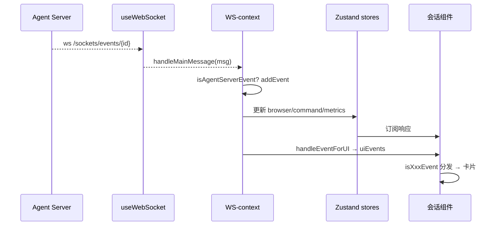

# 实时会话流：WebSocket 事件 → Zustand → UI 渲染

> 本子文档深挖 Agent Canvas 的实时会话关注面。引用以 OpenHands Agent Canvas 仓库根为验证根。

## 实时通道的设计选择

Agent Canvas 的实时事件不用 socket.io（`package.json` 声明的 `socket.io-client` 实际只在 `src/` 出现 import 于测试 mock，`@mswjs/socket.io-binding`），而是用**浏览器原生 WebSocket**。封装在 `src/hooks/use-websocket.ts`（创建 `new WebSocket` 于 `:55`，含 3s 间隔重连、`sendMessage`、`disconnect/reconnect`）。原生 WS 依赖少、调试透明，与后端对话、事件分发都在一个长连接里。

### URL 构建：路径前缀 + 协议选择

`buildWebSocketUrl()` 生成 `ws(s)://host[:port][/path-prefix]/sockets/events/{conversationId}`。**path-prefix 是给反向代理部署用的**（如 `/runtime/55313`），注释明确"proxy deployments"：

```ts
export function buildWebSocketUrl(
  conversationId: string | undefined,
  conversationUrl: string | null | undefined,
): string | null {
  if (!conversationId) {
    return null;
  }

  const baseHost = extractBaseHost(conversationUrl);
  const pathPrefix = extractPathPrefix(conversationUrl);
```
`[src/utils/websocket-url.ts:109-115]()` — WS URL 由 conversation URL 解析出 baseHost 与 pathPrefix，pathPrefix 供代理部署
<!-- snippet: export function buildWebSocketUrl(
  conversationId: string | undefined,
  conversationUrl: string | null | undefined,
): string | null {
  if (!conversationId) {
    return null;
  } -->

协议（ws vs wss）的选择遵循**真实 HTTP 访问路径**而非盲信 https：页面 https 或目标 https 才 wss，否则 ws——注释给出反例：对 HTTP-only ingress 强推 WSS 会触发 TLS 握手并被 Node 报为 malformed HTTP method：

```ts
  const pageIsSecure = window.location.protocol === "https:";
  const targetIsSecure =
    getConversationUrlProtocol(conversationUrl) === "https:";
  const protocol = pageIsSecure || targetIsSecure ? "wss:" : "ws:";

  return `${protocol}//${baseHost}${pathPrefix}/sockets/events/${conversationId}`;
```
`[src/utils/websocket-url.ts:129-134]()` — 协议取"页面 https 或目标 https"的并集，为处理 Tailscale 等 HTTP-only 代理场景
<!-- snippet:   const pageIsSecure = window.location.protocol === "https:";
  const targetIsSecure =
    getConversationUrlProtocol(conversationUrl) === "https:";
  const protocol = pageIsSecure || targetIsSecure ? "wss:" : "ws:";

  return `${protocol}//${baseHost}${pathPrefix}/sockets/events/${conversationId}`; -->

认证走已建立的通道：WS 打开后发送 `{ type: "auth", session_api_key }`（`src/utils/websocket-auth.ts:12-17`），与 REST 的 session-api-key 并存。

## REST 历史 + WS 增量：避免重复重放

实时流最易踩的坑是"历史重放"。Agent Canvas 的处理：先 REST 拉历史进 store（`useConversationHistory` → `EventService.searchEvents`），再开 WS 用 `resend_mode='since'` + `after_timestamp` **只续传断点之后的事件**；若 REST 一条都没有（全新会话），回退 `'all'`，靠 event store 去重兜底重叠：

```ts
    const queryParams: Record<string, string | boolean> = initialAfterTimestamp
      ? { resend_mode: "since", after_timestamp: initialAfterTimestamp }
      : { resend_mode: "all" };
```
`[src/contexts/conversation-websocket-context.tsx:862-864]()` — WS 只订阅断点之后的事件，重叠由 event store 去重兜底
<!-- snippet:     const queryParams: Record<string, string | boolean> = initialAfterTimestamp
      ? { resend_mode: "since", after_timestamp: initialAfterTimestamp }
      : { resend_mode: "all" }; -->

**连接门控**：WS URL 要等 REST 历史 `isFetching` 结束才建立（`conversation-websocket-context.tsx:330-343`），否则 `after_timestamp` 锚点未就绪。事件去重、排序、合并统一在 `src/stores/use-event-store.ts`（`addEvent`/`addEvents`/`clearEventsForConversation`，`:153-214`）。

## 事件消费与状态写入（handleMainMessage）

连接后的消息统一进 `handleMainMessage`（`:470`，另有 planning 子代理的 `handlePlanningMessage` `:666`）。流程是**"先入库去重，再按类型派发副作用"**：`JSON.parse` → `isAgentServerEvent` 守卫（`:479`）→ `addEvent(event)`，若是重复重放则跳过副作用（`:483-492`）。之后按事件 kind 分派：

- 用户消息回显 → 消费"发送中"乐观气泡（`:532-541`）；
- ActionEvent → 相关 query 缓存失效（`:544-552`）；
- 会话状态更新 → `setExecutionStatus` / 更新 metrics / goal（`:556-572`）；
- bash action/observation → 写入 command-store（`:575-587`）；
- Browser observation/navigate → 写 browser-store（`:590-603`）；
- PlanningFileEditorObservation → REST 读文件 → `setPlanContent`（`:796-829`）。

发送侧 `sendMessage`（`:985`）：WS 开着则 `JSON.stringify({...message, run:true})` 发送（`:1025`），WS 断开则回退 REST `ConversationClient.sendEvent`（`:1000-1008`）。**WS 优先、REST 兜底**，保证不丢用户消息。

### 清空时序（微妙但关键）

事件 store 的清空必须放路由 effect **之前**（子 layout effect 先于父 passive effect），否则会覆盖刚从 REST 种的 history——用 `useLayoutEffect` + `loadedConversationId` 对比实现（`:248-258`），切换会话时原子 `clearEventsForConversation`。

## 渲染管线：从事件到可视化卡片

实时数据落库后，UI 渲染分两步走：

1. **归一化** `handleEventForUI`（`src/utils/handle-event-for-ui.ts:327-427`）：把 observation 原位替换对应 action（按 `action_id` 匹配，`:412-417`）、丢弃 Think/Finish observation、合并流式 delta、替换 ACP tool call 进行中→终态，产出 `uiEvents`。
2. **类型守卫路由** `event-message.tsx:137-347` 用 `isXxxEvent` 逐类分发：goal/agent-error/hook/ACP/streaming delta/Finish/Think/Action/Observation/MessageEvent 各自渲染；observation 保留对应 action 的 thought。

**专用 React 可视化器**取代 markdown：`tool-visualizers/index.ts:22-27` 注册 bash / file-editor / search / task 四种，`dispatcher.tsx:19-37` 按 kind 查 Map 调 React 组件，给工具结果更强的可读性。

浏览器/文件/终端面板不走聊天卡片，而是由 WS 副作用**直接把数据写进对应 store**，再由 tab 渲染：`browser-store`、`command-store`、`files-tab-store.setSelectedPath`。



## 权衡与总结

- **原生 WS + SDK REST 双通道**：send 走 WS、REST 兜底；事件历史走 REST、增量走 WS。两者互补保证送达不重复也不丢失。
- **"先入库再副作用"**保证同一条重放事件不会触发两次 UI 副作用，是幂等的关键。
- **store 分散 + 中央 context**：各面板用自己的 store（浏览器/终端/文件），而 `conversation-websocket-context` 是唯一写入口，避免多写者竞争同一状态。

核心哲学：**把"网络事件"与"渲染状态"之间的转换收敛到一条显式管线**，事件只需在入库处去重一次，之后所有面板共享一致快照。
