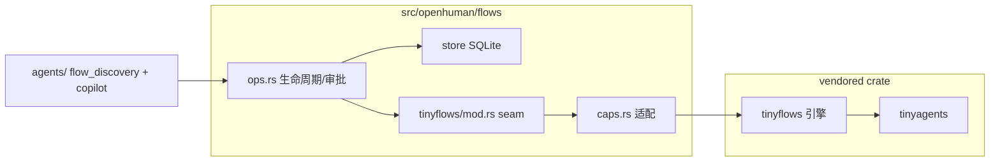

# OpenHuman 工作流引擎：approval-gated 的 durable 自动化（flows）

> 本解读按 **Agent ⊗ framework** 类规格产出。基于当前上游 v0.63.6 / HEAD `e29bfc66f` 代码快照比对。注意：**真正的 tinyflows 引擎是 vendored git submodule（`vendor/tinyflows`）**，本地 host 侧 `src/openhuman/flows/` 是"编排 + 门控 + adapter seam"层；本文只对 host 侧做真源引用，引擎内部实现仅为文字表述。

## 根因

n8n/Zapier 式可视自动化与 agent 本体的差别在于：**工作流是"计算机自己编排自己"，必须对副作用施加与 agent tool-loop 同等、甚至更严的审批门控，同时要 durable（重启可续）、trigger-driven（可被计划/Webhook/事件唤醒）**。OpenHuman 的 `flows` 域就是"把 tinyflows 图包装成一个有审批、有时间上限、可暂停恢复的持续运行"。

## 架构：host 编排 + vendored 引擎

`flows/ops.rs` 是门控与生命周期的真核心；`flows/tinyflows/` 是 capability seam，把 host-agnostic 的 tinyflows 引擎接到真实 OpenHuman 服务（validate → compile → run on tinyagents，[src/openhuman/flows/tinyflows/mod.rs:1-15]()）。

## 三道安全边界（flows 区别于"裸脚本"的地方）

**1. 整 run 硬时间上限。** `FLOW_RUN_TIMEOUT_SECS = 600`——即便各 capability 有自己的 HTTP/sandbox 超时，一个挂起的 LLM/tool 调用也不能无限阻塞 RPC（[src/openhuman/flows/ops.rs:36-36]()）。加上 DAG 无环约束与 `run_registry` 的 `is_in_flight` 去重，构成"bounded loop"的含义：运行时间有界。

**2. HITL 停车 TTL。** run 停在 `pending_approval` 审批门时，`FLOW_PARKED_TTL_SECS = 600` 秒后未应答即超时取消，防止"人类永不应答的审批让 durable checkpoint 卡死"（[src/openhuman/flows/ops.rs:46-46]()）。

**3. fail-closed 的图指纹校验。** run 停车时 pin 的图 hash，恢复时必须仍匹配当前图（`GRAPH_CHANGED_SINCE_PARK_ERROR`，[src/openhuman/flows/ops.rs:59-60]()）——若用户在审批挂起期间用 `save_workflow` 改写了图，恢复会被明确拒绝而不是用一个"幽灵审批"跑到新版图上。文案单独区分"stale-approval refusal"与普通 invalid-resume，让 UI/agent 能解释而非丢一条泛化错误。

## 节点级自治授权（autonomy tier）

`flows_run` 以 `TrustedAutomation { Workflow }` origin 执行，但行动的**实权仍受用户 `[autonomy]` tier 约束**——复用 agent tool-loop 同一套 `SecurityPolicy`，node → `CommandClass` → 每档决策（[src/openhuman/flows/ops.rs:62-93]() 的表格）：

| Flow 节点 | CommandClass | read-only | supervised | full |
|-----------|-------------|-----------|-----------|------|
| `http_request` | Network | BLOCK | Prompt | Prompt |
| `code` | Write | BLOCK | Prompt | Allow |
| `tool_call` | curation+ApprovalGate | 受管 | Prompt | Prompt/Allow |
| `agent (llm)` | —（无副作用，不 tier-gated） | — | — | — |
| `state (kv)` | host 内部 KV，非外发行为 | — | — | — |

`Block` 直接拒绝（`[policy-blocked]`，不派发）；`Prompt`/`Allow` 落到进程级 `ApprovalGate` 做人类往返，与 agent tool-loop 完全一致（[src/openhuman/flows/ops.rs:73-78]()）。**要点**：工作流"能画图"不等于"能裸奔副作用"——能力与授权分离。

## 触发驱动与 copilot 构建

run 由多种触发唤醒，`trigger_kind_label` / `trigger_kind_fires` 枚举了 Manual / Schedule / Webhook / AppEvent / Form / ExecuteByWorkflow / ChatMessage / Evaluation / System 等（[src/openhuman/flows/ops.rs:868-868]() 区域）。README 宣传"agent 提议自动化、你在画布审查后保存"对应 `agents/` 下的 `flow_discovery` + `workflow_builder` copilot——构建工作流本身也是 agent 能力。

## 与其它模块的全局关联

- flows 与 agent 共用同一套 tinyagents durable runtime 与 SecurityPolicy 审批，体现"**无论自动化由谁发起，副作用边界统一**"。
- `flows` 域是 `DomainGroup::Flows`（`src/core/all.rs` 的 22 族之一），`#[cfg(feature = "flows")]` 门控。
- 引擎在 vendored crate，与记忆/编排同一"host 编排 + crate 执行"模式（详见 `orchestration.md`、`memory-system.md`）。

## 不足 / 风险

- **引擎在未克隆的 submodule**：本地无法直接深挖 tinyflows 内部；对"图如何编译/如何 checkpoint"的理解受限。
- **HITL TTL 是便利 vs 安全的折中**：600s 停车上限避免了死锁，但也可能打断"人类确实想慢慢审"的长审批。

## 可借鉴的设计

- **审批门 + 停车 TTL + 图指纹 pin**三件套：让"等人类"既安全又可回收，也不会用过期审批复活跑错版本。
- **能力与授权分层**：节点"能不能执行"（capability）与"获不获准执行"（autonomy tier + ApprovalGate）彻底分开。
- **bounded automation**：任何自动化都有整 run 时间上限与去重，杜绝无限/重入。
