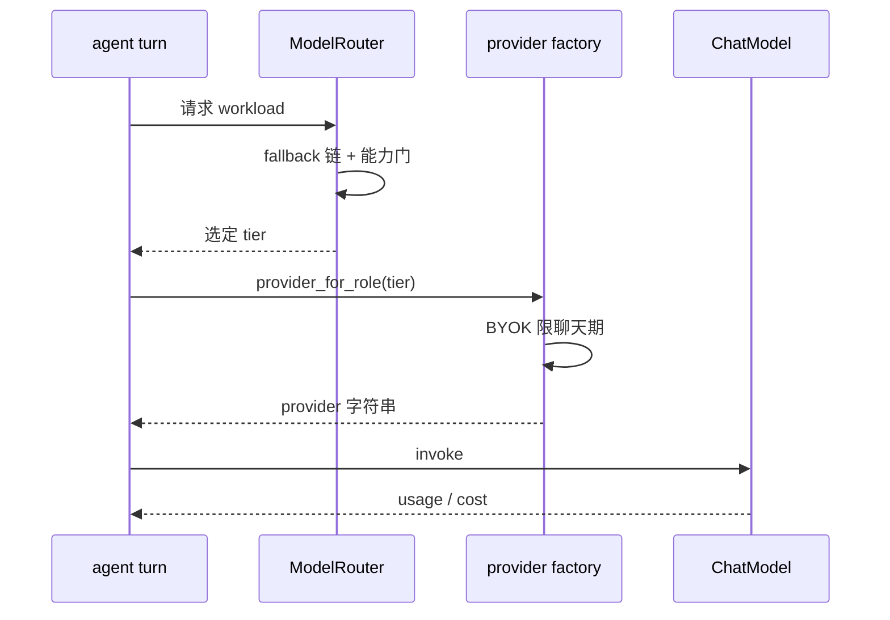

# OpenHuman 模型路由：workload→tier→provider 三层解析

> 本解读按 **Agent ⊗ framework** 类规格产出。基于当前上游 v0.63.6 / HEAD `e29bfc66f` 代码快照比对，所有引用指向 host 侧源码。注意：**路由表本体在 `agent/tinyagents/routes.rs` 而非 `inference/`**，`inference/` 负责 provider 字符串→真实 ChatModel 的解析；`agent/cost.rs` 承载 per-call 成本。

## 根因

一个拥抱多 provider、多工作负载的 agent harness，最核心的问题不是"能用多少种模型"，而是**"把每个 turn 的负载在正确的时间委托给正确的模型"，并在订阅/自带 Key/本地 Ollama 三种形态之间无缝混用**——同时让每一笔调用都有可审计的成本。OpenHuman 用**三层声明式解析**解决：workload → tier →（provider 字符串）→ 具体 `ChatModel`。

## 核心链路（sequenceDiagram）

## 第一层：workload → tier 路由（`agent/tinyagents/routes.rs`）

`WORKLOAD_ROUTE_TIERS` 是权威 tier 清单：`reasoning / chat / agentic / burst / coding / summarization / vision`（[src/openhuman/agent/tinyagents/routes.rs:26-26]()）。`subconscious` 与 `memory` 被刻意排除——它们是 riding `chat-v1` 的 role alias，不是独立 tier。

`OH_WORKLOAD_ROUTER` 是单个声明式 `ModelRouter`（[src/openhuman/agent/tinyagents/routes.rs:53-53]()），它从一张表同时回答"跨路由 fallback 链"和"每 tier 的 required-capability 门"：

| Tier | Fallback | 备注 |
|------|----------|------|
| `chat-v1 ⇄ burst-v1` | 互退 | 轻/快会话兄弟 |
| `reasoning-v1 ⇄ agentic-v1` | 互退 | 重推理兄弟 |
| `coding-v1 → agentic-v1` | 单向 | coding 工具密集，紧邻 agentic |
| `summarization-v1 → chat-v1` | 单向 | 摘要骑通用聊天模型 |
| `vision-v1` | **primary-only** | `image_in` 门控，文本不可回退 |

vision 用 `image_in` capability gate 且无 fallback——因为携带图像输入的 turn 不能退到无视觉模型，`requiring(vision_gate)` 把这条规则写进声明式路由（`src/openhuman/agent/tinyagents/routes.rs:80-85`）。

## 第二层：tier → provider 字符串（`inference/provider/factory.rs`）

`provider_for_role(role, config)`（`src/openhuman/inference/provider/factory.rs` 顶部 `pub fn provider_for_role`）把选出的 role 解析成 provider 字符串：

- **BYOK 继承被限定到三个聊天期 role（chat/reasoning/coding）**：只有这三个在未显式配置时可继承用户的 BYOK provider 字符串；**background 工作负载（memory/embeddings/heartbeat/learning/subconscious）与 agentic/burst 必须留在 managed 后端**——它们用 tier 专属模型，BYOK provider 不懂，也不会被本地 runtime 服务（`src/openhuman/inference/provider/factory.rs` §"BYOK inheritance is scoped to the three chat-tier roles only"）。
- 未命中继承时回落到 managed 云 provider 字符串（`resolve_primary_cloud_provider_string`）。
- provider 字符串语法形如 `openhuman | cloud | ollama:<model> | lmstudio:<model> | claude_agent_sdk:<model> | <slug>:<model>[@<temp>]`。

这个"BYOK 只喂聊天、后台永远托管"的约束是防御性设计：后台稳定性的优先级高于"尽量用用户自己的便宜 key"。它的代价是**用户自托管偏好的成本收益不能覆盖后台分析型负载**，但换来 `memory`/`subconscious` 这类无常量模型列表的负载不会因缺 key 而中断。

## 第三层：provider 字符串 → ChatModel

`provider/` 下每种路由一个构造器——`openhuman_backend_model.rs`（managed backend，session JWT+billing）、`crate_openai.rs`（BYOK/local OpenAI 兼容）、`openai_codex.rs`（Codex OAuth）、`claude_agent_sdk/`（subprocess provider）。`create_chat_model*` 返回 `Arc<dyn tinyagents::ChatModel<()>>`。

## per-call 成本

成本是本路由的闭环：backend 报的 `charged_amount_usd` 优先，否则按 token × per-mtok 单价估值回退（[src/openhuman/agent/cost.rs:191-191]()、`:177`）。`TurnCost` 累计整轮输入/输出/cached token 与 charged/estimated USD（[src/openhuman/agent/cost.rs:206-206]()）。这正是"one subscription + TokenJuice"与"BYOK/本地可混用"的产品承诺在代码层的落点——**无论流量走向哪种 provider，成本都统一进同一个计量表面**。

## 与其它模块的全局关联

- 路由表挂在 `agent/` 而非 `inference/`，因为它是 **harness 组装期的决策**；`inference/` 只是其下的解析执行者。
- 本路由输出的 `provider_string` 同时也是 `orchestration.md` 里 sub-agent 派发时的模型选择依据。
- cost 累计喂给 budget stop hooks 与 dashboard（见 README「每个 run 以真实 per-call 成本回放」）。

## 可借鉴的设计

- **三态 provider（订阅 / BYOK / 本地 Ollama）统一为一条运行时抽象**，路由只关心 tier 语义，不关心钱怎么付。
- **capability gate 写进声明式路由表**：`vision→image_in` 这类硬约束不再散落在调用方 if-else。
- **background 负载与交互负载分开路由策略**：稳定性负载永远走托管，价值负载才走 BYOK。
