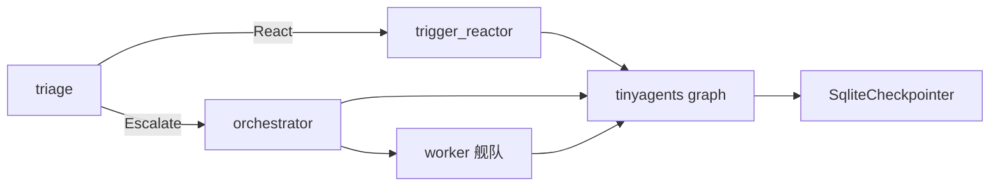

# OpenHuman Agent 编排层：分脑架构、triage 与 checkpointed graph

> 本解读按 **Agent ⊗ framework** 类规格产出（上游自述"orchestrator, not a chatbot"）。基于当前上游 v0.63.6 / HEAD `e29bfc66f` 代码快照比对，所有 `文件:行号` 引用均指向 host 侧源码（vendored `tinyagents` crate 内部不做行号引用）。

## 根因

一个生产级 agent harness 的难点不是"跑一个 agent loop"，而是**在多 agent、长任务、可回放的前提下把"分脑决策"和"执行运行时"稳定地组织起来**。OpenHuman 的回答是两层：

- **决策分脑**：一个极小的本地模型做三/四分类的 `triage`（快速反射），把消息判给正确的下游；慢速的深推理核心负责真正的工作委派。
- **执行统一**：所有 agent turn、sub-agent、工作流、潜意识 tick 都跑在同一套 **tinyagents `CompiledGraph`** 之上——checkpointed、可断点续跑、带 per-call 成本，从而"每次运行都可回放、可计费、卡住能自愈"。

## 架构：分脑（split brain）



（ASCII 对照图，保留旧式排版）：

```
入站事件（渠道/定时/消息）
        │
        ▼
┌─────────────────────────────┐
│  triage（快速反射，小而宽容）  │
│  gemma3:1b 级 / 宽容解析器     │
│  Drop ▸ Acknowledge ▸ React ▸│
│  Escalate                     │
└───────┬─────────┬───────────┘
        │React    │Escalate
        ▼         ▼
  trigger_reactor  orchestrator（深推理核心）
        │           │
        │           ▼  spawn_subagent / delegate_*
        │       worker 舰队 ──三级下钻──▶
        ▼
  checkpointed tinyagents CompiledGraph
   （SqliteCheckpointer / per-call cost / 事件 journal）
```

对比上下游 README 宣称的"fast reflex agent triages inbound traffic while a deep reasoning core delegates to worker fleets"，代码里的 triage 实际是**四分类**而非三分类。

## Triage：故意宽容的小模型四分类

`src/openhuman/agent/triage/decision.rs` 定义了四个合法结果（[src/openhuman/agent/triage/decision.rs:34-34]()）：
<!-- snippet: pub enum TriageAction { -->

| 动作 | 语义 | 是否派 agent |
|------|------|--------------|
| `Drop` | 噪音/重复/垃圾，无下游工作 | 否 |
| `Acknowledge` | 记录 + 持久化记忆条目，不派 agent | 否 |
| `React` | 单一副作用，交给 `trigger_reactor` | 是（需 target） |
| `Escalate` | 多步/多技能，交给 `orchestrator` | 是（需 target） |

两个关键设计权衡：

**1. 模型可小，解析器必须宽容。** triage agent 跑在 `gemma3:1b-it-qat` 这么小的模型上，会稳定产出 ```` ```json ```` 围栏尾随注释、裸 JSON 混在散文里、尾逗号、`"Drop"` 错大小写（`src/openhuman/agent/triage/decision.rs:16-26`）。因此 `parse_triage_decision` 刻意沿三条轴容忍（[src/openhuman/agent/triage/decision.rs:115-115]()）：优先取**最后一个** ```` ```json ```` 围栏块（小模型常在 JSON 后又加注释）、退化为括号配对的最后一个平衡 `{…}`、解析前剥尾逗号并小写化 `action` 值。代价是解析器更复杂，但换来**用本地廉价模型就能可靠做首个分类环节**——这是把"便宜逻辑"前移的典型取舍。

**2. React/Escalate 强制带 target，防未定型委派。** `requires_target()` 保证这两类动作必须有 `target_agent` + `prompt`（[src/openhuman/agent/triage/decision.rs:62-62]()），缺失则返回 `ParseError::MissingTarget` 并让调用方在远端 provider 重试整轮。防止小模型"我想 escalate 但没说派给谁"被静默通过。
<!-- snippet: pub fn requires_target(&self) -> bool { -->

side effect 执行在 [src/openhuman/agent/triage/escalation.rs:40-40]() 的 `apply_decision`——总是先发布 `TriggerEvaluated`（dashboard 唯一真相来源），React/Escalate 再用与 `agent_chat` 相同的 `Agent` 构造路径 + `ParentExecutionContext` 派 sub-agent（`src/openhuman/agent/triage/escalation.rs:40-50`）。

## Adapter seam：host 类型桥到 tinyagents crate

agent 执行跑在发布版 `tinyagents` crate 上，host 侧 `src/openhuman/agent/tinyagents/mod.rs` 是 **adapter seam**——把 OpenHuman 的 `Provider`/`Tool`/`ChatMessage` 桥到 crate 的 `ChatModel`/`Tool`/`Message` trait，再由 `AgentHarness::invoke` 驱动一轮（`src/openhuman/agent/tinyagents/mod.rs:5-11`）。这是全书反复出现的一个模式：**引擎放 vendored crate，host 只留"桥 + 策略"**（记忆同款，见 `memory-system.md`）。

`run_policy_for` 集中了每个 turn 的执行边界（[src/openhuman/agent/tinyagents/mod.rs:190-190]()）：

- 模型调用上限取 OpenHuman 的 `max_iterations`（而非 crate 默认 25）；
- 每个模型与工具调用都由 run 的**剩余墙钟预算**包一层 `tokio::time::timeout`，默认整体 600s（`DEFAULT_AGENT_TURN_TIMEOUT_SECS`，[src/openhuman/agent/tinyagents/mod.rs:163-163]()），专治"某个 sub-agent 工具调用永不返回导致空回复"；
- 重试固定为 2 次重试 / 500ms 指数退避（从旧 `ReliableProvider` 收敛到 crate 单一 RetryPolicy 层）；
- fail-closed：`RunPolicy` 的 unknown tool → `ReturnToolError`、schema 无效参数 → `ReturnToolError`、`TokenResult` 失败不吞。

## checkpointed graph 与 durable 回放

Readme 的"checkpointed graph runs on tinyagents"落点：harness 用 `SqliteCheckpointer` 断点续跑（`src/openhuman/agent/tinyagents` 走同一 durable runtime，subconscious 的 tick 也用它，见 `subconscious.md`）。durable event journal 让每次运行可重构成可回放时间线（`journal::mint_run_id()` → `EventSink::with_stream_id`，`src/openhuman/agent/tinyagents/mod.rs:751-752`）——即便 `on_progress = None` 的后台 turn 也附着 journal，保证"即便失败，已烧掉的模型调用也计入成本表面"（`src/openhuman/agent/tinyagents/mod.rs:754-763`）。

## 成本可观测：per-call 计费

每次 turn 带权威成本：backend 报的 `charged_amount_usd > 0` 优先，否则按 token 数 × per-mtok 单价估值回退（[src/openhuman/agent/cost.rs:191-191]()、估算函数见 [src/openhuman/agent/cost.rs:177-185]()）。`TurnCost` 累计整轮（[src/openhuman/agent/cost.rs:206-213]()）。这就是 Readme 宣传"every run replays with real per-call costs"的实现底子。

## 与其它模块的全局关联

- 本层的 `CompiledGraph` + `SqliteCheckpointer` 是**全仓库统一执行内核**：潜意识 tick、flows 运行、agent turn 都复用（见 `subconscious.md`、`flows.md`）。
- triage 的 `Escalate` 目标就是 orchestration；orchestration 依赖 model routing 决定 worker 用哪个 provider（见 `model-routing.md`）。
- sub-agent 的工具白名单 fail-closed（`Some(空)` = 显式 deny-all），防止 tool-less 子 agent 静默继承父的 shell/文件写/spawn 能力（`src/openhuman/agent/tinyagents/mod.rs:489-496`）。

## 不足 / 风险

- **triage 解析器复杂度 vs 收益**：宽容解析把大量小模型脏输出归一整，但解析失败时的"远端重试整轮"会提升延迟与成本。
- **host 策略深度依赖 vendored crate**：`tinyagents` crate 决定 checkpoint/cost/retry 语义，host 只能通过 `RunPolicy` 等窄缝调参，升级 crate 可能破坏既有缝。

## 可借鉴的设计

- **把"决策"和"执行"分离**：快而廉的 triage 先分类，重而贵的编排只接该接的，控制成本与延迟。
- **engine-in-crate + host-adapter-seam**：核心引擎独立可测试，host 层只做桥接与策略注入，减少碎片。
- **fail-closed 工具授权**：工具白名单 `None`=全部、`Some(空)`=deny-all 的语义区分，堵住子 agent 越权。
