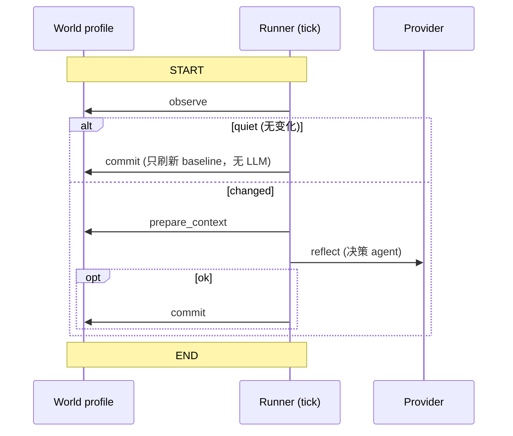

# OpenHuman 潜意识子系统：cron 驱动的 Deep Reflection

> 本解读按 **Agent ⊗ framework** 类规格产出。基于当前上游 v0.63.6 / HEAD `e29bfc66f` 代码快照比对。`src/openhuman/subconscious/README.md` 是作者自述的第一手来源，本节大量以其 + `instance.rs` 为底，引用均指向 host 侧源码。

## 根因

LLM 的本质是**被动**的——你不问它就不想。OpenHuman 想让 agent"在你停止打字后仍继续思考"（README 原话 "Thinking continues after you stop typing"），需要的不是又一个聊天循环，而是一个**离线、后台、定期**运行的反射器：消费世界如何变化，产出简短密集的"转向指令"去驱动系统的其余部分。它被设计成 `subconscious` —— 一个 **factory**：一份通用反射 runner，按 world 实例化多份，而非每加一个来源重写一条引擎。

## 核心设计：通用 runner + 按 world 注入 profile

`src/openhuman/subconscious/README.md:3-15` 给出精确定位——它是 **Deep Reflection Layer**，离线、cron 驱动、按 factory 模式每个 world 一个实例：

- **`memory`** — 观察用户已连接记忆源（Gmail/Slack/Notion/folders）与 baseline checkpoint 的 `memory_diff`，用精简决策 agent 反射（to-dos、goals、`notify_user`、delegation）。
- **`tinyplace`** — tiny.place 编排 world，观察 20:1 压缩的执行历史 + 世界状态 diff，用 **tool-free** 的 steering 综合产出 `STEERING_DIRECTIVE` 给推理核心。

"加一个 world 只是加一个 profile 文件 + 一个 factory 分支，而不是又一台引擎"（[src/openhuman/subconscious/README.md:15-15]()）——这是 factory 模式带来的核心可扩展性。

## 每个 tick 是一张 tinyagents CompiledGraph

每个 tick 的载体不是裸 async 函数，而是一张 **tinyagents `CompiledGraph`**——与编排 wake path 同一套 durable 运行时（`src/openhuman/subconscious/README.md:19-20`）：

节点 handler 1:1 委派给 world 的 `SubconsciousProfile`（`observe → prepare_context → reflect → commit` + `origin`），profile **就是注入的运行时**（`src/openhuman/subconscious/README.md:28-29, 42-53`）。所有 world 无关的设施在 runner 里只写一次：per-instance tick lock、generation/supersede 计数器、30 分钟 `TICK_TIMEOUT` 墙钟、provider gate + per-instance rate-cap halt、tool-capability 分类器、成功才推进 baseline、quiet-tick 短路、`SqliteCheckpointer` 断点续跑（`src/openhuman/subconscious/README.md:31-40`）。

**"安静 tick 短路"** 是关键成本控制：若 `observe` 发现没有变化，就**不发任何 LLM 调用**，只刷新 baseline 就结束（`src/openhuman/subconscious/README.md:107-108`）——后台循环不会烧 token。

## 实例与调度

`SubconsciousInstance` 是通用 runner 的壳（[src/openhuman/subconscious/instance.rs:133-133]()），持 profile、workspace、interval、状态与 tick 等。`registry.rs` 的 `bootstrap_after_login()` 在登录后按每用户 workspace 启动，`HeartbeatEngine` 以 `tokio::spawn` 起心跳循环（[src/openhuman/subconscious/registry.rs:61-61]() 区域），每个 interval 对"cadence 已到"的已注册实例并发 fan-out tick。`status` RPC 从不碰 tick 锁，读 SQLite + 小状态锁——因为 tick 锁在整个 tick 内持有（`src/openhuman/subconscious/README.md:100-103`）。

## 持久化与状态

SQLite 于 `<workspace>/subconscious/subconscious.db`（每用户 workspace），state key **按实例命名空间**（`"<instance>:<key>"`）：`memory:last_tick_at`、`tinyplace:last_tick_at`、`memory:baseline_checkpoint_id`；tick graph checkpoint 存 `<workspace>/subconscious/graph_checkpoints.db`，thread `subconscious:<instance>:<tick_id>`（`src/openhuman/subconscious/README.md:56-67`）。旧单引擎 key 通过幂等、老版本容忍的 DDL UPDATE 迁移到 `memory:` 命名空间。状态只成功才推进，失败的 reflect 保留 `last_tick_at`/baseline，下个 tick 重看同一窗口。

## 安全：taint 与 tool-free

反射的副作用受同类审批级约束：memory 决策 agent 的工具集**仅限内部**，tinyplace reflect 路径是 **tool-free** provider chat（源码扫测强制不出现 Agent/channel/send-message 符号）；external effects 仍由 approval gate 把关（`src/openhuman/subconscious/README.md:109-112`）。对含外部内容 diff 的 tick，标记 `SubconsciousTainted`——与记忆系统的 `MemoryTaint::ExternalSync` 门控呼应。

## 与其它模块的全局关联

- 潜意识复用了 `orchestration`/`tinyagents` 的 **CompiledGraph + SqliteCheckpointer** 执行内核（`orchestration.md` 同款）——"后台反射"与"前台交互"不搞两套运行时。
- 它的 memory world 挂在记忆系统的 `memory_diff` 上（`memory-system.md`），tinyplace world 挂在 orchestration 的 review window 上。
- 它每天产出 morning briefing（README 宣传），体现闭环：反射 → 指令 → 白天的执行，全部在同一套 durable 基础设施里。

## 不足 / 风险

- **cron-driven factory** 简单，但也意味着反射频率受限于 heartbeat interval，无法对"即时重要事件"做出亚分钟级响应（需要更事件驱动路径，如 flows 的 trigger）。
- baseline/checkpoint 的单点状态推进"只成功才推进"在 partially-failing world 下可能长期滞留同一窗口。

## 可借鉴的设计

- **factory 抽象把"new world"降维成写一个 profile**，避免后台逻辑重复爆炸。
- **quiet-tick 短路**是后台循环控制成本的核心——没变化就不调 LLM。
- **状态命名空间 + 幂等迁移**让多实例并行与老库升级都能安全进行。
