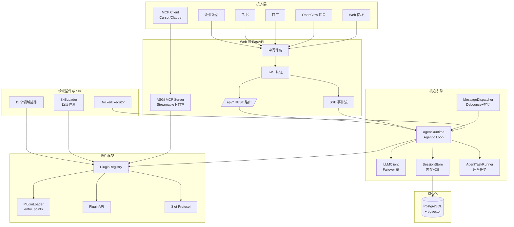
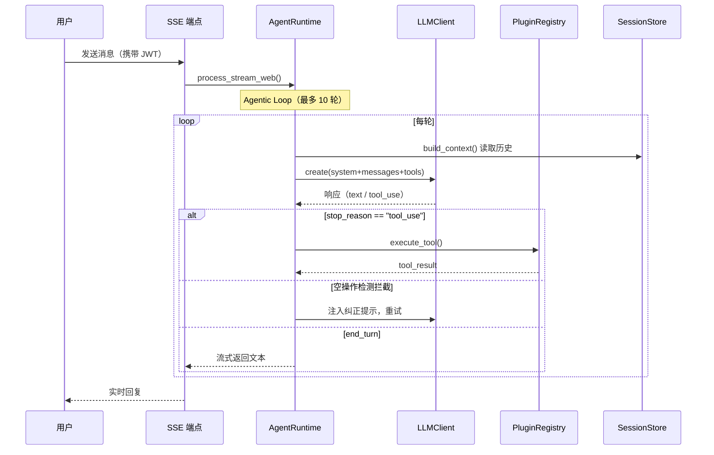

# OpenVort：开源 AI 员工平台与研发工作流引擎

> 本解读按 **agent ⊗ framework** 类型规格产出（Python 实现的 AI 员工平台 + 插件框架 + MCP Server）。
> 依据 **代码快照比对**（源码 v0.13.0）撰写，非官方 changelog 对照。

OpenVort（开放漩涡）是一个开源 AI 员工平台与研发工作流引擎。它把 AI Agent 当作一名**真正的团队成员**——通过企业微信、飞书、钉钉等 IM 对话给它派活，它自主调用工具完成需求解析、写代码、审查 PR、执行构建、生成报告，并异步通知结果。

- **语言**: Python 3.11+ / Vue 3 + TypeScript
- **协议**: AGPL-3.0-or-later
- **仓库**: https://github.com/openvort/openvort
- **版本**: v0.13.0（当前源码 HEAD）

## 子文档索引

- [`agent-loop.md`](agent-loop.md) — 主 Agent 循环与 LLM 编排（10 轮上限、空操作检测、Failover 链）
- [`plugin-system.md`](plugin-system.md) — 插件框架（BasePlugin/BaseTool/BaseChannel 三正交 + Slot Protocol + 引导）
- [`mcp-integration.md`](mcp-integration.md) — MCP Server 接入（仅暴露 tools 的边界 + 认证中间件穿透技巧）
- [`skill-system.md`](skill-system.md) — Skill 四级知识体系与双轨注入（修正旧文档"三级"说法）
- [`data-model.md`](data-model.md) — 数据模型与无 Alembic 自动迁移策略
- [`runtime-messaging.md`](runtime-messaging.md) — 消息分发状态机、群聊激活与 IM 通道适配

## 解决什么问题

研发团队中大量重复性工作——写日报、审代码、跑测试、部署构建、跟踪需求状态——持续消耗工程师时间。现有 Agent 工具的普遍痛点是：只能"单机问答"，无法融入企业现有的 IM 办公流与研发工具链。

OpenVort 的思路：让 AI Agent 以**员工身份**进入团队，通过日常使用的 IM 对话派活，同时深度绑定项目管理（Zentao/VortFlow）、代码仓库（GitHub/GitLab/Gitee）、CI/CD（Jenkins）、知识库（RAG）。它把 Agentic Loop、插件生态、IM 通道、异步任务调度打包成一个可自托管的员工平台。

## 核心能力

| 能力 | 说明 |
|------|------|
| AI 员工 | 基于 Claude Tool Use 的 Agentic Loop，AI 以员工身份（绑定岗位/人设/Skill）工作 |
| 多 IM 通道 | 企业微信、飞书、钉钉、OpenClaw（WhatsApp/Telegram/Slack/Discord 网关） |
| 插件系统 | Tool + Prompt 双轨可插拔，11 个内置插件覆盖研发全流程 |
| 异步任务 | Agent 执行与前端 SSE 解耦，离开页面 AI 继续工作，完成后通知 |
| 定时任务 | AI 员工按 cron 表达式定时执行工作 |
| 代码沙箱 | Docker 隔离的编码/浏览器/工作沙箱（3 种环境）|
| 知识库 | RAG 向量检索（pgvector），注入 Agent 上下文 |
| Skill 体系 | 四级知识注入（内置/公共/个人/市场），按岗位映射 |
| 项目管理 | 需求/缺陷/任务/迭代/测试用例/发布版本全流程（VortFlow） |
| 代码管理 | 代码仓库关联、提交分析、PR 审查、编码任务（VortGit） |
| MCP Server | 内部插件工具经 Streamable HTTP 暴露，Cursor/Claude Desktop 可调用 |
| 扩展市场 | Skill + Plugin 统一市场，支持 Bundle/PyPI/CLI 发布 |

## 技术栈

| 层 | 技术 |
|----|------|
| 运行时 | Python 3.11+ |
| Web 框架 | FastAPI |
| ORM | SQLAlchemy 2.0 (async) + asyncpg + PostgreSQL 17 |
| AI 模型 | Anthropic Claude + OpenAI 兼容（DeepSeek/通义千问/智谱等） |
| 前端 | Vue 3 + TypeScript + Vite + Pinia + Tailwind CSS |
| 图表 | ECharts + Mermaid |
| 向量 | pgvector |
| 任务调度 | APScheduler |
| 迁移 | 无 Alembic，`create_all` + ORM 元数据自动补列 |
| 加密 | Fernet（Token 加密）+ bcrypt（密码） |
| 构建 | Hatchling + Ruff |

## 架构总览



## 核心请求链路

以 Web 面板对话为例：Web 经 JWT 认证后请求 SSE 端点，`AgentRuntime` 逐轮走 Agentic Loop——构建 system prompt → 调 `LLMClient.create()` → 依据 `stop_reason` 决定执行工具或结束。空操作检测会拦截"声称完成但没调工具"的虚假回复并注入纠正。



## 核心模块导读

各关注面的实现细节、Why 与权衡分散在下列子文档中（每篇均带 `文件:行号` 真源引用）。

| 模块 | 路径 | 职责 | 深读 |
|------|------|------|------|
| Agent 引擎 | `src/openvort/core/engine/` | Agentic Loop、LLM failover、会话、上下文 | [`agent-loop.md`](agent-loop.md) |
| 插件框架 | `src/openvort/plugin/` | 插件注册/发现/加载、Slot、引导 | [`plugin-system.md`](plugin-system.md) |
| MCP Server | `src/openvort/web/mcp_server.py` | 工具以 Streamable HTTP 暴露 | [`mcp-integration.md`](mcp-integration.md) |
| Skill 体系 | `src/openvort/skill/` | 四级 Skill 加载与注入 | [`skill-system.md`](skill-system.md) |
| 数据持久化 | `src/openvort/db/` + 各插件 models | ORM 模型、自动补列迁移 | [`data-model.md`](data-model.md) |
| 消息分发 | `src/openvort/core/messaging/` | Debounce+排空、群聊、IM 幂等 | [`runtime-messaging.md`](runtime-messaging.md) |
| 领域插件 | `src/openvort/plugins/` | 11 个研发流程插件 | 见各子文档 |

## 启动流程

```
1. openvort start
   ├─ 初始化 Settings（Pydantic） ← .env / DB / 默认值
   ├─ 初始化数据库引擎（asyncpg + SQLAlchemy 2.0）
   │   ├─ 探测 pgvector 扩展（不可用则剔除 kb_chunks 表）
   │   ├─ create_all 建缺失表
   │   └─ _sync_missing_columns 自动补列（ADD COLUMN IF NOT EXISTS）[src/openvort/db/engine.py:993-995]()

<!-- snippet-base64:ICAgICAgICBkZWYgX3N5bmNfbWlzc2luZ19jb2x1bW5zKGNvbm5lY3Rpb24pOgogICAgICAgICAgICBpbnNwZWN0b3IgPSBzYV9pbnNwZWN0KGNvbm5lY3Rpb24pCiAgICAgICAgICAgIGV4aXN0aW5nX3RhYmxlcyA9IHNldChpbnNwZWN0b3IuZ2V0X3RhYmxlX25hbWVzKCkp -->
   ├─ 加载插件框架（entry_points → validate_credentials → activate）
   ├─ 加载 Skill 体系（磁盘 → DB 同步 → 注册进 PluginRegistry）
   ├─ 初始化核心引擎（TaskRunner / MessageDispatcher / AgentRouter）
   ├─ 初始化 Web（挂载 30+ REST 路由、MCP Server、SSE）
   └─ 启动 Uvicorn + 启动 IM Channel 适配器
```

启动流程的自动补列迁移依赖 `_sync_missing_columns` [src/openvort/db/engine.py:993-995]()，详见 [`data-model.md`](data-model.md)。

<!-- snippet-base64:ICAgICAgICBkZWYgX3N5bmNfbWlzc2luZ19jb2x1bW5zKGNvbm5lY3Rpb24pOgogICAgICAgICAgICBpbnNwZWN0b3IgPSBzYV9pbnNwZWN0KGNvbm5lY3Rpb24pCiAgICAgICAgICAgIGV4aXN0aW5nX3RhYmxlcyA9IHNldChpbnNwZWN0b3IuZ2V0X3RhYmxlX25hbWVzKCkp -->

> **说明**：启动流程图中的迁移引用行号以 [`data-model.md`](data-model.md) 的精确验证为准。

## 部署与可观测

| 方式 | 命令 | 说明 |
|------|------|------|
| Docker Compose | `docker compose up -d` | 端口 10899，内置 pgvector PostgreSQL |
| pip 安装 | `pip install openvort && openvort start` | 端口 8090，自动拉取前端产物 |
| 源码运行 | `pip install -e ".[dev]" && openvort start` | 开发模式（`--dev` 跳过 IM 初始化）|

- **配置分层覆盖**：Pydantic Settings 默认值 → `.env` → DB 配置（ConfigService 覆盖），Web 面板可在线改配置。
- **LLM 模型库**：UI 管理，主模型不可用时沿优先级链 fallback（`LLMClient.create`，[`agent-loop.md`](agent-loop.md)）。
- **自动建库**：`openvort start` 检测不到本地 PostgreSQL 时自动拉起 Docker 容器（`pgvector/pgvector:pg17`）。

## 与同类项目的对比

| 维度 | OpenVort | OpenBee | Leros | Multica |
|------|----------|---------|-------|---------|
| 定位 | AI 员工 + 研发工作流 | 数字员工管理平台 | AI 工作协作平台 | Agent 协作任务管理 |
| 语言 | Python | Go+TS | Go | Go+TS |
| 协议 | AGPL-3.0 | MIT | Apache-2.0 | Apache-2.0 |
| IM 集成 | 企微/飞书/钉钉/OpenClaw | 企微/飞书/钉钉/Discord | 企微/飞书/钉钉 | Web 为主 |
| 插件系统 | 完善（Tool+Prompt+MCP） | 插件框架 | 插件框架 | 模块化 |
| 研发流程 | 强（需求/缺陷/任务/版本/CICD） | 弱 | 中等 | 无 |
| 代码沙箱 | Docker 沙箱（3 种） | 无 | Docker 沙箱 | 无 |
| 知识库 | RAG + pgvector | 无 | 内置 | 无 |
| Skill 体系 | 四级（builtin/public/personal/marketplace） | 内置 Skill | 内置 Skill | 无 |
| MCP Server | 支持（tools 维度） | 无 | 无 | 无 |

**核心优势**：研发工作流的覆盖深度（项目管理 + 代码管理 + CI/CD）远超同类，插件框架成熟度最高，Skill 体系与 IM 场景（防重复回复、空操作检测）打磨充分。

**主要局限**：AGPL-3.0 对商用有约束；整体复杂度偏高；MCP Server 目前只暴露 tools 维度（resources/prompts 未实现，见 [`mcp-integration.md`](mcp-integration.md)）。

## 值得借鉴的设计

1. **空操作检测护栏**：用"声称完成但未调工具"的关键词匹配拦截 LLM 虚假回复，注入纠正提示强制作业走工具——低成本防幻觉手段（[`agent-loop.md`](agent-loop.md)）。
2. **Failover 链 + 模型库优先链**：不依赖外部路由，在 LLMClient 内按优先级逐个尝试模型，流式在连接期完成切换（[`agent-loop.md`](agent-loop.md)）。
3. **Slot Protocol 排他契约**：用 Python Protocol 定义模块间接口，一个 slot 只允许唯一提供者注册，core 绝不 import 具体插件（[`plugin-system.md`](plugin-system.md)）。
4. **插件引导（bootstrapping）**：未就绪插件屏蔽其工具并注入引导 prompt，而非直接报错——企业产品 UX 细节（[`plugin-system.md`](plugin-system.md)）。
5. **无 Alembic 自动迁移**：`create_all` + ORM 元数据 `ADD COLUMN IF NOT EXISTS` 自动补列，契合插件可插拔模型，牺牲迁移版本管理换迭代速度（[`data-model.md`](data-model.md)）。
6. **Debounce + 排空状态机**：per-user lock 串行化 IM 连续消息，新消息入队丢弃过时中间回复（[`runtime-messaging.md`](runtime-messaging.md)）。

## 不足与风险

- **迁移无版本历史**：自动补列只追加不改类型/改名/删除，破坏性变更靠手写 `DO $$` 条件块，没有版本号，多实例并发升级需谨慎（[`data-model.md`](data-model.md)）。
- **MCP 单维度**：只暴露 tools，未实现 resources/prompts，插件领域知识无法经 MCP 透出。
- **空操作检测为启发式**：中文关键词误报/漏报并存，对非中文场景覆盖有限。
- **单机 ASGI 状态**：MessageDispatcher 的 per-user lock 与 SessionStore 内存缓存是进程内状态，水平扩容依赖 PostgreSQL inbox 幂等做跨实例去重，扩展性受单事件循环限制。

## 总结

OpenVort 解决的根本问题，是把 AI Agent 从"独立的在线工具"变成"融入企业研发流程的团队成员"。它用一套深度融合 IM + 研发工具链的插件生态承载业务，用精细打磨的 Agentic Loop（空操作检测、failover、会话裁剪）保证可靠性，用 Skill 体系实现按岗位的知识注入。对想在自托管环境里把 AI 接进真实团队研发工作流的中小团队，是一个功能完整性很高的参考样板。
