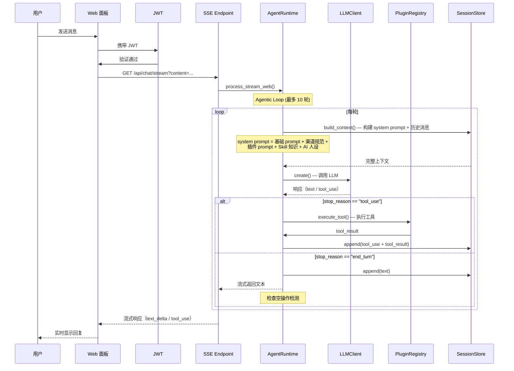

# OpenVort：开源 AI 员工平台架构深度解读

> OpenVort（开放漩涡）是一个开源 AI 员工平台和工作流引擎。它允许用户创建"AI 员工"，让 AI Agent 与真人同事在企业微信、钉钉、飞书等 IM 平台上协作 —— 接需求、写代码、审查 PR、执行构建、生成报告。
>
> - **语言**: Python 3.11+ / Vue 3 + TypeScript
> - **协议**: AGPL-3.0-or-later
> - **仓库**: https://github.com/openvort/openvort
> - **文档**: https://openvort.com

---

## 第一部分：快速概览

### 解决什么问题

研发团队中大量重复性工作（写日报、审代码、跑测试、部署构建、跟踪需求状态）消耗工程师时间。OpenVort 的思路是：把 AI Agent 当成一个**真正的团队成员**，通过 IM 对话给它派活，它自己调用工具完成工作，完成后通知你。

### 适用场景

- 研发团队需要 AI 助理处理日常开发工作流
- 团队使用企业微信/飞书/钉钉作为主要沟通工具
- 需要 AI 与项目管理（Zentao/GitHub Issues）、代码仓库（GitLab/Gitee/GitHub）、CI/CD（Jenkins）等工具联动
- 需要定时自动执行的任务（日报生成、代码审查、构建检查）

### 核心能力

| 能力 | 说明 |
|------|------|
| AI Agent | 基于 Claude Tool Use 的 Agentic Loop，自主决策调工具 |
| 多 IM 通道 | 企业微信、飞书、钉钉、OpenClaw（WhatsApp/Telegram/Slack/Discord 网关） |
| 插件系统 | Tool + Prompt 可插拔，11 个内置插件覆盖研发全流程 |
| 异步任务 | Agent 执行与前端解耦，离开页面 AI 继续工作，完成后通知 |
| 定时任务 | AI 员工按 cron 表达式定时执行工作 |
| 代码沙箱 | Docker 隔离的编码/浏览器/工作沙箱 |
| 知识库 | RAG 向量检索，注入 Agent 上下文 |
| Skill 体系 | 四级知识注入（内置/公共/个人/市场），按岗位映射 |
| 项目管理 | 需求、缺陷、任务、迭代、测试用例、发布版本全流程 |
| 代码管理 | 代码仓库关联、提交分析、PR 审查 |
| Web 面板 | 管理后台 + AI 聊天（SSE 流式）|
| MCP Server | 所有工具通过 Streamable HTTP 暴露，Cursor/Claude Desktop 可直接调用 |
| 扩展市场 | Skill + Plugin 统一市场，支持 Bundle/PyPI/CLI 发布 |

### 技术栈

| 层 | 技术 |
|----|------|
| 运行时 | Python 3.11+ |
| Web 框架 | FastAPI + SSE-Starlette |
| ORM | SQLAlchemy 2.0 (async) + asyncpg |
| AI 模型 | Anthropic Claude + OpenAI 兼容（DeepSeek/通义千问）|
| 前端 | Vue 3.5 + TypeScript 5.9 + Vite 7 + Pinia |
| CSS | Tailwind CSS 4 |
| 图表 | ECharts 6 + Mermaid |
| 容器 | Docker （沙箱执行）|
| 向量 | pgvector |
| 队列 | APScheduler |
| 构建 | Hatchling + Ruff |

---

## 第二部分：架构深读

### 整体架构

```mermaid
graph TB
    subgraph "接入层"
        WeCom[企业微信]
        Feishu[飞书]
        DingTalk[钉钉]
        WebUI[Web 面板]
        MCP[MCP Client]
        CLI[CLI]
    end

    subgraph "Web 层 FastAPI"
        Auth[JWT 认证]
        REST[/api/* REST 路由]
        WS[WebSocket]
        SSE[SSE 事件流]
        MCP_S[MCP Server]
        Middleware[中间件链]
    end

    subgraph "核心引擎"
        AR[AgentRuntime]
        LC[LLMClient<br/>Failover 链]
        SS[SessionStore<br/>内存+DB]
        MD[MessageDispatcher<br/>Debounce+排空]
        AT[AgentTaskRunner<br/>后台任务]
        EB[EventBus<br/>发布/订阅]
        RT[AgentRouter<br/>多 Agent 路由]
    end

    subgraph "插件框架"
        PR[PluginRegistry]
        PL[PluginLoader<br/>entry_points]
        PA[PluginAPI]
        Slot[Slot Protocol]
    end

    subgraph "领域插件与执行层"
        Plugins[11 个内置插件]
        SK[Skill 加载器]
        DE[DockerExecutor]
        SM[SandboxManager]
    end

    subgraph "持久化"
        PG[(PostgreSQL<br/>+ pgvector)]
        Model[ORM Models]
    end

    WeCom & Feishu & DingTalk --> Auth
    WebUI & CLI --> Auth
    MCP --> MCP_S

    Auth --> REST & WS & SSE
    REST & WS & SSE --> AR

    AR --> LC
    AR --> SS
    AR --> PR
    AR --> AT

    MD --> AR
    RT --> AR

    PR --> PL
    PR --> PA
    PR --> Slot

    Plugins --> PR
    SK --> PR
    DE --> SM

    SS --> PG
    Model --> PG
```

### 启动流程

```
1. openvort start
   │
   ├─ 初始化 Settings（Pydantic） ← .env / DB / 默认值
   │
   ├─ 初始化数据库引擎 ← asyncpg + SQLAlchemy 2.0
   │   ├─ 自动创建所有 ORM 表
   │   └─ 自动补列（ADD COLUMN IF NOT EXISTS）
   │
   ├─ 加载插件框架
   │   ├─ PluginLoader.load_all() ← entry_points + 本地目录
   │   ├─ 注册 Core Tools（6 个基础工具）
   │   ├─ PluginLoader.load_channels() ← IM 通道
   │   └─ PluginLoader.load_all_async() ← 从 DB 加载配置
   │
   ├─ 加载 Skill 体系
   │   ├─ 扫描 builtin/ → public/ → personal/ 目录
   │   ├─ 同步 SKILL.md 到 DB（upsert）
   │   └─ 注册到 PluginRegistry
   │
   ├─ 初始化核心引擎
   │   ├─ AgentTaskRunner（恢复孤儿任务）
   │   ├─ MessageDispatcher（启动消息处理循环）
   │   └─ AgentRouter（注册路由规则）
   │
   ├─ 初始化 Web 应用
   │   ├─ FastAPI app 创建
   │   ├─ 挂载路由（30+ REST + 插件路由）
   │   ├─ 挂载 MCP Server
   │   └─ 注入依赖（set_runtime）
   │
   └─ 启动 Uvicorn（Web）/ 启动 Channel 适配器（IM）
```

### 核心请求链路

以 Web 面板对话为例：



### 模块职责划分

| 模块 | 路径 | 职责 |
|------|------|------|
| **核心引擎** | `src/openvort/core/` | Agent 运行时、LLM 客户端、会话管理、消息分发、事件系统 |
| **插件框架** | `src/openvort/plugin/` | 插件注册/发现/加载、Slot 接口、运行时 API |
| **内置插件** | `src/openvort/plugins/` | 11 个领域插件（项目管理/代码/知识库/CI/CD/浏览器...）|
| **IM 通道** | `src/openvort/channels/` | 企业微信/飞书/钉钉/OpenClaw 适配器 |
| **Skill 体系** | `src/openvort/skill/` | 三级 Skill 加载器、SKILL.md 解析 |
| **Web 层** | `src/openvort/web/` | FastAPI 应用、路由、JWT、SSE、MCP Server |
| **配置管理** | `src/openvort/config/` | Settings + ConfigService（DB 覆盖） |
| **执行沙箱** | `src/openvort/core/execution/` | Docker 执行器、沙箱管理器 |
| **数据持久化** | `src/openvort/db/` | 引擎初始化、ORM 模型、自动迁移 |

---

## 第三部分：插件框架设计

OpenVort 的插件系统是项目最大的工程亮点之一。它比一般项目的插件系统走得更远，不是因为有多复杂的 SPI，而是在**职责边界**上划分得非常干净。

### 三层抽象

```
BaseChannel                BasePlugin                BaseTool
  │                          │                          │
  │  IM 通道适配器            │  插件容器（工具+Prompt）   │  AI 可调用工具
  │                          │                          │
  ├─ start() / stop()        ├─ get_tools()             ├─ input_schema()
  ├─ send()                  ├─ get_prompts()           ├─ execute()
  └─ on_message()            ├─ activate(api)           └─ to_claude_tool()
                              ├─ validate_credentials()
                              └─ get_api_router()
```

**关键设计决策**：`BasePlugin` 既提供 AI 工具（`get_tools()`），又提供 System Prompt 片段（`get_prompts()`），还能挂载 Web API 路由（`get_api_router()`）。这意味着一个插件可以在三个层次发挥作用：
- **AI 层**：工具和知识注入到 Agent 上下文
- **API 层**：Web 面板管理端直接调用
- **UI 层**：可通过前端配置页面动态渲染

### Slot 机制

`src/openvort/plugin/slots.py` 定义了 Python `Protocol` 接口。核心模块和插件之间的解耦契约。

```python
class ProjectProvider(Protocol):
    """Slots 接口定义"""
    async def get_project(self, ...) -> Project: ...
    async def get_sprint(self, ...) -> Sprint: ...
    async def get_tasks(self, ...) -> list[Task]: ...
```

只允许**唯一提供者**注册某个 Slot，避免冲突。例如，当安装了 Zentao 插件后，它成为 `ProjectProvider` 的唯一提供者，Agent 通过统一接口访问项目管理数据。

### 插件引导

每个插件可以实现 `get_setup_status(ctx)` 返回 `"ready"` / `"not_synced"` / `"not_bound"`。未就绪时，其所有工具被自动屏蔽，Agent 返回引导提示给用户。这解决了"插件装了但没配好，Agent 乱调用报错"的常见问题。

### 配置 Schema 动态渲染

`get_config_schema()` 返回 JSON Schema，前端自动渲染配置表单。支持个人级配置（`get_personal_config_schema()`），允许每个用户绑定自己的账号（如 GitHub Token）。

---

## 第四部分：Agent 引擎设计

### Agentic Loop

不依赖 LangChain 等框架，从头实现的 Tool Use 循环：

```
loop (max 10 rounds):
    1. 动态构建 system prompt（含插件知识 + Skill + 人设 + 渠道规范）
    2. 调用 LLM.create()
    3. switch stop_reason:
         case "tool_use":  执行工具 → 注入结果 → 继续
         case "end_turn":  返回文本 → 结束
    4. 空操作检测：如果 LLM 声称完成但没调工具 → 注入纠正提示
```

### 空操作检测

这是 IM 场景特有的问题。Claude 有时会"礼貌性地回复"而不是真的调工具。`_detect_empty_action` 检查 assistant 的最后一条消息，如果包含"完成/已处理/办好了"等关键词但没有 tool_use 调用，注入纠正提示重试。

```python
_empty_patterns = [
    r"(?:已经|已完成|已处理|已经完成|处理完成|已处理完毕|已处理好|已为您)",
    r"(?:好的|收到|明白|了解|没问题|可以了|搞定了)",
    r"(?:正在|开始|准备)(?:(?!调用|使用|执行|查询|创建|更新|删除).{0,10}(?:处理|执行|操作))",
]
```

### 上下文构建

`build_context()` 是 Agent 引擎的核心方法，构建发给 LLM 的 messages 列表。system prompt 由多个片段拼接：

1. 基础系统提示词（开源协议声明等）
2. 发送者上下文（`RequestContext` 中按角色加载的 prompt）
3. 渠道规范（"群聊回复需 @ 提及"、"请使用中文"）
4. 插件知识（`registry.get_system_prompt_extension()` 拼接所有插件 prompt）
5. 插件引导（未就绪的插件配置引导）
6. AI 员工人设（绑定岗位的 Skill 内容）
7. 远程节点信息（如果有远程节点）

### Failover 链

```python
class LLMClient:
    def __init__(self):
        self.models: list[LLMModel] = []  # 按优先级排序

    async def create(self, ...):
        errors = []
        for model in self.models:
            try:
                provider = self._create_provider(model)
                return await provider.create(...)
            except Exception as e:
                errors.append(e)
        raise AllProvidersFailed(errors)
```

主模型不可用时（如配额耗尽、API 超时），自动切换到备选模型。流式模式通过 `_FailoverStreamWrapper` 实现透明切换。

---

## 第五部分：消息分发设计

### Debounce + 排空模式

IM 场景下用户连续发消息是一个常见问题。OpenVort 的 `MessageDispatcher` 实现了清晰的状态机：

```
idle ──收到消息──→ debounce ──超时 2s──→ processing
               ↑                        │
               │     收到新消息          │
               ├────────────────────────→ drain
               │                        │
               └── 处理完毕 ────────────→ idle
```

- **debounce**：等待 2 秒收集同用户消息（含图片累积）
- **processing**：per-user lock 持有中
- **drain**：处理期间新消息入 pending 队列，当前回复被丢弃，重新处理

每个用户独立一把 `asyncio.Lock`，多用户互不影响。

---

## 第六部分：Skill 知识体系

### 三级体系

| 级别 | 存储位置 | 用途 |
|------|----------|------|
| builtin | `skills/` 目录 | 项目内置 Skill，如"Python 专家"、"前端开发" |
| public | `/etc/openvort/skills/` | 企业级公共 Skill，管理员统一管理 |
| personal | `~/.openvort/skills/` | 个人 Skill，用户自己创建 |

### 加载流程

1. 启动时扫描各目录的 `SKILL.md`，同步到 DB（upsert）
2. 从 DB 加载所有 enabled 的 Skill
3. 注册到 `PluginRegistry` 作为 Prompt 片段
4. 运行时 `get_member_skills_content()` 按角色 + 公共 + 个人返回

### SKILL.md 格式

```yaml
---
name: Python Expert
description: 精通 Python 开发
enabled: true
requires:
  plugins: [vortgit, vortflow]
  bins: [python3, pip]
  packages: [requests, pytest]
---
你是一个 Python 专家，擅长：
- Python 代码审查、重构、优化
- 编写测试用例
- 依赖管理和打包
```

---

## 第七部分：部署与可观测

### 部署方式

| 方式 | 命令 |
|------|------|
| Docker Compose | `docker compose up -d` (端口 10899) |
| pip 安装 | `pip install openvort && openvort start` (端口 8090) |
| 源码运行 | `pip install -e ".[dev]" && openvort start` |

### 配置管理

- 启动时：`Settings` 从环境变量 /.env 加载
- 运行时：`ConfigService` 将 DB 中的配置覆盖到 `Settings` 单例
- Web 面板可在线修改配置，持久化到 DB
- LLM 模型配置支持 UI 管理（模型库 + 优先级链）

### 自动补列迁移

`src/openvort/db/engine.py` 的 `_sync_missing_columns()` 在启动时自动检测 ORM 模型新增的字段并执行 `ALTER TABLE ADD COLUMN IF NOT EXISTS`，无需手动编写 Alembic 迁移。这是典型的"小团队快节奏"权衡 —— 快速迭代期省去迁移管理成本。

---

## 第八部分：值得借鉴的设计与工程实践

### 设计亮点

1. **不依赖 LLM 框架**：手动实现 Agentic Loop，对每个细节有完全控制。LangChain 等框架适合原型，生产环境往往需要这种精细控制。

2. **Slot 接口优于继承**：用 Python `Protocol` 定义模块间契约，而不是让插件继承核心类。插件与核心之间的耦合度更低。

3. **插件引导的 UX 设计**：插件未配置时不是直接报错，而是引导用户完成配置。这在企业产品中是一个被低估但非常重要的细节。

4. **Debounce + 排空状态机**：IM 场景下消息处理的经典问题，用不到 150 行代码就给出了优雅的工业级方案。

5. **SSE 生命周期解耦**：Agent 执行与前端 SSE 连接解耦，用户关闭浏览器后 AI 继续工作。这从根本上解决了"等 AI 响应期间不敢刷新页面"的体验问题。

6. **空操作检测**：LLM "幻觉式回复"的实用检测手段，简单但有效。通过模式匹配 + 纠正注入提升可靠性。

7. **三级 Skill 体系**：内置/公共/个人 三级知识注入，配合岗位角色映射，比简单的"提示词模板"灵活得多。

### 工程实践

8. **自动补列迁移**：`ALTER TABLE ADD COLUMN IF NOT EXISTS` 虽不优雅但在小团队迭代期非常实用，省去了手动迁移脚本的管理成本。

9. **配置分层覆盖**：`Pydantic Settings` 默认值 → `.env` → DB 配置的三层覆盖，既有代码级的默认保障，又有运行时的动态更新能力。

10. **纯 CLI 操作 Docker**：不依赖 Docker SDK，直接 subprocess 调用 docker CLI。减少依赖、更可控、跨版本兼容性更好。

---

## 第九部分：与同类项目的对比

| 维度 | OpenVort | OpenBee | Leros | Multica |
|------|----------|---------|-------|---------|
| 定位 | AI 员工 + 研发工作流 | 数字员工管理平台 | AI 工作协作平台 | Agent 协作任务管理 |
| 语言 | Python | Go+TS | Go | Go+TS |
| 协议 | AGPL-3.0 | MIT | Apache-2.0 | Apache-2.0 |
| IM 集成 | 企微/飞书/钉钉/OpenClaw | 企微/飞书/钉钉/Discord | 企微/飞书/钉钉 | Web 为主 |
| 插件系统 | 完善（Tool+Prompt+Route） | 插件框架 | 插件框架 | 模块化 |
| 研发流程 | 强（需求/缺陷/任务/版本/CICD） | 弱 | 中等 | 无 |
| 代码沙箱 | Docker 沙箱（3 种） | 无 | Docker 沙箱 | 无 |
| 知识库 | RAG + pgvector | 无 | 内置 | 无 |
| Skill 体系 | 三级（builtin/public/personal） | 内置 Skill | 内置 Skill | 无 |
| 定时任务 | APScheduler | 无 | 内置 | 无 |
| MCP Server | 支持 | 无 | 无 | 无 |
| Web 面板 | Vue 3 完整面板 | 有 | 有 | 有 |
| 安装复杂度 | 中等（PostgreSQL+Docker） | 简单（SQLite） | 中等 | 简单 |

**OpenVort 的核心优势**：功能深度最全，特别是研发工作流（项目管理+代码管理+CI/CD）的覆盖程度远超同类。插件框架的成熟度最高。

**OpenVort 的主要局限**：AGPL-3.0 协议对商用有约束，整体复杂度较高，Python 版在性能和包大小上不如 Go 版本。

---

## 附录：文件与代码引用

| 文件 | 说明 |
|------|------|
| `src/openvort/core/engine/agent.py` | AgentRuntime，核心 Agentic Loop 实现 |
| `src/openvort/core/engine/llm.py` | LLMClient + Provider 抽象，Failover 链 |
| `src/openvort/core/engine/session.py` | SessionStore，内存+DB 会话管理 |
| `src/openvort/core/engine/context.py` | RequestContext，请求上下文封装 |
| `src/openvort/core/engine/router.py` | AgentRouter，多 Agent 路由 |
| `src/openvort/core/events.py` | EventBus，50 行异步发布/订阅 |
| `src/openvort/core/task_runner.py` | AgentTaskRunner，SSE 生命周期解耦 |
| `src/openvort/core/messaging/dispatcher.py` | MessageDispatcher，Debounce+排空 |
| `src/openvort/core/messaging/group.py` | GroupActivation，群聊响应策略 |
| `src/openvort/core/messaging/commands.py` | CommandHandler，IM 命令处理 |
| `src/openvort/plugin/base.py` | BasePlugin/BaseTool/BaseChannel 抽象基类 |
| `src/openvort/plugin/registry.py` | PluginRegistry，插件注册中心 |
| `src/openvort/plugin/loader.py` | PluginLoader，entry_points 插件发现 |
| `src/openvort/plugin/api.py` | PluginAPI，插件运行时 API |
| `src/openvort/plugin/slots.py` | Slot Protocol 接口定义 |
| `src/openvort/web/app.py` | FastAPI 应用工厂，路由注册 |
| `src/openvort/web/deps.py` | 依赖注入全局单例 |
| `src/openvort/web/auth.py` | JWT 认证 |
| `src/openvort/skill/loader.py` | SkillLoader，三级 Skill 加载 |
| `src/openvort/config/settings.py` | Pydantic Settings 全局配置 |
| `src/openvort/config/config_service.py` | ConfigService，DB 配置覆盖 |
| `src/openvort/db/engine.py` | 数据库引擎初始化 + 自动补列 |
| `src/openvort/db/models.py` | ORM 数据模型 |
| `src/openvort/core/execution/docker_executor.py` | Docker 执行器 |
| `src/openvort/core/execution/sandbox.py` | 沙箱管理器 |
