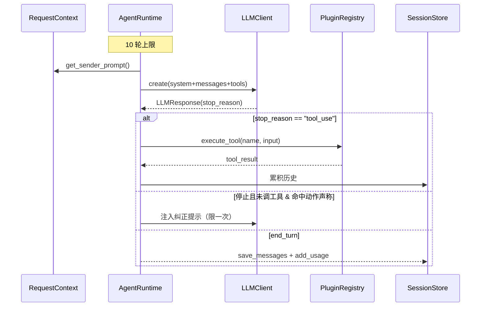

# Agent 主循环与 LLM 编排

OpenVort 的核心是**手写的 Agentic Loop**——不依赖 LangChain 等编排框架，对循环的每个细节（上下文构建、停止条件、防幻觉、错误处理）完全掌控。主实现集中在 `src/openvort/core/engine/agent.py` 的 `AgentRuntime`（真正被 `core/__init__.py` 导出的运行时；`src/openvort/core/agent.py` 是未被 import 的旧版孤本）。

提供三个入口：`process`（IM 非流式）、`process_stream_im`、`process_stream_web`，每个入口都含一段 `max_rounds = 10` 的循环体。

## 主 Agent 循环

`process` 的循环头是 `max_rounds = 10` + token 用量累加 [src/openvort/core/engine/agent.py:205-208]()。10 轮是对"LLM 无限链式调工具"的硬顶，代价是超长多步任务会被截断。

<!-- snippet-base64:ICAgICAgICAjIDQuIEFnZW50aWMgbG9vcAogICAgICAgIG1heF9yb3VuZHMgPSAxMAogICAgICAgIHJlc3BvbnNlID0gTm9uZQogICAgICAgIHRvdGFsX3VzYWdlID0gVXNhZ2UoKQ== -->

每轮唯一判据是模型的 `stop_reason`：为 `tool_use` 则执行工具后继续，否则进入停止/检测分支。`stop_reason` 来自统一的 `LLMResponse` 字段，跨 Provider 归一为 `"tool_use"`/`"end_turn"`。

### 停止条件与空操作检测

停止时并非直接退出——先做**空操作检测** [src/openvort/core/engine/agent.py:262-264]()。若本轮从未调用过工具（`any_tool_called == False`）且回复文本命中"已完成/已创建/已搞定"等动作声称关键词，系统判定模型在"撒谎"（声称做了但没真的调工具），于是注入纠正提示作为 user 消息并 `continue` 强制重试；`correction_injected` 保证一次对话最多纠正一次，避免死循环。

<!-- snippet-base64:ICAgICAgICAgICAgIyDkuI3mmK8gdG9vbF91c2Ug4oCUIOajgOafpeaYr+WQpuiZmuWBh+WujOaIkOWQjue7k+adnwogICAgICAgICAgICBpZiByZXNwb25zZS5zdG9wX3JlYXNvbiAhPSAidG9vbF91c2UiOgogICAgICAgICAgICAgICAgaWYgKG5vdCBhbnlfdG9vbF9jYWxsZWQgYW5kIG5vdCBjb3JyZWN0aW9uX2luamVjdGVk -->

`_ACTION_CLAIMS` 是一组中文完成态关键词 [src/openvort/core/engine/agent.py:1143-1144]()。这是**低成本启发式防幻觉**——用关键词匹配而非 LLM 评估，对中文场景误报/漏报并存但成本最低。它是系统 prompt 铁律"必须通过工具完成"的执行层保证。

<!-- snippet-base64:ICAgIF9BQ1RJT05fQ0xBSU1TID0gKAogICAgICAgICLlt7LlrozmiJAiLCAi5bey5Yib5bu6IiwgIuW3sua3u+WKoCIsICLlt7Lkv67mlLkiLCAi5bey5Yig6ZmkIiwgIuW3suabtOaWsCIs -->

`_detect_empty_action` 在 1300 行、`_text_claims_action` 在 1166 行做子串匹配。

### 上下文构建

system prompt 按**固定顺序在每轮重建**（插件引导状态、工具列表可能跨轮变化），片段顺序即优先级：基础 prompt → 发送者上下文 → **动态时间注入** → 渠道规范 → 操作提示 → 群组 prompt → AI 员工人设 → 插件领域知识 → 插件引导（放最末强调优先）。

其中**动态时间注入**是刻意设计 [src/openvort/core/engine/agent.py:1307-1308]()：LLM 训练数据有截止日期算不出"今天"，必须由程序按配置时区在每次请求注入，AI 才能正确回答"今天/本周/最近"等相对时间问题。

<!-- snippet-base64:ICAgIGRlZiBfYnVpbGRfdGltZV9jb250ZXh0X3Byb21wdChjbHMpIC0+IHN0cjoKICAgICAgICAiIiLmnoTlu7oi5b2T5YmN57O757uf5pe26Ze0IuauteiQve+8jOazqOWFpeWIsCBzeXN0ZW0gcHJvbXB044CC -->

AI 员工人设拼接：`system += f"\n\n# AI 员工人设\n\n{ctx.member.virtual_system_prompt}"`（engine/agent.py:200-202 行）。

### 错误熔断

任何 LLM 调用异常都**不进入下一轮**——立即用 `_extract_error_reason` 构造人性化错误文本，写回历史后直接返回 [src/openvort/core/engine/agent.py:1122-1123]()，避免"错一轮就无限重试"。

<!-- snippet-base64:ICAgIGRlZiBfZXh0cmFjdF9lcnJvcl9yZWFzb24oZTogRXhjZXB0aW9uKSAtPiBzdHI6CiAgICAgICAgIiIiRXh0cmFjdCBhIHVzZXItZnJpZW5kbHkgZXJyb3IgcmVhc29uIGZyb20gYW4gTExNIEFQSSBleGNlcHRpb24uIiIi -->

## LLM 编排与 Failover 链

### Provider 抽象

`LLMProvider` [src/openvort/core/engine/llm.py:94-95]() 把请求格式统一为 **Anthropic 风格**（`system`/`messages`/`tools`/`thinking`），三个具体 Provider（Anthropic / OpenAI-Compatible / OpenAI-Responses）各自内部做格式转换。agent 层只依赖 `llm.py`，永不 import 具体 SDK。

<!-- snippet-base64:Y2xhc3MgTExNUHJvdmlkZXIoQUJDKToKICAgICIiIkxMTSBQcm92aWRlciDmir3osaHln7rnsbsiIiI= -->

### Failover 链

`LLMClient.create()` 接收**整条模型链**（主模型 + fallback，来自 `LLMSettings.get_model_chain()`），按优先级逐个尝试，成功即返回，全失败抛最后的错误 [src/openvort/core/engine/llm.py:897-900]()。

<!-- snippet-base64:ICAgIGFzeW5jIGRlZiBjcmVhdGUoc2VsZiwgKiwgc3lzdGVtOiBzdHIsIG1lc3NhZ2VzOiBsaXN0W2RpY3RdLAogICAgICAgICAgICAgICAgICAgICB0b29sczogbGlzdFtkaWN0XSB8IE5vbmUgPSBOb25lLAogICAgICAgICAgICAgICAgICAgICB0aGlua2luZzogZGljdCB8IE5vbmUgPSBOb25lKSAtPiBMTE1SZXNwb25zZToKICAgICAgICAiIiLosIPnlKggTExN77yI5bimIGZhaWxvdmVy77yJIiIi -->

### 流式 Failover 的边界权衡

流式场景 failover 有天然难点——**握手成功后再中途失败无法回退**（已产出 token）。`_FailoverStreamWrapper` [src/openvort/core/engine/llm.py:826-827]() 只在 `__aenter__`（连接建立）阶段完成切换：逐模型尝试建立连接，成功即锁定；**不解决流中途退化**——这是避免丢弃已流内容的取舍。

<!-- snippet-base64:Y2xhc3MgX0ZhaWxvdmVyU3RyZWFtV3JhcHBlcjoKICAgICIiIldyYXBzIG11bHRpcGxlIG1vZGVsIGNvbmZpZ3MgYW5kIHRyaWVzIGVhY2ggaW4gb3JkZXIgZm9yIHN0cmVhbWluZy4= -->

### Provider 工厂与默认地址

`create_provider` [src/openvort/core/engine/llm.py:801-802]() 依据 provider 名称 + `api_format`（`auto`/`responses`/`chat_completions`）路由；`_default_api_base` 内置 openai/deepseek/moonshot/qwen/zhipu 等默认地址。

<!-- snippet-base64:ZGVmIGNyZWF0ZV9wcm92aWRlcihwcm92aWRlcjogc3RyLCBhcGlfa2V5OiBzdHIsIGFwaV9iYXNlOiBzdHIgPSAiIiwKICAgICAgICAgICAgICAgICAgICB0aW1lb3V0OiBpbnQgPSAxMjAsIGFwaV9mb3JtYXQ6IHN0ciA9ICJhdXRvIikgLT4gTExNUHJvdmlkZXI6 -->

### Anthropic Prompt Caching

`_apply_caching` [src/openvort/core/engine/llm.py:172-173]() 仅对官方 Anthropic 启用：在 system prompt 与最后一个 tool 上加 `cache_control: ephemeral` 断点，让 Agentic loop 跨轮稳定的 system+tools 命中缓存降本提速；只对官方启用是规避第三方 gateway 兼容问题。

<!-- snippet-base64:ICAgIGRlZiBfYXBwbHlfY2FjaGluZyhrd2FyZ3M6IGRpY3QpIC0+IE5vbmU6CiAgICAgICAgIiIiQWRkIGNhY2hlX2NvbnRyb2wgYnJlYWtwb2ludHMgdG8gc3lzdGVtIHByb21wdCBhbmQgdG9vbHMuIiIi -->

### 跨协议消息转换

Agent 内部统一存 Anthropic 消息格式，`_convert_messages` [src/openvort/core/engine/llm.py:366-367]() 在 OpenAI 兼容 Provider 内映射：`tool_result` → `role:tool`（配 `tool_call_id`），`text`+`tool_use` → `content` + `tool_calls`，SDK 差异被彻底隔离。

<!-- snippet-base64:ICAgIGRlZiBfY29udmVydF9tZXNzYWdlcyhzZWxmLCBzeXN0ZW06IHN0ciwgbWVzc2FnZXM6IGxpc3RbZGljdF0sIG1vZGVsOiBzdHIpIC0+IGxpc3RbZGljdF06CiAgICAgICAgIiIi5bCGIEFudGhyb3BpYyDmoLzlvI/mtojmga/ovazkuLogT3BlbkFJIOagvOW8j++8jOW5tuaMieaooeWei+WkhOeQhuWkmuaooeaAgeOAgiIiIg== -->

## 会话管理与上下文容量

`SessionStore` 是内存 + DB 混合：内存 dict 为热路径，未命中才从 DB 恢复（读穿透）[src/openvort/core/engine/session.py:65-66]()。有无 `session_factory` 决定纯内存（CLI 调试）还是 DB 持久化模式。

<!-- snippet-base64:ICAgIGFzeW5jIGRlZiBnZXRfbWVzc2FnZXMoc2VsZiwgY2hhbm5lbDogc3RyLCB1c2VyX2lkOiBzdHIsIHNlc3Npb25faWQ6IHN0ciA9ICJkZWZhdWx0IikgLT4gbGlzdFtkaWN0XToKICAgICAgICAiIiLojrflj5bnlKjmiLfnmoTlr7nor53ljoblj7LvvIjlhoXlrZjkvJjlhYjvvIzmnKrlkb3kuK3liJnku44gREIg5Yqg6L2977yJIiIi -->

### 裁剪保持 tool_use/tool_result 配对

`_trim` [src/openvort/core/engine/session.py:631-634]() 不只取最近 N 条，还**跳过开头的"孤儿消息"**——若开头是 `tool_result` 列表或 `tool_use` 的 assistant 消息就跳过，直到遇到普通纯文本 user 消息。原因是 Claude/OpenAI API 要求 `tool_use` 后必须有配对 `tool_result`，直接截断会破坏配对导致 400。

<!-- snippet-base64:ICAgIGRlZiBfdHJpbShzZWxmLCBzZXNzaW9uOiBTZXNzaW9uKSAtPiBOb25lOgogICAgICAgIG1zZ3MgPSBzZXNzaW9uLm1lc3NhZ2VzCiAgICAgICAgaWYgbGVuKG1zZ3MpIDw9IHNlbGYuX21heF9tZXNzYWdlczoKICAgICAgICAgICAgcmV0dXJu -->

### LLM 压缩

会话过长时 `compact` [src/openvort/core/engine/session.py:242-243]() 用 LLM 把老消息压成摘要，保留最近 N 条原始对话；LLM 摘要失败回退到启发式文本拼接。

<!-- snippet-base64:ICAgIGFzeW5jIGRlZiBjb21wYWN0KHNlbGYsIGNoYW5uZWw6IHN0ciwgdXNlcl9pZDogc3RyLCBsbG1fY2xpZW50PU5vbmUsIGtlZXBfcmVjZW50OiBpbnQgPSAxMCwgc2Vzc2lvbl9pZDogc3RyID0gImRlZmF1bHQiKSAtPiBzdHI6CiAgICAgICAgIiIi5Y6L57yp5Lya6K+d5Y6G5Y+y77ya55SoIExMTSDnlJ/miJDmkZjopoHmm7/mjaLml6fmtojmga/vvIzkv53nlZnmnIDov5EgTiDmnaEiIiI= -->

## 核心链路：Agentic Loop 逐轮时序

Agentic Loop 是最核心的策略循环：构建上下文 → 调 LLM → 依据 stop_reason 决定执行工具或结束，空操作检测在停止路径拦截虚假完成。

## 设计权衡小结

| 决策 | 取舍 |
|------|------|
| 手写 Agentic Loop | 放弃框架生态，换来对停止条件/防幻觉/上下文完全控制 |
| 10 轮硬上限 | 防死循环，但超长多步任务会被截断 |
| 关键词空操作检测 | 低成本，中文场景可接受，但误报/漏报并存 |
| 流式 Failover 仅连接期 | 避免丢弃已流内容，但不覆盖中途退化 |
| 每轮重建 system prompt | 保证插件/工具状态新鲜，代价是重复拼接开销 |
