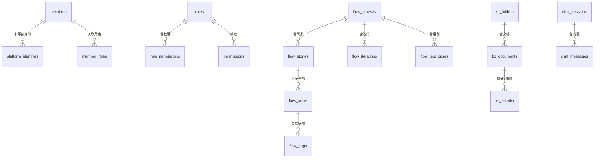

# 数据模型与无 Alembic 自动迁移

OpenVort 有数据存储（PostgreSQL + pgvector），本解读按五要素成文：实体关系 / 存储选型 / 核心表设计 / 演进策略 / 读写路径。

## 存储选型与理由

- **PostgreSQL 17 + pgvector**：既当业务库又当向量库。选 pgvector 而非独立向量数据库（如 Milvus/Qdrant），是因为 OpenVort 的 RAG 知识库体量注定不大，**用同一数据库省去多系统运维与同步**，向量语义检索还能同库 join 业务表。代价：向量搜索能力与性能上限受 PostgreSQL 约束。
- **asyncpg 驱动 + SQLAlchemy 2.0 async**：默认连接串 `postgresql+asyncpg://openvort:...` [src/openvort/config/settings.py:246]()，连接池 `pool_size=20 / max_overflow=40 / pool_pre_ping / pool_recycle=1800` [src/openvort/db/engine.py:73-82]()。

<!-- snippet-base64:ICAgIF9lbmdpbmUgPSBjcmVhdGVfYXN5bmNfZW5naW5lKAogICAgICAgIGRhdGFiYXNlX3VybCwKICAgICAgICBlY2hvPUZhbHNlLAogICAgICAgIHBvb2xfc2l6ZT0yMCwKICAgICAgICBtYXhfb3ZlcmZsb3c9NDAsCiAgICAgICAgcG9vbF9wcmVfcGluZz1UcnVlLAogICAgICAgIHBvb2xfcmVjeWNsZT0xODAwLAogICAgICAgIGNvbm5lY3RfYXJncz17InNzbCI6IEZhbHNlfSwKICAgICkKICAgIF9zZXNzaW9uX2ZhY3RvcnkgPSBhc3luY19zZXNzaW9ubWFrZXIoX2VuZ2luZSwgY2xhc3NfPUFzeW5jU2Vzc2lvbiwgZXhwaXJlX29uX2NvbW1pdD1GYWxzZSk= -->

- **无 Alembic**：迁移完全不走成熟迁移框架，而是 `create_all` + ORM 元数据自动补列 + 少量手写幂等 `DO $$` 块（见演进策略）。这与插件可插拔、动态注册模型的架构强相关——Alembic 的静态迁移脚本难以覆盖运行时动态注册的插件表。

## 实体关系总览

分几组核心领域：**通讯录成员**（真人 + AI 员工同一张表）、**RBAC 权限**、**研发工作流（VortFlow）**、**知识库 RAG**、**系统/会话**。



`members` 是全局中枢：真人用户、AI 员工、通讯录成员统一在 `members` 表，靠 `is_virtual`/`post`/`virtual_system_prompt` 区分（见核心表）。

## 核心表设计

以下每张表给字段要点 + 定义位置。**字段级完整信息请点开源文件 `文件:行号` 复核**，这里只列承载设计的核心字段。

### members 统一成员（真人 + AI 员工）

定义于 [src/openvort/contacts/models.py:21-22]()。核心思路：**真人与 AI 员工不拆表**，用增量字段表达 AI 身份——这是"AI 员工当作团队成员"的数据模型映射。

<!-- snippet-base64:Y2xhc3MgTWVtYmVyKEJhc2UpOgogICAgIiIi5oiQ5ZGYIOKAlCDpgJrorq/lvZXmoLjlv4Plrp7kvZPvvIzku6XkurrkuLrljZXkvY0iIiI= -->

核心字段：`id`(PK) / `name` / `password_hash` / `must_change_password` / `is_account` / `status` + AI 相关 `is_virtual` / `post`（岗位模板标识）/ `virtual_system_prompt`（AI 人设）/ `skills`（JSON 数组）/ `remote_node_id`。

### RBAC 四表

定义于 `src/openvort/auth/models.py`。`Roles` [src/openvort/auth/models.py:16-17]() 等四表（roles/permissions/member_roles/role_permissions），`member_roles`/`role_permissions` 均为复合主键 FK。支持插件扩展（`source = "core" / "plugin_name"`）。

<!-- snippet-base64:Y2xhc3MgUm9sZShCYXNlKToKICAgICIiIuinkuiJsiIiIg== -->

### flow_stories 需求（父子递归 + 多角色 FK）

定义于 [src/openvort/plugins/vortflow/models.py:36-37]()，是工作流最复杂的表：五个成员角色 FK（submitter/assignee/pm/designer/reviewer）+ `parent_id` 自我递归 + 多 JSON 数组列。

<!-- snippet-base64:Y2xhc3MgRmxvd1N0b3J5KEJhc2UpOgogICAgIiIi6ZyA5rGCIiIi -->

### kb_documents / kb_chunks（RAG 知识库）

`KBChunk` [src/openvort/plugins/knowledge/models.py:55-56]() 含 `embedding = Vector(1024)`（`pgvector.sqlalchemy.Vector`）[src/openvort/plugins/knowledge/models.py:6]()：

<!-- snippet-base64:Y2xhc3MgS0JDaHVuayhCYXNlKToKICAgICIiIktub3dsZWRnZSBiYXNlIGRvY3VtZW50IGNodW5rIHdpdGggZW1iZWRkaW5nIHZlY3Rvci4iIiI= -->

检索用 `<->` 余弦距离算子并 `ORDER BY distance ASC` [src/openvort/plugins/knowledge/retriever.py:60-64]()，这正是选 pgvector 的直接收益——向量与业务表同库 join。

<!-- snippet-base64:ICAgICAgICAgICAgIyBwZ3ZlY3RvciBjb3NpbmUgZGlzdGFuY2U6IDEgLSBjb3NpbmVfc2ltaWxhcml0eQogICAgICAgICAgICAjIExvd2VyIGRpc3RhbmNlID0gbW9yZSBzaW1pbGFyLCBzbyB3ZSBPUkRFUiBCWSBkaXN0YW5jZSBBU0MKICAgICAgICAgICAgc3RtdCA9IHRleHQoIiIiCiAgICAgICAgICAgICAgICBTRUxFQ1QgYy5pZCwgYy5kb2N1bWVudF9pZCwgYy5jaHVua19pbmRleCwgYy5jb250ZW50LAogICAgICAgICAgICAgICAgICAgICAgIGMuZW1iZWRkaW5nIDw9PiA6cXVlcnlfdmVjIEFTIGRpc3RhbmNlLA== -->

### 会话与异步任务（系统表）

| 表名 | 定义位置 | 职责 |
|------|----------|------|
| `chat_sessions` / `chat_messages` | `db/models.py:64 / :306` | Web 多会话聊天 |
| `agent_tasks` | `db/models.py:343` | Agent 异步任务（SSE 解耦）|
| `message_logs` / `im_inbox` | `db/models.py:20 / :383` | IM 消息日志与幂等 |
| `schedule_jobs` | `db/models.py:99` | 定时任务 |
| `remote_nodes` | `db/models.py:251` | 远程工作节点 |
| `report_publications`/`reports` | `plugins/report/models.py:25 / :138` | 汇报发布与实例 |

`ChatSession` 定义于 [src/openvort/db/models.py:64]()。

<!-- snippet-base64:Y2xhc3MgQ2hhdFNlc3Npb24oQmFzZSk6 -->

## Schema 演进策略：无 Alembic 的三板斧

全部集中在 `src/openvort/db/engine.py`。

### 机制一：`create_all` 建缺失表

`Base.metadata.create_all` 只建不存在的表，不更新已有表列；pgvector 不可用时主动剔除 `kb_chunks` 表 [src/openvort/db/engine.py:93-97]()。依赖启动时 import 全部 ORM 模型注册进 metadata（插件模型包 `try/except ImportError`）。

<!-- snippet-base64:ICAgIGFzeW5jIHdpdGggX2VuZ2luZS5iZWdpbigpIGFzIGNvbm46CiAgICAgICAgdGFibGVzID0gQmFzZS5tZXRhZGF0YS5zb3J0ZWRfdGFibGVzCiAgICAgICAgaWYgbm90IF9wZ3ZlY3Rvcl9hdmFpbGFibGU6CiAgICAgICAgICAgIHRhYmxlcyA9IFt0IGZvciB0IGluIHRhYmxlcyBpZiB0Lm5hbWUgIT0gImtiX2NodW5rcyJdCiAgICAgICAgYXdhaXQgY29ubi5ydW5fc3luYyhCYXNlLm1ldGFkYXRhLmNyZWF0ZV9hbGwsIHRhYmxlcz10YWJsZXMp -->

### 机制二（核心）：ORM 元数据自动补列

`_sync_missing_columns` [src/openvort/db/engine.py:993-995]() 遍历 metadata 所有表，用 `inspector.get_columns` 对比已存在列，对缺失列执行 `ALTER TABLE ... ADD COLUMN IF NOT EXISTS`。**演进安全三个内建保证**：`IF NOT EXISTS` 幂等；非空列必须配默认值（数据库拒绝给老行补无默认非空列）；仅追加列，不做改名/删除/类型变更。

<!-- snippet-base64:ICAgICAgICBkZWYgX3N5bmNfbWlzc2luZ19jb2x1bW5zKGNvbm5lY3Rpb24pOgogICAgICAgICAgICBpbnNwZWN0b3IgPSBzYV9pbnNwZWN0KGNvbm5lY3Rpb24pCiAgICAgICAgICAgIGV4aXN0aW5nX3RhYmxlcyA9IHNldChpbnNwZWN0b3IuZ2V0X3RhYmxlX25hbWVzKCkp -->

### 机制三：面向存量生产库的手写幂等 `DO $$` 块

对列改名、删列带数据回填等复杂变更，用 `information_schema` 探查 + 条件执行。代表：`openclaw_nodes` → `remote_nodes` 表重命名（engine.py:100-112）、`members.openclaw_node_id` → `remote_node_id` 带数据拷贝删列（engine.py:156-172）、条件加列（`EXCEPTION WHEN duplicate_column`，engine.py:659,671）、一次性业务数据迁移（engine.py:757,933）。

### pgvector 探测（优雅降级）

启动时 `CREATE EXTENSION IF NOT EXISTS vector`，失败则降级（知识库向量不可用但不影响核心业务）[src/openvort/db/engine.py:84-91]()。

<!-- snippet-base64:ICAgICMgRW5hYmxlIHBndmVjdG9yIGV4dGVuc2lvbiBmb3Iga25vd2xlZGdlIGJhc2UgKG9wdGlvbmFsIOKAlCBza2lwIGlmIG5vdCBpbnN0YWxsZWQgb24gc2VydmVyKQogICAgX3BndmVjdG9yX2F2YWlsYWJsZSA9IEZhbHNlCiAgICB0cnk6CiAgICAgICAgYXN5bmMgd2l0aCBfZW5naW5lLmJlZ2luKCkgYXMgY29ubjoKICAgICAgICAgICAgYXdhaXQgY29ubi5leGVjdXRlKHRleHQoIkNSRUFURSBFWFRFTlNJT04gSUYgTk9UIEVYSVNUUyB2ZWN0b3IiKSkKICAgICAgICBfcGd2ZWN0b3JfYXZhaWxhYmxlID0gVHJ1ZQogICAgZXhjZXB0IEV4Y2VwdGlvbiBhcyBlOgogICAgICAgIGxvZy53YXJuaW5nKGYicGd2ZWN0b3Ig5omp5bGV5LiN5Y+v55So77yM55+l6K+G5bqT5ZCR6YeP5qOA57Si5Yqf6IO95bCG5LiN5Y+v55SoOiB7ZX0iKQ== -->

### 演进策略总结

| 迁移类型 | 做法 | 位置 |
|---|---|---|
| 建表 | `metadata.create_all`（仅缺表）| engine.py:97 |
| 加列（通用）| ORM 元数据自动 `ADD COLUMN IF NOT EXISTS` | engine.py:993-1020 |
| 加列（手写）| `DO $$ ... EXCEPTION duplicate_column` | engine.py:659,671 |
| 重命名表/列 | `DO $$ ... information_schema` 条件块 | engine.py:105,159 |
| 删列+回填 | 条件 UPDATE 后 DROP COLUMN | engine.py:166-169 |
| 业务数据迁移 | 一次性幂等 UPDATE | engine.py:757,933 |

**权衡**：这套方案契合"配置即模型"的插件架构（插件动态加表加列，静态 Alembic 脚本难以覆盖），换取研发迭代速度；代价是**迁移无版本号、无有序脚本**，列改名/删列/类型变更依赖手写且靠幂等而非版本管理，多实例并发升级、跨大版本演进需人为保证安全。

## 读写路径

**知识库写入→检索链路**：文档上传 → `kb_documents` 落库 → 分块写 `kb_chunks` 并生成 `embedding=Vector(1024)` → 检索时 `<->` 余弦距离排序取 top-k → 注入 Agent 上下文。pgvector 的收益是向量可与 `kb_documents` 过滤条件同库 join（见上面 `retriever.py` 引用）。

**聊天会话链路**：`chat_messages` 由 SessionStore 写入（内存热路径 + DB 持久化），`agent_tasks` 承载 SSE 解耦的后台 Agent 执行，完成后经 `notifications` 通知。

```
用户消息 → MessageDispatcher(内存去抖) → AgentRuntime.AgenticLoop
         → SessionStore.save_messages(内存+DB)
         → agent_tasks(async) → 完成 → notifications → Web SSE 推送给用户
```

## 设计权衡小结

| 决策 | 取舍 |
|------|------|
| 真人/AI 员工同一张表 | 统一身份管理、通讯录天然含 AI；代价是 `is_virtual` 分支散落 |
| pgvector 同库向量 | 省运维、可 join；代价是向量性能上限受 PostgreSQL 约束 |
| 无 Alembic 自动补列 | 契合插件动态模型、迭代快；代价是无迁移版本、破坏性变更靠手写 |
| JSON 数组列（tags/collaborators）| 避免大量继承表；代价是 JSON 列无强类型约束 |
