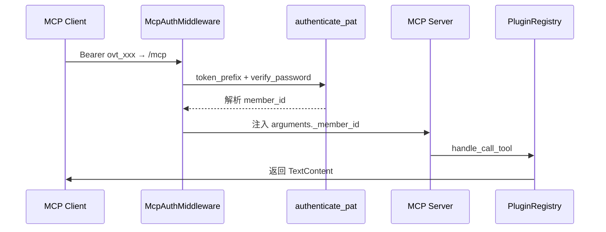

# MCP Server 集成与认证

OpenVort 把内部插件工具通过 MCP（Model Context Protocol）暴露给 Cursor / Claude Desktop 等外部客户端。实现上有三个值得深读的点：**单维度只暴露 tools**、**认证中间件用改写请求体解决 contextvars 穿透**、**PAT 令牌验证**。

## 承载形态：Streamable HTTP + ASGI Mount

MCP Server 用 FastMCP 的 `stateless_http=True` + `streamable_http_path="/"` 配置，在 FastAPI 应用工厂里作为 ASGI sub-app **Mount 到 `/mcp`**，外包裹认证中间件，并手动启 session manager（因为 Starlette sub-app lifespan 不自动触发）[src/openvort/web/app.py:64-68]()：

<!-- snippet-base64:ICAgICAgICByZWdpc3RyeSA9IF9nZXRfcmVnKCkKICAgICAgICBtY3AgPSBjcmVhdGVfbWNwX3NlcnZlcihyZWdpc3RyeSkKICAgICAgICBtY3BfYXNnaSA9IE1jcEF1dGhNaWRkbGV3YXJlKG1jcC5zdHJlYW1hYmxlX2h0dHBfYXBwKCkpCgogICAgICAgIEBhc3luY2NvbnRleHRtYW5hZ2Vy -->

## 只暴露 tools 维度的边界

MCP 三元协议（tools/resources/prompts）中，本实现**只暴露 tools**。全仓库 `list_resources`/`list_prompts` 均无实现（经代码检索证实）。`handle_list_tools` [src/openvort/web/mcp_server.py:76-77]() 直接读 `registry.list_tools()` 并复用每个 `BaseTool` 的 `input_schema()`，因此"插件工具"零成本变成"MCP 工具"：

<!-- snippet-base64:ICAgIGFzeW5jIGRlZiBoYW5kbGVfbGlzdF90b29scygpIC0+IGxpc3RbdHlwZXMuVG9vbF06CiAgICAgICAgdG9vbHMgPSBbXQ== -->

```python
    @low.list_tools()
    async def handle_list_tools() -> list[types.Tool]:
        tools = []
        for t in registry.list_tools():
            if not _should_expose(t.name):
                continue
            tools.append(types.Tool(name=t.name, ...))
```

`handle_call_tool` [src/openvort/web/mcp_server.py:90-91]() 复用同一 registry 的 `get_tool` 并执行。**注意**：plugin 的领域知识 prompt（`register_prompt`）与通讯录资源不会经 MCP 暴露——MCP 只映射 `BaseTool` 这一维度。

<!-- snippet-base64:ICAgIGFzeW5jIGRlZiBoYW5kbGVfY2FsbF90b29sKG5hbWU6IHN0ciwgYXJndW1lbnRzOiBkaWN0KSAtPiBsaXN0W3R5cGVzLlRleHRDb250ZW50XToKICAgICAgICB0b29sID0gcmVnaXN0cnkuZ2V0X3Rvb2wobmFtZSk= -->

**Why 不暴露 resources/prompts**：这是刻意取舍。MCP 定位为"给外部代码工具用"，把 Agent 的知识注入留给内部 system prompt 链路（见 `plugin-system.md` 双轨注入），避免把面向 Agent prompt 的上下文外泄成 MCP prompts。

### 工具黑名单

`EXCLUDED_TOOL_PREFIXES` [src/openvort/web/mcp_server.py:20-22]() 过滤 `sessions_`/`send_wecom_` 等带内部副作用的工具，防止外部客户端触发非工具语义的操作。

<!-- snippet-base64:RVhDTFVERURfVE9PTF9QUkVGSVhFUyA9ICgKICAgICJzZXNzaW9uc18iLAogICAgInNlbmRfd2Vjb21fIiw= -->

## 认证中间件的 contextvars 穿透技巧

MCP 库在后台 anyio 任务里处理 `call_tool`，**contextvars 不可见**——在 ASGI 中间件里 `contextvars.set` 的值到 `call_tool` handler 时读不到 [src/openvort/web/mcp_server.py:115-117]()。解法是**直接改写 JSON-RPC 请求体**，在消息到达 MCP 应用前把 `_member_id` 注入进 `tools/call` 的 `arguments`（请求体解析于 161-163 行）：

<!-- snippet-base64:Y2xhc3MgTWNwQXV0aE1pZGRsZXdhcmU6CiAgICAiIiJBU0dJIG1pZGRsZXdhcmUgdGhhdCByZXNvbHZlcyBNQ1AgY2FsbGVyIGlkZW50aXR5IGFuZCBpbmplY3RzIF9tZW1iZXJfaWQKICAgIGRpcmVjdGx5IGludG8gdG9vbHMvY2FsbCBhcmd1bWVudHMu -->

```python
            raw = b"".join(body_chunks)
            try:
                data = _json.loads(raw)     # 161-163
                if isinstance(data, dict) and data.get("method") == "tools/call":
                    params = data.get("params")
                    if isinstance(params, dict):
                        if "arguments" not in params:
                            params["arguments"] = {}
                        params["arguments"]["_member_id"] = member_id
```

这正是 Agent 主循环里 `tool_input["_member_id"]`（见 `agent-loop.md`）的同一套下划线系统字段——插件工具读 `params["_member_id"]` 即可识别操作者身份。这实现了**跨层身份透传**：MCP 外部调用者与内部 Agent 走同一条身份注入通道。

<!-- snippet-base64:ICAgICAgICAgICAgcmF3ID0gYiIiLmpvaW4oYm9keV9jaHVua3MpCiAgICAgICAgICAgIHRyeToKICAgICAgICAgICAgICAgIGRhdGEgPSBfanNvbi5sb2FkcyhyYXcp -->

## PAT 令牌认证

访客身份来自 `authenticate_pat` [src/openvort/web/mcp_auth.py:20-21]()：Bearer Token 前缀 `ovt_` → 用 token 前 8 位索引查 `personal_access_tokens` 表的 `token_prefix` → `verify_password` 逐候选校验 → 查活跃 Member → 拼 roles/platform_accounts/department 构建 RequestContext。

<!-- snippet-base64:YXN5bmMgZGVmIGF1dGhlbnRpY2F0ZV9wYXQodG9rZW46IHN0cikgLT4gZGljdCB8IE5vbmU6CiAgICAiIiJWYWxpZGF0ZSBhIFBBVCBhbmQgcmV0dXJuIG1lbWJlciBpbmZvLCBvciBOb25lIGlmIGludmFsaWQu -->

用 `token_prefix`（前 8 位）做 DB 索引定位，避免把完整哈希放进查询条件（哈希不可直接匹配），再 `verify_password` 在候选里确认——这是"索引前缀 + 逐候选验密"的典型 PAT 设计。

**身份解析优先级**：`resolve_mcp_identity` [src/openvort/web/mcp_auth.py:149-150]()——Bearer PAT 优先，无则回退 `allow_anonymous_localhost` 解析配置的匿名成员。

<!-- snippet-base64:YXN5bmMgZGVmIHJlc29sdmVfbWNwX2lkZW50aXR5KGF1dGhvcml6YXRpb246IHN0ciB8IE5vbmUsIGNsaWVudF9ob3N0OiBzdHIgfCBOb25lID0gTm9uZSkgLT4gZGljdCB8IE5vbmU6CiAgICAiIiJSZXNvbHZlIE1DUCBjYWxsZXIgaWRlbnRpdHkgZnJvbSB0aGUgcmVxdWVzdC4= -->

## 核心链路：MCP 调用经认证注入

外部 MCP 客户端调用工具时，认证中间件改写请求体透传 `_member_id`，插件工具据此识别操作者。



## 设计权衡小结

| 决策 | 取舍 |
|------|------|
| 只暴露 tools | 收敛边界、不外泄 Agent 知识；代价是 MCP 能力单维 |
| 改写请求体注入身份 | 绕开 contextvars 穿透；代价是侵入请求管线、需解析 JSON |
| token_prefix 索引 + 验密 | 高效定位且不泄完整哈希；代价是多存储前缀字段 |
| ASGI Mount `/mcp` | 与 FastAPI 同生命周期；代价是需手动管理 sub-app lifespan/session |
