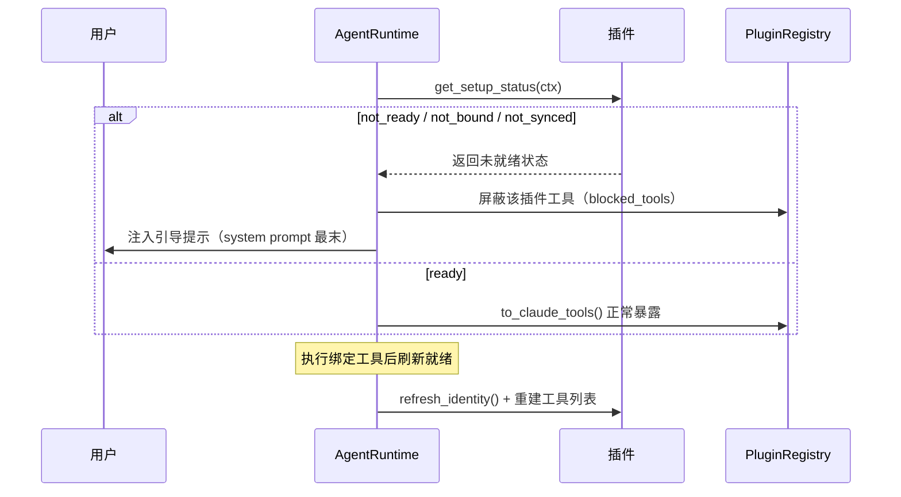

# 插件框架设计与 Slot 契约

OpenVort 的插件系统是它最大的工程亮点。它优于普通项目的地方不是有多复杂的 SPI，而是**职责边界划分得干净**：插件被拆成三个正交维度（Channel / Plugin / Tool），并用 Python `Protocol`（Slot）做模块间契约反转。

## 三个正交抽象

`src/openvort/plugin/base.py` 定义五大抽象：`Message`、`BaseChannel`、`BaseTool`、`BasePlugin`、`BaseAPI`。核心三件套：

| 抽象 | 职责 | 关键方法 |
|------|------|----------|
| `BaseChannel` | IM 通道适配 | `start()/stop()/send()/on_message()` + 可选能力钩子 |
| `BaseTool` | AI 可调用原子工具 | `input_schema()/execute()/to_claude_tool()` |
| `BasePlugin` | 领域容器（Tool+Prompt+Config） | `activate()/get_tools()/get_prompts()/get_api_router()` |

`BaseChannel` [src/openvort/plugin/base.py:40-41]() 由四通道（企微/飞书/钉钉/OpenClaw）继承。除核心三抽象（`start`/`send`/`on_message`）外有**可选能力钩子**：`get_channel_prompt()`（渠道回复风格）、`get_tool_filter()`（该渠道允许的 Tool 白名单）、`get_max_reply_length()`（回复长度上限）——同一 AI 在不同渠道表现出不同行为约束。

<!-- snippet-base64:Y2xhc3MgQmFzZUNoYW5uZWwoQUJDKToKICAgICIiIklNIOmAmumBk+mAgumFjeWZqOWfuuexuw== -->

`BaseTool` [src/openvort/plugin/base.py:170-171]() 极精简：三个类属性 `name/description/required_permission` + 两个抽象 + `to_claude_tool()` 转换器输出标准结构 `{name, description, input_schema}`。

<!-- snippet-base64:Y2xhc3MgQmFzZVRvb2woQUJDKToKICAgICIiIkFJIOW3peWFt+Wfuuexuw== -->

### BasePlugin 双轨激活

`BasePlugin` [src/openvort/plugin/base.py:203-204]() 是"Tool + Prompt + Config 的容器"。

<!-- snippet-base64:Y2xhc3MgQmFzZVBsdWdpbihBQkMpOgogICAgIiIi5o+S5Lu25Z+657G7IOKAlCBQbHVnaW4g5pivIFRvb2wgKyBQcm9tcHQgKyBDb25maWcg55qE5a655Zmo -->

其 `activate()` 提供**双轨机制** [src/openvort/plugin/base.py:223-224]()：新插件直接覆盖它并用 `PluginAPI` 注册工具/prompt/slot；旧插件靠默认实现委托给 `get_tools()`/`get_prompts()` 向后兼容。

<!-- snippet-base64:ICAgIGRlZiBhY3RpdmF0ZShzZWxmLCBhcGk6ICJQbHVnaW5BUEkiKSAtPiBOb25lOgogICAgICAgICIiIlJlZ2lzdGVyIGFsbCBjYXBhYmlsaXRpZXMgdmlhIHRoZSBQbHVnaW5BUEku -->

**凭证校验门禁**：`validate_credentials()` 返回 False 时插件不会被加载，其 Tools/Prompts 不注册 [src/openvort/plugin/base.py:249-250]()。

<!-- snippet-base64:ICAgIGRlZiB2YWxpZGF0ZV9jcmVkZW50aWFscyhzZWxmKSAtPiBib29sOgogICAgICAgICIiIuagoemqjOaPkuS7tuWHreivgS/phY3nva7mmK/lkKbmnInmlYjvvIjlj6/pgInvvIk= -->

**引导状态**：`get_setup_status(ctx)` 返回 `"ready"`/`"not_synced"`/`"not_bound"`，配合 `get_onboarding_prompt` 注入 system prompt 实现"插件装了但没配好 → Agent 引导用户配置"而非直接报错 [src/openvort/plugin/base.py:339-340]()。

<!-- snippet-base64:ICAgIGFzeW5jIGRlZiBnZXRfc2V0dXBfc3RhdHVzKHNlbGYsIGN0eDogQW55KSAtPiBzdHI6CiAgICAgICAgIiIi5qOA5p+l5o+S5Lu25a+55b2T5YmN55So5oi355qE5bCx57uq54q25oCB -->

## 三件套分工：Registry / API / Loader

- **PluginRegistry**（`plugin/registry.py`）——受控容器，存工具/prompt/slot/插件。
- **PluginAPI**（`plugin/api.py`）——受控门面，插件唯一接触的宿主 Facade。
- **PluginLoader**（`plugin/loader.py`）——装配工厂，负责发现与实例化。

### Registry：单一出口 `to_claude_tools`

`to_claude_tools` [src/openvort/plugin/registry.py:137-138]() 是 MCP 侧与 Agent 侧**共享的出口**，做渠道过滤 + 权限过滤，把内部 `BaseTool` 统一转成 Claude tool use 结构；当 `permissions` 传入时，`required_permission` 的工具仅在拥有对应权限时暴露。

<!-- snippet-base64:ICAgIGRlZiB0b19jbGF1ZGVfdG9vbHMoCiAgICAgICAgc2VsZiw= -->

Prompt 注入按来源分节：`register_prompt` 带 source [src/openvort/plugin/registry.py:162-163]()。

<!-- snippet-base64:ICAgIGRlZiByZWdpc3Rlcl9wcm9tcHQoc2VsZiwgcHJvbXB0OiBzdHIsIHNvdXJjZTogc3RyID0gIiIpIC0+IE5vbmU6CiAgICAgICAgIiIi5rOo5YaM5LiA5p2h6aKG5Z+f55+l6K+GIHByb21wdO+8iOW4puadpea6kOagh+iusO+8iSIiIg== -->

`get_system_prompt_extension` 把插件知识与 skill 拼成 `## 插件能力` / `## 技能知识` 两节 [src/openvort/plugin/registry.py:170-171]()。

<!-- snippet-base64:ICAgIGRlZiBnZXRfc3lzdGVtX3Byb21wdF9leHRlbnNpb24oc2VsZikgLT4gc3RyOgogICAgICAgICIiIuaLvOaOpeaJgOaciemihuWfn+efpeivhu+8jOaMieadpea6kOWIhuiKgui+k+WHuiIiIg== -->

### API：插件门面

`PluginAPI.emit` [src/openvort/plugin/api.py:55-56]() 用 `loop.create_task` 实现 fire-and-forget 事件发射（不在当前协程 await，避免阻塞插件回调）。

<!-- snippet-base64:ICAgIGRlZiBlbWl0KHNlbGYsIGV2ZW50OiBzdHIsIGRhdGE6IGRpY3QgfCBOb25lID0gTm9uZSkgLT4gTm9uZToKICAgICAgICAiIiJGaXJlLWFuZC1mb3JnZXQgZXZlbnQgZW1pc3Npb24gKHNjaGVkdWxlcyBjb3JvdXRpbmUpLiIiIg== -->

### Loader：四种发现来源

`PluginLoader._load_plugins` [src/openvort/plugin/loader.py:96-97]() 从 `entry_points`（`openvort.plugins` 组）发现插件，判定 `module` 是否 `openvort.` 前缀区分内置/pip，然后 `validate_credentials()` 门禁 → `activate(api)`。另有本地目录、`_load_manifest_plugin`（`manifest.json + SKILL.md` 无代码纯 prompt 插件）、IM 通道三种来源。

<!-- snippet-base64:ICAgIGRlZiBfbG9hZF9wbHVnaW5zKHNlbGYpIC0+IE5vbmU6CiAgICAgICAgIiIi5LuOIGVudHJ5X3BvaW50cyDliqDovb0gUGx1Z2lu77yI6Ieq5Yqo5rOo5YaM5YW2IFRvb2xzIOWSjCBQcm9tcHRz77yJIiIi -->

## Slot Protocol：排他能力契约

Slot 是**排他性**能力提供者——一个 slot 只能被一个插件注册，消费者通过 Protocol 读取数据而无需 import 具体实现。`ProjectProvider` [src/openvort/plugin/slots.py:47-48]() 用 `@runtime_checkable` 支持鸭子类型校验：

<!-- snippet-base64:Y2xhc3MgUHJvamVjdFByb3ZpZGVyKFByb3RvY29sKToKICAgICIiIlNsb3Q6IHByb2plY3RfcHJvdmlkZXIg4oCUIHByb2plY3QgLyBzdG9yeSAvIHRhc2sgLyBidWcgZGF0YS4iIiI= -->

```python
@runtime_checkable
class ProjectProvider(Protocol):
    """Slot: project_provider — project / story / task / bug data."""
    async def list_projects(self, member_id: str = "") -> list[ProjectInfo]: ...
```

**Why**：core 定义 `ProjectProvider` 接口，插件侧实现（如 `VortFlowProjectProvider`），core 绝不 import 具体插件——正向依赖反转。VortFlow 插件在 `activate()` 里同时走旧式 `get_tools()` 和新增的 `register_slot` 双轨并存 [src/openvort/plugins/vortflow/plugin.py:60-61]()。

<!-- snippet-base64:ICAgIGRlZiBhY3RpdmF0ZShzZWxmLCBhcGk6ICJQbHVnaW5BUEkiKSAtPiBOb25lOgogICAgICAgIHN1cGVyKCkuYWN0aXZhdGUoYXBpKQ== -->

## 插件引导流程（Bootstrapping）

引导是 OpenVort 企业 UX 的关键。核心机制：启动时从 DB 加载配置与禁用状态；运行时 Agent 对未就绪插件屏蔽其工具，并把引导提示注入 system prompt（放片段最末强调"优先处理"）。

更深的一层：当用户执行了**会改变身份就绪状态的工具**（如通讯录同步/身份绑定）后，主循环会在同一轮内 `ctx.refresh_identity()` 并重建工具列表——使插件从"未就绪"变"就绪"后，工具**立即**能被下一轮使用，无需用户重新发消息 [src/openvort/core/engine/agent.py:331-333]()。

<!-- snippet-base64:ICAgICAgICAgICAgaWYgbmVlZF9yZWZyZXNoX3Rvb2xzIGFuZCBibG9ja2VkX3Rvb2xzOgogICAgICAgICAgICAgICAgYXdhaXQgY3R4LnJlZnJlc2hfaWRlbnRpdHkoKQogICAgICAgICAgICAgICAgYmxvY2tlZF90b29scy5jbGVhcigp -->

## 插件的三层发挥

`BasePlugin` 一个对象能在三个层次发挥作用：

- **AI 层**：`get_tools()` 注入 AI 可调用工具，`get_prompts()` 注入 Agent 知识 prompt。
- **API 层**：`get_api_router()` 返回 FastAPI sub-router，由宿主挂载，Web 管理端直接调用。
- **UI 层**：`get_config_schema()` 返回 JSON Schema，前端自动渲染配置表单；`get_personal_config_schema()` 支持个人级配置（绑定个人账号如 GitHub Token）。

## 核心链路：插件引导（Bootstrapping）

插件未就绪时屏蔽工具并注入引导 prompt，执行改变身份状态的工具后在循环内刷新就绪并立即启用工具。



## 设计权衡小结

| 决策 | 取舍 |
|------|------|
| Protocol Slot 优于继承 | core 与插件解耦、方向反转，代价是接口分散于 Protocol |
| Slot 唯一提供者 | 避免冲突，但同名 slot 并发安装需抉择 |
| 双轨 activate | 新旧插件兼容，代价是 API 演进并存增加心智负担 |
| 引导而非报错 | UX 更好，代价是启动/运行时多一次就绪扫描 |
