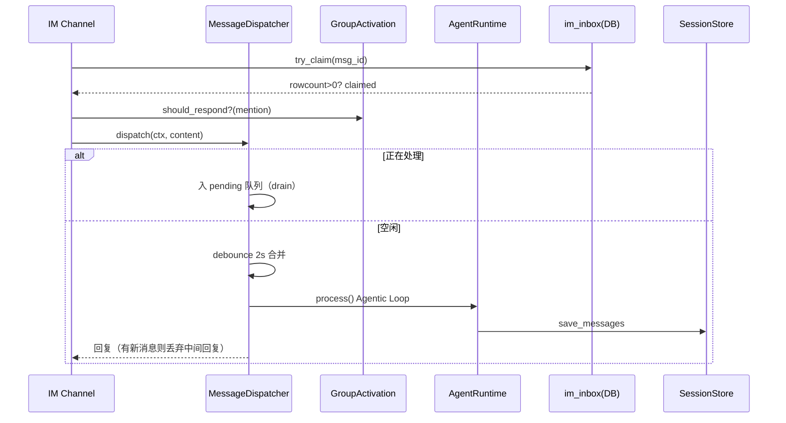

# 消息分发状态机、群聊激活与 IM 通道

IM 场景是 OpenVort 最独特的运行约束：用户连续发消息、群聊 @ 触发、跨实例重复投递。本文把 `MessageDispatcher`（防重复回复）、`GroupActivation`（群聊策略）、`BaseChannel`（通道适配）与 PostgreSQL `im_inbox`（跨实例幂等）串成完整链路。

## 消息分发状态机（Debounce + 排空）

设计目标写在 docstring：**per-user 处理锁 + 消息队列 + 中间回复丢弃**，解决 IM 连续消息重复回复。核心四状态：

```
idle ──收到消息──→ debounce ──超时 2s──→ processing
               ↑                        │
               │      收到新消息         │
               ├────────────────────────→ drain
               │                        │
               └── 处理完毕 ────────────→ idle
```

状态数据用 `defaultdict` 按 `user_key="{channel}:{user_id}"` 分组 [src/openvort/core/messaging/dispatcher.py:40-41]()，关键字段：`_locks`（per-user 锁）、`_pending`（待处理队列）、`_processing`（处理中集合）、`_debounce_tasks`（去抖定时器）。

<!-- snippet-base64:ICAgICAgICBzZWxmLl9sb2NrczogZGljdFtzdHIsIGFzeW5jaW8uTG9ja10gPSBkZWZhdWx0ZGljdChhc3luY2lvLkxvY2spCiAgICAgICAgc2VsZi5fcGVuZGluZzogZGljdFtzdHIsIGxpc3Rbc3RyXV0gPSBkZWZhdWx0ZGljdChsaXN0KQ== -->

`user_key` 是 `f"{ctx.channel}:{ctx.user_id}"` [src/openvort/core/messaging/dispatcher.py:63-63]()，是后续所有分组状态的索引入口。

<!-- snippet-base64:ICAgICAgICB1c2VyX2tleSA9IGYie2N0eC5jaGFubmVsfTp7Y3R4LnVzZXJfaWR9Ig== -->

### debounce：合并连续消息

`dispatch` [src/openvort/core/messaging/dispatcher.py:51-53]() 若该用户正在处理中，消息直接入 `_pending` 并累积图片；否则入队后**重置 debounce 定时器**（每次新消息 `cancel()` 再新建 Task），等 2s 停顿后合并处理。2s 是把"打字停顿期"连续消息合并成一堆再统一处理，是省调用 vs 及时性的折中。

<!-- snippet-base64:ICAgIGFzeW5jIGRlZiBkaXNwYXRjaCgKICAgICAgICBzZWxmLAogICAgICAgIGN0eDogUmVxdWVzdENvbnRleHQs -->

`_debounce_then_process` [src/openvort/core/messaging/dispatcher.py:99-100]() 先 `asyncio.sleep(self._debounce)`，被取消则跳过（新消息重置）。

<!-- snippet-base64:ICAgIGFzeW5jIGRlZiBfZGVib3VuY2VfdGhlbl9wcm9jZXNzKAogICAgICAgIHNlbGYs -->

### processing：per-user 串行化

debounce 到点后在 `_locks[user_key]` 锁内处理 [src/openvort/core/messaging/dispatcher.py:123-124]()。**不同用户各自独立 lock 互不阻塞**，同用户串行化；Lock 只包处理段、不包 debounce 等待段。

<!-- snippet-base64:ICAgICAgICBsb2NrID0gc2VsZi5fbG9ja3NbdXNlcl9rZXldCiAgICAgICAgYXN5bmMgd2l0aCBsb2NrOg== -->

### drain：丢弃过时中间回复

`_process_with_drain` [src/openvort/core/messaging/dispatcher.py:136-137]() 处理完当前批后，在处理返回前**再查一次 `_pending`**：有新消息就丢弃刚算出的中间回复继续循环（162-163 行）。用户不停说话时 Agent 不会对着过时上下文抢答，代价是中间那次 LLM 调用白耗。`max_pending=10` + `lock_timeout=60s` 兜底防失控。

<!-- snippet-base64:ICAgIGFzeW5jIGRlZiBfcHJvY2Vzc193aXRoX2RyYWluKAogICAgICAgIHNlbGYs -->

```python
            # 检查处理期间是否有新消息入队
            if not self._pending.get(user_key):      # 162-163
                return reply
            # 有新消息，丢弃当前回复继续处理
```

<!-- snippet-base64:ICAgICAgICAgICAgaWYgbm90IHNlbGYuX3BlbmRpbmcuZ2V0KHVzZXJfa2V5KToKICAgICAgICAgICAgICAgIHJldHVybiByZXBseQ== -->

## 群聊响应策略（GroupActivation）

群聊何时响应由 `GroupActivation.should_respond` 决定 [src/openvort/core/messaging/group.py:38-39]():模式 `mention`（默认）/`always`，只在"always"或"被 @ 提及"时响应。

<!-- snippet-base64:ICAgIGRlZiBzaG91bGRfcmVzcG9uZChzZWxmLCBncm91cF9pZDogc3RyLCBjb250ZW50OiBzdHIsIGlzX21lbnRpb25lZDogYm9vbCkgLT4gYm9vbDoKICAgICAgICAiIiLliKTmlq3mmK/lkKblupTor6Xlk43lupTnvqTogYrmtojmga8= -->

`get_mode` 决定模式优先级：**运行时覆盖 > 配置覆盖 > 全局默认** [src/openvort/core/messaging/group.py:60-61]()。

<!-- snippet-base64:ICAgIGRlZiBnZXRfbW9kZShzZWxmLCBncm91cF9pZDogc3RyKSAtPiBzdHI6CiAgICAgICAgIiIi6I635Y+W5oyH5a6a576k57uE55qE5r+A5rS75qih5byPIiIi -->

## IM 通道适配（BaseChannel）

统一消息模型 `Message` [src/openvort/plugin/base.py:19-21]()：`content/sender_id/channel/msg_type/images/voice_media_ids/raw`，天然支持文本/图片/语音多模态。四通道统一继承 `plugin/base.py` 的 `BaseChannel`（见 plugin-system.md）。

<!-- snippet-base64:QGRhdGFjbGFzcwpjbGFzcyBNZXNzYWdlOgogICAgIiIi57uf5LiA5raI5oGv5qC85byP77yM6LeoIENoYW5uZWwg6YCa55SoIiIi -->

运行时装配：`build_context` 在每个 handler 里先查身份/角色/权限，再注入渠道 prompt、tool 过滤与长度上限 [src/openvort/cli/service.py:405-410]()。

<!-- snippet-base64:ICAgICAgICAjIOa4oOmBkyBwcm9tcHQKICAgICAgICBjaCA9IHJlZ2lzdHJ5LmdldF9jaGFubmVsKGNoYW5uZWxfbmFtZSkKICAgICAgICBpZiBjaDoKICAgICAgICAgICAgY3R4LmNoYW5uZWxfcHJvbXB0ID0gY2guZ2V0X2NoYW5uZWxfcHJvbXB0KCkKICAgICAgICAgICAgY3R4LmFsbG93ZWRfdG9vbHMgPSBjaC5nZXRfdG9vbF9maWx0ZXIoKQogICAgICAgICAgICBjdHgubWF4X3JlcGx5X2xlbmd0aCA9IGNoLmdldF9tYXhfcmVwbHlfbGVuZ3RoKCk= -->

通用 handler 模板是 `on_message` 钩子 + `dispatcher.dispatch` [src/openvort/cli/service.py:484-487]()——这是跨 IM 的统一入口。

<!-- snippet-base64:ICAgICAgICAgICAgICAgIHJlcGx5ID0gYXdhaXQgZGlzcGF0Y2hlci5kaXNwYXRjaChjdHgsIG1zZy5jb250ZW50LCBwcm9jZXNzX2ZuLCBzZW5kX2ZuKQogICAgICAgICAgICAgICAgcmV0dXJuIHJlcGx5CgogICAgICAgICAgICBjaC5vbl9tZXNzYWdlKGhhbmRsZV9tZXNzYWdlKQ== -->

<!-- snippet-base64:ICAgICAgICAgICAgICAgIHJlcGx5ID0gYXdhaXQgZGlzcGF0Y2hlci5kaXNwYXRjaChjdHgsIG1zZy5jb250ZW50LCBwcm9jZXNzX2ZuLCBzZW5kX2ZuKQogICAgICAgICAgICAgICAgcmV0dXJuIHJlcGx5CgogICAgICAgICAgICBjaC5vbl9tZXNzYWdlKGhhbmRsZV9tZXNzYWdlKQ== -->

## 跨实例幂等（im_inbox）

分状态机是**进程内**的（`_locks`/`_pending` 是内存字典），水平扩容到多实例会失效。跨实例去重交给 PostgreSQL `InboxService`：`try_claim` [src/openvort/core/messaging/inbox.py:27-28]() 用 `INSERT ON CONFLICT DO NOTHING` 的 `rowcount>0` 判断"谁 claim 到该消息"。单实例用内存状态机、多实例用 DB 幂等兜底，是"按部署规模自适应"的取舍。

<!-- snippet-base64:ICAgIGFzeW5jIGRlZiB0cnlfY2xhaW0oc2VsZiwgY2hhbm5lbDogc3RyLCBtc2dfaWQ6IHN0cikgLT4gYm9vbDoKICAgICAgICAiIiJBdG9taWNhbGx5IHRyeSB0byBjbGFpbSBhIG1lc3NhZ2Uu -->

## 生命周期图：单条 IM 消息完整链路



## 设计权衡小结

| 决策 | 取舍 |
|------|------|
| per-user lock + debounce + drain | 进程内优雅防重复；代价是局限于单事件循环 |
| debounce 2s | 省调用 vs 及时性的平衡 |
| im_inbox DB 幂等兜底 | 支持多实例扩容；代价是每消息一次 DB 写 |
| 群聊默认 mention | 避免刷屏；代价是"always"需显式配置 |
| 通道可选钩子 | 同一 AI 多渠道差异化；代价是各渠道行为需分别调优 |
