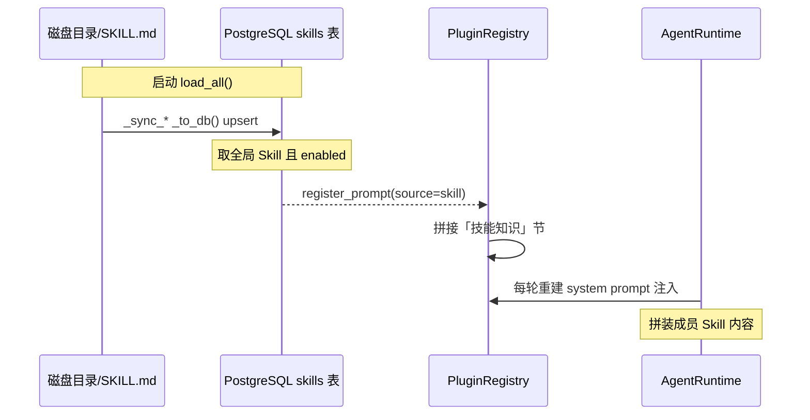

# Skill 知识体系与双轨注入

OpenVort 的 Skill 体系是"按岗位动态注入知识"的核心，是一个**DB 驱动**的四级体系——磁盘只是启动同步源，数据库是权威数据。**重要修正**：模块 docstring 仍写"三级"，实际代码范围字段（`scope`）有四级（builtin / public / personal / marketplace），旧解读据此误记为三级。

## 四级体系与目录映射

`Skill` 数据模型的 `scope` 字段定义范围 [src/openvort/skill/loader.py:50-51]()：

<!-- snippet-base64:Y2xhc3MgU2tpbGw6CiAgICAiIiJTa2lsbCDmlbDmja7mqKHlnovvvIjlhoXlrZjop4blm77vvIkiIiI= -->

> **演进观察**：`skill/__init__.py` 的 docstring 写"三级知识注入体系"（2-5 行），但 `scope` 实际有四级（含 marketplace）。本版以字段为准修正。

四级来源：
| 级别 | scope | 存储位置 |
|------|-------|----------|
| 内置 | `builtin` | `src/openvort/skills/` |
| 公共 | `public` | `/etc/openvort/skills/` |
| 个人 | `personal` | `~/.openvort/skills/` |
| 市场 | `marketplace` | `~/.openvort/marketplace/bundles/skills/<slug>/files` |

`_resolve_skill_base_dir` 按 scope 映射到不同文件系统目录（loader.py:68-82）。

## DB 驱动的加载主流程

`load_all` [src/openvort/skill/loader.py:173-174]() 分三段：① 迁移 schema → ② 磁盘 → DB 同步 → ③ DB → PluginRegistry 注册为 system prompt 段。

<!-- snippet-base64:ICAgIGFzeW5jIGRlZiBsb2FkX2FsbChzZWxmLCBzZXNzaW9uX2ZhY3Rvcnk6IGFzeW5jX3Nlc3Npb25tYWtlcltBc3luY1Nlc3Npb25dKSAtPiBOb25lOgogICAgICAgICIiIlN5bmMgYnVpbHRpbi91c2VyL29yZ2FuaXphdGlvbiBmaWxlcyB0byBEQiwgdGhlbiByZWdpc3RlciBlbmFibGVkIGdsb2JhbCBza2lsbHMuIiIi -->

注入终点：只取 `scope.in_(["builtin","public","marketplace"])` 且 enabled 的 Skill，经依赖检查后 `register_prompt(content, source=f"skill:{row.name}")` 注册 [src/openvort/skill/loader.py:215-215]()，并注册 `SkillUseTool` 让 Agent 在对话里动态管理 Skill。

<!-- snippet-base64:ICAgICAgICAgICAgc2VsZi5yZWdpc3RyeS5yZWdpc3Rlcl9wcm9tcHQoY29udGVudCwgc291cmNlPWYic2tpbGw6e3Jvdy5uYW1lfSIp -->

## SKILL.md 解析与依赖检查

`_parse_skill_file` 用正则切 frontmatter（`_FRONTMATTER_RE`）[src/openvort/skill/loader.py:35-35]()，解析 `name/description/enabled/requires`，其余 markdown 为 content。

<!-- snippet-base64:X0ZST05UTUFUVEVSX1JFID0gcmUuY29tcGlsZShyIl4tLS1ccypcbiguKj8pXG4tLS1ccypcbiIsIHJlLkRPVEFMTCk= -->

依赖检查 `_check_skill_requirements` [src/openvort/skill/loader.py:100-101]() 只真正校验 `bins`（`shutil.which`）和 `env`（环境变量）；`packages`/`plugins` 虽在 docstring 声明但运行时未校验——这是"声明能力略超前于实现"的观察点。

<!-- snippet-base64:ZGVmIF9jaGVja19za2lsbF9yZXF1aXJlbWVudHMocmVxdWlyZXM6IGRpY3Rbc3RyLCBsaXN0W3N0cl1dKSAtPiB0dXBsZVtib29sLCBsaXN0W3N0cl1dOgogICAgIiIiQ2hlY2sgaWYgc2tpbGwgcmVxdWlyZW1lbnRzIGFyZSBzYXRpc2ZpZWQuIFJldHVybnMgKHNhdGlzZmllZCwgbWlzc2luZ19pdGVtcykuIiIi -->

## 双轨注入：Skill（知识）vs Plugin（工具）

Skill 与 Plugin 最终都汇入 `PluginRegistry` 的 prompt 池与 tool 池，但分工不同：

- **Skill = 文本知识注入**（source 前缀 `skill:`）
- **Plugin = 代码工具 + 可选 Prompt 的容器**（source 前缀 `plugin:`）

`get_system_prompt_extension` 按来源分节，把两者拼成 `## 插件能力` 与 `## 技能知识` 两节 [src/openvort/plugin/registry.py:183-188]()：

<!-- snippet-base64:ICAgICAgICBzZWN0aW9ucyA9IFtdCiAgICAgICAgaWYgcGx1Z2luX3BhcnRzOgogICAgICAgICAgICBzZWN0aW9ucy5hcHBlbmQoIiMjIOaPkuS7tuiDveWKm1xuXG4iICsgIlxuXG4iLmpvaW4ocGx1Z2luX3BhcnRzKSkKICAgICAgICBpZiBza2lsbF9wYXJ0czoKICAgICAgICAgICAgc2VjdGlvbnMuYXBwZW5kKCIjIyDmioDog73nn6Xor4ZcblxuIiArICJcblxuIi5qb2luKHNraWxsX3BhcnRzKSkKICAgICAgICByZXR1cm4gIlxuXG4iLmpvaW4oc2VjdGlvbnMp -->

```python
        if plugin_parts:
            sections.append("## 插件能力\n\n" + "\n\n".join(plugin_parts))
        if skill_parts:
            sections.append("## 技能知识\n\n" + "\n\n".join(skill_parts))
```

<!-- snippet-base64:ICAgICAgICBzZWN0aW9ucyA9IFtdCiAgICAgICAgaWYgcGx1Z2luX3BhcnRzOgogICAgICAgICAgICBzZWN0aW9ucy5hcHBlbmQoIiMjIOaPkuS7tuiDveWKm1xuXG4iICsgIlxuXG4iLmpvaW4ocGx1Z2luX3BhcnRzKSkKICAgICAgICBpZiBza2lsbF9wYXJ0czoKICAgICAgICAgICAgc2VjdGlvbnMuYXBwZW5kKCIjIyDmioDog73nn6Xor4ZcblxuIiArICJcblxuIi5qb2luKHNraWxsX3BhcnRzKSkKICAgICAgICByZXR1cm4gIlxuXG4iLmpvaW4oc2VjdGlvbnMp -->

## 与岗位 / 角色的映射

- **岗位 Post**：`_sync_posts_to_db` [src/openvort/skill/loader.py:590-591]() 写入约 20 个岗位模板（开发/PM/QA/架构师等），每个带 `default_persona` 人设 prompt。

<!-- snippet-base64:ICAgIGFzeW5jIGRlZiBfc3luY19wb3N0c190b19kYihzZWxmKSAtPiBOb25lOgogICAgICAgICIiIuWQjOatpeWyl+S9jeWFg+aVsOaNruWIsOaVsOaNruW6kyIiIg== -->
- **role ↔ skill**：迁移时创建 `role_skills` 表 `(role, post, skill_id, priority)`；按优先级推荐岗位 Skill。
- **成员级装配**：`get_member_skills_content` [src/openvort/skill/loader.py:809-810]() 把 role 来源 + public + personal 三块拼装成成员专属内容。

<!-- snippet-base64:ICAgIGFzeW5jIGRlZiBnZXRfbWVtYmVyX3NraWxsc19jb250ZW50KHNlbGYsIG1lbWJlcl9pZDogc3RyKSAtPiBsaXN0W3N0cl06CiAgICAgICAgIiIiUmV0dXJuIGNvbnRlbnQgbGlzdCBvZiBBTEwgbWVtYmVyIHNraWxsczogcm9sZS1iYXNlZCArIHN1YnNjcmliZWQgKyBwZXJzb25hbC4iIiI= -->

> **观察**：`get_member_skills_content` 在代码库中除定义外无直接调用点，当前运行时注入主要由 `register_prompt` 全局路径承载——角色/个人级 Skill 的"按成员注入"仍未完整接线，是"已定义未接线"的一部分。

<!-- snippet-base64:ICAgIGFzeW5jIGRlZiBfc3luY19wb3N0c190b19kYihzZWxmKSAtPiBOb25lOgogICAgICAgICIiIuWQjOatpeWyl+S9jeWFg+aVsOaNruWIsOaVsOaNruW6kyIiIg== -->

## 核心链路：Skill 加载与注入

Skill 从磁盘/市场同步到 DB，再注册进 PluginRegistry，运行时拼进 system prompt。



## 设计权衡小结

| 决策 | 取舍 |
|------|------|
| DB 驱动（磁盘仅同步源） | 运行时动态增删；代价是启动一次同步、需迁移 schema |
| 四级 scope | 覆盖企业/个人/市场；代价是目录与 scope 映射需维护 |
| Skill 知识 vs Plugin 工具分节 | prompt 结构清晰；代价是 Agent 需自行区分"知识"与"工具" |
| requires 仅校验 bins/env | 轻量依赖检查；代价是 packages/plugins 声明未强制 |
