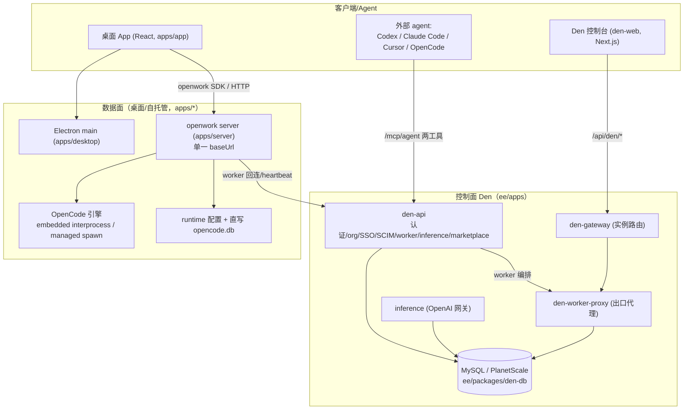

# OpenWork

> **GitHub:** [github.com/different-ai/openwork](https://github.com/different-ai/openwork)（源码由本地克隆解读，pnpm monorepo）

OpenWork 是一个开源、免费的桌面应用，用于**分享 AI 工作流**，定位为 Claude Cowork / Codex 的开源替代。它最核心的主张是：把同一套 skills、MCP 连接、已连接的第三方服务，通过**一个 MCP 注入面**复用到任意 agent harness（Codex / Claude Code / Cursor / OpenCode），做到"创建一次、处处复用"。桌面 App 是可选的工作区，不是必需；面向组织时还有名为 **Den** 的企业控制平面。

## 子文档索引

- [`agent-runtime-opencode.md`](agent-runtime-opencode.md) — 代理运行时与 OpenCode 引擎集成：双路径启动、状态机、直写引擎 DB
- [`server-proxy-api.md`](server-proxy-api.md) — Server 数据面：单一 baseUrl + `/opencode` 透明代理、四档鉴权、token 分级
- [`den-control-plane.md`](den-control-plane.md) — Den 企业控制平面：多服务架构、worker 编排、checkpoint、多云 provisioner
- [`data-model.md`](data-model.md) — den-db 数据模型：Drizzle + MySQL 约 80 表，ER 图 + 核心表 + 演进策略
- [`mcp-injection.md`](mcp-injection.md) — MCP 双工具注入：`search_capabilities` / `execute_capability` 伞 + marketplace/SSO/inference
- [`deployment-evals.md`](deployment-evals.md) — 部署形态与测试体系：桌面/自托管/Helm 云 + 证据卷轴 evals

## 根因：把"引擎进程"封装成"可复用、可治理的共享服务"

OpenCode 引擎是一个**面向单机的、默认无鉴权的本地 HTTP 进程**。OpenWork 要实现"本地优先、云端就绪、一处复用"，本质要回答一个架构问题：**谁来把引擎的裸能力改造成带鉴权、带权限分层、带实时配置同步、可统一审计的共享服务，且不让前端感知多套地址**（`[`agent-runtime-opencode.md`](agent-runtime-opencode.md)` / `[`server-proxy-api.md`](server-proxy-api.md)`）。

这一改造分三层落地，构成全项目的架构主线：

1. **代理运行时** —— 桌面/服务端把 OpenCode 引擎跑起来（同进程 embedded 或 spawn 托管子进程双路径）。
2. **Server 数据面** —— 用**一个 baseUrl** 同时承载 OpenWork 私有 API 与 `/opencode/*` 引擎透明代理，把引擎收敛成唯一入口。
3. **Den 控制面** —— 当需要团队/组织级能力时，叠加多云可部署的企业控制平面，共享一套 MySQL 数据模型，并用**恰好两个 MCP 伞工具**把能力注入任意 agent。

> 注：本项目历史可从 `changelog/` 中确认定位持续演进——从桌面共享工具转向"Den 控制平面 + MCP rail 双核心 + 多云 Helm 部署 + 企业身份(SSO/SCIM)"的组织级 AI 工作流平台，同时保留桌面/自托管可拆离（ejectable）。

## 架构总览

## 核心能力清单

| 能力 | 说明 | 深度文档 |
|------|------|---------|
| 本地/云端 Agent 工作区 | 桌面可选，从任意 agent 经 MCP 接入 | [`agent-runtime-opencode.md`](agent-runtime-opencode.md) |
| 引擎统一封装 | 单一 baseUrl 透明代理 + 鉴权分级 | [`server-proxy-api.md`](server-proxy-api.md) |
| 组织控制平面 | worker 生命周期、多云 provisioner、checkpoint | [`den-control-plane.md`](den-control-plane.md) |
| 企业数据模型 | Drizzle + MySQL 约 80 表 | [`data-model.md`](data-model.md) |
| 跨 Agent 复用 | `search_capabilities` + `execute_capability` 两工具契约 | [`mcp-injection.md`](mcp-injection.md) |
| 组织治理 | SSO/SCIM、marketplace、推理供应(inference) | [`mcp-injection.md`](mcp-injection.md) |
| 可拆离部署 | 桌面 / 自托管 / Helm 云 | [`deployment-evals.md`](deployment-evals.md) |
| 证据驱动测试 | evals 证据卷轴 + demo driven development | [`deployment-evals.md`](deployment-evals.md) |

## 技术栈一览

| 层 | 技术 |
|----|------|
| 桌面 | Electron（apps/desktop）、React + Vite（apps/app），shadcn/ui (Base UI)、Tailwind、TanStack Query、Zustand、Zod |
| 服务端 | Node/Bun、`node:http`（serve-node）、`@opencode-ai/sdk`；MCP（server 端管理），Better-Auth |
| 控制面 | Hono（den-api）、Next.js（den-web）、Daytona/Render/Stub provisioner、OpenRouter 推理网关 |
| 数据 | Drizzle ORM + MySQL / PlanetScale（ee/packages/den-db），runtime SQLite（本地）、Redis（diagnostics） |
| 编排 | pnpm monorepo + turbo；evals 独立 workspace（vitest）+ 愿景模型断言 |
| 部署 | electron-builder（多 flavor）、Docker、Kubernetes Helm（openwork-ee Chart） |

## 核心模块导读

| 模块 | 职责 | 深读 |
|------|------|------|
| 代理引擎集成（desktop + engine） | 拉起/掌控 OpenCode 引擎，双路径、状态机、token、直写 DB | [`agent-runtime-opencode.md`](agent-runtime-opencode.md) |
| Server API 数据面（apps/server） | 单一 baseUrl、四档鉴权、`/opencode` 透明代理、MCP/skill 管理 | [`server-proxy-api.md`](server-proxy-api.md) |
| Den 控制平面（ee/apps） | 多服务控制面，worker 编排与多云部署 | [`den-control-plane.md`](den-control-plane.md) |
| 数据模型（den-db） | 统一 MySQL 数据层，约 80 表 | [`data-model.md`](data-model.md) |
| 能力注入与治理 | MCP 两工具契约、marketplace、SSO/SCIM、推理 | [`mcp-injection.md`](mcp-injection.md) |
| 部署 + 测试 | 多种部署形态 + 证据卷轴 evals | [`deployment-evals.md`](deployment-evals.md) |

## 可借鉴的设计

- **单一 baseUrl + 透明代理**：把"引擎裸进程"收敛成"一个带鉴权/审计/统一 CORS 的入口"，同时保住流式语义——要求代理做关键头剥离与 hop-by-hop 头清理（`[`server-proxy-api.md`](server-proxy-api.md)`）。
- **Two-tool MCP rail contract**：避免"一个能力一个工具"导致的工具面爆炸，用"搜索伞 + 执行伞"两个原语承载动态增长的能力目录，作为跨 agent 复用的唯一闸口（`[`mcp-injection.md`](mcp-injection.md)`）。
- **低频写状态机 + 高频无状态转发**：控制面把"写事务/组织上下文"收敛到一个进程（den-api），其余服务只做只读/转发，用共享 MySQL 单一 schema 胶合；配合 checkpoint 让容器不可持久变成状态可迁移（`[`den-control-plane.md`](den-control-plane.md)`）。
- **证据卷轴（evidence tape）**：把"截图 + 愿景模型分级断言"固化成可回放、可贴 PR 的证据，以 `Passed` 只当每个 claim 有可观察断言为铁律，替代脆弱的像素快照（`[`deployment-evals.md`](deployment-evals.md)`）。

## 不足与风险

- **直写 `opencode.db` 的 schema 强耦合**：`seedOpencodeSessionMessages` 硬编码引擎 sqlite 的 `message/part` 结构，引擎升级即可能 break，缺"pin 版本 + 升级回归"的显式护栏（详见 [`agent-runtime-opencode.md`](agent-runtime-opencode.md#关键设计决策)）。
- **伞工具即单一缺口放大**：所有能力经一个 `execute_capability` 执行闸，任何分支的授权疏忽都会横向放大到所有能力源（详见 [`mcp-injection.md`](mcp-injection.md#问题与安全隐患)）。
- **共享单库的演进成本**：den-api/inference/worker-proxy 直接 import 同一份 den-db schema，跑 migration 必须三服务齐步、顺序部署（详见 [`den-control-plane.md`](den-control-plane.md#问题--风险)）。
- **模块命名 vs 物理路径的混乱**：如 `opencode-config-path` / `opencode-proxy-gate` 命名像独立源文件，实际逻辑在 `server.ts`（见 [`agent-runtime-opencode.md`](agent-runtime-opencode.md#源码拓扑速查)）。

## 总结

OpenWork 的根因是"把无鉴权的引擎进程，改造成可复用、可治理的共享服务"：数据面（`[`server-proxy-api.md`](server-proxy-api.md)`）把引擎收敛成单一 baseUrl，控制面（`[`den-control-plane.md`](den-control-plane.md)` + `[`data-model.md`](data-model.md)`）提供组织级多租户底座，MCP rail（`[`mcp-injection.md`](mcp-injection.md)`）让能力能以最小契约跨 agent 复用。整套设计以 **ejectable（可拆离）** 与 **server-consumption first（消费控制面、不发明平行行为）** 两个不变式贯穿。它的最大价值不在聊天 UI，而在"引擎—服务—控制面—agent"四层之间清晰而务实的边界切分，以及用两工具契约 + 证据卷轴这两项创新把"能力注入"与"质量自证"同时做成了可持续演进的一等公民。
