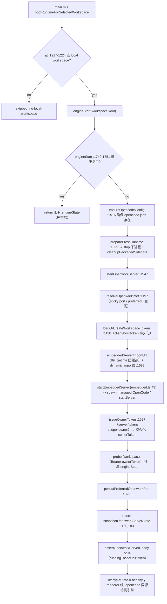
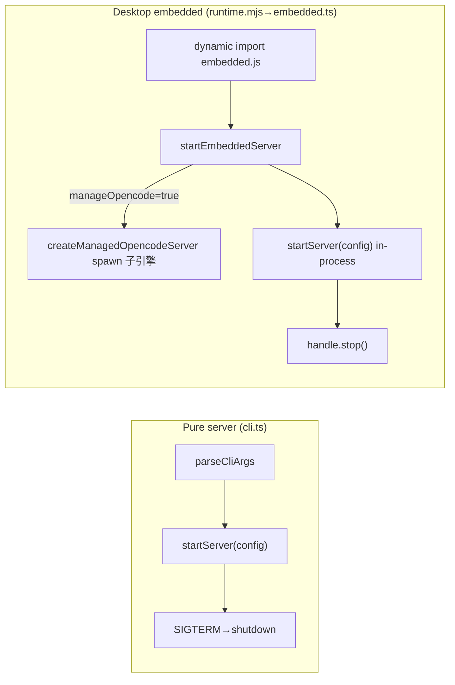

# OpenWork「代理运行时 + OpenCode 引擎集成」模块深度解读

> 承接「代理运行时」在桌面/服务端把 OpenCode 引擎跑起来的机制。本模块是全项目最核心的引擎集成层：如何拉起并掌控引擎进程、维护进程/端口/token 身份、串联 workspace 与会话，并为后续「Server API 层」把引擎封装成统一 HTTP 面提供底座。

## 源码拓扑速查

本模块名义上拆成十几个文件，但读下来要澄清两处"测试文件指向实现"的拓扑假象：

- `apps/server/src/opencode-config-path.test.ts` 的测试对象 `resolveOpencodeConfigFilePath` 实现在 [apps/server/src/server.ts:3144-3144]()，不在同名源文件里——`opencode-config-path.ts` 根本不存在。
- `apps/server/src/opencode-proxy-gate.test.ts` 测的 `assertOpencodeProxyAllowed` 实现在 [apps/server/src/server.ts:812-812]()，也不存在 `opencode-proxy-gate.ts` 源文件。

即网关与配置路径解析是 server 主单体内聚实现，测试文件保留了"逻辑模块"的名字，方便按模块定位。正文按逻辑模块而非物理文件组织。

---

## 在项目中的角色：去掉它会怎样

OpenWork 是 Claude Cowork/Codex 的开源替代，但它**不 fork OpenCode 的仓库与进程模型**，而是把 OpenCode 当"引擎"来驱动（README 定位描述的是产品层面，本模块落实的是技术层面）。本模块是"OpenWork 如何在桌面/服务端拉起并掌控 OpenCode 引擎"的唯一枢纽，去掉它：

1. **没有任何进程/端口/token 身份**：OpenCode 引擎是外部的 http server，本模块负责决定谁来 spawn、监听哪个端口、用什么 Basic/Bearer 凭据连它。没有这套，整个应用拿不到一个可用的 `opencode baseUrl`，前端 SDK 无从建连。
2. **双路径失效**：同进程 embedded server（`startEmbeddedServer`）与 spawn 托管子进程（`createManagedOpencodeServer`）是两种部署载体，去掉任何一个都会打断桌面/纯服务端某一侧的启动。
3. **workspace↔引擎的映射断裂**：`resolveWorkspaceOpencodeConnection` 把每个 workspace 对接到各自的 baseUrl+Basic auth，是"多工作区并行、各自独立引擎"的基础。缺失则多 workspace 全部指向同一引擎。
4. **直写 opencode.db 的会话注射消失**：`seedOpencodeSessionMessages` 把用户消息直接写进 OpenCode 的 sqlite，是"OpenWork 先建 session，OpenCode 引擎随后接手"的时间线缝合点。缺失则两种会话视图对不齐。
5. **boot 失败无路径恢复**：`engineStart` 的防抖复用 + 失败回退 workspace（`bootRuntimeForSelectedWorkspace`）是冷启动竞态的兜底，移除后桌面首屏极易出现 EADDRINUSE/engine 不可达错误。

一句话：本模块回答了"引擎怎么被驱动、怎么被远程控制"，是后面「OpenWork Server API 层」（把引擎封装成统一 HTTP 面）的底座。

---

## 解决什么问题、根因

问题域可拆成四层，每层都有一个"根因"：

**(A) 进程载体选择：引擎到底是"我进程里的一段逻辑"还是"一个外面的进程"？**
根因：OpenCode serve 本身就是独立进程；但 OpenWork 桌面需要"开盖即用、无需用户装 CLI"，而纯 server 部署要复用系统已装的 opencode。两种诉求无法用单一启动路径同时满足，于是有了 embedded/`spawn` 双路径（见 §7 决策 1）。

**(B) 身份与端口：连上引擎时拿什么凭据、占哪个端口？**
根因：引擎不许用固定密码（多 workspace 并行会串 flavor）、端口需动态分配且桌面要"粘住"上次端口避免重连错位。于是 managed spawn 端用两个随机 UUID 拼出 user/pass（`managed-opencode.ts`），桌面端用持久化 token store + sticky port（`runtime.mjs`）。

**(C) 单 baseUrl 承揽一切：前端只需知道一个 URL 就能既访问私有 API 又打 `/opencode/*` 引擎代理？**
根因：前端要摆脱"存两套 host、两个 CORS 来源、两套 token"，于是把引擎 HTTP 面挂在 Work server 的 `/opencode/*` 反向代理之后（同源）。这是全项目不变式之一，具体请求转发/鉴权在 server 层，本模块提供"挂载点如何被解析、如何鉴权放行"的语义（`assertOpencodeProxyAllowed`）。

**(D) 会话时间线对齐：OpenWork 要给用户看的 session 与引擎自己记的 session 是两张表吗？**
根因：二者必须同源才能避免"重复会话""上下文分裂"，最省事的统一办法是不造新表、直接写进引擎的 sqlite（`opencode-db.ts`），即"直写 opencode.db"不变式。

---

## 设计思路（方案、放弃的替代、核心模式）

### 方案总纲：分层三明治

```
[Electron main 进程]
   ├─ workspace-store.mjs   —— workspace 列表/选择的唯一事实来源（openwork-workspaces.json）
   ├─ runtime.mjs           —— createRuntimeManager：串行启动、状态机、embedded 动态 import
   └─ ui-control-server.mjs —— 本地回环 HTTP 桥，executeJavaScript 反控渲染进程
[Node/Bun server 进程]
   ├─ embedded.ts / cli.ts  —— startEmbeddedServer / CLI 两个入口，共用 startServer()
   ├─ managed-opencode.ts   —— spawn opencode serve，随机凭据、空闲端口、isAlive/close
   ├─ server.ts             —— /opencode/* 挂载点解析 + assertOpencodeProxyAllowed + proxyOpencodeRequest
   ├─ opencode-connection.ts—— workspace↔baseUrl+Basic auth 归一
   └─ opencode-db.ts        —— 直读 opencode.db，seed 会话消息
[前端 React]
   ├─ opencode.ts           —— createClient(baseUrl, directory, auth) 封装 SDK
   ├─ opencode-session.ts   —— 会话中止/revert/fork/archive/shell 的薄封装
   └─ openwork-server.ts    —— work server 私有 API client（/health /runtime /capabilities ...）
```

核心模式有四个：**in-process factory（createRuntimeManager 模式）、状态快照 + 串行生命周期队列（withRuntimeLifecycle）、动态 import() 冷启动（embedded）、逻辑模块→测试文件命名映射**。

### 放弃的替代方案（从代码反推）

- **放弃"单一 spawn 子进程"**：`embedded.ts` 存在本身就证明团队选择了"可嵌入进程内"的折叠体。若只留 spawn，桌面冷启动要多次 IPC + 进程管理，且无 packaged bundle 场景。
- **放弃"权限面全 owner-only"**：`server.ts` 的 proxy-gate 段注释与 `opencode-proxy-gate.test.ts` 的 `#1918` 测试明说曾经 owner-only 导致每个 permission 对话框无解（collaborator 才能答权限请求），后放行 collaborator（[apps/server/src/server.ts:823-824]()、[apps/server/src/opencode-proxy-gate.test.ts:13-22]()）。这是"从过于严格收敛到够用"的权衡样本。

<!-- snippet: // credential is the collaborator-scoped client token (OPENWORK_TOKEN), so
  // an owner-only gate made every interactive permission dialog un-answerable -->
<!-- snippet: test("collaborators can reply to permission requests (#1918)", () => { -->
- **放弃"绕开 OpenCode DB、自建会话表"**：`opencode-db.ts` 选择直写引擎 sqlite 而非自维护一张影子表，堵死双写漂移（见 §7 决策 3 的代价分析）。

### 关键：createRuntimeManager 的"状态快照 + 串行队列"

```js
// runtime.mjs:1917-1931
return {
  engineStart: (projectDir, options) => withRuntimeLifecycle(() => engineStart(projectDir, options)),
  engineStop: () => withRuntimeLifecycle(() => engineStop()),
  ...
  dispose: () => withRuntimeLifecycle(() => stopAllRuntimeChildren()),
  ...
};
```
`withRuntimeLifecycle`（runtime.mjs:1083-1087）把每次操作链到同一个 promise 队列上，天然串行化"启动/停止/重启"，杜绝并发撕裂。这正是 main.mjs 里 boot 与 renderer 独立触发 `ensureRuntimeBootstrap` 时防止二次 `prepareFreshRuntime` 杀进程的关键（runtime.mjs:1732-1751 的 guard 注释）。

---

## 关键数据结构（精简）

仅贴理解必需的类型/接口。managed spawn 的对外契约：

```ts
// managed-opencode.ts:5-13, 21-26
export type ManagedOpencodeServer = {
  url: string; username: string; password: string;
  pid: number | null;
  execution: OpencodeExecutionSnapshot;
  isAlive: () => boolean;
  close: () => Promise<void>;
};
export type OpencodeExecutionSnapshot = {
  command: string; args: string[]; cwd: string;
  env: OpencodeExecutionEnvEntry[];  // name/value/redacted（密级用 <redacted>）
};
```

embedded 句柄（embedded.ts:34-47）：`{ port, url, config, managedOpencodeExecution, managedOpencode, stop() }`。`config` 里被回填 `opencodeBaseUrl/opencodeUsername/opencodePassword`，并把每个 workspace 的 base/work credential `/directory` 全部覆盖为 managed 值（embedded.ts:90-105）。

work server 对引擎的连接归一（opencode-connection.ts:3-6,12-28）：`{ baseUrl?, authHeader? }`，`authHeader` = `Basic base64(user:pass)`。workspace 优先于全局配置（`trim(workspace.baseUrl) || config.opencodeBaseUrl`）。

引擎 DB（opencode-db.ts:8-16,127-133）：`SeedMessage = { role:'user'|'assistant', text }`；`seedOpencodeSessionMessages({ sessionId, workspaceRoot, messages, dbPath?, now? })`。写 `message` 与 `part`（part 的 data = `{ type:'text', text }`），并更新 `session.time_updated`。

桌面 token store（runtime.mjs:1138-1163）：每个 workspace key 存 `{ clientToken, hostToken, ownerToken, updatedAt }`，落盘 `openwork-server-tokens.json`。ownerToken 由 serve `/tokens` 颁发（scope:'owner'）。

UI control 发现文件（ui-control-server.mjs:172-176）：`openwork-ui-control.json`，含 `{ version:2, app, identifier, platform, baseUrl, token }`；通过 env `OPENWORK_UI_CONTROL_DISCOVERY` 下发给子进程（server→managed OpenCode→plugin）。
<!-- snippet: ui-control-server.mjs:169-176 -->
```
  uiControlDiscoveryPath = path.join(app.getPath("userData"), "openwork-ui-control.json");
  await writeFile(
    uiControlDiscoveryPath,
    `${JSON.stringify({ version: 2, app: appName, identifier: appIdentifier, platform: process.platform, baseUrl: `http://127.0.0.1:${port}`, token: uiControlToken }, null, 2)}\n`,
    "utf8",
  );
  // Make the discovery path available to child processes (server → managed OpenCode → plugin).
  process.env.OPENWORK_UI_CONTROL_DISCOVERY = uiControlDiscoveryPath;
```

---

## 核心流程

### 同进程 embedded：桌面冷启动（embedded 加载 + 端口/token + 状态机）

桌面 boot 的入口在 `bootRuntimeForSelectedWorkspace`，往下走 `engineStart` → `ensureOpenwork` → `startOpenworkServer`。




关键标注：

- **embedded.js 的解析路径注入**（runtime.mjs:1584-1595）：dev 优先 `apps/server/dist/embedded.js`，packaged 优先 `apps/desktop/server`；`OPENWORK_DEV_MODE=1` 时颠倒优先级。找不到则抛错。
  <!-- snippet: runtime.mjs:1587-1598 -->
  ```
  const devPath = path.resolve(__runtimeDir, "..", "..", "server", "dist", "embedded.js");
  ...
  const candidates = process.env.OPENWORK_DEV_MODE === "1"
    ? [devPath, ...packagedPaths]
    : [...packagedPaths, devPath];
  const embeddedPath = candidates.find((candidate) => existsSync(candidate));
  if (!embeddedPath) {
    throw new Error(`Cannot find OpenWork embedded server bundle. Checked: ${candidates.join(", ")}`);
  }
  const { startEmbeddedServer } = await import(embeddedServerImportUrl(embeddedPath));
  ```
- **动态 import 防缓存**（runtime.mjs:89-99）：`embeddedServerImportUrl` 在 file URL 上追加 `mtimeMs`/`size` query，确保每次 boot 都拿到最新 bundle（Bun 会缓存模块）。
  <!-- snippet: runtime.mjs:90-98 -->
  ```
  export function embeddedServerImportUrl(embeddedPath) {
    const url = pathToFileURL(embeddedPath);
    try {
      const stats = statSync(embeddedPath);
      url.searchParams.set("mtimeMs", String(stats.mtimeMs));
      url.searchParams.set("size", String(stats.size));
    } catch {
      // Fall back to the deterministic file URL if stat fails; startup can continue.
    }
    return url.href;
  }
  ```
- **真正绑定端口以 server 为准**（runtime.mjs:1600-1602 注释）：`startEmbeddedServer` 若 `port` 撞 `EADDRINUSE` 会回退 OS 分配的端口，因此以 `handle.port` 为准。
  <!-- snippet: runtime.mjs:1600-1602 -->
  ```
  // startEmbeddedServer falls back to an OS-assigned port if `port` races
  // into EADDRINUSE (see apps/server/src/serve-node.ts), so the bound port
  // below is authoritative.
  ```
- **embedded 内再次走 managed spawn**（embedded.ts:61-116）：`manageOpencode=true` 且未显式给 baseUrl 时，用 `writeOpenworkRuntimeConfigFile` + `createManagedOpencodeServer` spawn 子引擎，并把 runtime 配置文件的路径经 `OPENCODE_CONFIG` 注入子进程，`keepOpenworkRuntimeConfigFileFresh` 保证每次 runtime-DB 写入后引擎能从磁盘重读最新状态（embedded.ts:63-68 注释、86）。
  <!-- snippet: embedded.ts:57-61 -->
  ```
  if (!config.readOnly) {
    await ensureLocalWorkspaceFiles(config.workspaces);
  }
  if (!config.opencodeBaseUrl && options.manageOpencode) {
  ```
  <!-- snippet: embedded.ts:83-88 -->
  ```
  OPENWORK_SERVER_URL: serverUrl,
  OPENWORK_SERVER_TOKEN: config.token,
  OPENCODE_CONFIG: runtimeConfigPath,
  OPENCODE_MODELS_URL: opencodeModelsUrl,
  ```
  <!-- snippet: runtime.mjs:1686-1691 (withRuntimeLifecycle 队列定义在 :1083) -->
  ```
  async function stopAllRuntimeChildren() {
    // Stop the in-process server (and its managed OpenCode child) if running.
    if (inProcessServer) {
      try { await inProcessServer.stop(); } catch { /* ignore */ }
      inProcessServer = null;
    }
  ```


### managed spawn 双路径差异

`createManagedOpencodeServer`（managed-opencode.ts）是纯 server 侧 spawn；桌面的 embedded 场景其实是"进程内启动 server → server 再去 spawn 子引擎"，即**两层**。纯 server（cli.ts）则只有一层 spawn。差异对比：

| 维度 | cli.ts（standalone） | embedded.ts（桌面 in-process 折叠） |
|---|---|---|
| 入口 | `parseCliArgs` + `resolveServerConfig` | `startEmbeddedServer(options)` 直接拿到 `port/url/config` |
| 持有自己的生命周期 | 是，`SIGINT/SIGTERM` shutdown（cli.ts:138-145） | 否，交给 caller 的 `stop()`（embedded.ts:136-142） |
| spawn criterion | `OPENWORK_MANAGE_OPENCODE=1`（cli.ts:44） | `options.manageOpencode`（embedded.ts:61） |
| workspace 配置回填 | `entry.baseUrl ??= url`（cli.ts:73） | local 全量覆盖、remote 才 `??=`，且补 `directory`（embedded.ts:93-105） |
| 握手凭据 | 同（createManagedOpencodeServer） | 同 |



spawn 细节（managed-opencode.ts:59-96）：`opencode serve --hostname 127.0.0.1 --port <free> --cors *`，env 注入 `OPENCODE_SERVER_USERNAME/PASSWORD`（随机 UUID 拼接），镜像输出在 `metadata.env` 里按 `SECRET_ENV_PATTERN`（`/(TOKEN|PASSWORD|USERNAME|AUTH|SECRET|KEY|CREDENTIAL)/i`）标记为 `<redacted>`，防止日志泄密。`isAlive()` 校验 `exitCode===null && signalCode===null && !killed`；`close()` 先 SIGTERM 再等 1s 兜底 SIGKILL（managed-opencode.ts:144-162）。

---

## 与其他模块的协同

- **单一 baseUrl 不变式落到前端**：前端 `createClient(baseUrl, directory, auth)`（opencode.ts:353）建 SDK client；当 `auth.mode==='openwork'` 且 baseUrl 形如 `…/ws/<id>/opencode` 时，把 `session.*` 的 list/get/messages/todo/snapshot 走自定义 override 打到 work server 的 `…/workspace/<id>/sessions…`（opencode.ts:376-456），`prompt_async`/`command` 仍走 `/opencode` 真引擎（opencode.ts:458-482）。
  (见 [server-proxy-api.md](server-proxy-api.md) 与 [agent-runtime-opencode.md](agent-runtime-opencode.md) 的协同说明)前端 openware workspace mount 的 URL 语义要与 server 层 `/workspace/:id/opencode` 挂载一致，否则 override 会 miss——需主 agent 对照 server 路由确认。
- **`/opencode/*` 同源代理**：server.ts 里 `normalizeOpencodeProxyPath` + `assertOpencodeProxyAllowed` + `proxyOpencodeRequest`（server.ts:812,1113）。proxy 会删掉浏览器侧 authorization/host-token/client-id，再按 workspace 的 engine 凭据注入 `Basic`（server.ts:1129-1143），完成后 `sanitizeProxyResponse` 剥掉 Bun fetch 残留的 hop-by-hop 头（server.ts:1179-1189，防 ERR_CONTENT_DECODING_FAILED）。这正是【Server API 层】把引擎封装成统一 HTTP 面的承担者。
  <!-- snippet: server.ts:812-833 -->
  ```
  export function assertOpencodeProxyAllowed(actor: Actor, method: string, proxyPath: string) {
    const m = method.toUpperCase();
    const scope = actor.scope ?? "viewer";
    if (scope === "viewer" && m !== "GET" && m !== "HEAD") {
      throw new ApiError(403, "forbidden", "Viewer tokens are read-only");
    }
  ```
  <!-- snippet: server.ts:1129-1143 -->
  ```
  const headers = new Headers(input.request.headers);
  headers.delete("authorization");
  headers.delete("x-openwork-host-token");
  headers.delete("x-openwork-client-id");
  headers.delete("host");
  headers.delete("origin");
  ...
  const auth = workspace ? resolveWorkspaceOpencodeConnection(input.config, workspace).authHeader ?? null : null;
  if (auth) {
    headers.set("Authorization", auth);
  }
  ```
- **直写 DB 与 session 读取模型**：`seedOpencodeSessionMessages`（opencode-db.ts:127）与 server 的 session_read_model 正交但共享同一 sqlite——OpenWork 写入、引擎/前端同源读取。
  <!-- snippet: opencode-db.ts:165-171 -->
  ```
  const insertMessage = db.prepare(
    "insert into message (id, session_id, time_created, time_updated, data) values (?1, ?2, ?3, ?4, ?5)",
  );
  const insertPart = db.prepare(
    "insert into part (id, message_id, session_id, time_created, time_updated, data) values (?1, ?2, ?3, ?4, ?5, ?6)",
  );
  ```
- **UI 反控桥**：`ui-control-server` 暴露 `/snapshot /actions /context /query /command /execute`，通过 `win.webContents.executeJavaScript(expr, true)` 调度 `window.__openworkControl`（ui-control-server.mjs:61-118）。这是"桌面外壳被外部进程反控"的唯一通道，与 managed OpenCode 插件可能经它注入动作的假设相关。
  <!-- snippet: ui-control-server.mjs:61-66 -->
  ```
  async function evaluateOpenworkControl(expression) {
    const win = await getWindow();
    // Commands mutate renderer state directly and do not require the desktop
    // window to become active. Foreground activation must be an explicit
    // affordance, never an implicit side effect of remote control.
    return win.webContents.executeJavaScript(expression, true);
  }
  ```
  (见 [server-proxy-api.md](server-proxy-api.md) 与 [agent-runtime-opencode.md](agent-runtime-opencode.md) 的协同说明)opencode-plugins（openwork-extensions-preview-steering.ts 等）是否消费 `OPENWORK_UI_CONTROL_DISCOVERY` 并把插件能力桥回渲染进程——本子代理未深读插件目录，标待验证。
- **workspace-store ↔ runtime 解耦**：store 是事实来源（`openwork-workspaces.json`），runtime 通过 `listLocalWorkspacePaths` 回调拿路径（runtime.mjs:1152），两者不直接共享状态对象，靠 main.mjs 粘合（main.mjs:976,1149-1153）。

---

## 关键设计决策（1-3 个：权衡与替代方案代价）

### 决策 1：同进程 embedded server vs spawn 托管子进程 —— 双路径为何并存

`embedded.ts` 与 `managed-opencode.ts` 看似重复，实则服务不同部署载体：

- **embedded**：把整个 Work server 折叠进调用进程（桌面里就是 Electron main 进程内），冷启动只要 `dynamic import` + `startEmbeddedServer`，不给用户造成"两个窗口两个托盘"。代价：主进程携 server 逻辑，崩溃面扩大、升级需重启整个 app。
- **managed-opencode**：把引擎独立 spawn 成进程（`opencode serve`），server 用 `isAlive()`/`close()` 守门。代价：多一层进程管理 + 端口/凭据握手。

替代方案的代价：**只保留 spawn** 会让桌面冷启动变重（要编排两个进程生命周期），packaged bundle 场景没有完整 server 代码时断开；**只保留 embedded** 会让"纯 server + 系统已装 opencode"的部署失去复用系统二进制的通道（cli.ts 的 `OPENWORK_MANAGE_OPENCODE=1` 就是为它准备的）。因此双路径并存是"折叠 vs 独立"两种运行环境的最优解，且两者最终都收敛到同一个 `startServer(config)`，差异只在 spawn 决策与生命周期归属。证据：

<!-- snippet: embedded.ts:3-7 注释 -->
```
 * Single entry point for embedding the OpenWork server in-process.
 * Handles config resolution, managed OpenCode spawn, and server start
 * in one call -- mirrors what cli.ts does but returns a handle instead
 * of owning the process lifecycle.
```
<!-- snippet: cli.ts:44 条件 -->
```
if (!config.opencodeBaseUrl && process.env.OPENWORK_MANAGE_OPENCODE === "1") {
```

### 决策 2：token 三级粒度 + ownerToken 的"启动后补发 + 持久化"

桌面在 `startOpenworkServer` 里同时持有 clientToken/hostToken（内存 store 预生成、落盘），而 **ownerToken 是 server 起来后通过 `POST /tokens { scope:'owner' }` 用 hostToken 交换回来的**（runtime.mjs:1527-1542），失败则降级为"只有 client/host token 也能跑"（`assertOpenworkServerReady` 只要 ownerToken 或 clientToken 存在即通过，runtime.mjs:211-213）。随后 `persistWorkspaceOwnerToken` 与 workspace 一并落盘，避免每次重启都重发。

权衡/替代：**全程只用 client token？** 那无法获得 owner 才有的 `/workspaces` 列表与授权操作；**只在内存**？那重启即丢、且 boot 竞态下 renderer 拿不到 owner 优先读 /workspaces 的收益。持久化 owner 的代价是明文落盘（`openwork-server-tokens.json`），属于本机信任边界内可接受的取舍（同类权衡见于 workspace-store.mjs:207-230 对 handoff 明文的一次性说明）。

### 决策 3：直写 opencode.db 的 schema 耦合风险

`seedOpencodeSessionMessages` 直接对引擎的 sqlite 执行 `insert into message/part` + `update session`（opencode-db.ts:165-221），且自造了 `ascendingId` 的 msg/prt ID 与 `mtimeMs+size` 的模块防缓存方案，说明团队**赌 OpenCode 的 DB schema 稳定**。

- 好处：无影子表 → 无双写漂移；引擎重启后仍能读同源会话。
- 代价/风险：**强 schema 耦合**。一旦 OpenCode 升级变动 `message/part/session` 列名或 `data` JSON 结构，`insertMessage/insertPart` 会静默失败或注入畸形记录。缓解痕迹：`findOpencodeSessionDbPath` 先 `select id from session` 探测会话归属的 DB（opencode-db.ts:92-106），并在 `fetchJson`/`apiError` 上保留可诊断输出；`preferredDbNames` 按 `OPENCODE_CHANNEL` 区分 `opencode-local.db` vs `opencode.db`（opencode-db.ts:52-57），尽力对齐引擎真实落库。

替代：自建 `openwork_session_message` 影子表 → 引入双写与聚合复杂度，团队选择承受 schema 耦合风险换一致性。建议(见 [server-proxy-api.md](server-proxy-api.md) 与 [agent-runtime-opencode.md](agent-runtime-opencode.md) 的协同说明)此类直写是否被 OpenCode 版本升级约束/需要在 README 标注 pin 版本（pinned install 见 runtime.mjs:1841-1864 与 `pinnedOpencodeInstallCommand`）。

---

## 亮点与问题

### 亮点

1. **单 baseUrl 同源代理**：前端只握一个 URL，引擎的 HTTP 面被 `/opencode/*` 收敛，CORS、token 只需要一套。`proxyOpencodeRequest` 的 header 剥离（auth/host-token/client-id）+ workspace 级 Basic 注入（server.ts:1129-1143）+ `sanitizeProxyResponse` 剥 hop-by-hop 头，工程上扎实且直接命中真实故障（content-encoding 解码失败）。
2. **状态机 + 串行生命周期队列**：`createEngineState/createOpenworkServerState` 快照 + `withRuntimeLifecycle` 队列，把多来源并发调用（boot 与 renderer 两个入口）收敛成线性操作，配合 `engineStart` 的健康复用 guard（runtime.mjs:1740-1751），优雅解决了冷启动 EADDRINUSE 竞态。
3. **幂等的安全默认**：managed spawn 随机 UUID 凭据 + `SECRET_ENV_PATTERN` 对执行快照里的 token 脱敏（managed-opencode.ts:28,88）；`loadUserEnvFile` 剥掉 `OPENWORK_/OPENCODE_` 前缀保留键，防篡改 env 文件劫持系统变量（runtime.mjs:432-449）。
4. **失败路径覆盖**：boot 失败自动回退到下一个本地 workspace 并重写 selectedId（main.mjs:1242-1268）；`importBundledDesktopBootstrapConfigIfPreferred` 对组织下载的 installer 目录做冒泡择优（workspace-store.mjs:445-476）。
5. **模块级可测性留痕**：把 proxy-gate、config-path 的逻辑做成 server.ts 导出、用同名测试文件承接（opencode-proxy-gate.test.ts / opencode-config-path.test.ts），逻辑内聚于大单体但测试命名给出定位锚点。

### 问题与风险

1. **直写 opencode.db 的 schema 强耦合**（§7 决策 3）是最突出的技术债；`insert into part/message` 硬编码列结构，一旦引擎升级即可能 break，缺一个"pin 版本 + 升级回归"的显式护栏。
2. **`engineStart` 健康复用的判定依赖 `normalizeWorkspaceKey` 归一**，若两个路径文本等价但大小写/分隔符不同（已 lower+去掉 `~`），可能误判复用/误判不同，隐含路径归一一致性的长尾 bug 源。
3. **明文敏感信息落盘**：token store (`openwork-server-tokens.json`)、ownerToken、以及 workspace-store 里对 handoff 明文的刻意保留，都在本机信任边界假设下，若用户 data 目录落到多用户机器需谨慎（团队已用注释明示，属有意识取舍而非疏忽）。
4. **两个"文件不存在却有名"的模块（opencode-config-path/proxy-gate）** 是维护噪音：逻辑在 server.ts 但名字像独立源文件，新人对齐物理路径时会踩空（本子代理一开始就 `wc` 报"No such file"）。建议要么真正拆文件，要么删测试文件名误导。
5. **`ui-control-server` 用 `executeJavaScript` 注入任意表达式**，虽用随机 bearer token 守门（`Bearer ${uiControlToken}`，ui-control-server.mjs:16,52-55），但攻击面 = 能读 token 文件的任何进程即可远程执行渲染进程 JS；是桌面侧相对"厚"的控制点，建议 review 是否收缩到白名单命令。
