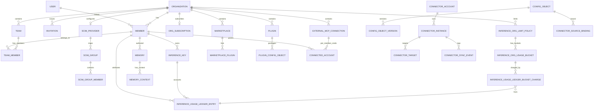
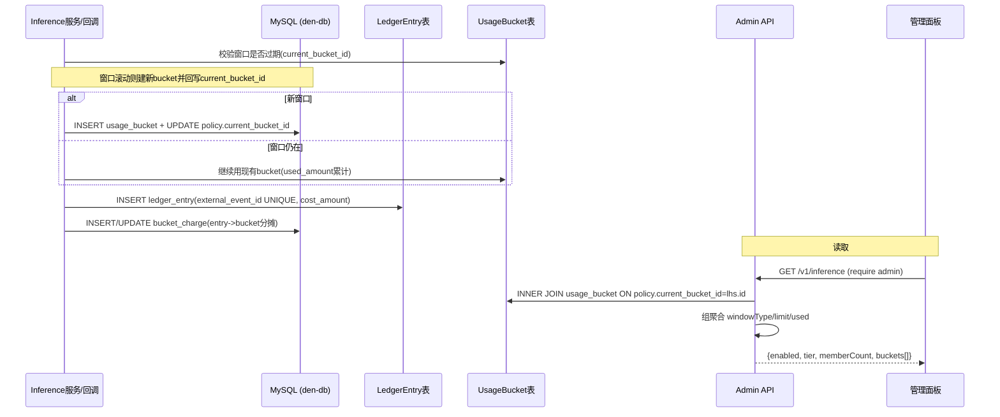
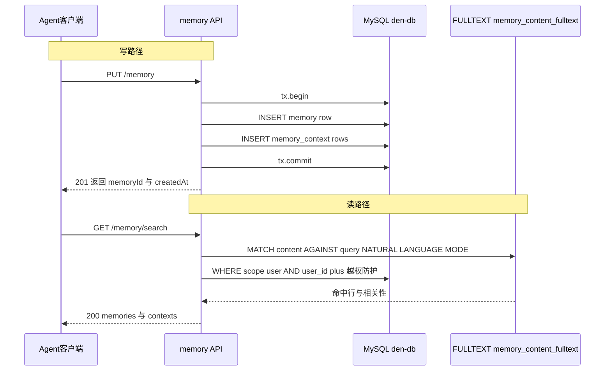

# OpenWork den-db 数据模型：企业控制平面统一数据层深度解读

## 快速概览

OpenWork 开源 AI 工作流分享平台的企业控制平面 Den，背后有一套名为 **den-db** 的统一数据层包（`ee/packages/den-db`）。本解读回答三个问题：这套多服务共享的 MySQL 数据模型长什么样、为什么这么建模、数据如何随版本演进。"长什么样"用 ER 图 + 核心表字段表回答，"为什么"落在存储选型与演进策略，"如何演进/读写"用迁移机制与读写路径回答。

核心事实：约 80 张表分布在 `src/schema/` 13 个 schema 文件 + `sharables/` 3 个 schema 文件，统一从 `src/schema/index.ts` 导出；Drizzle ORM + MySQL(mysql-core)，同时支持原生 MySQL / PlanetScale 两种驱动；演进靠 `drizzle/` 目录 50+ 个编号迁移 SQL；敏感字段通过自定义 `encryptedTextColumn` 在应用层做 AES-256-GCM 加密。

> 前置叙事：本文是 Den 服务架构之后的第二个关注面。前一个模块拆解了 Den 各服务如何组织；本文解构「这些服务背后共用同一套 MySQL 数据模型」。它是后续 MCP 注入/企业能力解读的存储根基——memory、marketplace、connector、external_mcp_connection 这些表正是能力落地的落点。

## 存储选型与理由

### 为什么是 Drizzle + MySQL，而不是别的

仓库对外接口最直接的证据在 `drizzle.config.ts`：`dialect: "mysql"`，schema 出口是 `./src/schema.ts`，credentials 支持 `DATABASE_URL`（原生 MySQL）与 `DATABASE_HOST/USERNAME/PASSWORD/DATABASE_NAME`（PlanetScale，强制 TLS）两种。

```ts
export default defineConfig({
  dialect: "mysql",
  schema: "./src/schema.ts",
  out: "./drizzle",
  dbCredentials: resolveDrizzleDbCredentials(),
})
```
<!-- snippet: 逐字复制片段（drizzle.config.ts:43-47）：export default defineConfig({
  dialect: "mysql",
  schema: "./src/schema.ts",
  out: "./drizzle",
  dbCredentials: resolveDrizzleDbCredentials(),
}) -->

选型是一次**面向部署形态的折中**，逐项对比：

| 候选 | 取舍 | 为什么不选 |
|------|------|-----------|
| SQLite | 单文件、零运维，最省心 | Den 是多租户企业控制平面，多写并发 + 被多服务（den-api、inference、worker 运行时）同时访问。SQLite 写锁是单写者，无法承载高并发 admin 读 + 遥测写 + 计费记账同时发生 |
| MongoDB / 文档型 | schema-less、嵌套自然（如 organization.metadata） | 但计费记账（usage ledger + bucket charges）需要强一致的事务与唯一约束防重；关系型唯一索引与 `ON DUPLICATE KEY UPDATE` / `MATCH...AGAINST` 全文检索等 MySQL 原生能力是文档型不好替代的 |
| PostgreSQL | 功能更全（pg 也有 jsonb、更强的 fulltext） | 生态与核心：Den 的主要目标部署拥抱 **PlanetScale（Vitess）**，MySQL 协议是其客户端默认协议。同一份 schema 同时跑 mysql2 与 planetscale-serverless 两种驱动，是架构层明确支持的双部署形态 |

真正的取舍集中在 **关系型 vs 文档型**：schema 大量用 `json` 列承载半结构化数据（`organization.metadata`、`desktop_policy.policy`、connector 的各类 `*_config_json`），但**用关系型表承担一切要求一致性/唯一性/可查询的部分**（成员、订阅、计费、权限、身份），JSON 只留给"演进最快、查询面最窄"的扩展位。这是"JSON blob + 提升列"演进哲学的基石（详下）。

### 一致性/可用性取向

从 `client.ts` 能看到对双部署形态的显式适配，以及其隐含的一致性策略：

- 双模式切换在 `resolveDbMode`：无 `DATABASE_URL` 即 planetscale，有则视为原生 mysql。
- 针对 PlanetScale/Vitess 的网络抖动，做了一个**只对读查询重试一次**的包装：`isRetryableReadQuery` 只匹配 `select/show/describe/explain` 前缀，配合 `TRANSIENT_DB_ERROR_CODES`（ECONNRESET/EPIPE/PROTOCOL_CONNECTION_LOST 等）判定瞬时断连。

```ts
function isRetryableReadQuery(sql: string | null): boolean {
  if (!sql) { return false }
  const normalized = sql.trimStart().toLowerCase()
  return RETRYABLE_QUERY_PREFIXES.some((prefix) => normalized.startsWith(prefix))
}
```
<!-- snippet: 逐字复制片段（client.ts:67-74）：function isRetryableReadQuery(sql: string | null): boolean {
  if (!sql) { return false }
  const normalized = sql.trimStart().toLowerCase()
  return RETRYABLE_QUERY_PREFIXES.some((prefix) => normalized.startsWith(prefix))
} -->

设计取向：**读可用性 > 强一致**。写不重试（写重试会引入重复插入/重复记账风险），只对可安全重放的读做一次瞬时重试——这与 PlanetScale 的 Vitess 分片主从架构是匹配的：读可能打到副本，短暂连接抖动可接受一次重试；写必须走主节点，失败则由业务侧重试或靠幂等约束兜底。业务侧用**唯一约束防重**（如 ledger 的 `external_event_id` 唯一）弥补写路径的一致性，而非依赖单点强一致。

## 实体关系总览

下面用 Mermaid `erDiagram` 画出核心实体与关系。注意 den-db **几乎不使用 DB 级外键约束**（PlanetScale/Vitess 惯例，见 memory.ts 注释），关系在应用层由 `drizzle relations()` 声明靠 `denTypeIdColumn` 的 TypeId 对齐维护；ER 图中的关系标注仅作语义表述。



关系要点（均是应用层 `relations()` 语义）：

- **Multi-tenancy 是绝对主干**：几乎每张业务表都以 `organization_id`（或 `org_id`）开头，是天然的租户隔离轴。`Organization -- Member -- Team` 是三件套，`Member` 是 `USER` 与 `ORG` 之间的身份桥（同一 user 可加入多 org）。
- **多对多经中间表**：`Marketplace -- MarketplacePlugin -- Plugin`、`Plugin -- PluginConfigObject -- ConfigObject`、`Team -- TeamMember -- Member` 都是显式联接表。
- **授权三范式**：各类 access grant 表（`marketplace_access_grant`、`plugin_access_grant`、`config_object_access_grant`、`connector_instance_access_grant`、`llm_provider_access`、`external_mcp_connection_access_grant`）共用同一套「三列取其一」模式：`orgMembershipId`（人）/`teamId`（团队）/`orgWide`（全组织），表达"把资源授予谁"。
- **计费是链状**：`inference_org_limit_policy -> usage_bucket -> ledger_bucket_charge -> ledger_entry`，记账明细与分摊到 bucket 的量解耦。

## 核心表设计

以下选取代表性核心表，每张配一个 Markdown 字段表，字段行序按设计要点而非建表顺序；`{文件:行号}` 指向 schema 定义。

### Organization / Member

**Organization**（[ee/packages/den-db/src/schema/org.ts:40-56]()）：多租户根实体。identity 用 `denTypeIdColumn("organization", ...)`——每个 TypeId 带类型前缀，天然防串表引用。多处 `json` 承载快速演进的策略与扩展位：`allowedEmailDomains`（域名校验）、`desktopAppRestrictions`（桌面限制，默认空对象）、`metadata`（自由键值，inference/plan 等大量子能力都写这里）。

| 字段 | 类型 | 约束 | 说明 |
|------|------|------|------|
| id | varchar(64) | PK，TypeId | 类型化主键 `denTypeIdColumn` |
| name | varchar(255) | NOT NULL | 组织名 |
| slug | varchar(255) | NOT NULL, UNIQUE(organization_slug) | 品牌短名，唯一约束 |
| logo | varchar(2048) | 可空 | Logo URL |
| allowedEmailDomains | json | 可空 string[] | 准入域名白名单，`$type<string[]\|null>` |
| desktopAppRestrictions | json | NOT NULL 默认 `(json_object())` | `DesktopAppRestrictions` 类型约束，空对象兜底 |
| metadata | json | 可空 Record<string,unknown> | 自由扩展位：inference 开关/tier、plan、allowedDesktopVersions 等 |
| createdAt / updatedAt | timestamp(3) | NOT NULL，updatedAt 带 `ON UPDATE` | 审计时间戳 |

**Member**（[ee/packages/den-db/src/schema/org.ts:79-101]()）：user 与 org 的桥实体，同时承载邀请与移除的软状态。

| 字段 | 类型 | 约束 | 说明 |
|------|------|------|------|
| id | varchar(64) | PK，TypeId | |
| organizationId | varchar(64) | NOT NULL, TypeId | 所属组织 |
| userId | varchar(64) | 可空, TypeId | 唯一约束(member_organization_user) 在 (org,user) 上——一个 user 一个 org 至多一条活跃成员 |
| inviteId | varchar(64) | 可空, TypeId(invitation) | 入组织经邀请时回指 |
| invitedByOrgMember | varchar(64) | 可空, TypeId(member) | 邀请人（成员） |
| role | varchar(255) | NOT NULL 默认 `member` | 成员角色：owner/admin/member |
| joinedAt / removedAt | timestamp(3) | removedAt 可空 | 软删除标记（成员可移除但保留历史） |
| removedByOrgMember | varchar(64) | 可空 | 移除人 |
| createdAt | timestamp(3) | NOT NULL | |

设计要点：`member_organization_user` 唯一约束保证"一个用户在一个组织至多一条活跃关系"；`removedAt` 可空意味着**软移除**，保留历史计费/审计归属。身份用 TypeId 前缀避免跨类型串扰（[ee/packages/den-db/src/schema/org.ts:82-82]() 的 `denTypeIdColumn("member", ...)` 校验 `member_` 前缀）。

### Worker / WorkerInstance

**Worker**（[ee/packages/den-db/src/schema/workers.ts:8-32]()）：远程运行时的抽象登记表。用 `mysqlEnum` 约束 `destination`(local/cloud)、`status`(provisioning/healthy/failed/stopped)。heartbeat/last_active 是可观测字段，被 worker 心跳写路径更新。

| 字段 | 类型 | 约束 | 说明 |
|------|------|------|------|
| id | varchar(64) | PK，TypeId | |
| org_id | varchar(64) | NOT NULL, TypeId(org) | 租户隔离（此表用 `org_id` 命名） |
| created_by_user_id | varchar(64) | 可空 | 创建者 |
| name / description | varchar | description 可空 | 展示信息 |
| destination | enum | NOT NULL | local / cloud |
| status | enum | NOT NULL | 生命周期状态 |
| image_version | varchar(128) | 可空 | 运行镜像版本 |
| workspace_path | varchar(1024) | 可空 | 工作区路径 |
| sandbox_backend | varchar(64) | 可空 | sandbox 后端标识 |
| last_heartbeat_at / last_active_at | timestamp(3) | 可空 | 心跳/活跃，成 `worker_last_heartbeat_at`/`worker_last_active_at` 索引用于探活扫描 |
| created_at / updated_at | timestamp(3) | NOT NULL（`...timestamps` 展开） | 复用时间戳组合 |

**WorkerInstance**（[ee/packages/den-db/src/schema/workers.ts:34-46]()）：一个 worker 可有多实例（多 region/多 provider）。`...timestamps` 是 [ee/packages/den-db/src/columns.ts:166-171]() 定义的可复用时间戳组合。

| 字段 | 类型 | 约束 | 说明 |
|------|------|------|------|
| id | varchar(64) | PK，TypeId | |
| worker_id | varchar(64) | NOT NULL, TypeId(worker)，`worker_instance_worker_id` 索引 | 归属 worker |
| provider | varchar(64) | NOT NULL | 云厂商/提供方 |
| region | varchar(64) | 可空 | 部署区域 |
| url | varchar(2048) | NOT NULL | 实例接入地址 |
| status | enum(WorkerStatus) | NOT NULL | 沿用 worker 状态机 |
| created_at / updated_at | timestamp(3) | NOT NULL | |

### InferenceKey / InferenceUsageLedgerEntry（推理计费）

**InferenceKey**（[ee/packages/den-db/src/schema/inference.ts:18-37]()）：组织在 inference 代理持有的一份 API key 登记。存 `key_hash` 不存明文；`key_prefix` 供 UI 识别。

| 字段 | 类型 | 约束 | 说明 |
|------|------|------|------|
| id | varchar(64) | PK，TypeId(inferenceKey) | |
| organization_id | varchar(64) | NOT NULL, TypeId | 归属组织 |
| org_membership_id | varchar(64) | NOT NULL, TypeId(member) | 成员级 key：`inference_keys_org_membership_id` 索引 |
| name | varchar(255) | 可空 | key 名称 |
| key_hash | varchar(255) | NOT NULL, UNIQUE(inference_keys_key_hash) | 哈希防重，靠唯一约束保证 key 不重复 |
| key_prefix | varchar(32) | 可空 | 显示用的前缀 |
| status | enum | NOT NULL 默认 active | active/revoked |
| revoked_at | timestamp(3) | 可空 | 撤销时间 |
| created_at / updated_at | timestamp(3) | NOT NULL | |

**InferenceUsageLedgerEntry**（[ee/packages/den-db/src/schema/inference.ts:109-133]()）：推理用量**不可变流水账**，一条 = 一个外部计费事件，靠两层唯一索引防重复入账。这是整套计费正确性的核心。

| 字段 | 类型 | 约束 | 说明 |
|------|------|------|------|
| id | varchar(64) | PK，TypeId(inferenceUsageLedgerEntry) | |
| organization_id | varchar(64) | NOT NULL, TypeId | 归属组织 |
| org_membership_id | varchar(64) | NOT NULL, TypeId(member) | 记账归属成员 |
| inference_key_id | varchar(64) | 可空, TypeId(inferenceKey) | 若经 key 记账，回指 |
| external_job_id | varchar(255) | NOT NULL | 外部 job 标识 |
| external_event_id | varchar(255) | 可空, UNIQUE(external_event_id) | **外部事件 id 唯一**＝幂等入账关键 |
| cost_amount | bigint | NOT NULL | 成本（最小单位，整型防浮点误差） |
| event_type | varchar(64) | NOT NULL | UNIQUE(external_job_id, event_type)：同一 job 同一事件类型只入账一次 |
| occurred_at | timestamp(3) | NOT NULL | 事件发生时间 |
| created_at | timestamp(3) | NOT NULL | 入账时间 |

配套的有 `inference_org_limit_policies`（窗口+重置策略）、`inference_org_usage_buckets`（时间窗口桶，`used_amount` 累计）、`inference_usage_ledger_bucket_charges`（把一条 ledger entry 的分摊额挂到某个 bucket 上）。金额统一 `bigint(mode:"number")` 存整数，规避浮点误差——计费正确性的典型工程取舍。

### OrgSubscription（订阅计费）

**OrgSubscription**（[ee/packages/den-db/src/schema/subscriptions.ts:19-46]()）：Stripe 钟摆同步的结构化镜像。它刻意**不**把计划细节塞进 metadata，而是把 Stripe 侧的 id、状态、周期、数量每一项列化，便于按 status/period 查询与计费判断。

| 字段 | 类型 | 约束 | 说明 |
|------|------|------|------|
| id | varchar(64) | PK，TypeId(orgSubscription) | |
| organization_id | varchar(64) | NOT NULL, TypeId | `org_subscriptions_org_type` 唯一(org,type)：一组织一类型至多一条活跃订阅 |
| created_by_org_membership_id | varchar(64) | 可空, TypeId(member) | 购买人 |
| type | enum | NOT NULL | inference / seat |
| status | enum | NOT NULL 默认 incomplete | 9 态覆盖 Stripe 全生命周期（trialing/active/past_due/canceled/...） |
| stripe_customer_id | varchar(255) | NOT NULL, 索引 | Stripe 客户 |
| stripe_subscription_id | varchar(255) | NOT NULL, UNIQUE | 订阅幂等主键 |
| stripe_price_id / item_id | varchar(255) | 可空 | 价格与计费项 |
| quantity | int | NOT NULL 默认 0 | 席位数量 |
| current_period_start / end | timestamp(3) | 可空 | 当前计费周期 |
| cancel_at_period_end / canceled_at / ended_at | boolean / timestamp | | 取消与结束状态 |
| last_event_id | varchar(255) | 可空 | **Stripe webhook 幂等游标**：防事件重复处理 |
| created_at / updated_at | timestamp(3) | NOT NULL | |

设计要点：`stripe_subscription_id` 唯一 + `last_event_id` 游标 = 订阅同步的幂等三保险，与 ledger 的 `external_event_id` 唯一是同一套"事件幂等"哲学。

### Memory / MemoryContext（agent 记忆）

**Memory**（[ee/packages/den-db/src/schema/memory.ts:16-30]()）：持久化的 agent 用户记忆条目，`content` 挂 FULLTEXT 索引供文本搜索。这是"记忆作为能力落地"在存储层的根基。注意 `MEMORY_CONTENT_FULLTEXT_INDEX = "memory_content_fulltext"` 是一个**外置常量名**：Drizzle 的 mysql-core DSL 无法表达 FULLTEXT 索引，所以索引名被提为常量，由 `ensureMemoryFulltextIndex`/迁移 SQL 在建库后幂等补建（见演进策略）。

| 字段 | 类型 | 约束 | 说明 |
|------|------|------|------|
| id | varchar(64) | PK，TypeId(memory) | |
| user_id | varchar(64) | NOT NULL, TypeId(user)，`memory_user_id` 索引 | 记忆主体 |
| org_id | varchar(64) | NOT NULL, TypeId(org) | 也在组织轴内（同租户隔离） |
| scope | enum | NOT NULL 默认 user | user / org 两级记忆范围 |
| content | text | NOT NULL | 记忆正文，挂 FULLTEXT 索引 `memory_content_fulltext` |
| source | varchar(64) | NOT NULL | 来源（chat 等） |
| tags | json | 可空 | 检索标签 |
| created_at / updated_at | timestamp(3) | NOT NULL | |

**MemoryContext**（[ee/packages/den-db/src/schema/memory.ts:32-45]()）：记忆条目的检索上下文片段（引用、snippet）。schema 注释明确说明**没有 DB 级 FK**，级联删除在应用层 delete handler 显式执行。

| 字段 | 类型 | 约束 | 说明 |
|------|------|------|------|
| id | varchar(64) | PK，TypeId(memctx) | |
| memory_id | varchar(64) | NOT NULL, TypeId(memory)，索引 | 归属记忆，应用层级联删除 |
| citation | json | 可空 | 引用元数据 |
| snippet | text | NOT NULL | 检索命中片段 |
| origin | enum | 可空 | active_conversation / searched_conversation |
| created_at | timestamp(3) | NOT NULL | |

### Plugin / Marketplace（插件与市场）

**Plugin**（[ee/packages/den-db/src/schema/sharables/plugin-arch.ts:97-117]()）：组织内打包与派发的一组配置对象（skill/agent/tool/mcp...）。

| 字段 | 类型 | 约束 | 说明 |
|------|------|------|------|
| id | varchar(64) | PK，TypeId(plugin) | |
| organization_id | varchar(64) | NOT NULL, TypeId | 租户轴 |
| name / description | varchar/text | | 展示信息 |
| source_repository_url | varchar(1024) | 可空 | 来源仓库 |
| status | enum | NOT NULL 默认 active | active/inactive/deleted/archived |
| created_by_org_membership_id | varchar(64) | NOT NULL, TypeId(member) | 创建人 |
| created_at / updated_at | timestamp(3) | NOT NULL | |
| deleted_at | timestamp(3) | 可空 | 软删除 |

**Marketplace**（[ee/packages/den-db/src/schema/sharables/plugin-arch.ts:119-139]()）+ **MarketplacePlugin**（`141-158`）：市场（渠道）+ 市场与插件成员关系。

| 字段 | 类型 | 约束 | 说明 |
|------|------|------|------|
| id | varchar(64) | PK，TypeId(marketplace) | |
| organization_id | varchar(64) | NOT NULL | |
| name / description / logoUrl | varchar/text | logoUrl 可空 | 展示 |
| status | enum | NOT NULL 默认 active | |
| created_by_org_membership_id | varchar(64) | NOT NULL | |
| created_at / updated_at / deleted_at | timestamp(3) | deletedAt 可空 | |

MarketplacePlugin 是中间表，`marketplace_plugin_marketplace_plugin` 唯一(marketplace_id, plugin_id) 表达"某插件在某市场只出现一次"，`membershipSource` 区分 manual/connector/api/system 来源——同一 join 表记录不同导入渠道，是"来源标注"的演进友好设计。

### ExternalMcpConnection（"接入任意 MCP"）

**ExternalMcpConnection**（[ee/packages/den-db/src/schema/sharables/capability-credentials.ts:155-240]()）：本模块对未来「MCP 注入/企业能力」解读最重要的存储根基。它是"add any MCP"的通用化登记——任意 URL 可作为外部 MCP 服务器接入，或作为 Den 自研能力(native_provider)持证。

| 字段 | 类型 | 约束 | 说明 |
|------|------|------|------|
| id | varchar(64) | PK，TypeId(externalMcpConnection) | |
| organization_id | varchar(64) | NOT NULL，索引 | 租户轴 |
| name / url | varchar(2048) | NOT NULL | 名称与 MCP 端点 |
| authType | enum | NOT NULL | oauth / apikey / none |
| kind | enum | NOT NULL 默认 external_mcp | external_mcp(动态握手) / native_provider(自研能力持证) |
| nativeProviderKey | varchar(64) | 可空 | 仅 native_provider 时指向 provider-registry 注册键 |
| oauthConfiguration | json(compatJsonColumn) | 可空 | 版本化 OAuth 策略：authorizationServerIssuer/requestedScopes/callbackMode/discovery |
| credentialMode | enum | NOT NULL 默认 shared | shared(组织级单凭证) / per_member(每人授权自己的账号) |
| apiKey | encryptedTextColumn | 可空 | authType=apikey 时的凭证，发送为 Bearer |
| accessToken / refreshToken / tokenType / scope / expiresAt | encrypted 等 | 可空 | OAuth tokens，组织级共享 |
| pendingCodeVerifier | encryptedTextColumn | 可空 | PKCE 一次性验证码（connect/start 到 callback 之间，存后即清） |
| credentialHealth | json | 可空 | 凭证健康：ready/reconnect_required + reason |
| oauthIssuerReviewRequiredAt | timestamp(3) | 可空 | issuer 与实时发现不符时置位，fail-closed 待管理员确认 |
| connectedAt / createdByOrgMembershipId / createdAt / updatedAt | | | 审计与时间戳 |

设计亮点：**这是免新表扩展的典范**——schema 注释明确说明加一个 native 能力或一个外部 MCP 连接，都不需要新表，只加一个新的 `providerId` 值。`credentialMode` 里"组织级共享凭证" vs "每人授权"，是对"服务账号型集成"与"个人权限型 SaaS"两类 MCP 的两种合规模型。

### ScimProvider / ScimGroup（SSO/SCIM）

**ScimProvider**（[ee/packages/den-db/src/schema/auth.ts:236-253]()）+ **ScimGroup**（[ee/packages/den-db/src/schema/scim-groups.ts:4-21]()）：企业身份供给。

| 字段 | 类型 | 约束 | 说明 |
|------|------|------|------|
| id | varchar(64) | PK，TypeId(scimProvider) | |
| providerId | varchar(255) | NOT NULL, UNIQUE(scim_provider_provider_id) | 单一 SCIM 提供方 |
| scimToken | encryptedTextColumn | NOT NULL | **加密**存储的 SCIM token |
| organizationId | varchar(64) | NOT NULL, UNIQUE(scim_provider_organization_id) | 一组织一 SCIM 提供方 |
| groupMappingMode | varchar(32) | NOT NULL 默认 metadata_only | 组->团队映射模式（新迁移列，见演进） |
| created_at / updated_at | timestamp(3) | NOT NULL | |

ScimGroup：以 `providerId + externalId` 唯一（远端组幂等），`teamId` 唯一（一 SCIM 组至多映射一个内部 team）。配套有 `scim_group_member`（组与成员关系，`group_id + remote_user_id` 唯一）与 `scim_user_tombstone`（离职与去供给墓碑，防远端重建后重复入账）。

## Schema 演进策略

### Drizzle 迁移机制

den-db 用 Drizzle 的**编号 SQL 迁移**方案：开发改 schema -> `drizzle-kit generate` 生成编号迁移文件（`drizzle/00NN_*.sql`）与快照（`drizzle/meta/00NN_snapshot.json` + `_journal.json` 记录已应用序）-> 部署/启动时按 journal 顺序 apply。`drizzle.config.ts` 的 `out: "./drizzle"` 就是迁移输出目录。

关键点：目录里大量 `00NN_random-name.sql`（drizzle 用一组随机词给迁移命名），部分带 `.manual.sql` 后缀（如 `0004_organization_plugin.manual.sql`）表示**手写迁移**，说明团队允许跨越 DSL 生成、直接手编 SQL 处理 DSL 表达不了的场景（数据回填、FULLTEXT、复杂 DDL）。目录里同时出现 `0015`, `0031`（用户生成）与 `0002`（desktop/worker 相关），编号并非完全连续——是数条开发线的迁移被合并的历史痕迹。

### JSON blob + 提升列的渐进加字段

这是演进的核心哲学，一条脉络贯穿所有 schema：**能塞 metadata 的字段先进 JSON，等它变得"需要被查询/约束/索引"了再提升成独立列**。

证据链：

- 组织层的演化缩影在 `organization.metadata`：`0023_grandfather_enterprise_plans.sql` 用一坨 SQL 直接给所有已用企业功能的历史组织 **UPDATE 回填 metadata** 里的 plan 字段（`JSON_SET`/`JSON_OBJECT`），而不是新增列——证明"演进最快的业务状态暂存 JSON"。

```sql
UPDATE `organization` `o`
SET `o`.`metadata` = JSON_SET(
  COALESCE(`o`.`metadata`, JSON_OBJECT()),
  '$.plan',
  JSON_OBJECT('tier', 'enterprise', 'source', 'grandfathered', ...)
)
WHERE COALESCE(JSON_UNQUOTE(JSON_EXTRACT(`o`.`metadata`, '$.plan.tier')), '') <> 'enterprise'
  AND (EXISTS (SELECT 1 ... FROM `sso_connection` ...) OR ...)
```
<!-- snippet: 逐字复制片段（drizzle/0023_grandfather_enterprise_plans.sql:8-18）：UPDATE `organization` `o`
SET `o`.`metadata` = JSON_SET(
  COALESCE(`o`.`metadata`, JSON_OBJECT()),
  '$.plan',
  JSON_OBJECT(
    'tier', 'enterprise',
    'source', 'grandfathered',
    'grandfatheredAt', DATE_FORMAT(UTC_TIMESTAMP(3), '%Y-%m-%dT%H:%i:%s.%fZ')
  )
)
WHERE COALESCE(JSON_UNQUOTE(JSON_EXTRACT(`o`.`metadata`, '$.plan.tier')), '') <> 'enterprise' -->

- **提升列**的典型例子：`0022_marketplace_logo_url.sql` 是一条单行 `ALTER TABLE marketplace ADD logo_url varchar(1024);`——logo 由可选字段提升为独立列便于读取。单行 ADD COLUMN 是"提升"的最小粒度。

- **加新枚举/模式列**：`0042_superb_swarm.sql` 里 `ALTER TABLE scim_provider ADD group_mapping_mode varchar(32) DEFAULT 'metadata_only' NOT NULL;` 是一次带默认值的增量加列，旧行自动获得合法值，无需回填即可向前兼容。

```sql
ALTER TABLE `scim_provider` ADD `group_mapping_mode` varchar(32) DEFAULT 'metadata_only' NOT NULL;
```
<!-- snippet: 逐字复制片段（drizzle/0042_superb_swarm.sql:40）：ALTER TABLE `scim_provider` ADD `group_mapping_mode` varchar(32) DEFAULT 'metadata_only' NOT NULL; -->

### 向后兼容与幂等的工程纪律

- **幂等迁移**是显式目标：`0023` 文件头注释"Idempotent: organizations already on the enterprise tier are skipped"；`0009_api_keys.sql` 用 `CREATE TABLE IF NOT EXISTS`。凡是可能被重复 apply / 多路径 apply 的迁移都自带 guard。
- **FULLTEXT 外置统一 seam**：memory FULLTEXT 索引无法用 Drizzle DSL 表达，团队做了一个**单一 seam** `ensureFulltextIndexes`（[ee/packages/den-db/src/fulltext.ts:106-109]()），在 **bootstrap（新装）** 和 **migrate（增量）两条 apply 路径都调用**，并把索引名提为常量，防止两条路径漂移。`0028_memory_bank.sql` 也是"手写 FULLTEXT CREATE INDEX" + migrate 路径兜底的双保险。

```sql
CREATE FULLTEXT INDEX `memory_content_fulltext` ON `memory` (`content`);
```
<!-- snippet: 逐字复制片段（drizzle/0028_memory_bank.sql:29）：CREATE FULLTEXT INDEX `memory_content_fulltext` ON `memory` (`content`); -->

- **读路径应用层幂等**：`client.ts` 只对 `select/show/describe/explain` 读做一次瞬时重试（[ee/packages/den-db/src/client.ts:67-74]() 见上），写不回放——写入幂等交给唯一约束（如 ledger `external_event_id`、subscription `stripe_subscription_id`）。这是把"失败语义"也做进向后兼容：失败决策宁可向上抛，让唯一约束挡住重复，也不冒险重放写。

### 演进脉络（挑代表性迁移）

| 迁移 | 性质 | 体现的演进 |
|------|------|-----------|
| `0001_desktop_handoff_grants.sql` | 建表 | 早期桌面临时授权，纯 `CREATE TABLE` + 两个索引 |
| `0003_rate_limit.sql` | 建表 | 系统级限流 `rate_limit(key, count, last_request)` 一张极简表 |
| `0009_api_keys.sql` | 建表(IF NOT EXISTS) | OSS 认证 apikey，带 refill 与 rate limit 全套字段 |
| `0022_marketplace_logo_url.sql` | ALTER ADD | JSON->列的"提升列"最小示意 |
| `0023_grandfather_enterprise_plans.sql` | 手写 UPDATE 回填 | 用 SQL 一次性给存量组织回填 metadata 里的 plan 字段，幂等 |
| `0028_memory_bank.sql` | 建表 + 手写 FULLTEXT | 记忆落库，含 DSL 无法表达的全文索引 |
| `0015_inference_proxy.sql` | 多表建表 + 索引 | 推理计费整块落地，唯一约束防重入账 |
| `0019_scim_sso_identity.sql` | 多表建表 | 企业身份：scim_provider / sso_connection / external_identity 统一入模 |
| `0042_superb_swarm.sql` | 建表 + ALTER | SCIM 组/成员/墓碑 + 提升组映射模式列 |

## 读写路径

数据从写入到读取的关键链路：谁写、何时写、谁读、经什么中间层。这里挑两条最有代表性的链路，一条写密集（推理用量记账）、一条读密集（记忆全文检索）。

### 推理用量记账：inference 服务写 ledger，admin 读 bucket

推理用量走"**不可变流水 + 桶内累计**"双结构。写入侧的核心是 **inference 服务（或 webhook 回调）**，读取侧是 **org admin 的 `/v1/inference` 状态 API**。

写路径的关键代码在 `den-api/src/inference.ts`：`syncInferenceLimitPolicies` 在每个窗口滚过时插入新 `usage_bucket` 并把 policy 的 `current_bucket_id` 指向它；bucket 是 `used_amount` 累计位。

```ts
const bucketId = createDenTypeId("inferenceOrgUsageBucket")
await db.insert(InferenceOrgUsageBucketTable).values({
  id: bucketId,
  organization_id: input.organizationId,
  policy_id: policy.id,
  window_start_at: window.start,
  window_end_at: window.end,
  limit_amount: limitAmount,
  used_amount: 0,
})
await db
  .update(InferenceOrgLimitPolicyTable)
  .set({ current_bucket_id: bucketId })
  .where(eq(InferenceOrgLimitPolicyTable.id, policy.id))
```
<!-- snippet: 逐字复制片段（den-api/src/inference.ts:369-381）：await db.insert(InferenceOrgUsageBucketTable).values({
      id: bucketId,
      organization_id: input.organizationId,
      policy_id: policy.id,
      window_start_at: window.start,
      window_end_at: window.end,
      limit_amount: limitAmount,
      used_amount: 0,
    })
    await db
      .update(InferenceOrgLimitPolicyTable)
      .set({ current_bucket_id: bucketId })
      .where(eq(InferenceOrgLimitPolicyTable.id, policy.id)) -->

读路径：`getInferenceStatus` 用 `innerJoin` 通过 `current_bucket_id` 把 policy 窗口与 bucket 用量联出来，返回给 admin 面板（[ee/apps/den-api/src/inference.ts:533-547]()）。这是"policy 指到当前活动 bucket"的读取技巧——不需要一个"是否活跃"的标志位，靠 `current_bucket_id` 这一指针就够了。



要点：`external_event_id` 唯一保证同一计费事件重复推送不会重复入账；`cost_amount` 用整型存最小单位规避浮点误差；写入与读取各走各的表族（流水 vs 桶累计），查询面向 admin 只读桶，不扫流水。

### 记忆写入与检索：一次 save + 一次全文搜索

记忆读写集中在 `den-api/src/routes/memory/`。**写**：`core.ts` 把一条 `memory` 与其若干 `memory_context` 放在**同一事务**里写入，用同一个 app 时钟时间戳作权威排序；**读**：`shared.ts` 用 `MATCH(...) AGAINST(... IN NATURAL LANGUAGE MODE)` 全文检索，外层强制 `scope="user"` 做越权防护。

写路径（[ee/apps/den-api/src/routes/memory/core.ts:86-90]()）：一次 `db.transaction` 内先插 memory 再插 context 行——保证记忆与其检索上下文要么都成功要么都不落库。

```ts
await db.transaction(async (tx) => {
  await tx.insert(MemoryTable).values(row)
  if (input.contexts && input.contexts.length > 0) {
    await tx.insert(MemoryContextTable).values(
      input.contexts.map((ctx) => ({
        id: createDenTypeId("memctx"),
        memory_id: memoryId,
        snippet: ctx.snippet,
        citation: buildCitation(ctx),
```
<!-- snippet: 逐字复制片段（den-api/src/routes/memory/core.ts:86-93）：await db.transaction(async (tx) => {
        await tx.insert(MemoryTable).values(row)
        if (input.contexts && input.contexts.length > 0) {
          await tx.insert(MemoryContextTable).values(
            input.contexts.map((ctx) => ({
              id: createDenTypeId("memctx"),
              memory_id: memoryId,
              snippet: ctx.snippet,
              citation: buildCitation(ctx), -->

读路径（[ee/apps/den-api/src/routes/memory/shared.ts:165-167]()）：全文检索用带参数绑定的 `MATCH ... AGAINST`，不是 `sql.raw`，规避注入。

```ts
export function memoryRelevance(query: string): SQL<number> {
  return sql<number>`MATCH(${MemoryTable.content}) AGAINST (${query} IN NATURAL LANGUAGE MODE)`
}
```
<!-- snippet: 逐字复制片段（den-api/src/routes/memory/shared.ts:165-167）：export function memoryRelevance(query: string): SQL<number> {
  return sql<number>`MATCH(${MemoryTable.content}) AGAINST (${query} IN NATURAL LANGUAGE MODE)`
} -->



要点：写入在同一事务内保一致；全文索引靠 `ensureFulltextIndexes` seam 保证 bootstrap/migrate 两路径都存在（`fulltext.ts`）；删除层级联（先删 memory_context 再删 memory）由应用层 delete handler 显式维护，替代 DB 外键。
